# Hidden Clans: the copy is made and runs

Hidden Clans started today as a copy of Banners of the Deep in `standalone/hidden-clans`, to grow into the ninja
game: Banners' 3D world, engine and limb combat, with Naruto GOA's mechanics (chakra, jutsu, clans) under our own
names. You play your own ninja directly; your village's ninjas work and fight RTS-style.

## Done
- GOA checked first: its 45k lines compile and boot on our engine (with stand-ins for two missing BYOND libraries),
  but a 1:1 port needs engine work (BYOND's tiled big pictures, case-sensitive `.PNG` loading), so the owner chose
  the Banners copy instead.
- Copied Banners' game, engine, tools, launcher, art and plans as APFS clones (no extra disk). Reports, tests and
  restore points stayed behind.
- Own identity: `Hidden Clans.app`, bundle `local.hiddenclans`, saves in `~/Library/Application Support/Hidden Clans`,
  ports 12171 / 25671 / 8090. Banners' saves and a running Banners are never touched.
- New title, window name and app icon (`tools/make_client_brand.py`), with the HUD sources kept in Banners' layout so
  fixes can move between the two games.
- Built the app and played a private world in the browser: the Hidden Clans loading cover, choosing a people, the
  starting company in 3D, selecting a unit and walking it all work. No page errors.

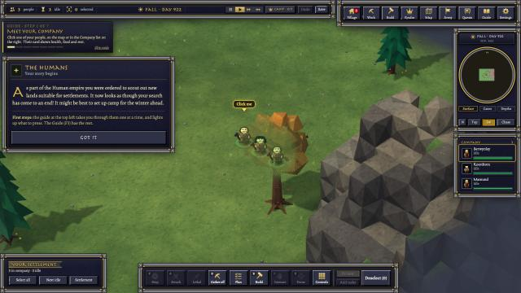
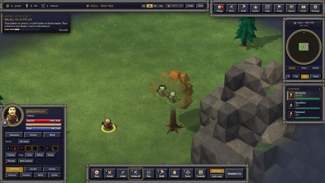

## Not changed yet
- The game itself is still Banners': races, guide text, the browser tab title ("Banners of the Deep · Command").
- Discord sign-in uses Banners' Discord application.

## Next
- The GOA mechanics list and the first one to build (planning/GOA_MECHANICS_PLAN.md).

# Later the same day: techniques, GOA bodies, WASD

## Done
- **Chakra and four techniques** (`Code/Remastered/Ninja.dm`): every ninja has chakra (80 + 4 per Intelligence, 1.5% back
  a second) and Substitution, Flash step, Fireball (hand seals, real fire on the ground) and Kunai (10 carried). They are
  weapon moves every ninja has: used on their own in fights, or from the card's Spells tab, which now has a Techniques
  section with a chakra and kunai bar.
- **GOA bodies are Hidden Clans' own**: the GOA test pipeline's bodies, limb-loss states, ropes, grips, ragdoll maps
  and generated armour for every race and male hybrid, plus the 80 female bodies (female hybrids too). A woman is drawn
  on her own body with her own top and hair (`FemaleBodies.dm`).
- **WASD** walks your ninja (`Drive.dm`, page 027): camera-relative, 8 ways, the camera follows. The first step goes in
  the tick the key arrives, your ninja steps at twice its walking pace, and it slips through its own people. A click
  on a foe attacks it. Attack-move moved from A to R (button, keycap, skin macro).

## Numbers
| Test | Result |
|---|---|
| Raiders vs company, techniques used (test overlay, NINJA log) | kunai at 6 tiles, flash step, fireball at 3-4, substitution dodged a blow, on both sides |
| WASD before the pace change: key down to the 3D view's new tile | first tile 91-187 ms, then a tile every ~500 ms |
| GOA sheets in game/ and the app after the build | 107 of 107 bodies match the pipeline's output |

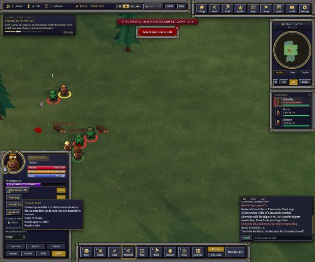
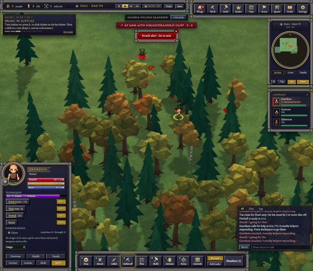
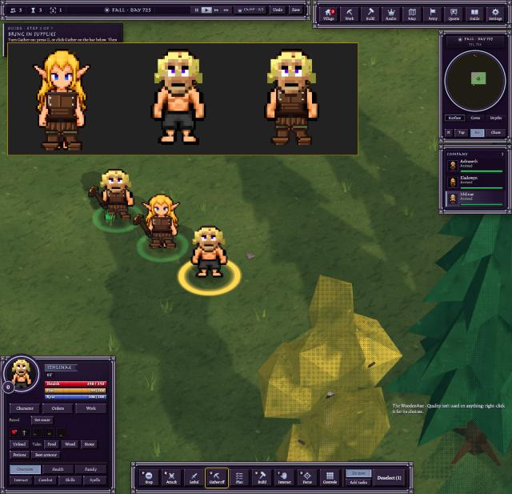
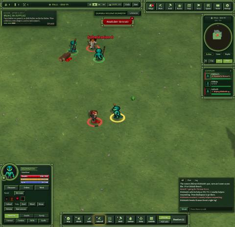

## Needs the owner
- The plan for the battler (planning/BATTLER_PLAN.md): which first, movement on the grid or turned with the camera, and
  whether the village stays.

## Last of the day: WASD on the tiles
- The owner: "strictly follow the tiles", then "responsive but doesnt speed up". One key steps along a grid line, two keys
  along a tile diagonal, turned by the camera a quarter turn at a time (steady at the 45° camera). Back to the ninja's
  own walking pace; only the first step is sped up (it goes the moment the key arrives).
- Measured in the test world: first step on the 3D view 12-20 ms after the key; then a tile every ~0.4 s; at the 45°
  camera W = west, D = north, S = east, A = south, every step one tile on one axis.
- Kept on the owner's word: the animations as they are, the techniques, the GOA punch (a kick still to add).

## The kick, and turning at once
- **GOA's kick** (KickA from the Ki Combat side project's sheets: knee up in a guard, then the leg out high with the body
  leaning back) is a clip now. A new `kick` key lifts the front foot off the ground; the leg solver bends the knee into it.
  Bare-handed fighters throw it on a third of their blows (half on a killing one); the raiders in the test fight did.
- **Turning at once** (the owner: "cancel or switch movements instantly without committing to a tile"): a new direction
  steps ~60 ms after the key, without waiting out the tile it was on; one step early at most, so the pace holds.

| Test (test world, synthetic keys) | Result |
|---|---|
| W, then D 202 ms later | W stepped at 56 ms, D at 261 ms |
| W/D tapped every 100 ms for 3 s | 9 steps (the walking pace; only the first turn early) |
| S held 3 s | a step every ~0.4 s |

## Hero mode and Diablo-style keys
- **Hero mode** (the owner: "remove the click movement and the company of people ... hero mode"): every race starts as
  one ninja (Restart.dm), the company card skips itself. A click on the ground does nothing; an order to walk to something
  further than beside the ninja is refused ("Walk there with W A S D."); the right-click menu has no Move here.
- **Keys 1-4** cast Substitution, Flash step, Fireball, Kunai at what is under the mouse, at once (Drive.dm
  RmNinjaCastAt): Fireball can burn an empty tile, Flash step blinks to a tile, Kunai flies at the first foe on its way
  or lands on the tile. The card's rows show their keys.
- Found on the way: the web link sends every key that has a skin macro to the server and the page never sees it; plain
  1-4 were Banners' "Quick N Select" group macros. They are gone from skin.dmf (Ctrl/Shift+N groups stay).
- Checked in the test world: one unit at the start; a ground click left it where it stood; real-style key presses 1-4
  each sent their cast at the mouse tile; on the server chakra 92 -> 58, kunai 10 -> 9, the ninja on the tile Flash step
  was aimed at.
- The whole plan from here: planning/GOA_INTEGRATION_PLAN.md.

## Responsive hero (the owner: "make that as responsive as possible")
- **Blows and effects this tick:** the page plays every blow, damage number and technique effect from the HUD's model,
  which went out twice a second. Now a player whose unit strikes, is struck or casts gets an update at the end of that
  tick (Drive.dm RmHudHurry, from Hits.dm RemasterHitAt and Specials.dm RemasterSpecialFx), at most one extra a tick,
  only for real players.
- **Faster swings:** rm_swing_pace 2 -> 1 (Hits.dm): Banners' "slow, brutal" pace swung every 2.4-3 s; now 1.2-1.6 s,
  nearer GOA's. Damage per blow is unchanged, so fights end about twice as fast. Technique cooldowns doubled in the
  table so they stay GOA's (30 s, 5 s, 60 s, 3 s).
- **One combo:** bare hands go jab, cross, kick (the punch split in two, art/gear3d skills.js; game.js g3combo), the
  string kept while blows come within 4.5 s.

| Test (test world, 20 s fight with raiders) | Before | After |
|---|---|---|
| Keys 1, 2, 4 to the page | 35-50 ms | (unchanged) |
| Screen updates during a fight | every 500 ms | median 197 ms (145 in 24 s) |
| Your ninja's axe blows | every 2.4-3 s | every 1.6 s |
| A raider's bare hands | jab, jab, jab | jab, cross, kick, jab (0.7-1.2 s apart) |

## Movement follows the camera, and lands on the tile
- The owner: "you was right we need to change the movement based on the camera", then "when i click on wasd it need to be
  on that tile no lagging effect". WASD is the screen's way again (up on screen = W), snapped to the nearest of 8 tile
  directions (page 027 hcDriveVec); a driven step's 3D slide is 50 ms (Drive.dm remaster_step_gap 0.5), so the ninja is on
  the tile at once and waits there for its next step. Checked: W/D/S/A at a north camera stepped N/E/S/W, the step on the
  page ~95 ms after the key, its slide 50 ms (it was the whole step time, ~0.4 s).

## GOA's drawn punch and kick: what exists
- Drawn GOA attack frames exist only as the original 32x32 GOA frames (GOA Source icons, base_m*.dmi and every clothing
  piece): PunchA-1/2, KickA-1/2 (4 directions x 2 frames), plus weapon attack, throw, casting / hand seals (4 frames),
  hurt ("Dungeon Master Sample/GOA Attack and Casting Sample.png"). None exist at 64 px for any race; the Universal
  Animation Library's "punch" is Banners' own keyframe clip, not drawn frames.

## The walk back to normal; GOA's run
- The owner: "slow down the animation to make it look normal for the walk", "use the goa walk animations", "and run
  animations". The 50 ms snap is gone: a step's 3D slide takes the step's time again, so the GOA walk shows (the 64 px GOA
  sheets' walk state: idle, step A, step B per direction, 0.2 s a frame); it still starts the tick the key arrives.
- GOA's own run (Combat.dm 316): each step raises runlevel (to 8), each point fades after 1 s; above 4 the body shows its
  Run state, at 3 or below the walk again. Speed is unchanged: running is how it looks once you keep moving.
- GOA's Run (4 frames, 0.1 s), PunchA-1/2, KickA-1/2, HandSeals, Throw, Knockout and hurt are drawn only on the original
  32 px GOA body. For the 64 px races they have to be made per race (each race's own parts recomposed into GOA's poses,
  Human first for review); then the game switches to them (Run while moving on, the punch and kick frames in the combo).

## GOA's punch, kick and run on the 64 px Human (for review)
- The owner chose "Remake at 64 px". The approved Human rig (`Dungeon Master Sample/GOA Retarget Review - Human Male`,
  copied to `art/goa-actions/rig`, the original untouched) poses the Human's own 15 parts per facing into each of GOA's
  frames: no pixel redrawn, the original head kept. 48 stills: jab and cross (PunchA-1/2), two kicks (KickA-1/2), 2 frames
  each, and the 4-frame run, in all 4 facings (`art/goa-actions/out`).
- Owner calls while it was made: the second punch is the other hand (the jab is the right hand and the cross the left in
  every facing, as GOA draws them; West is East mirrored onto the West parts with the same hands), and the chest moves into
  the blow, not only the arm.
- The Human's legs are short next to GOA's, so the kicking leg is stretched a little (1.3-1.4x) and drawn over the body;
  the kick lands at chest height, not head height. A tilted torso showed its cut edges (stripes on the shorts, the collar
  under the chin): the shorts are drawn again over it and the head tilts with the run.
- Review: `art/goa-actions/review.html` (plays GOA's and the Human's frames side by side at GOA's timing; served by
  any static server from that folder), still sheet `img/goa-actions-human-64.png`. Poses are data in
  `art/goa-actions/poses.js` (joint positions read off GOA's frames doubled), rendered by `pose.html` / `pose-app.js`.

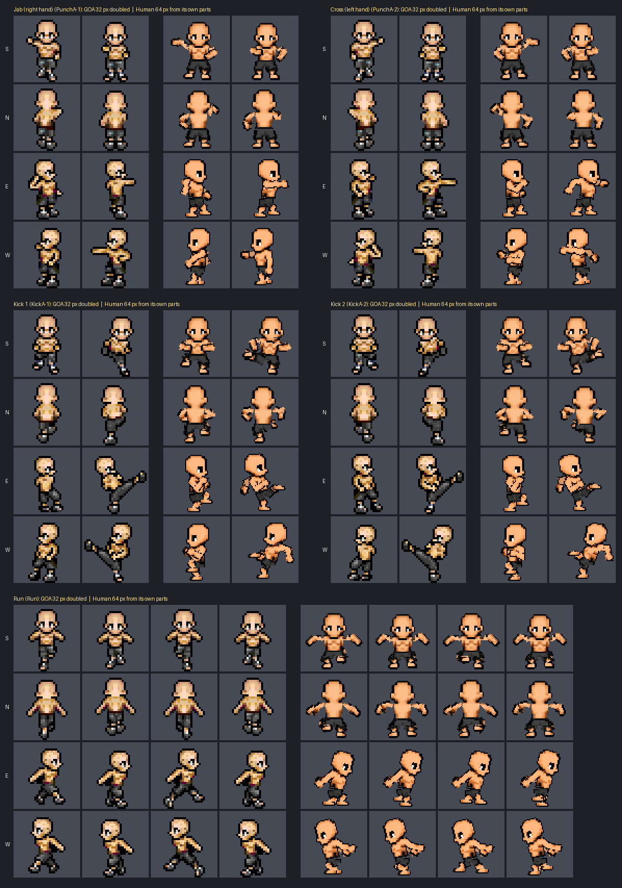

## No: GOA's own sprites, updated
- The owner on the posed Human: "nah ... just make the original sprites updated". GOA's own drawn frames (base_m1: walk,
  run, jab, cross, both kicks, 4 facings, 52 frames) now go through the enhance pipeline the game's originals went
  through (`art/enhance/remaster64.py`: Scale2x, light from the top-left in flat bands), with Scale2x's doubled outline
  thinned back to one pixel. Nothing redrawn. `art/goa-actions/updated.py` → `art/goa-actions/updated/`; review plays at
  `art/goa-actions/review.html?set=updated`. The posed-Human set stays in `out/` as history.

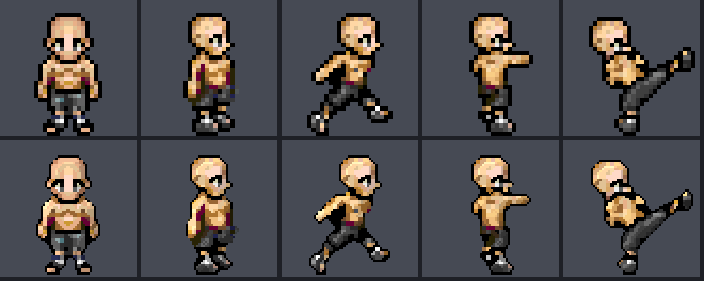

## Our heads and skins on GOA's moves
- The owner: "thats awesome now lets see if we can combine our sprites on this", then chose "our heads and skins" (the
  races share GOA's build for these moves). `art/goa-actions/heads.py`: each race's own 64 px head per facing (the head
  the 3D doll cuts out, g3rig.json, from the race sheet's standing frame; cut at the neck where a head zone takes in the
  shoulder tops, as the Dwarf's does) laid with its chin on GOA's chin, following GOA's head frame by frame (matched to
  GOA's standing head); GOA's skin recoloured to the race's (its bare arms' colours, by brightness rank; GOA's
  near-black far-hand shadow to the race's darkest skin, halved), then updated to 64 px. Faces untouched.
- 8 races so far (Human, Dwarves, Night Elf, Orc, Goblins, Kobold, FrogMan, LizardMan) x walk, run, jab, cross, two
  kicks x 4 facings: `art/goa-actions/races/<Race>/`. Plays at `art/goa-actions/races.html` (one move at a time, every
  race and facing). Not in the game; women, hybrids and the flyers not done.

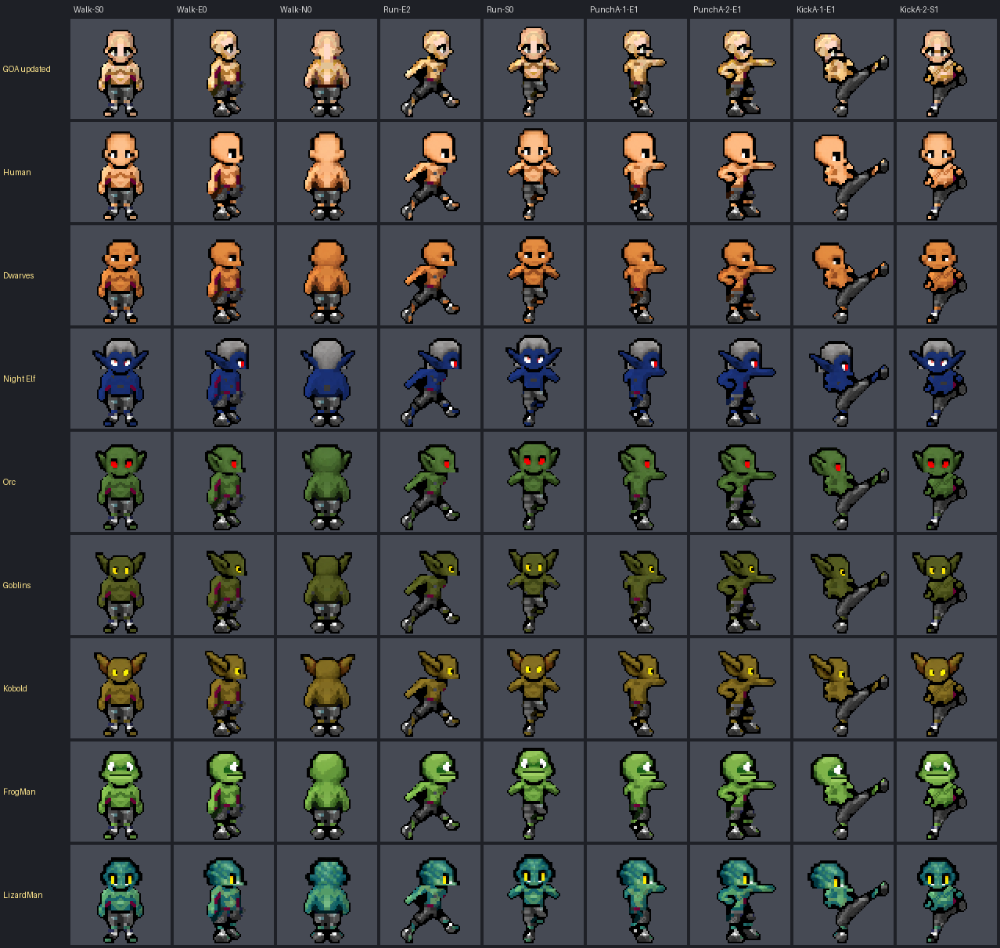

## GOA's moves on each race's own build
- The owner: "we just need to fix the heads? and maybe can we make those sprites match the bodys of the goa race
  sprites now?" Our heads looked too big because GOA's body is slimmer and taller than ours (chin to feet: GOA 37 rows,
  our races 27 (Goblin, Kobold) to 36 (Human); chests 0.65x to 1.35x GOA's). `bodyfit.py` measures both standing
  frames and reshapes every GOA frame to the race's build (chin to feet, chest width; whole pixels moved, outline
  closed where shrinking dropped it); the race's head then sits exactly where its own sprite has it, moved as GOA's head
  moves. GOA's clothes become the race's: the shorts (the biggest grey piece) take the race's shorts colours, the
  sandals (small separate pieces at the feet) become bare feet in its skin, GOA's crimson skin shadow its darkest skin.
- Left: GOA's punch frames draw the legs dark to the feet, so those feet stay dark; the LizardMan has no tail and the
  Night Elf's hair stops at the head on its back.

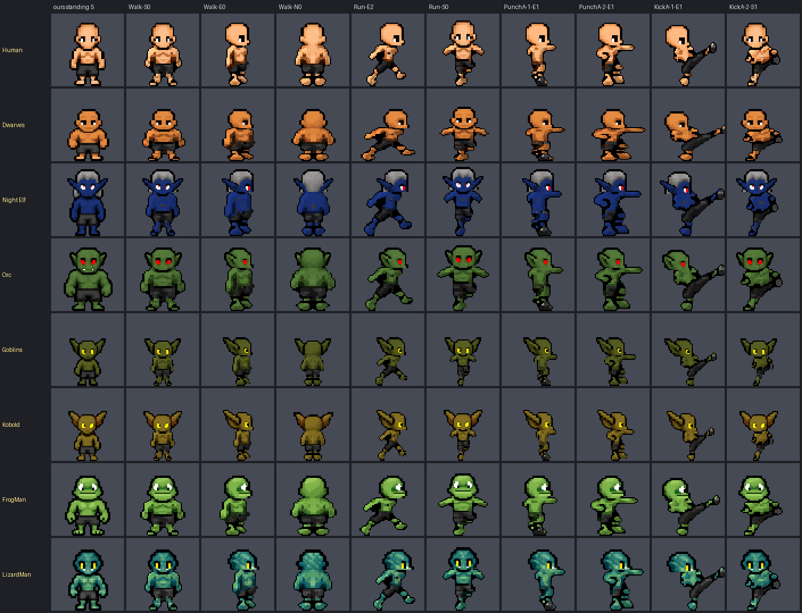

## Side heads, tails, women and hybrids; what each pixel is
- The owner: "we need fix some of the east and west heads and tails for lizardmen then women and hybrid". Side views now
  take the body's depth and middle at the waist (hair hanging down a back had made the chest stick out past the face);
  hair below the head (the head's own hair colours, joined to it) moves with the head; a tail (outside GOA's body below
  the waist, behind it from the side; over the legs from behind) hangs from the hips, its root kept on the body's back.
  Women and hybrids have no 3D-doll part maps: each of their pixels takes the part of the nearest pixel of their race's
  male map. All 152 humanoid sheets build (men, the 80 women, the hybrids; flyers and the Gargoyle family left out).
- Then: "do a pixel overlay ... what each pixel is so you can expand it for the bodies". GOA's skeleton was read off
  every one of its frames (`art/goa-actions/goa-joints.json`, 64 frames; West's walk and run are East's mirrored, as
  GOA draws them) and every pixel given a part in GOA's draw order (`partmap.py`, overlays in `partmap/`). Each GOA pixel
  then takes the colour from the same place on the race's own standing sprite, along the same bone (`uvmap.py`): the
  race's chest, a woman's top, shorts, bare feet, an Ashen's cracks, a Marked's marks. GOA keeps its outline and drawn
  lines. Reshaping each part on its own (bones, then a smooth warp) was tried and dropped: it tore GOA's drawing or
  read muddier than the whole-body stretch, which stays.
- Review: `art/goa-actions/races.html` (pick a race family: its men, women and hybrids; "What each pixel is" shows the
  part maps).

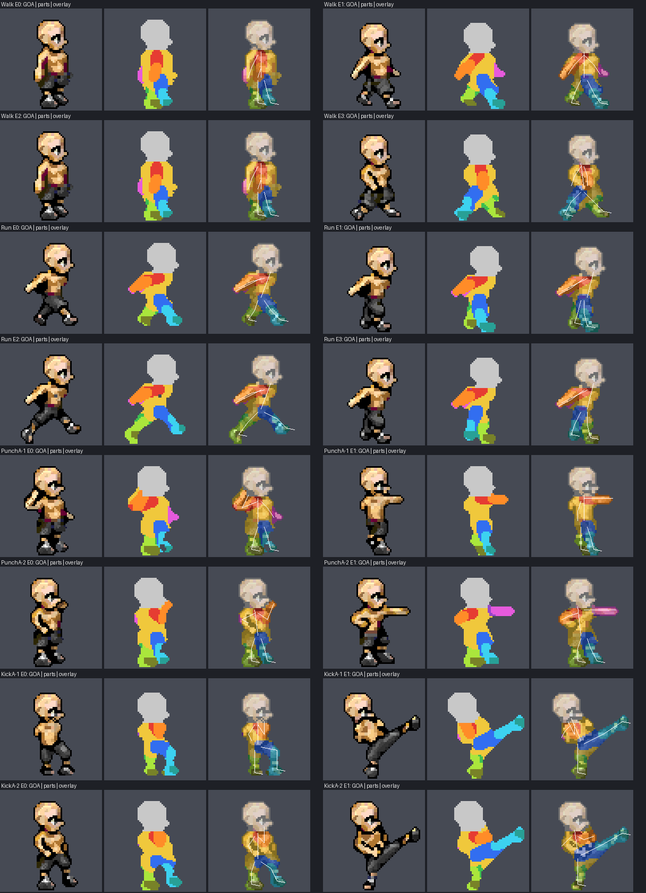

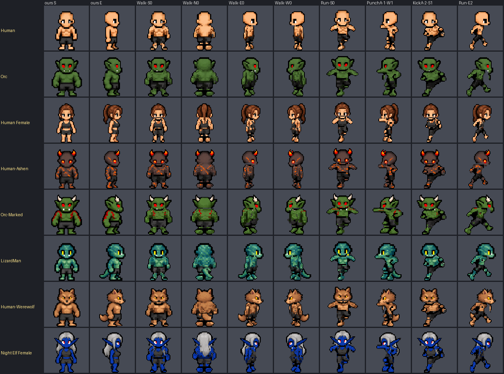

## Polish: why it disappointed, and the fixes
- The owner: "can you do your polish and see why i am disappointed". Side by side with our own sprites the frames read as
  dirty copies: GOA's dithered speckle kept (every dark GOA pixel was kept) and the body texture resampled twice;
  side views far too thin (GOA's waist, with its hand hanging there, measured against our chest); ragged outlines;
  GOA's punch and kick legs dark to the ankle (leggings, not shorts and bare legs); and a generated walk worse than
  our own.
- Now (`heads.py`, `uvmap.py`): the walk is the race's own sheet walk; for the other moves GOA's shape is stretched to
  the race's build first and the whole inside then drawn from the race's sprite at its own scale: the torso is the
  race's own torso carried as GOA's moves (chest, top, abs, markings exactly as drawn), arms and legs come from the
  matching zone of the race's sprite along each bone (its outer outline left out, its shading, lines, clothes and
  markings in); a clean black outline round the figure plus GOA's own black lines where a limb crosses the body; stray
  pixels gone. Side views are measured at the chest for both (hair left out). The race's knee sits at its shorts' hem,
  so a kick shows shorts on the thigh and a bare shin.
- Still weakest: side-view legs in the run (some patchy darks), and a few joints read by eye a pixel off.

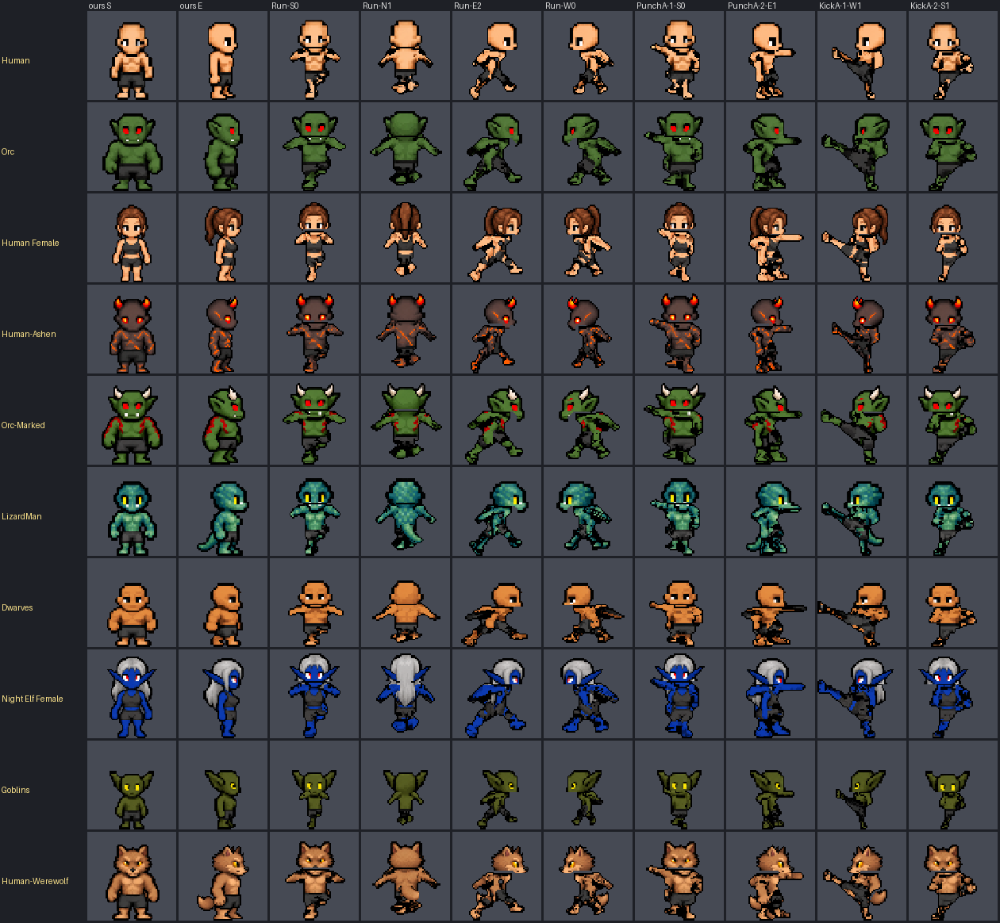

## Banners app check fixed (evening)
- The app check failed after the character port, but not because of it. The HUD's automatic race picker for a new player (added 11-01) opened before the smoke test, so the test never answered it. Fix: test runs (RemasterTestRun) send `testRun` to the HUD, and the HUD skips the automatic start for them. Landed as check-race-native (restore point before-polish-check-race-native-20261101-205200); compile, jscheck, hudjoin and combat 32/32 pass.
- The "copied bootstrap doesn't match" fail came from the check itself. On Apple silicon the launcher lays the arm64 client over the copy, so tools/check_app.py now compares the copy with the client it actually used (client-arch).
- Rebuilt the app; check_app passed (Human, 3 units saved and reloaded, no errors).

## 11-02: public server, GOA characters live, browser save slots
- Turned the public address back on, then published build 822e149 (owner: "Yes, publish"): the GOA men, women, limbs, gear and ropes are live on the public browser game.
- Save slots (owner: "we should have the save slots", "make the version thats like with the base game"): the public front page now has the Mac launcher's world list as "Choose a character", with up to 10 characters a browser. Each row has the race picture (screens-races.png), name, "Your company: 3 Elves · Fall of 614" and when it was last played; the buttons are Continue, New character, Rename, Forget and Back. Each slot is its own keep code, so it keeps its own village (Guests.dm, unchanged). The source is reports/save-slots-1102 (guestform.template.html + make_guest_slots.py), which writes engine/web/guestform.html; the engine and app were rebuilt. The HUD writes the playing slot's race, people and season (landings guest-save-slots, guest-save-slots-season). Tested in a private guest world on 8094; a first character came back in its own slot. Not published yet.
- Elf men (owner: "the elfs player model for some reason keeps the old elf head", then "elfs males have their own sprites"). Banners drew elf men on the GOA Human body with the old Elf head (Hair.dmi "ElfMale") laid over it. The pack's own male Elf sheet (staged overlay Races64/Elf.dmi, from Male/Elf/base, built 11-01 but never landed) is now in game/ and used for elf men (FemaleBodies.dm RmElfMaleBody, RmOwnHeadBody: no hair laid over it). Landed as goa-elf-male; before that, goa-elf-head cleaned the old face out of the ElfMale/ElfFemale hair, which is still the fallback. Seen in a test world: three elves with their own heads.
