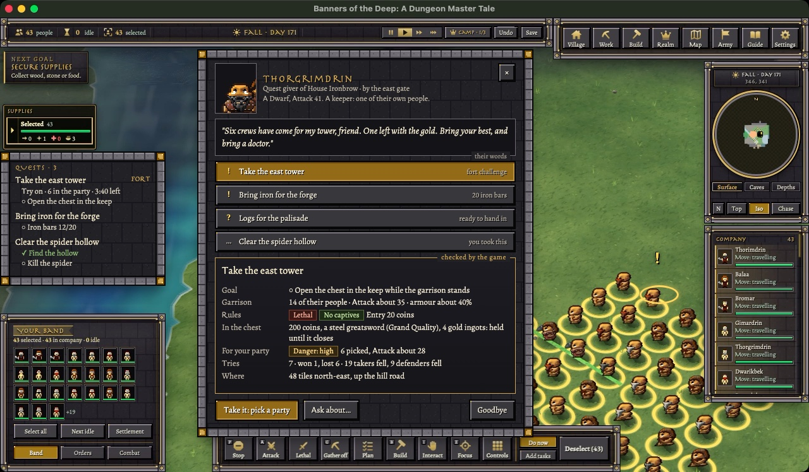
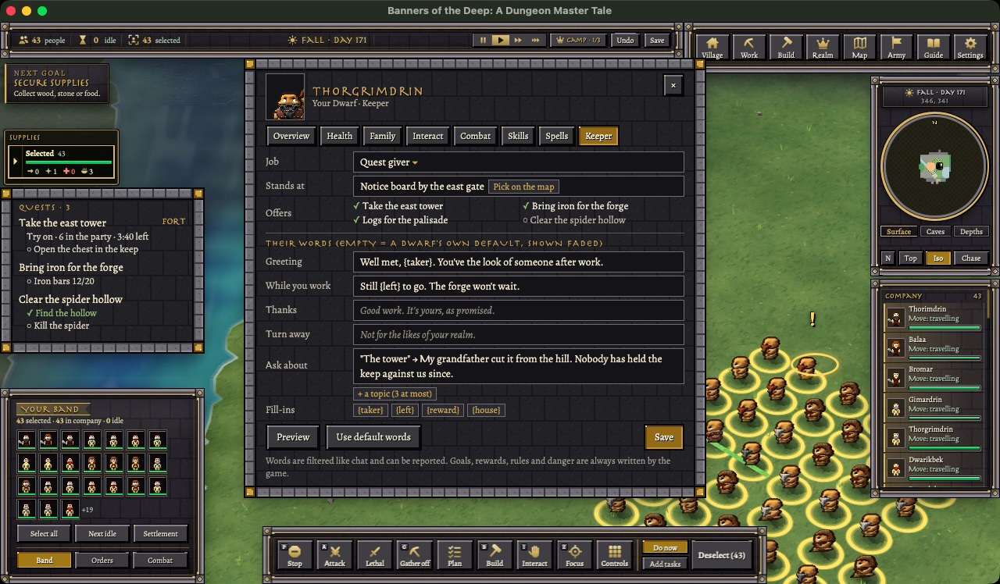

# Quest maker plan (2026-10-31)

**Decided (owner, 10-31, "Yes, all eight" to the eight recommendations in section 13):** keepers yes, a few per
realm, never a whole town; fort challenges against the real garrison, no copies; the maker picks Lethal and
captives, the card shows it, and what dead takers drop stays in the fort; rewards only from the maker, plus a capped
renown score; guards keep guarding offline for every player; world notices in Q8; start with Q1-Q2 and Q4; a
**Quests** button on the menu.
**Status (10-31 22:25):** Q1-Q8 landed, Q9 landed except idle garrisons as far records (waits for far records): region
keys, kept HUD data, the 10-player web test, quests saved by region (REGIONS_ON_DISK R3).

**Added 10-31 (owner: "we need npc quest hud and dialog they can make too or generic?"):** section 15, the quest HUD
and the keepers' dialog, with a mock-up. Read as a yes to keepers (question 1) unless the owner says otherwise.



The owner asked (10-31): "we need for our engine a adaptive quest maker we can build in game using the openrealm quest
i want players to populate the world build economies and build quest and etc can u do that so a persons goal can be to
build a fort equip it with units and etc work for it and then turn them into a quest or npc or dungeon and then we can
have quest connect and etc is this possible".

## Is this possible?

**Yes.** Most of what it needs is already in the game: forts (Plan mode, construction sites, walls, doors), units and
gear, stores, coins, claim banners, the war and peace rules, beast lairs and cave instances, golems. OpenRealm shows a
simple, proven way to keep quests: a small quest log per player and quests as rows of data.

What's new is the quest records and the boards that show them, holding a reward aside, and letting a taker fight your
garrison without a war. Guards must also keep guarding while their owner is offline, which they don't today. Then the
HUD panels. That's about 16 working days in nine small steps. The first one you can play (one player posts "bring me
20 iron bars", another brings them and gets paid) comes after about 3 days.

## Summary

- **Three things a player can publish.** A **quest** (a job with a reward: bring goods, hunt a beast, clear a lair,
  reach a place, work on my build). A **fort challenge** or **dungeon** (your real fort and your real garrison, for
  others to storm). A **keeper** (one of your own units with a standing job, such as quest giver, stall keeper or gate
  warden). Keepers are the "player-made NPC", and whether they fit the no-NPC rule is question 1.
- **Quests are records, not code.** A maker picks a goal, a reward and who may take it from fixed lists. There is no
  script language, and the server checks every choice. This is OpenRealm's Warcraft III "events, conditions, actions"
  idea, turned into menus.
- **Rewards are real.** Coins and goods are taken from the maker's own stores and held aside when the quest is posted.
  The taker gets them only by finishing it. The maker gets them back if it expires or is cancelled. The game never
  makes rewards from nothing, so a quest posted for your own second account only moves goods you already had.
- **Others find quests on notice boards** that anyone can build, and on the world map. They take a quest into their
  quest log, finish it for real, and carry the reward home, where it can be robbed on the way.
- **The maker gets** what the quest was for: the goods delivered, the work done, the lair cleared, entry fees, a
  garrison hardened by real fights, and a renown score shown on every board.
- **Quests connect.** A quest can need another one done (or failed) first, and can give a token item that another
  maker's quest asks for, so chains run across players and across the map.
- **"Adaptive"** means three things: quests react to the world (they close when their lair is gone or their fort
  falls), to economies (a steward reposts "bring iron" whenever the store runs low, with a price hint from real
  trades), and to the taker (a danger rating worked out from real stats, text that names the taker, a fort that
  remembers how it was beaten).
- **Cost on the server is small**, except garrisons that are awake: those cost like any units. Progress is counted from
  events (a death, a delivery, a step onto a goal tile), never by scanning the world.

## 1. What a player can make

| Kind | What it is | Example | Who pays the reward |
|---|---|---|---|
| **Quest** | A job with a goal and a reward, posted on a notice board | "Bring 20 iron bars to my store: 60 coins"; "Kill the spider in the lair north of my hold: 3 steel swords" | The maker, from coins and goods held aside |
| **Fort challenge / dungeon** | The maker's real fort, garrisoned by their real units, with a goal inside (the treasure room, the banner, the champion) | "Take the east tower: the chest in the keep is yours. Lethal. Entry 20 coins." | The chest's contents, put in by the maker |
| **Keeper** (the player-made NPC) | One of the maker's own units given a standing job | A quest giver standing by a notice board; a stall keeper; a gate warden collecting tolls | Not a quest: a service the keeper runs for the maker |

A **dungeon** here is a fort that's underground or carved into a mountain: the same thing as a fort challenge, dug
block by block instead of built. Copying a fort into a cave instance for each party is possible, but it would create
units and gear from nothing; see question 2.

## 2. How OpenRealm does quests

OpenRealm (`/Users/kiwimango/Downloads/open-realm-main`) has two quest systems, one per game it runs. Neither lets
players make quests. Both are useful as a shape to copy.

**The engine part is tiny** (`server/sv_quest.c`, 18 lines; `common/shared.h:597-609`):

- A quest log is a fixed list of 16 entries per player. An entry is a quest number and a state: none, active,
  complete, rewarded.
- Two calls: find an entry, add an entry (refused if the log is full or already has it).
- Nothing else: no goals, no rewards, no chains. The game on top owns all of that.

**World of Warcraft mode: quests are data, a little code reads them** (`games/world-of-warcraft/`):

| Part | Data or code | Where |
|---|---|---|
| 2,737 quests: title, story, goal text, reward text, XP, gold, 2 reward items, the one quest before it, lowest level, up to 4 "kill N of this creature" goals | data (a table, compiled into the game at build time) | `serverdata/quests.csv` -> `gen_serverdata_c.py` -> `g_quests.c` |
| Who gives each quest and where they stand; goal map points | data | `serverdata/quest_spawns.csv` |
| Take a quest: checks the quest before it is complete and the log has room | code | `game/g_wow.c:1962-1972` |
| Kill counting: on every death the killer's active quests are checked against the dead creature | code, one hook | `g_ai.c:327` -> `g_wow.c:1931` |
| Hand in: XP and gold paid, a "Quest complete" letter in the inbox | code | `g_wow.c:1991` |
| One giver with many quests offers the first one this player may take | code | `g_wow.c:1977` |
| "!" and "?" over a giver, worked out separately for each player when the server sends what they see | code, per viewer | `g_wow.c:2383` (`Wow_CustomizeEntity`) |
| Buttons in the quest window send text commands to the server (`quest_accept 12`) | code | `g_wow.c:2124-2160` |

**Warcraft III mode: quests are a journal page; the map's own scripts do everything**
(`games/warcraft-3/game/api/api_quest.h`, `g_local.h:1419-1442`):

- A quest is a title, a story, an icon, "main or side", and on/off flags: shown, found, done, failed.
- It has up to 16 goal lines, each a text and a done flag.
- The quest itself checks nothing. The map maker's triggers (an event such as a death, entering an area or a timer;
  then a condition; then an action) tick the goal lines and set the flags (`api_trigger.h`).
- This is the "maker" model: a map maker builds quests out of events, conditions and actions.

**What we take from it**

1. **Keep the generic part tiny.** A quest log of ids, states and counts, a "find" and an "add". Everything about BOTD
   (forts, garrisons, stores) stays in the DM game. No engine native is needed for any phase of this plan.
2. **Quests are records, not code.** WoW keeps 2,737 quests as rows read by about 100 lines of code. Ours are made by
   players in the game, so the rows are written while the game runs and saved with the world.
3. **Count by events, not by scanning.** WoW never scans the world for progress. A death calls one function that
   checks only the killer's few active quests. We hook deaths, deliveries, steps onto goal tiles and a few more.
4. **Markers are worked out per viewer when sending.** The same board shows "!" to one player and nothing to another.
   Our HUD already sends to each player separately.
5. **Warcraft III's events, conditions and actions are the right shape for a maker,** but as a fixed menu, never a
   script language. Players pick from lists; the server checks every piece.

**What OpenRealm doesn't have, and we must add**

- Quests made by players while the game runs, with a maker who pays the reward and gets something back.
- Rewards held aside when a quest is posted (WoW pays from nowhere).
- Chains with more than one way forward (WoW has exactly one quest before each quest).
- Failing, time limits, and quests that end when the place they're about is gone.
- Saving with the world and growing to many players (WoW's tables are fixed; its log is 16 slots).

## 3. What we have and what is missing

Paths are under `game/Code/` (`R/` = `Remastered/`). There is no quest code anywhere today (a whole-word search for
"quest" in `game/Code` and `art/hud/src` finds nothing).

| Needed | Today | Where |
|---|---|---|
| Build a fort | Yes: Plan mode Building tool, walls, doors, storeys, construction sites | `R/Plans.dm`, `R/PlanPieces.dm`, `R/Sites.dm` |
| Equip and train units | Yes | `R/Gear.dm`, `R/Skills.dm` |
| Coins | Yes, a number per player (`remaster_coins`); a stall moves coins from buyer to seller | `R/Market.dm:8-10, 75-93` |
| Coins as items | No (the old GoldCoin isn't in the build) | — |
| Hold a reward aside | **No.** Nearest: item `Owner`, the `suffix` that blocks collection, `remaster_placed` | `R/Settlement.dm:114`, `R/Buildings.dm:29` |
| One player filling another's order | **No.** Board orders, workers and counts are the poster's own | `R/Board.dm:13-16, 84-87, 155-164` |
| Give goods to another player | No (Bag "Give" is own units only); only stall sales | `R/Bag.dm:109` |
| Item kinds a quest can ask for | Yes: `rm_item` ids (386 rows) and `rm_gear` ids (354); no lookup proc by id | `R/ItemData.dm`, `R/GearData.dm` |
| Who owns a place | Claim banners (radius 8-30 by rank), laid blocks (`remaster_laid_by`), own doors | `R/Claims.dm:10-57`, `R/Plans.dm:278`, `R/Doors.dm:26-34` |
| Fighting another realm | Only at war, or back at someone who just hit you (`RemasterWarAllows`) | `R/War.dm:50-56`, used by `R/Attack.dm:43, 46` |
| Guards while the owner is offline | **No.** The log-off guard stops at once (`if(AUTO) ... if(!Owner:client) break`), and defence and patrols run only in the online track | `Creatures/Monster AI.dm:156`, `R/Orders.dm:999`, `R/Patrol.dm:68-83` |
| A player-owned dungeon | Yes, one precedent: a player's dragon lair (`owner_key`); only owner and allies enter; items left inside are kept | `R/Instances.dm:252-270, 518` |
| Event points to count progress | Death (`Death()`; the killer as `Killer` or `remaster_attacker`), knock-out, capture, lair cleared, block mined, tree felled, site/building finished, a unit's tile change | `Creatures/Death.dm:1-73`, `R/Subdue.dm:64`, `R/Captives.dm:178`, `R/Instances.dm:272`, `R/Yield.dm:101, 267`, `R/Blueprints.dm:213`, `R/Buildings.dm:473`, `R/QoL.dm:281` |
| A ready "needs" checker | Yes: settlement ranks and milestones measure needs like `list("walls", 30, "wall tiles")` | `R/Progress.dm` |
| A dialog card | Yes: `RemasterAsk(...)` with custom `kind`s | `R/AskCard.dm:19` |
| A place to save global lists | Yes: the world save keeps `Wars`, `Lieges`, `Lairs` as keys; `world-info.json` is a JSON side file | `R/WorldSave.dm:246-312` |
| Hex regions in the game | **No** (hexes exist only in `art/worldgen/worldgen.py`) | — |
| Village log | Yes, but `tmp` (not saved), 150 lines | `R/VillageLog.dm:5-20` |

## 4. The player's path: build a fort, garrison it, publish it

1. **Build and work for it.** The fort is ordinary play: Plan mode walls, gates, towers and storeys; stone doors;
   stores; workshops to make the gear. Nothing new.
2. **Mark it as a site.** A new Plan mode tool, **Site**, draws the fort's area (like a zone) and asks for two spots:
   the **way in** and the **goal** (a chest in the keep, the banner, or a room). The server checks that the goal can
   be reached from the way in on foot (the reach map), so a sealed box can't be published.
3. **Garrison it.** Pick units (a selection or a Company group, Ctrl+G) and press **Garrison this site**. They take
   posts by themselves: doors first, then walls for bowmen, then the goal (plan, don't micromanage). Gear them as
   usual. A garrisoned unit keeps guarding while you're offline (phase Q4; today it doesn't).
4. **Stock the prize.** Move coins and goods into the site's **reward chest**. Whatever is in the chest is held: no
   worker takes from it, and you can't spend it until the challenge closes.
5. **Publish.** A quest card asks, all from lists: the kind (fort challenge), the goal (take the chest, take the
   banner, beat the champion), Lethal or Non-lethal, captives yes or no, entry fee, who may take it (anyone, not my
   realm, my realm only, a settlement rank or bigger), how long it stays up, and whether it repeats. The title and
   story are typed by the maker (filtered like chat). The card also shows the server's **danger rating** worked out
   from the garrison's real levels and armour, which the maker can't change.
6. **It goes up** on the maker's notice boards and on every notice board within reach (section 5), with a marker on
   the world map for players who have explored that land.

A **dungeon** is the same steps on a dug-out hold. A **plain quest** (bring, hunt, clear, reach, work) skips steps 2-3:
the maker posts it on a notice board, picks the goal and puts the reward in the board's chest.

A **keeper** is made from the unit card: **Keeper › Quest giver** (stands by a board; talking to them opens it),
**Stall keeper** (attends a market stall at the maker's prices), **Gate warden** (asks a toll at a gate; needs the
toll rules of the economy plan). Keepers stay the maker's units: they eat, sleep, can be killed or captured, and stop
when their town falls. That's how they differ from NPC towns; question 1 asks whether it's close enough.

## 5. Other players: find, take, finish, get paid

**Find.** A **notice board** is a building anyone can place (1 wood, like a claim banner). It lists the maker's own
quests and every public quest within about 60 tiles. Once hex regions are in the game, that becomes the board's hex and
its six neighbours. A realm's members also see all their realm's quests on any of their boards. The world map shows
quests in explored land. A board, keeper or fort shows "!" (can take), "..." (taken, in progress) or "?" (ready to hand
in) worked out for each viewer, as OpenRealm does.

**Take.** Reading a notice opens its card: the goal, the reward, the danger rating, Lethal or not, the fee, how many
tries it has had and how they went. **Take** puts it in the taker's quest log (at most 10 open at once). For a fort, the
taker also picks the party that goes (a selection or Company group). Only that party may fight the garrison, only
inside the site, and only until the try ends. No war is declared and nothing outside the site changes.

**Finish.** The server counts progress from events, never from what the player says:

- **Bring:** the taker's units put the goods into the maker's reward chest or board chest. The chest counts what each
  taker put in.
- **Hunt** and **clear:** the death of the named beast, or the lair's "cleared" mark.
- **Reach:** one of the party steps onto the goal tile.
- **Take** (fort): the party opens the goal chest, takes the banner, or the champion falls, while the try is on.
- **Work:** blocks laid by the taker's units on the maker's build plan.

**Get paid.** The held coins go straight to the taker. Held goods drop out of the chest at the goal, and the party
carries them home. A party can be robbed on the way back, which fits a brutal world. The quest log marks it rewarded,
and the maker's village log and saved quest journal record who did it.

**What the maker gets:**

| Quest kind | The maker gets |
|---|---|
| Bring | The goods (this is how one player buys from another without a stall) |
| Work | The building work done on their land |
| Hunt / clear | The land made safe, the lair's ground to settle or mine, a golem's mountain |
| Fort challenge | Entry fees (kept win or lose), whatever dead takers drop inside the fort (question 3), a garrison that learns from real fights, a report of how each try went |
| Any | Renown: a score on every board, counted only for takers from other realms (section 10) |

## 6. Goals a maker can pick

| Goal | Counts when | Hook (today's code) | Phase |
|---|---|---|---|
| Bring N of an item kind (and a lowest quality) | Goods go into the quest's chest | the chest's own "put in" (new) | Q2 |
| Hunt a beast or N of a creature kind | The beast dies to the party | `Death()` beside `RemasterWarDeath` (`Creatures/Death.dm:4`) | Q3 |
| Clear a lair or cave | The lair is marked cleared | `R/Instances.dm:272` | Q3 |
| Fell a golem | The golem falls (its last striker needs recording; `RmGolemFell` doesn't know who killed it) | `R/Golems.dm:325-337` | Q3 |
| Reach a place | A party unit steps on the goal tile | the unit's tile change in `RemasterTrack` (`R/QoL.dm:281`) | Q3 |
| Work on my build | Blocks laid by the taker's units on a marked plan | `RmPlanLeft` (`R/Plans.dm:89`) and a claim exception in `RemasterMayWork` | Q3 |
| Take the fort's goal | Chest opened, banner taken or champion down, during a try | new, in the site's goal | Q5 |
| Later: escort a cart, rescue a captive, bring a beast alive on a rope | — | `R/Carts.dm`, `R/Captives.dm` (no third-party rescue yet), `R/Capture.dm` | after Q8 |

**Who may take it:** anyone; not my realm; my realm only; a settlement rank or higher (`R/Progress.dm`); has done a
named quest (chains); a party of at most N.

**Rewards:** held coins; goods from the chest; a **token item** (for chains). Nothing else.

## 7. Quests that connect

- Every quest can say what has to come first: **after** quest A is done, **or** after A failed, **all of** A and B, or
  **any of** A and B. This is a small list on the record, like WoW's "quest before" but with more than one link and
  with branches.
- A quest can give a **token item** ("the hold's seal", "half of a map"). Another quest, by the same maker or anyone
  else, can ask for it in its Bring goal. That's how chains cross between players, with no special link between them.
  Tokens are real items, so they can be traded, stolen or lost.
- Example across makers: maker A posts "Bring 50 logs to my camp", and when it's done, "Escort my cart to the old
  hold". The cart's road passes a spider lair, so maker A also posts "Clear the spider lair", which gives "the hold's
  seal". Maker B's fort challenge "The hold's inner gate" can be taken only by a party carrying that seal.
- Limits checked at posting: no loops, at most 10 links deep, links only to quests the maker can see.
- A fort can have **tiers**: the outer gate is one quest and the inner keep a second that needs the first. That's how
  a fort gets harder for those who come back.

## 8. What "adaptive" means here

**It reacts to the world.**

- A quest is about real things, so it follows them. When the lair is cleared by someone else, the hunt quest closes
  and the reward goes back to the maker. A fort lost in a war closes its challenge. A golem that walks off is followed
  by its hunt quest's marker.
- **World notices** (question 6): the world can post notices with no giver, such as "A stone golem walks near the
  mountains here", "A lair is spreading" or "A ruin was found". The prize is the place itself (the mountain a felled
  golem leaves, the lair's hoard), never coins from nothing. That gives new realms something to aim at in an empty
  world without adding NPC towns.

**It reacts to economies.**

- **Standing quests:** the maker sets "keep iron bars at 50 or more: pay 3 coins a bar", and the steward posts a Bring
  quest whenever the store drops below that, and takes it down when it's full again. This extends `Board.dm`'s
  standing orders to other players. Players set the price; the game never does.
- **Going rate:** the post card shows what this good really sold for lately at stalls, as a hint only.
- **Danger and distance:** the card shows how far it is and how dangerous the land is (lairs and raiders on the way),
  so makers price it fairly.

**It reacts to who takes it.**

- The **danger rating** compares the garrison's real Attack, Strength, Defence, Ranged and armour with the taker's
  party. Boards can sort quests by what this party could manage. It's worked out by the server, never typed by the
  maker.
- The quest text can name the taker and their party (OpenRealm fills in tokens like the player's name the same way).
- **A fort that learns:** each try is recorded (party size, who fell, where the line broke), and the maker gets a
  short report ("the east door fell in 3 of 4 tries"). They rebuild, and the rating follows the results.
- **Repeats remember:** a taker who has done a repeatable quest is offered the next tier first.

## 9. What is saved, where, and growing to many players

**Today (one world on one Mac or one host):**

- **The quests:** one global list `rm_quests` (id -> record), saved as one more world-save key `S["Quests"]` next to
  `Wars`, `Lieges` and `Lairs` (`R/WorldSave.dm:249-269`). Records hold only text, numbers, player keys, unit ids and
  x,y,z. They never hold object links, the same rule the world save already follows.
- **Each player's quest log:** `Player/var/list/rm_quest_log` (id -> state, taken at, counts, party unit ids), saved in
  the player's unit save. Like OpenRealm's log, it holds what that player is doing, not the quest itself.
- **Held rewards:** coins as a number on the quest record (taken off `remaster_coins` at posting). Goods as items inside
  the reward chest, which the world save already keeps with their contents (the item record's `inner`).
- **The quest journal:** the last 20 events of each quest (taken, done, failed, a try's report) on the record. The
  village log isn't saved, so the journal is what the maker reads after being away.
- **Goal tiles** carry a `tmp` mark rebuilt from the records at load, so no tile save changes.

A record looks like this (about 0.5-1 KB):

```
rm_quests["q12"] = list("id"="q12", "kind"="fort", "maker"=key, "realm"=root key,
    "title"="...", "text"="...", "goal"=list("take", x, y, z), "site"=list(x1, y1, x2, y2, z),
    "door"=list(x, y, z), "chest"=list(x, y, z), "who"="others", "lethal"=1, "captives"=0, "fee"=20,
    "coins_held"=200, "after"=list("q9"="done"), "gives"="token", "garrison"=list(unit ids),
    "state"="open", "posted"=RemasterNow(), "ends"=..., "repeat"=..., "danger"=n,
    "stats"=list(tries, wins, losses, taker deaths, garrison deaths), "journal"=list(...))
```

**Many players (the MMO):**

- **A small index for everyone** (id, kind, title, maker, region, x,y,z, state, reward line, danger: about 150 bytes
  a quest) is what boards and the world map read. 100,000 quests are about 15 MB.
- **Full records live with their place.** When the regions-on-disk plan saves the world by region
  (`planning/REGIONS_ON_DISK_PLAN_2026-10-31.md` step R3, `world/regions/...`), each region's file holds its sites and
  quests. A quest costs nothing until someone opens it or walks there. The region key starts as one value ("the
  heartland") and becomes the hex id once hexes are in the game.
- **Quest logs stay with the player**, so they travel with the player's save blob when a party crosses to another
  region's server (`planning/MMO_ARCHITECTURE.md` section 11).
- **Garrisons are the real cost**, see section 11.

## 10. Abuse and how it is stopped

| Abuse | What stops it |
|---|---|
| Quests for your own second account, to make wealth | Rewards are only the maker's own held goods, so nothing is created; it's the same as trading with yourself |
| Farming renown with your own accounts | Renown counts only takers from another realm, only quests with a reward above a floor, at most 3 a day from the same maker to the same taker, and only from accounts signed in with Discord once that's live |
| Taking the reward away after someone takes the quest | The reward is held from posting; cancelling a taken quest waits until the takers' time runs out |
| A death trap to farm newcomers' gear | The card shows Lethal, captives, the server's danger rating and the record of every try; nobody is pulled in, a taker picks their party |
| Lying in the quest text | The goal, reward and rating come from the server, not the text; the text is filtered like chat and can be reported |
| Using a quest to fight without war | Only the chosen party, only inside the site, only during the try; no banners or land change hands; leaving the site ends the try |
| Spam | A notice costs 2 coins (there's no paper item in the game); boards show 20 at most; open quests per realm grow with settlement rank (Camp 1, Hamlet 3, Village 5, Town 10, Kingdom 20) |
| Completing the same quest again and again | One completion per taker realm unless it's set to repeat, and repeats wait a set time |
| Changing the fort mid-try | Building goes on (it's a living fort), but the goal, reward and garrison list are fixed once a try starts |
| Offline makers losing their town | Takers may fight only inside the site; the town outside it is untouched |

## 11. What each part costs on the server

Estimates from today's measurements, to be measured in each phase:

| Part | Cost | Note |
|---|---|---|
| Quest records in memory | about 0.5-1 KB each; 1,000 quests about 1 MB | |
| Death hook | 1-3 µs a death (one keyed lookup) | a death already costs about 2.6 ms |
| Reach hook | about 0 | only goal tiles carry a mark, checked in the tile change that already runs |
| Chest and board counts | only when goods go in | no scans of stores |
| Quest loop (expiries, standing quests, measured needs) | under 1 ms a second; capped at 2 ms a pass every 3 s | runs for offline makers too |
| A garrison that's awake | like any unit: about 6 µs of DM a tick each; 20 guards about 1.2 ms a second | only while a player is near (awake land) |
| A garrison that's asleep | no tick, but about 71 KB a unit in memory | at MMO size this must become a far record (about 3 KB) or unload with its region; `rm_far_on` is 0 today |
| HUD | the board card is sent only while open (2-4 KB once, then changes); log rows are a few bytes; markers per viewer only in view | same pattern as `hudview` |
| Saves | 1,000 quests add about 1-2 MB to the world save | written off the game thread since "save-later" |
| Fights at forts | the same as any battle of that size | they're real battles |

The one that scales badly is sleeping garrisons: 10,000 forts with 20 guards each would be 200,000 live units (about
14 GB). As far records they'd be about 0.6 GB, and they'd cost nothing more once regions unload. Phase Q9 has to
solve this before many players can publish forts.

## 12. Phases

Each phase lands on its own through `reports/polish-night-1026/tools/land_polish.py`, with its own arena test
(`tools/check_arena.py`, behaviour at speed 32) and, from Q2 on, a play-test in the browser pane through
`tools/web_host.py` with two web players. One big run at a time. HUD changes go in `art/hud/src` and
`python3 art/hud/hud.py build`.

| Phase | What lands | What the player sees | Days |
|---|---|---|---|
| **Q1** Quest records | `rm_quests`, `rm_quest_log`, save and load, a new `R/Quests.dm` (+ `.dme` line); test `tests/quest_records.dm` (round trip, 1,000 quests) | Nothing yet | 0.5 |
| **Q2** Bring quests | Notice board building, its chest, holding coins and goods, the post card, the quest card (the dialog of section 15 without a keeper), the quest tracker, pay on finishing, refunds on expiry or cancel; Village › Board lists "Our quests" and "Quests we took" | Post "bring 20 iron bars", another player brings them and is paid | 2.5 |
| **Q3** Hunt, clear, reach, work (on section 17's targets) | Death, lair, golem, tile and plan-laying hooks; quests about real lairs, caves, golems and marked spots; the taker's units may lay blocks on a marked plan in the maker's claim | Hunt a beast, clear a lair, find a place, work on someone's wall for pay | 2 |
| **Q4** Guards that hold while you're away | A garrison post order; guarding and defence ticked by a world loop for awake land when the owner is offline; fixes a defence that's started offline and never ends (`Monster AI.dm:155`) | Your guards keep guarding after you log off (for every player, question 5) | 1.5 |
| **Q5** Fort challenges | Plan mode Site tool (area, way in, goal), garrison posts, a try (only the party, only inside the site; bumps `rm_realm_ver` so `Attack.dm`'s kept answers refresh), goal "take", entry fee, danger rating, try reports | Publish your fort; storm someone else's | 2.5 |
| **Q6** Chains | After / if failed / all of / any of, token items, the chain shown on the card, tiers inside a fort | Quests that lead into each other, across players | 1 |
| **Q7** Keepers | Quest giver, stall keeper (and gate warden once tolls exist) from the unit card's Keeper tab; the keeper's dialog with the maker's words and each race's default words (section 15); at most a few per realm | A unit of yours who gives your quests or minds your stall, in your words | 2 (only if question 1 is yes) |
| **Q8** Adaptive | Standing quests by the steward, going-rate hints, sorting by what this party can manage, fort reports, world notices (question 6) | Quests that come and go with your stores and the world | 2 |
| **Q9** Many players | The quest index, quests saved by region (with REGIONS_ON_DISK R3), idle garrisons as far records, a 10-player web test with 500 quests and 50 forts | Nothing new; it stays fast with many players | 2 (after R3) |

**Q1-Q2 status (10-31 11:49): landed** ("quest-maker-q12", gate compile + jscheck + hudjoin + combat 32/32;
arena test `tests/quest_check.dm` 58/58; page check `tools/check_quest_hud.py` 16/16). `R/Quests.dm`: records saved
with the world as one JSON text, quest logs with the units, the Notice board workshop (Build › Workshops, 1 wood, a
wooden sign in 3D with each viewer's ! or ?), Bring quests with coins and goods held aside, take, hand in, pay,
refunds on time-out, take-down, give-up or a lost board, renown, caps by rank. HUD: the Quests button (Taken, Ours,
the post form), the quest card, the tracker, the unit card's board box. The quest log lives on the Quests button
(question 8), not Village › Board. Played in the browser pane with two web players (devlog). Follow-up
"quest-maker-q12b": time left rounds up; a label moved.

**Q3 status (10-31 14:34): landed** ("quest-maker-q3" 14:06, play-test fixes "q3b" 14:29 and "q3c" 14:34; gate compile +
jscheck + hudjoin + combat 32/32 each). `R/QuestTargets.dm`: goals on section 17's targets: slay (a wild creature or
beast, clicked), hunt (N of a race, an optional hint circle), clear (a lair's beast, or every creature of a cave visit,
while the taker's party is down there), reach (a point and a radius, picked in 3D or on the world map), work (the
maker's build plan, up to 200 blocks: the taker gets their own plan row over it, lays it with their own stone or logs,
the blocks are the maker's; the maker's row waits). Markers per viewer (made, taken or read), obeying the fog: last
seen and how long ago; exact, a circle about it, or words only; on the world map, as 3D pins, and in the tracker with
distance and direction. Hooks: `RemasterThreatenedBy` (who struck it), `Death()`, `RemasterTrack` (reach),
`RmPlanLayTick` (work), `RmPlanGroundOK` (a taker may lay on the maker's floor). Tests: `tests/quest_targets_check.dm`
55/55 (`--maxz 4`), `tools/check_quest_targets_hud.py` 17/17; `quest_check` 58/58 and the Q2/admin page checks still
pass. Played in the browser pane by two players: slay a deer, reach a marked place (devlog). Not done: clear and work
were not played in the browser; chains that reveal targets wait for Q6; bounties on players' people were left out (war's
business). Wild creatures aren't saved: after a restart a slay notice rebinds to one of the same kind within 12 tiles
of the last-seen spot, or ends with its reward back.

**Q5 status (10-31 17:52): landed** ("quest-maker-q5" 17:41, play-test fixes "q5b" 17:52; gate compile + jscheck + hudjoin
+ combat 32/32 each). `R/QuestForts.dm`: the post form's "Storm my fort" (pick the area's two corners, the way in, a
chest's spot or a champion; Lethal, captives, entry fee); the chest placed at its spot; Garrison on the notice's card
(the selected take aggressive posts inside: the way in, the goal, the rest; Q4's posts, so they guard while away); a try
(the taker's people at the way in, up to 8, the fee to the maker; 20 minutes; the two sides may fight with no war only
inside the site, the party also from the way in on its way in: War.dm `RemasterWarAllows`, the garrison's own look
`LocateTarget`; non-lethal holds both sides' Lethal switches off; captives only if allowed; no war grievance; the
engine's attack pool steps aside for try units); won at the chest or by the champion falling, lost when the party is all
down, fallen or out, or the time is up; each try's report on the notice; the danger rating from both sides' real stats.
Q5b: a try's end stops every chase, defence and attack between the sides (a guard fought on in the play-test) with a
30 s truce; a party may fight from the way in. Tests: `tests/quest_forts_check.dm` 44/44 (with a real fight called off
mid-way), `tools/check_quest_forts_hud.py` 12/12; quest, targets, admin tests still pass. Played in the browser: post,
garrison, take, a try fought and lost. Not done: a won try in the browser (arena only); the site is marked from the post
form, not a Plan mode tool; tiers, repeats and fort reports to the maker beyond the notice's tries wait for Q6/Q8.

**Q6 status (10-31 18:45): landed** ("quest-maker-q6" 18:33, play-test fixes "q6b" 18:45; gate compile + jscheck + hudjoin
+ combat 32/32 each). `R/QuestChains.dm`: a notice comes after up to 3 others (`RM_QUEST_LINKS`), each once done or once
failed, all or any; failed = gave it up, it came down while held, someone else did it first, or a fort try lost. A
token: a real item (`RemasterToken`, weight 0) put in the pack of the one who did it; any notice the maker can see may
ask for it in a Bring goal (by its id, so a forged one of the same name doesn't count). A secret step hides its marker
and its "where" until the step before is done. Limits: links only to notices the maker can see; at most 10 steps deep;
no loops (a link needs an older notice). A record an open notice comes after is kept past its few days. The card shows
comes after (ticked when met), asks for, gives, leads to. A fort's tiers are two fort notices, the inner after the
outer. Q6b: the bare token type is no Bring kind; ticked boxes in the quest form show their tick (the form's input rule
hid it, Q1's reward goods too); the chain fields clear after a post. Tests: `tests/quest_chains_check.dm` 23/23,
`tools/check_quest_chains_hud.py` 10/10. Played in the browser by two players: a two-step chain (bring, then a secret
reach): locked, token given, step two opened with its marker, done. Not played: a token asked for by another player's
Bring goal, fort tiers (both arena-tested or by design only).

**Q7 status (10-31 20:19): landed** ("quest-maker-q7" 20:12, play-test fix "q7b" 20:19; gate passed each). `R/QuestKeepers.dm`:
a keeper is one of the maker's units with a standing job saved on the unit (`rm_keeper`), at most `RM_KEEPER_MAX` (3) a
realm. A quest giver has the job "keeper" (Settlement.dm runs `RmKeeperTick`: walk to its board, stand by it); a taker's
unit beside it acts at its board (`RmQuestNear`, `RmQuestNearUnits`, `RmKeeperBoardBeside`: take, hand in, the card's
unit). A stall keeper is the Merchant (Market.dm) with words. Made from the board or market box ("Make quest giver",
"Make stall keeper"); the unit card's Keeper tab (only on a keeper) sets job, place, offers, words (4 lines, empty =
the race's own, `rm_keeper_words`), up to 3 Ask about topics, Preview, Use default words, Save; words go through the
word list and a unit report copies them. Others talk to it by a click on it (QoL.dm `RemasterMapOrder`, with someone
selected) or Talk on the Interact card: the talk card (portrait, its line chosen by state: greeting, while you work,
thanks, turn away; fill-ins {taker} {left} {reward} {house}; its quests with ! ? and the ellipsis; Ask about; Report;
Goodbye); a quest opened from it carries its words and Back. A marker over it in 3D for each viewer (`qkeeper`, never
cached). A capture or another job ends it. Tests: `tests/quest_keepers_check.dm` 31/31,
`tools/check_quest_keepers_hud.py` 17/17; the other quest and admin tests pass. Played in the browser by two players:
made, words, Preview, marker, talk, Ask about, take and hand in beside the keeper, thanks, Talk on the Interact card.
Not built: the gate warden (no tolls yet), keepers on the world map. Not played: the stall keeper (arena only).

**Q8 status (10-31 20:50): landed** ("quest-maker-q8" 20:41, play-test fixes "q8b" 20:50; gate passed each).
`R/QuestAdaptive.dm`:
- Standing notices (Player `rm_quest_standing`, at most 3): a Bring notice with "keep at least N, pay X each" goes up
  for what the maker's stores lack (`RemasterStoreCount` on the board's level, checked each minute for online
  players). It comes down while untaken once they are full, and waits 5 min after one is done (its goods lie by the
  board). Ours lists them with Stop.
- The going rate: market stall sales are kept per good (`rm_quest_sales`, saved with the quests); the post form shows
  the average as a hint.
- What this party can manage: a board's rows are rated for the viewer's people there (`RmFortPower` against a fort's
  garrison, a creature to slay, a cave's danger, a lair as a great beast) and sorted on ask.
- Fort reports: each try keeps party, fell, down, garrison lost, and the post areas that lost someone; the maker's
  card sums them.
- World notices (maker `*world*`, house "The world", no coins): a stone golem (slay, a circle about it) and each
  uncleared great beast's lair (clear). The prize is a line of text. They are posted every 2 min if missing, are
  listed by boards near the place, and come down when the thing is gone. They are left out of the "Comes after" list.

q8b: world notices out of the chain list; lairs rated as great beasts; a long reward ends in an ellipsis on the board.
Tests: `tests/quest_adaptive_check.dm` 26/26, `tools/check_quest_adaptive_hud.py` 12/12; the other quest and admin
tests pass. Played in the browser by two players: a standing notice posted by itself (Ours row, coins taken), the
going-rate hint, the world's golem and lair notices on a board, ratings and sorting, a world notice's card. Not shown
in the browser: the notice coming down when the stores fill (the new realm had no stockpile; arena-tested), fort
reports (arena and page check). Not built: "a ruin was found" (the map's ruins aren't places the game knows).

**Q9 status (10-31 21:03): part landed** ("quest-maker-q9", gate compile + combat 32/32). The owner chose the part
ready now. `R/QuestScale.dm`:
- Every quest carries a region key (`Q["region"]`, from `RmQuestRegion`; "heartland" until hex regions exist). It is
  set on post and filled in for old saves on load.
- The HUD's quest data is kept between sends and rebuilt only on a change: the Quests page, a board's card, and each
  board's 3D marker. Each is keyed by `rm_quest_ver`, the player's rank and realms, the minute, and the viewer's own
  inputs. A send's quest data went from about 2.9 ms to 0.11 ms; a board marker is free while kept.

Tests: `tests/quest_scale_check.dm` 12/12 at 300x220 (10 realms, 450 Bring notices, 50 forts with 4 guards; loop pass
5 ms, rebuilds 1.8 ms, save 255 KB in 30-70 ms, world-notice pass with 25 at once 7 ms). Web test
`tools/check_quest_scale_web.py` (10 browsers, 500 quests, 50 forts, 3 min, `reports/quest-maker-1031/q9/`): quest
data 2-2.7 ms per game second for all ten; 0.7 KB/s sent to each; tick 13-18 % average. The slow ticks (worst 470 %)
were not quest code. A closer look (22:00) showed they were memory clean-ups landing inside whatever ran, and the
engine's planned gen2 compaction (0.36-0.5 s). The guards' target search is ~1 % CPU. The HUD's waste was cut
("hud-kept-keys", 21:54: a send 795 -> 575 KB).
Quests saved by region: landed with REGIONS_ON_DISK R3 (22:25). Each quest is saved in its board's region file, and
`RmQuestRegion` gives that region's id. Still waiting: idle garrisons as far records (far records are off,
`rm_far_on = 0`).

**Q4 status (10-31 11:51): landed** ("q4-offline-guards", gate compile + combat 32/32 + obey 32/32; arena test `tests/offline_guard.dm` 23/23). An away owner's guards hold their posts; defences, attacks and patrols of away owners are ticked by a world loop in awake land, and a defence in asleep land ends at once; posts are saved with the unit (`R/OfflineGuards.dm`). The Garrison post order moved to Q5 (it needs the HUD and Q5's Site area). After a restart an away player's units still wait for their owner's log-in (Q9). Devlog `devlog/2026-10-31/offline-guards.md`.

About 16 days in all. Q4 doesn't need Q1-Q3 and can run beside them.

## 13. Questions for the owner

1. **Player-made NPCs.** A "keeper" is one of your own units with a standing job: quest giver, stall keeper or gate
   warden. It stays yours: it eats, sleeps, can be killed or captured, and stops when your town falls. Does that fit
   "no NPC towns", or should there be no NPCs at all, only notice boards?
   *Recommendation: keepers yes, a few per realm, never a whole town of them.*
2. **Fort challenges: real or copies?** Takers fight your real garrison (deaths are real on both sides, one party at
   a time), or each party gets a copy of your fort in a cave instance (nobody really dies, many parties at once)?
   *Recommendation: real. Copies would make units and gear from nothing and break the economy.*
3. **Lethal and spoils.** The maker picks Lethal or Non-lethal and whether defenders take captives, and the card
   shows it. Whatever a dead taker drops stays in the fort, and the garrison may collect it. OK?
   *Recommendation: yes.*
4. **Rewards only from the maker.** Rewards come only from the maker's own coins and goods, held aside when posted.
   The game adds nothing but a renown score (counted only for takers from other realms, capped per day). OK?
   *Recommendation: yes.*
5. **Guards while you're away.** Should every player's guards keep guarding while their owner is offline, not just
   at quest forts? Today they stop at log-off. Fights stay real and only happen near players; there's still no
   off-screen fighting. *Recommendation: yes, for everyone.*
6. **World notices.** May the world post its own notices with no giver (a golem rises, a lair spreads, a ruin is
   found), where the prize is only the place itself? *Recommendation: yes, in Q8.*
7. **Where to start.** Start with Q1-Q2 (bring quests on a notice board, first playable after about 3 days) with
   Q4 alongside, and fort challenges as Q5? Or forts first?
   *Recommendation: Q1-Q2 + Q4 first.*
8. **Where the quest log lives** (added with section 15). A **Quests** button on the menu, or a Quests view inside
   Village beside Board and Log? *Recommendation: a Quests button.*

Defaults used unless the owner says otherwise: quest boards list quests within about 60 tiles plus your own realm's;
at most 10 quests open per taker; a notice costs 2 coins; the maker may keep building during a try.

## 14. Facts a builder must not miss

- `Owner` is `tmp` on every atom (`Vars.dm:627-631`). Records keep player keys, as the world save already does
  (`R/WorldSave.dm:9-10`, given back by `RemasterClaimWorld`, `:416`).
- `world.realtime` is broken in our engine: use `RemasterNow()` / `RemasterSince()` for times, and `RemasterIdStamp()`
  or `RemasterNewUID()` for ids (`R/Lineage.dm:34-40`).
- `RemasterWarAllows` (`R/War.dm:50`) is the gate for fighting another realm. `Attack.dm` keeps its answers until
  `rm_realm_ver` moves (`R/War.dm:20`), so starting or ending a try must bump it. The original guard AI picks targets
  by `AllyList`, `Faction` and `Friendlies` (`Creatures/Monster AI.dm:250-273`), so the garrison needs the try's
  party as foes there too.
- Offline today: `RemasterTrack` and everything in it (orders, defence, patrols, captives, claims) runs only for
  connected players (`R/QoL.dm:271-300`). The log-off guard stops at once (`Monster AI.dm:156`). A defence started
  while the owner is offline is never ticked, so `if(remaster_defense) continue` (`:155`) leaves that guard doing
  nothing (read from the code, not tested). Raids pick only connected players (`R/Raids.dm:40-44`). Awake land is
  marked only around connected players (`R/Awake.dm:47-59`).
- No single "into a store" hook exists (six drop places set `I.Owner`). That's why Bring quests count at their own
  chest, not in the stores.
- Board order progress is the gain in the poster's own stockpile over a baseline (`R/Board.dm:155`); it can't be used
  for other players' deliveries as it is.
- Item kinds: compare `rm_item` / `rm_gear` ids; there's no lookup proc by id yet (`R/ItemData.dm`).
- The killer: `Killer` (a mob or a text) and `remaster_attacker` (player units only, 30 s) (`R/CombatLog.dm:9-10, 25-30`).
  `RmGolemFell` doesn't know who felled the golem.
- No DM code knows hexes yet. Keep a region key field on records that returns one value until hex regions arrive.
- OpenDream: no var named `to`; deleted refs aren't null (use `Rm3DGone`); keyed list writes are O(n) on big lists, so
  keep `rm_quests` keyed by id and don't rebuild it per tick. Keep `.dm` code ASCII and write it Latin-1 safe.
- The player-owned dragon lair (`R/Instances.dm:518`, `owner_key`, items kept in `rm_lair_state`) is the nearest thing
  to a player's dungeon today; reuse its entry rules for "my realm only" places.

## 15. Quest HUD and the keepers' dialog (added 10-31)

The owner asked: "we need npc quest hud and dialog they can make too or generic?"

**Answer: both, split cleanly.** One dialog window, the same for everyone, drawn in the HUD's own look (the race's
frames and buttons; an AskCard kind "quest", `R/AskCard.dm`). Inside it are two parts:

- **The keeper's words, made by the maker.** They fill in fixed lines: greeting, while you work, thanks, turn away,
  plus up to 3 "Ask about" topics (a question and one answer, no deeper). Fill-ins like `{taker}`, `{left}`,
  `{reward}` and `{house}` are put in by the game. Any line left empty uses that race's own default words, which we
  write once for each race (a Dwarf keeper sounds like a Dwarf). The words are filtered like chat and can be reported.
- **The quest itself, written by the game,** in a box marked "checked by the game": the goal, the garrison, the rules
  (Lethal, captives, entry fee), what's held in the chest, the danger for the party you picked, the record of tries,
  and where it is. The maker can't change any of it, so nobody can lie about a reward or a garrison.

**Why not dialog trees players build freely:** a fixed set of lines is quick to fill in and quick to read. It costs
almost nothing to store or send, and it can't be used to fake a reward. Warcraft III's trigger editor shows how far a
free editor goes. Here that power is in the goal and chain menus (sections 6-7), not in the talk. Branching talk can
come later if players want more.

**The HUD pieces:**

| Piece | Where | What it shows | Phase |
|---|---|---|---|
| **Quest tracker** | Left side, under Supplies (folds like the other cards) | Each open quest: its title, its goal lines with ✓/○ and counts, a fort try's party and time left. Click: the quest card | Q2 |
| **Quest card** | Centre (AskCard) | The "checked by the game" box, plus Take, Hand in or Goodbye. Opened from a notice board, the tracker or the world map. Without a keeper it shows the quest's own story text | Q2 |
| **Quests page** | A **Quests** button on the menu (beside Army), sub-tabs **Taken**, **Ours**, **Nearby** | Your quest log, the quests you posted (their journal and try reports), notices within reach | Q2 (Taken, Ours), Q3 (Nearby) |
| **Post card** | From a notice board or Quests › Ours | Kind, goal, reward from the chest, who may take it, how long, repeat, chain links; all picked from lists | Q2, more goals in Q3/Q5/Q6 |
| **Markers** | Over keepers, boards and forts in the 3D view and on the world map | "!" can take, "?" ready to hand in, "..." taken; worked out for each viewer | Q2 (boards), Q7 (keepers) |
| **Keeper dialog** | Centre (AskCard), opened by clicking a keeper or Interact | Portrait, name, house, the maker's words, the keeper's quests with markers, then the quest card | Q7 |
| **Keeper tab** | Unit card, a new **Keeper** tab after Spells (only on a keeper) | Job, where they stand, which quests they offer, their words, Preview, Use default words | Q7 |

The maker's side, the unit card's Keeper tab:



**What it costs:** a keeper's words are at most about 1.5 KB, saved with the unit. Default words are one table for
the whole game. The dialog is sent only while it's open, about 2 KB. The tracker is a few rows, sent as changes like
the HUD's other rows. Markers are a few bytes for each keeper in view.

**Mock-up:** `planning/quest-maker/mockup.html` (add `#editorview` for the Keeper tab). It's drawn over a real capture
of app 146 with the HUD's own stone frames, buttons and fonts. It's a picture only: nothing in the game changed.

**One more choice for the owner** (question 8 in section 13): a **Quests** button on the menu (recommended: quests
are the heart of the hero side), or a Quests view inside Village beside Board and Log?

## 16. Points on the map and buried treasure (added 10-31; an idea only)

**Owner, 10-31:** "no thats just a idea to build the first principles". Not approved, not to be built as it stands;
kept as an example. The principle it raised is section 17.

The owner asked: "more polish to the quest maker? do we add points on a map have a unit place buried treasure and etc?"

**Yes.** Both fit the plan's "reach a place" goal (Q3) and add a new kind of prize. Proposed as step **Q3a**, before Q3's
hunts: about 1.5 to 2 days.

**Points on the map**
- The world map (the Map button) shows quest marks to each player in land they have explored: notice boards with
  something for them ("!" or "?"), the goal point of a "reach" notice, and the circle of a treasure they hold a map for.
- A maker picks the point by clicking the world map while posting, or uses the spot where their unit stands.
- A "reach" notice: bring one of your people to the point (an exact tile, or a circle the maker picks).
- Cost: a few marks a player, sent only while the map is open.

**Buried treasure**
- **Burying:** a unit carrying a spade (the game's Spade or Wooden spade) and some goods gets "Bury here" on open ground,
  outside another realm's claim. It digs for a few seconds, like a grave. The goods go into the ground as a hidden cache,
  held like a quest reward and saved with the world.
- **The treasure map:** the burier gets a Treasure map item. It shows a circle (the burier picks 3, 8 or 15 tiles; the
  exact spot stays hidden) and the burier's own words, as a clue. It is a real item: carried, traded, sold at a stall,
  and taken from whoever carries it when they are killed or robbed.
- **Who sees the circle:** whoever holds the map, on their world map and as a faint ring on the ground in 3D.
- **For everyone:** the holder can put the map up on a notice board as a "Treasure" notice. Everyone who reads it sees
  the circle and the words; the first to dig it up keeps it.
- **Digging:** any unit with a spade gets "Dig for treasure" on the tile it stands on (a few seconds). A wrong tile says
  "Nothing here" and leaves a hole others can see for a day, so they know where people already looked. The right tile
  brings the cache up on that tile, and the digger's people take it. The map becomes a used map ("dug up by ...").
- **Where one may dig:** where one may mine (`RemasterMayWork`): not in another realm's claim at peace. A treasure in your
  own land is safe from outsiders, unless you are at war.
- **Nobody finds it:** it stays buried. A notice ending doesn't dig it up; the burier can dig their own back up.
- **Renown:** the burier earns renown when someone from another realm finds a posted treasure (the same rules as notices).
- Cost: a cache is a record keyed by its tile (a few hundred bytes); a dig is one look-up; holes are tile marks that fade.

**Small polish found in the play-tests**
- Item names in notices read like the bag: "Iron ingot", not "IronIngot".
- The card's time line says "Ends in 3 days".

**Questions for the owner (Q3a)**
1. Treasure maps as real items that can be traded, sold and stolen, and posted on a board for everyone? Or only as
   notices? *Recommendation: real items.*
2. The burier picks how precise the map is: a circle of 3, 8 or 15 tiles? *Recommendation: yes.*
3. Wrong digs leave a hole for a day? *Recommendation: yes.*
4. Burying needs a spade and open ground outside another realm's claim (caves and under rock later)?
   *Recommendation: yes.*
5. Build Q3a now, then Q3's hunts, lairs and work? *Recommendation: yes.*

## 17. Targets and waypoints: first principles (added 10-31)

**Decided (owner, 10-31): "Yes, use it".** Every goal names a target (a thing, a kind of thing, or a place); only places
get waypoints; markers follow the target and obey the fog of war. Q3 builds it first.

The owner asked: "do we need put down way points for like slay this boss missions and etc?"

**Every goal has two parts: what to do, and what or where it is about.** The "what" is the action (bring, slay, clear,
reach, take, find). The "about" is the goal's **target**, and there are only three kinds:

| Target | Example | Does the maker put down a waypoint? | Where the marker comes from |
|---|---|---|---|
| **A thing that exists** | Slay this golem; take this fort's banner; rescue this captive | No: the maker clicks the thing itself (in 3D or on the world map) | The thing. A boss that walks off takes its marker with it |
| **A kind of thing** | Bring 20 iron bars; kill 5 wolves | No | None needed; the maker may add a hint area ("wolves in the north woods") |
| **A place** | Reach the old hold; defend this gate; treasure buried here | Yes: a point or a circle on the map | The waypoint |

So waypoints are only one of three kinds. For "slay this boss" the boss itself is the anchor, and nobody has to place
or move a marker by hand.

**What the marker shows obeys the fog of war.** It shows only what the maker could see or knew:
- a thing in view: where it is now;
- a thing out of sight: where it was last seen, with how long ago ("last seen here, 2 hours ago");
- the maker picks how exact to be: the exact spot, a circle, or just their words. A vague notice is a harder notice.

That keeps the world hostile with no hand-holding: a moving boss has to be tracked down, not followed on a line.

**How it is drawn:** for each viewer, only for the quests they have read or taken. It appears as a mark on the world
map, a pin over the target in 3D (the same per-viewer marks as the notice boards' "!" and "?"), and a distance and
direction line in the tracker.

**How it is checked:** the goal is checked against the same target the marker uses. "Slay this golem" completes on that
golem's death by the taker's party, and "reach" when one of the party steps into the place. (The golem's death doesn't
record who felled it yet: section 14's note.)

**In chains:** a step's target can stay hidden until the step before it is done ("the seal tells you where the hold
is"), so chains reveal the way as they go.

**On the server:** a target is one small record on the quest: its kind, then the thing's id or the place (x, y, z,
radius), plus where it was last seen. That's a few dozen bytes. The last-seen spot updates only when the maker's people
or the takers see the thing, using the sight checks the fog already does.

This replaces section 6's separate "hunt / clear / reach" wiring with one rule. Q3 would build it once, and every later
goal (forts in Q5, keepers in Q7, world notices in Q8) uses it.
