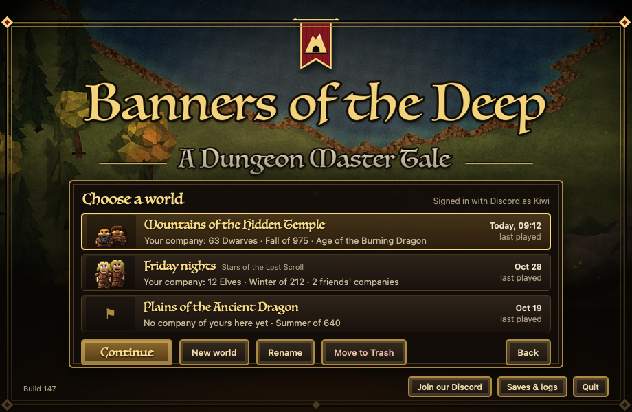

# World selector plan (2026-10-31)

**Decided (owner, 10-31, "perfect" to all five recommendations):** Play always opens the list; new worlds are the same
land for now; Rename changes the launcher's label only; the word is dropped from the name lists; the race picture now.
**Status:** landed as "world-list" (09:29) and in app build 146; "land-names-whole" (09:38) and "world-trash-size"
(09:50) come with the next build. Checks: `tools/check_world_selector.py --ui --hfs` and `tests/world_info_check.dm`.
Real-app pass done 10-31 ~09:45 on a clone of build 146 (owner: "Yes, take it"): 23/23 steps with events sent into the
launcher (List, arrows, Rename typed, Move to Trash into the real Trash and back, Host's password sheet, New world -> the
game -> quit, Continue -> a Dwarf company -> quit -> listed with 3 Dwarves). Proof: reports/world-selector-1031/real-app-1031/.

Mock-up: `planning/world-selector/mockup-list.png` (also `-new`, `-host`, `-delete`; the page is `mockup.html`).



## Summary

- **Play opens a world list.** The world you played last is at the top and already picked, so Enter, Enter continues
  it. The list has **New world**, **Rename**, **Move to Trash** and **Back**. If there is no world yet, Play makes
  the first one and starts at once, just like today.
- **Each row shows** the world's name, your company's race picture and size ("Your company: 63 Dwarves"), the
  season and year ("Fall of 975"), friends' companies if you hosted, and when you last played it.
- **Every world is its own folder.** Today's world stays exactly where it is (`world/`) and becomes the first entry.
  New worlds go in `worlds/<id>/`. Nothing in today's saves is moved, renamed or rewritten.
- **Delete moves the whole world folder to the Trash.** Nothing is ever deleted for good, and Put Back in the Trash
  brings the world back into the list.
- **Host for friends uses the same list**, with "Host this world" as its button, then the password as today.
  Join a friend doesn't change.
- **Your profile is shared by all worlds**: settings (sound, HUD), achievements (the rare-race odds) and saved designs.
  It moves out of the world into `profiles/`. It is *copied* from today's world, and the old file stays where it is.
- **No company selector inside a world**: one company per player name per world. "Start over" in game stays as it is.
- **Work:** the launcher window and its world list (Launcher.m), the world folder choice (launch.zsh), two small game
  changes (where the profile lives, and a small facts file written at each save), one picture packed by build_app.
  About 1.5 to 2 days with the checks, plus one short real-app pass once the owner says to build.

## How it works today

| What | Where (`$data` = `~/Library/Application Support/Dungeon Master Remastered`) |
|---|---|
| The game's files (map, code, art), copied from the app when the build changes | `$data/world/` (138 MB in build 146) |
| A player's company | `$data/world/units/<ckey>_save.sav` (+ `players/<ckey>_save.sav`) |
| The world: changed tiles, items, workshops, calendar, name, history | `$data/world/units/remaster_world.sav` (+ `.bak`, `.bak2`, `.bak3`) |
| The profile: `audio`, `hud`, `achievements`, `designs` | `$data/world/units/remaster_profile_<ckey>.sav` (Rarity.dm `RemasterProfilePath`) |
| Host files: `join-password`, `host-name`, `host-addresses` | `$data/world/` (launch.zsh writes them for Host, removes them for Play) |
| Final save on quit, lock, logs, the game window's copy | `$data/reports/save-request`, `$data/launcher.lock`, `$data/reports/`, `$data/client/` |

- The engine runs with the world folder as its current folder (DreamResourceManager sets it), so every save path in
  the game (`units/...`, `players/...`, `host-name`) is relative to that folder. **Pointing the engine at another
  folder therefore gives a separate world with no change to the save code.**
- `launch.zsh` copies the packaged world over `$data/world` whenever `$data/build-id` changes. The packaged world has
  no saves, so updates keep them.
- Every new world is the same land: the map files are fixed, and the biomes use seed 9191 (Biomes.dm). Its name,
  history, age and starting year are random (History.dm). The generated world (seed 1026, WORLDGEN plan) comes later.
- "Choose your people / start over" (Restart.dm `Restart()`, button in Actions.dm) keeps the world. The old company
  is left behind (caged units can be taken, the rest are removed) and a new race is picked.

## Where each world lives

```
$data/
  world/                  the first world: today's folder, saves untouched
    botd-world.json       NEW, small, the launcher's (label, created, last played); added beside the saves
    world-info.json       NEW, small, the game's facts (written at each save)
    .build-id             NEW: which build its game files came from
    units/ players/ ...   as today
  worlds/
    20261031-0912/        a new world: the same layout
  profiles/               NEW: remaster_profile_<ckey>.sav, shared by every world
  client/ reports/ server-data/ launcher.lock build-id discord-*.json   as today, shared
```

- **One folder per world, game files included.** New worlds get the game files with `cp -c` (an APFS clone:
  138 MB that take almost no disk until changed; checked on this Mac's disk). If the disk can't clone, a plain copy
  is used. No game save code changes, and later region files (REGIONS_ON_DISK plan R3, `world/regions/...`) land in
  the right world on their own.
- **Today's world stays at `world/`**: never moved, so an older app build still finds it. It is listed first until
  another world is played more recently.
- **Each folder describes itself** (`botd-world.json`). There is no central list that could go stale. The launcher
  lists `world/` plus every `worlds/*/` folder that has the file, so a world put back from the Trash shows up again.
- **Folder names never come from typed text**: `worlds/<yyyyMMdd-HHmmss>`. launch.zsh only accepts `world` or
  `worlds/<letters, digits, - and _>`.
- **Updates per world**: each world remembers its build in `.build-id`. Playing a world whose build is old refreshes
  its game files first (the "Getting the world ready…" stage), so a world that hasn't been played for months
  updates when it is next played. The first world's `.build-id` starts as a copy of `$data/build-id` (the build its
  files came from), so it refreshes exactly when it would today. The game window's copy (`client/`) stays gated by
  `$data/build-id` as today.
- **One world at a time**: the lock, the save request and the logs stay shared. Two worlds at once would need
  twice the memory (one-big-run rule) and two ports.

## What the selector shows

| On the row | From |
|---|---|
| Name (big) | the label from Rename, else the land's own name (`WorldName`) |
| Land name (small, only when renamed) | `WorldName` |
| Picture | your company's race, cut from the race-card sheet (`art/hud/src/assets/screens-races.png`, 14 races, 77 KB, packed into the app). A banner mark when you have no company there |
| "Your company: 63 Dwarves" | your entry in `world-info.json`: race (plural from a table: Dwarves, Elves, Lizardmen…) and unit count. "No company of yours here yet" when there's none. "None left" at 0 |
| "Fall of 975 · Age of the Burning Dragon" | `Season`, `Date`, `Ages` (the Realm tab's own rows) |
| "2 friends' companies" | other players in `world-info.json` (worlds you hosted) |
| Last played | `last_played` in `botd-world.json` (set by the launcher on Play), else the save file's date |

**`world-info.json`** is written by the game right after each world save (autosave, about every 16 min, and on quit),
through a temporary file then a swap. It is a few hundred bytes. The launcher never opens the big `.sav` files.

```json
{"version": 1, "name": "Mountains of the Hidden Temple", "season": "Fall", "year": 975,
 "age": "Age of the Burning Dragon",
 "players": {"localhost@kiwi": {"key": "Kiwi", "race": "Dwarf", "units": 63}}}
```

- Players who are offline at a save keep their last entry (the file is read, updated, written).
- Matching "you": the launcher's game name (Discord `game_name`, else the Mac account name, as launch.zsh uses) is
  compared with each entry's `key` without its "…@" prefix, ignoring case and anything but letters and digits.
- **Today's world before its first save under the new build** has no `world-info.json`. Its row shows "Your first
  world" and the save file's date until the first autosave or quit fills it in.
- Order: last played first. More than three worlds scroll. Double-click plays.

**Picture, cheapest first:** the race portrait (free, in the plan). A real picture of your town needs the HUD page
to grab its 3D view at quit and send it to the server to save, which is about half a day. That is open question 5.

## The actions

- **Continue / Play** (primary, Enter, double-click): writes `last_played`, then starts the world as today with
  `--world <folder>`.
- **New world**: a sheet with an optional name ("leave empty and the land names itself"). It makes
  `worlds/<id>/botd-world.json` and plays it. launch.zsh fills in the game files on the first start; the land gets
  its name and history, then the race card asks for your people, as on a first launch today.
- **Rename**: a sheet with the name, 1-40 printable characters. It changes the label only (open question 3); the
  game's land name, history and legends stay.
- **Move to Trash**: "Move “X” to the Trash? Its companies, buildings and history go with it (84 MB). You can put it
  back from the Trash until the Trash is emptied." It uses `NSFileManager trashItemAtURL`. Refused while the game is
  running (the lock holds a live pid), and refused for any folder that isn't `world` or `worlds/<id>` inside `$data`.
  If the first world is trashed, the next Play with no worlds makes a fresh `world/` (today's first-run path).
- **Back**: the three big buttons again.
- **Saves & logs** opens `DMDataDir()` (today it hard-codes the real folder even when `DM_STANDALONE_DATA_DIR` is set;
  fixed so tests never open the real one).

## Host for friends, Join a friend

- **Host for friends** opens the same list with the title "Host for friends: choose a world" and the button
  "Host this world", then the password sheet as today ([mockup-host.png](world-selector/mockup-host.png)).
  launch.zsh writes `join-password`, `host-name` and `host-addresses` into the chosen world's folder (today's code,
  pointed at that folder). Friends' companies live in that world. Their profiles live in the host's `profiles/`.
- **Join a friend**: no change. You play in your friend's world on their Mac.
- **Started with options** (check_app, scripts) goes straight in as today. With no `--world` that means the first
  world, so the existing checks keep working.

## What stays per player across worlds

- **Shared (`profiles/`)**: sound settings (`audio`), HUD settings (`hud`: size, colours, 3D look, edge scroll,
  right-click), achievements ever (the rare-race odds), saved designs (24 at most).
- **Per world**: the company, its units, gear, buildings, zones, plans and orders. Also the world's calendar,
  history, lieges, wars, claims, difficulty and fog setting.
- **Moving the profile:** `RemasterProfilePath` reads `RM_PROFILE_DIR` once (launch.zsh sets it to `$data/profiles`).
  Unset, it falls back to `units/` as before, so arena tests and older launchers are unchanged. The engine takes
  absolute savefile paths (its temporary savefiles already use one).
- **Copying the old profiles:** on the first start of the new launch.zsh, every
  `world/units/remaster_profile_*.sav` is copied (not moved) to `profiles/` if no file of that name is there yet.
  If an older build is played afterwards, its profile changes go to the old file and the new build won't see them.

## Why no company selector

One company per player name per world matches the RTS-MMO plan (each player is one town plus a hero party), keeps
alts out of a world, and the world list already gives "several games side by side". Start over stays the way to
change people inside a world.

## Later: the MMO server list

The row shape carries over: name, your company, the world's date, last played, plus players online. The list would
read from the account service (MMO_ARCHITECTURE: "which world/shard the player's realm lives on") instead of folders.
"New world" becomes "join a world". `botd-world.json` gets room for a `seed` now (null = the fixed land) so a
generated world per save is possible later.

## The work

### launch.zsh (~40 lines)
1. `--world REL`: only `world` or `worlds/[A-Za-z0-9_-]{1,40}`, default `world`, otherwise `fail`. `world="$data/$REL"`.
   Log "World: REL".
2. `.build-id` per world, as above (the first world's starts from `$data/build-id` before the client step rewrites it).
   Refresh with `cp -cR "$game/world/." "$world/"`, falling back to `cp -R`. The client copy keeps `$data/build-id`.
3. The initial-saves import only for `world` (unchanged).
4. `mkdir -p "$data/profiles"`, the one-time profile copy, `export RM_PROFILE_DIR="$data/profiles"`.
5. `--prepare-only`: stop after steps 1-4 and print the world folder. This is for windowless tests; the launcher
   never passes it.

### Launcher.m (~300 lines) + `mac-app/LauncherWorlds.h` (~120 lines, no UI)
- `LauncherWorlds.h` (like `LauncherOutcome.h`): list the worlds, read `botd-world.json` and `world-info.json`, sort,
  check names and folders, make a new folder id, race plurals, find "your" entry. Pure functions, testable without
  a window.
- The world panel over the art (dark panel, gold rim, rows, DMHoverButton plates, as in the mock-up), in play or
  host mode. Sheets for New world, Rename, Move to Trash; Host's password sheet after the list.
- `choosePlay`: no worlds → start as today. Else the list. `startWith` adds `--world`.
- `openFolder` uses `DMDataDir()`.

### Game (2 small changes, ~35 lines; both need the next app build)
- Rarity.dm `RemasterProfilePath`: `RM_PROFILE_DIR`, read once.
- WorldSave.dm, after `RemasterSaveWorld` writes the save: `RmWorldInfo()` writes `world-info.json` (read, update the
  online players, temporary file, swap). Only at save time; no tick cost.

### build_app.py (2 lines)
- Pack `art/hud/src/assets/screens-races.png` into Resources as `world-races.png`.
- Keep `world-info.json` and `botd-world.json` out of the packaged world by name (they are already excluded as
  `.json`, but this makes it explicit).

### Tools
- `check_app.py`: its "normal saves unchanged" hash also covers `worlds/*/units`. The other tools that read
  `$data/world/units` (check_real_save.py and others) keep reading the first world.

## Checks (all on temporary data folders via `DM_STANDALONE_DATA_DIR`; never the real saves)

1. **`tools/check_launcher_worlds.py`** (like `check_launcher_outcomes.py`): compile `LauncherWorlds.h` into a test
   with clang. Run it on built folders: empty; first world only, with no info file; three worlds; a world put back
   from the Trash; a bad `botd-world.json`; names with `_` and `@`; sorting; a folder outside `$data` refused.
2. **launch.zsh `--prepare-only`** on fixture folders (fake saves, never real ones):
   - a fresh folder gives the same layout as today plus `.build-id` and `profiles/`;
   - a legacy layout with the current `build-id`: nothing written under `world/units`, every file's hash the same,
     profiles copied, the originals the same;
   - `--world worlds/x` makes a clone, and a new build id refreshes it with the saves kept;
   - bad `--world` values (`../x`, `/tmp`, `worlds/a/b`, `worlds/..`, an empty value) are refused with an `error:`
     status;
   - the plain-copy fallback on a small HFS+ disk image (`hdiutil`, which can't clone).
3. **Arena check** (check_arena on its own port): with `RM_PROFILE_DIR` set, audio, HUD, designs and achievements are
   written to and read back from the profile folder, and nothing goes to `units/remaster_profile_*`. Without it,
   behaviour is as today. `world-info.json` after a save: name, season, year, age, players right, an offline
   player's entry kept, no `.tmp` left.
4. **Real app, after the owner's build go-ahead** (on a cloned current build, temporary data folder, real input on the
   launcher window): Play with no world → in game → quit. Play → list → New world "Test" → pick a race → quit.
   Play → both rows with the right race, count, season and year → Continue → the same company. Rename → the label
   changes. Move to Trash → the folder is in the Trash → Put Back → the row is back. Host this world → `host-name` is
   in that world, not the first one. `check_app.py` passes unchanged.

## Risks

- **An older build after this one** still plays the first world only, and doesn't see profile changes made since.
  Low risk: the app updates in place.
- **Time away per world**: each world catches up its own time away when it loads (Away.dm rules: no starving). A
  world left for weeks runs its catch-up on the next Play. That is today's behaviour, now possible on several worlds.
- **Disk**: a lived-in world is its saves (tens of MB, with three backups) plus cloned game files. The Trash question
  shows the size.
- **Name words**: the 2006 land and age name lists (History.dm) include one word about sexual violence, which can
  appear in a land name and so on the selector (see question 4).

## Open questions for the owner

1. **Play opens the list every time** (Enter, Enter continues), or Play goes straight into the last world with a
   small "Worlds…" button beside it? *Recommended: the list, so New world is easy to find.*
2. **New worlds are the same land** (fixed map, new name and history) until the generated world arrives, or should
   each world wait for its own land? *Recommended: same land now. A `seed` is kept per world for later.*
3. **Rename changes the launcher's label only**, or should it also rename the land in game (Realm tab, history,
   legends)? *Recommended: label only.*
4. **Drop the sexual-violence word from the 2006 name lists** (History.dm) so it can never name a world? Existing
   worlds keep their names. *Recommended: drop it.*
5. **Picture**: the race portrait now (free), or a real picture of your town taken at quit (about half a day more)?
   *Recommended: portrait now, town picture later.*
