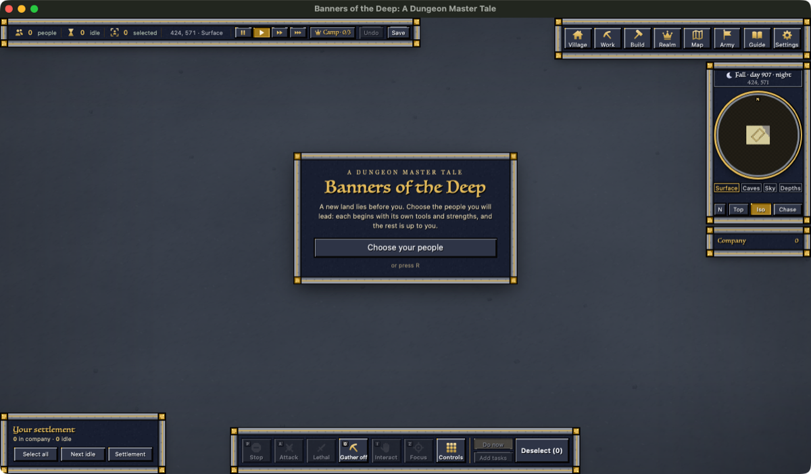

# 2026-10-24: the day's summary (coordinator)

Tonight's app build (23:53) is the fastest the game has been. Select-all with 200 units now shows in the first frame
after your click instead of 5–16 seconds later. Group moves start in a few milliseconds. The 3D view handles 30,000
units at about 12 ms a frame. The new v6e engine is in. Each session's own log is next to this file.

## Done (in the app build of 23:53)
- **Engine v6e.** It looks up big lists instantly, does memory clean-up between ticks, and tracks changes for the 3D
  view. On a busy Mac it beats v5.1 at standing, moving, war and creating units.
- **Instant select (hud-craft).** The panel and rings draw in the click's own frame. The real slowdown was the page
  building a full card for every selected unit, even with the page closed.
- **Units page (hud-craft).** Only cards near the screen are fully built, so opening it with 200 selected no longer
  freezes.
- **HUD at 30,000 units (hud-craft).** Per-unit entries are reused when nothing changed, with a separate path above
  1,000 units.
- **Group moves (formations, server-cost).** Back rows no longer wait on mates that haven't set off. Formation spots are
  handed out in one sorted pass. First steps run within a time budget on the click.
- **Server per-tick work (server-cost).** Idle units skip empty order ticks. The skills pass only works on units that
  trained. The explored map updates one patch at a time. Optional work steps back when the server falls behind.
- **3D (world-look).** Ground is sent as patches and only resent on change. The server's 3D work is capped at about
  10 ms a tick. Unchanged units' entries are reused. On the page, standing units cost nothing, and units off screen
  aren't drawn.
- **Carriers can pass their own villagers (jobs).** Lines of carriers used to freeze nose to tail. Units still never stop
  on a friend's tile.
- **Far-away units as records (far-records).** In the game, switched off. A rule bug turned test units into records, and
  it's fixed. It turns on in a later build, once a live-reference test passes.

## Also in the later build (01:57, check_app and real launch passed)
- **Walk v2e (server-cost).** Idle units' walk loops stay off until they're needed, so a standing 30,000-unit world costs
  about 68% less. It came with a fix so two friends can never be left stopped on one tile.
- **Gathering and lodges (jobs).** Carriers can pass friends, villagers pick up what's lying in their zone, and haulers
  cover gather zones. 200 workers store about 8× more stone and wood, at half the cost per piece. Lodges build
  themselves with furniture and banner (Elf 2.6 min, Orc 3.3 min).
- **Wild creatures (rts-feel).** Far from players they hold no running loops (about half the cost). The exact near-player
  saving arrives with engine v7.
- **Group moves (formations).** Each group's member list is built once a tick: 282 → 4 µs a call, an order tick
  77 → 36 µs.

## And in the 03:41 build (check_app and real launch passed)
- **Doors (jobs).** A shut door now stops every unit that isn't its owner's on every kind of walk. Before, wanders, work
  walks and rope steps went through, even locked doors. Your own villagers opening your doors switches on with engine
  v7f.
- **Fog fix (world-look).** A newly made unit ordered straight onto a target now goes for it. Before, it dropped the
  order silently.
- **Bed checks (server-cost).** Units that aren't tired aren't checked for a bed: a standing 30,000-unit world goes
  175 → 139 ms a tick.
- **Big orders over ticks (formations).** A 30,000-unit click goes 788 → ~400 ms, and every unit has its order within
  1.7 s. Groups of 200 or fewer are exactly as before.
- **Per-player passes (server-cost).** Care, bag and blueprints are spread over ticks, and carrying works off changes.

## Numbers
| What | Before | Now | Test |
|---|---:|---:|---|
| Select-all at 200, first screen update | 16,774 ms | 9 ms | real WKWebView |
| Select-all at 200, click → panel and rings | 5–16 s | 35–50 ms | real client, your world + 200 |
| Opening the Units page, 200 selected | 4,284 ms | 13 ms | WKWebView |
| Select-all at 30,000, the server's part | 7,168 ms | 151 ms | arena |
| "Is this unit mine?" at 30,000 | 83 µs | ~0 µs | arena, v6e |
| 30,000-unit move order | 8.5 s | 1.7 s | arena, v6e |
| Group of 30, first-step wait | 86 ms | 13 ms (staged pieces aim < 10) | arena, game/ |
| 200-unit group, units waiting 3+ ticks to start | 155 of 200 | 0 | arena |
| 5,000 units standing / moving / war | 74.7 / 130 / 251 ms | 59.7 / 79 / 183 ms | v5.1 vs v6e, loaded Mac |
| 3D frame, 30,000 units on screen | 35 ms | 12 ms | real WKWebView, 60 Hz |
| 3D scene build, 30,000 units | 1,904 ms | 482 ms | arena, v6e |
| Your 200-unit game, ticks over 100 ms (of ~1,750) | 356 | 39 | real window, loaded Mac |
| Stone stored per worker-hour, 200 workers | 4.6 | 141 | arena, jobs' fixes, staged |
| Your full world, server memory | 2,560 MB | 1,024 MB with sleeping tiles | prototype, not in the game |

## In progress
- **Walk clock v2d/v2e.** It cuts a standing 30,000-unit world by about 68%, but fails one narrow-corridor case. Two
  friends can end up stopped on one tile, so the step-off rule gets fixed first.
- **Engine v7 candidate.** It adds a write watch, so idle work happens only on change; a cheap "enemies nearby?" check;
  your own-doors rule in the route finder; and a 75 MB memory trim. Behaviour gates pass, and the cost gate is running.
  **Installing it needs your OK.**
- **Gathering and lodge fixes (jobs).** Proven and landing next. Then doors (a): your villagers open your unlocked doors.
- **Wild creatures (rts-feel).** Far from players they now cost about half. Near players is next, after a profile.
- **Map memory.** Sleeping tiles, region records, region files, in steps.

## Needs the user
- **3D stage 2.** Turn it on under about 5,000 units (the fastest at every size today), or everywhere (a third of the
  data, slower at 30k than reuse alone)?
- **Engine v7.** Your OK to install once its cost gate passes.
