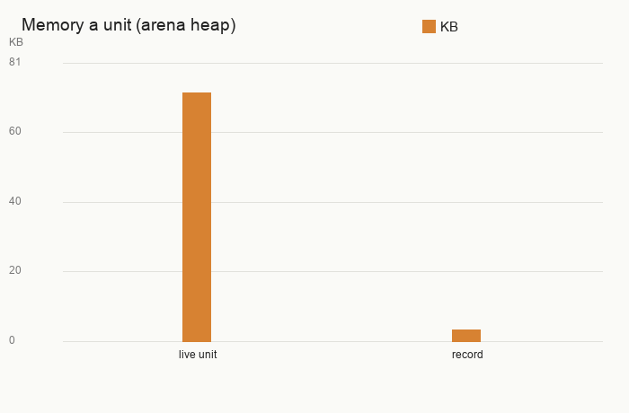
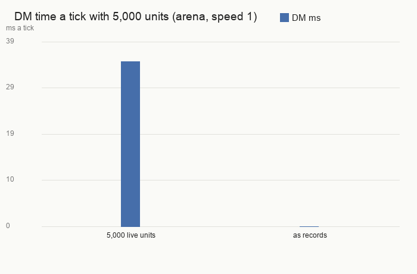
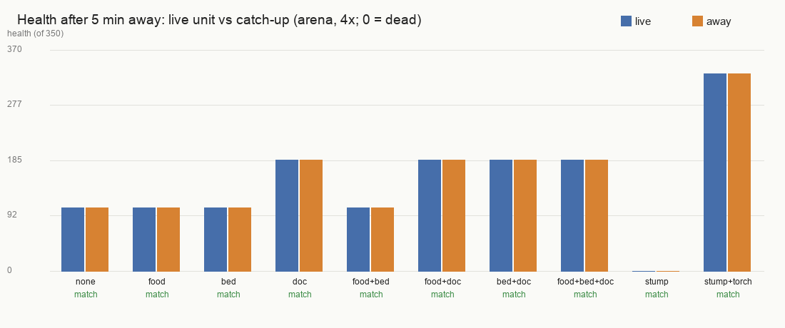
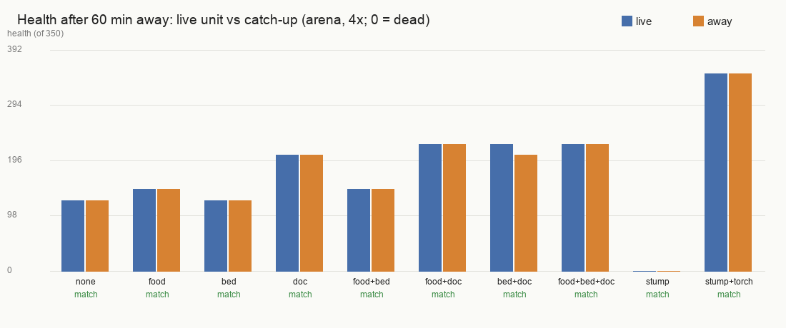
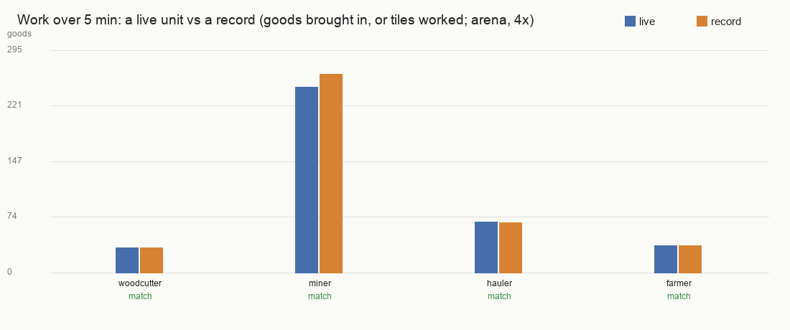
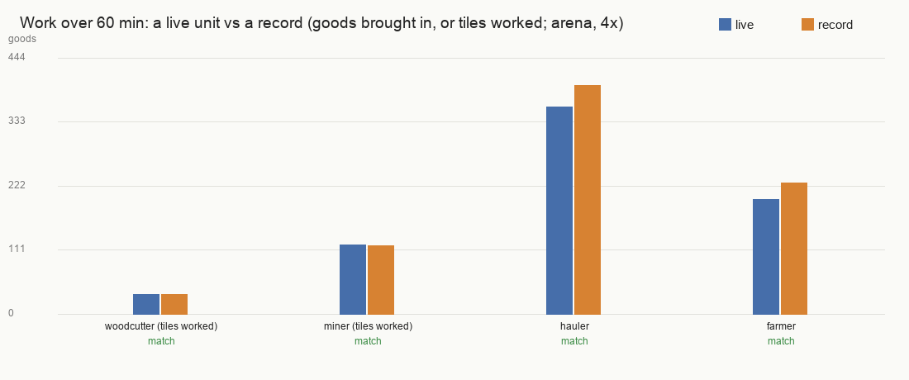

# Far-away units as records (far-records)

Villagers of players who are offline, standing where nobody is watching, now fold into a small record (~3 KB instead of
~71 KB) and cost the server next to nothing per tick. They come back as exactly the same unit when anyone comes near,
something heads their way, or their player logs in, and they live the time they slept through as if they had been
awake. Time away now heals only through meals, sleep, doctors and potions, never back to full for free.

Status: in the game folder since 22:46, but **switched off** (`rm_far_on = 0`) for the next app build: on arrival it
made the units in other sessions' arena tests vanish (fixed: see below). It goes back on once those checks pass with it
on. The healing change (time away heals only by the live rules) is on.

## When a unit becomes a record (normal play)
- Its player **was connected in this server run and has left** (players who never connected, such as the arena
  tests' players, are never recorded).
- It stands in **land nobody is watching**: more than about 24 tiles beyond the edge of every connected player's 3D view
  (so ~70+ tiles from their camera), more than ~32-48 tiles from every unit of a connected player, and more than 16
  tiles from their workshops (Awake.dm's 16-tile chunks, redrawn every second).
- It has been **quiet there for 60 seconds** (looked at every 6 s): not bleeding or ill, no orders, not walking or
  fighting, not asleep, not royal, the hero or the heir.
- **Switch:** `rm_far_on = 0` (FarRecords.dm) wakes every record within 2 s and keeps every unit a full unit, as before.

## Done
- A record keeps every saved value, its things inside one another, its place in its player's army and quick groups,
  links to its family or friends (linked units wake together), where it stood and when.
- It wakes as the same unit: 2,260 saved values checked equal over 3 units; clock jobs (hunger, sleep, healing) back.
- It wakes when its land is watched again, when a raider or any creature on its way comes within 16 tiles, when its
  player logs in, or when the switch is turned off. Nearest the player first, 100 at a time.
- The time asleep is lived through with the game's own rules: work at the live pace (woodcutters, miners, haulers,
  farmers, board and work-zone workers), real meals from the stores, sleep in a bed or rough, the Doctor, potions.
  Working records also wake every 10 minutes, so goods don't rot where they lie.
- Saves keep the records with the army; after a restart their time asleep counts on the real clock.
- Time away (the "While you were away" catch-up) no longer heals to full: it uses the same rules. Nobody starves while
  away (your rule): with no food they come back hungry.
- Hooks agreed with the work-zones (Jobs), map-memory, RTS-feel and server-performance sessions; an estimate of what
  sleeping villagers have brought in (`RmFarExpected`) is ready for the Village overview.

## Numbers
| What | Live units | As records | Test |
| --- | --- | --- | --- |
| Memory a unit | 71-72 KB | 3.1-3.4 KB | 5,000 units, arena heap |
| DM time a tick, 5,000 units | 29-34 ms | 0.02 ms | arena, speed 1 |
| Put 5,000 to sleep / wake them | | 8 s / 23 s, spread over ticks | arena |

Healing over time away, live unit vs catch-up (arena, 4x; 10 villages: with and without food, bed, Doctor; an open
stump with and without a torch): **5 minutes 10/10, 1 hour 10/10 match** (18 of 20 exactly, the rest within 5 %).
The orange bar is the catch-up, the blue bar the live unit; "0" means dead (the untreated stump bleeds out both ways).

Work, a sleeping record vs a live unit (arena, 4x, game held 3.99-4.01x):

| Job | 5 min live / record | 1 hour live / record |
| --- | --- | --- |
| woodcutter | 33 / 33 | wood worked out both ways |
| miner | 253 / 266 (5 %) | mountain face worked out both ways |
| hauler | 67 / 66 (1 %) | 358 / 396 (10 %) |
| farmer | 36 / 36 | 198 / 227 (14 %) |

A region waking at once: 1,000 records, each with 8 hours to live through (200 workers, a 2,000-tomato larder):
**all done in 308 s** (with 7 other sessions' tests on the machine), mean **13 ms** a tick; 4 of 3,082 ticks over
100 ms, the worst 287 ms (it was 664 ms, and before the per-batch caches it didn't finish in an hour).

## In progress
- Landed in the game folder 2026-10-24 22:46 (restore point `restore-points/before-far-records-20261024`), switched off
  at ~23:10. With it off, check_food, check_food_supply, check_stumps, check_buildings and check_away pass on the game
  folder; check_obey fails on felling tended trees (Orders.dm/Yield.dm tending, not this work).
- Next: turn it back on once those checks pass with it on, plus a test that no unit is recorded while an order, job,
  site, rope, selection or trade holds it.
- Follow-up: the few remaining 100-290 ms ticks while a big region wakes.

## Needs the user
- Over a full hour, live woodcutters keep nibbling trees they tend as those grow back (getting almost nothing), and
  live miners dig faster than they can carry, leaving stone to rot. Records don't copy either habit, so a sleeping
  miner brings in more stone than a live one. Worth fixing in the live jobs rather than copying into records?
