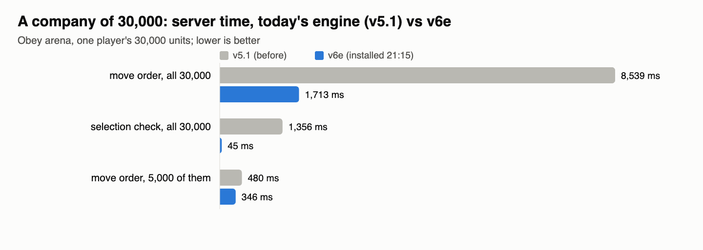
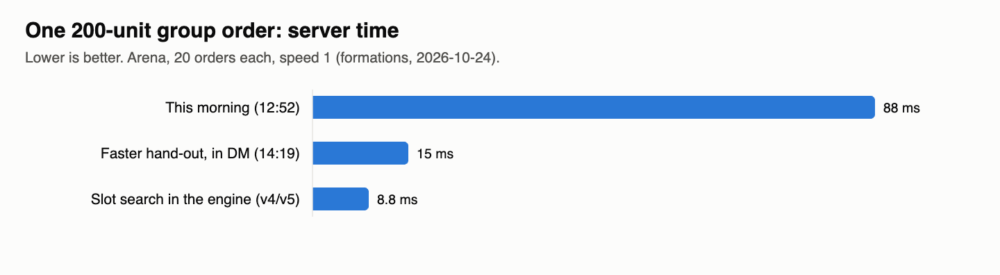

# Formations and the engine (formations)

Group orders got fast: a 200-unit move now costs the server about 9 ms instead of 88 ms this morning, and groups on a
mountain top find places they can actually stand on. Tonight's engine work: tests can run the game clock at 16x
(engine v5.1), and engine v6 is installed (21:15): memory is cleaned up between ticks, and the game's lookups in big
lists are instant, so an order to a 30,000-unit company went from 8.5 s to 1.7 s. Next: getting that 1.7 s down to
something that never shows as a hitch.

## Done
- **Engine v6 is in the app** (build 23:53): the slow 5,000-unit run the user saw was the busy Mac, not v6. Taking
  turns twice against today's engine, v6e was faster standing (75 -> 60 ms a tick), moving (130 -> 79) and in war (251 ->
  183), and making 5,000 units alone, three times each, came out the same or better (2.27 -> 2.14 s a lot).
- **200-unit groups set off together** (in the game since 21:5x): the back rows of a packed group no longer stand
  waiting while the front rows start. A unit about to set off counted as an obstacle for those behind it, so they gave up
  until the next order check (half a second). Now in a 200-unit block nobody waits 3 ticks or more: 174 step in the first
  tick, 26 in the second (before: 41 in the first, 155 waited 3+).
- **The 30,000-unit hand-out of places, 4x faster** with exactly the same formation (who goes where is identical at 200,
  5,000 and 30,000): 800 -> 186 ms at 30,000, 124 -> 18 ms at 5,000.
- **Engine v6 installed** (v6e, `reports/formations/engine-v6/`, restore point `restore-points/before-engine-v6-20261024/`):
  "is this unit one of mine?" (asked once per unit in 32 places) is now instant at any company size; memory is cleaned
  up between ticks; the profiler can count memory use; world-look's 3D change counters are in. Play gets it with the
  next app build, after the last behaviour checks pass.
- Found and fixed before install: the first v6 test build made 30,000 units in 25 s instead of 9 s (it built a lookup
  for every big list the first time it was used, even lists used once); v6e waits until a list is used 16 times.
- **Engine v5.1 installed ~20:3x** (`reports/formations/engine-v5.1/`, with a restore point): the same as tonight's engine, except a test world
  may now run its clock faster than 4x (up to 32x, set by the test). Play is unchanged: the speed buttons still give
  0-3, and asking the engine for 16 still runs at 4 unless the test switches it on. Above 4 the clock only takes extra
  steps while each tick has time left, so a loaded test runs as fast as it can without falling behind.
- The test tools set it for you: behaviour checks with `--speed 16`, arena tests with `--max-speed 16` (or a literal
  `world.game_state = 16` in the test).
- **200-unit group order in single digits**: the slot search, slot tiles and sorting moved into the engine (v4, part of
  v5), plus a cheaper hand-out of places; the same answers as before, proven on 363 + 225 + 60 cases.
- **Mountain tops**: a group sent up a mountain that isn't flat now gets places on the blocks it can walk to; nobody is
  left "as close as it could" or stranded on a plateau with no ramp.
- Earlier today: archers and casters spend arrows, throws and spells before melee; company groups (Ctrl+G, group cards,
  Ctrl-click whole groups); supply cards with arrows, medical supplies and the group's combined bag; bow reach by kind.

## Numbers

| a company of 30,000 (arena) | before (v5.1) | after (v6e) |
|---|---|---|
| "is this one of mine?", a unit not in it | 83 µs | 0 µs |
| "is this one of mine?", one of the newest | 85 µs | 0 µs |
| the defence check, per unit | 44 µs | 3 µs |
| an order's selection check, all 30,000 | 1,356 ms | 45 ms |
| a move order to all 30,000 | 8,539 ms | 1,713 ms |
| a move order to 5,000 | 480 ms | 346 ms |
| making the 30,000 units (test setup) | 9.3 s | 10.1 s (first v6 build: 25.4 s) |

The bars are the server's time for one 200-unit order; the last bar is what the game runs since engine v5.

| what | before | after | measured on |
|---|---|---|---|
| one 200-unit group order (server) | 88 ms (12:52) | 9.3 ms keep / 9.4 ms box | arena, engine v5, speed 1 |
| speed 16 asked, play (no switch) | 4x | 3.99x | arena, v5.1 |
| speed 16 asked, test switch on, empty world | 4x | 15.8x | arena, v5.1 |
| speed 16, test switch on, 8 ms of game work a tick | 4x | 8.9x, engine still at 10 ticks a second | arena, v5.1 |
| building a 28,000-unit set in a list | 1,409 ms | 13 ms | arena, v6 test build (not installed) |
| looking up 28,000 units in that set | 1,359 ms | 3 ms | same |

## In progress
- **A 30,000-unit move without a hitch** (the user: "how do we get 0s on 30k units?"). Targets: a 5,000 move under 100 ms
  in the click's tick, and at 30,000 no tick over 30 ms with everyone walking within about a second. Where the 1.7 s
  goes: handing out places 0.84 s (fixed: 0.19 s, the same formation), giving 30,000 orders 0.43 s, planning 0.3 s; then
  the rest is spread over the next ticks. A 30,000-unit world already costs ~200 ms a tick standing on today's loaded Mac,
  so that goes to server-cost as its own item.

- The list change's 25,000-step test caught one real difference against the old engine before install: removing
  something from a list quietly empties references to deleted things in it, and a later sum of two lists depended on
  that. Removing keeps the old behaviour (and its old speed); adding, looking up and finding are instant.

## Needs the user
- Nothing right now. Open question for later: making 30,000 units takes about 7 s of work (a world made or loaded with
  that many); worth its own look if big saves load slowly.
