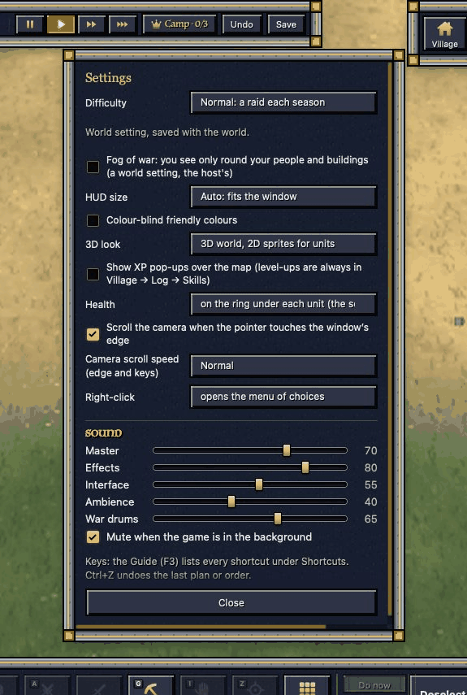
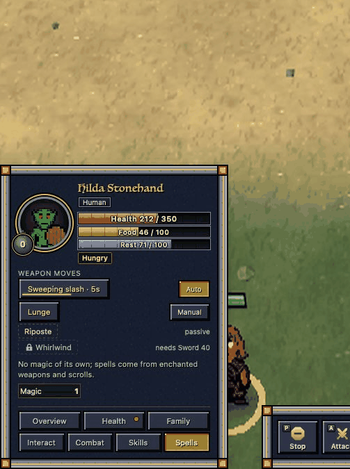
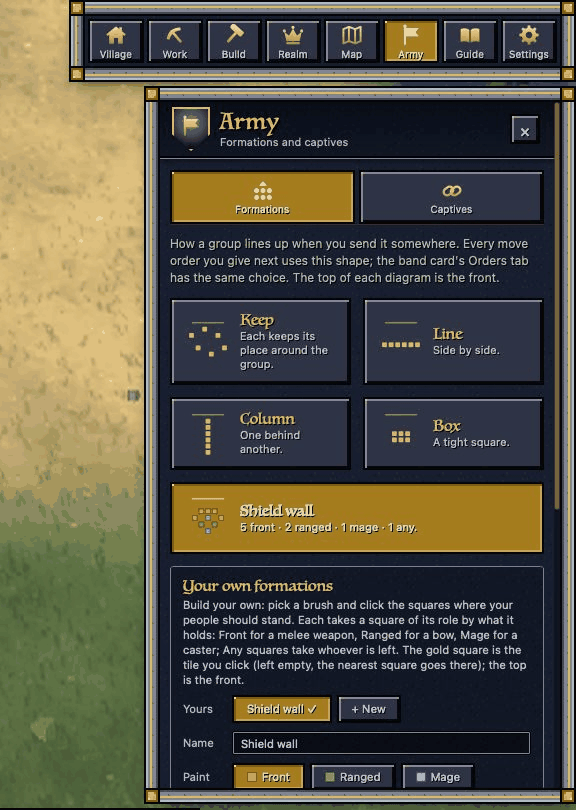
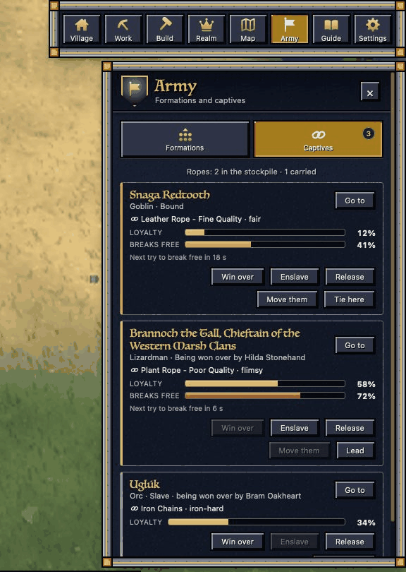
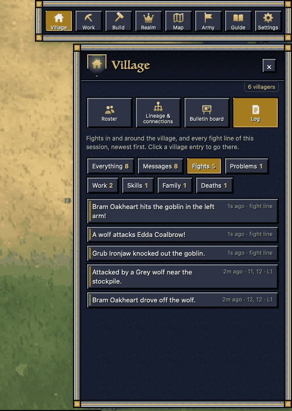
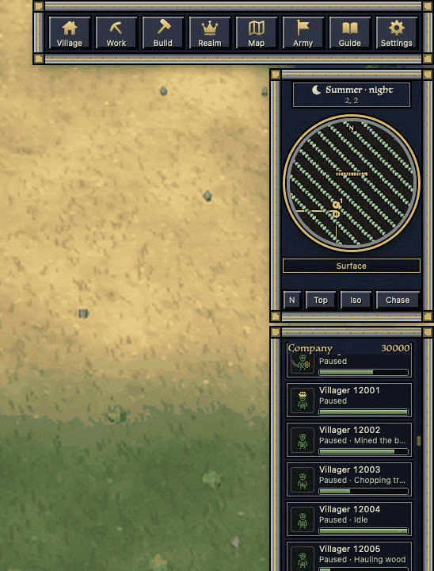
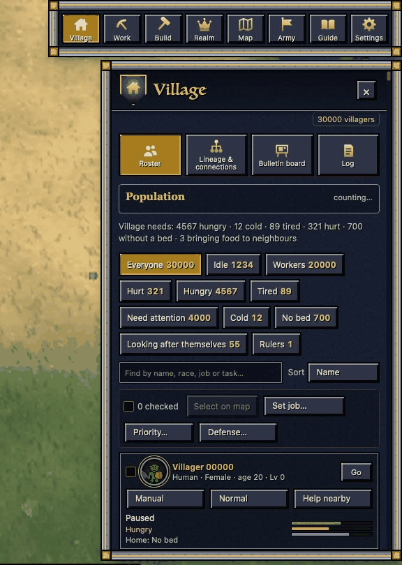
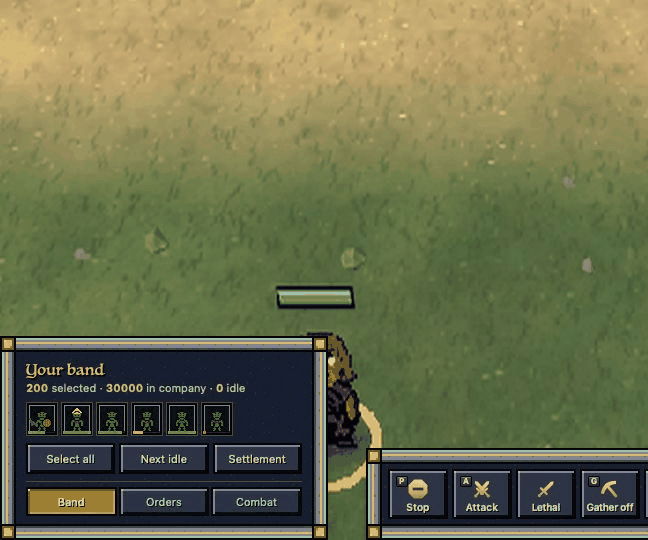

# hud-craft — 2026-10-24

The HUD now copes with 30,000 units: the server sends whole only what you can see (the selection, the units on screen,
the rows in view) and counts for the rest, so an update at 30,000 takes ~40 ms instead of ~1-2.5 s, and "Select all" at
30,000 no longer takes 9 s an update. It is in the game since 20:59. Earlier today: the HUD's data went from 2.8 MB a
second to a few KB, weapon moves moved to the Spells tab, the Settings Close button was pinned, and a start-up break I
caused (the game stuck in 2D for ~15 minutes) was found and fixed.

## Done
- **The Units page opens at once with 200 selected** (in the game since 23:37; it took ~4.4 s): each card's work, skills
  and sheet are built only for the cards on screen, the rest as you scroll to them. Opening it: 4.3 s -> 0.01 s of work,
  the cards on screen complete 60 ms later. It looks the same as before (the test pictures match pixel for pixel).
- **"Select all" is instant now** (in the game since 23:20). It crawled because the page built a full card for every
  selected unit on the Units and Orders pages each time the selection changed, even with both pages closed. Now those
  cards are built only when you open the pages, and Select all (its button, Ctrl+A, a box drawn round units) shows the
  band card, the counts and the rings in the same frame as the click; the server's next update confirms it.

  | 200 units (the game's own window, your world + 200) | before | now |
  | --- | --- | --- |
  | click Select all until the card and rings show | 5-16 s | 35-50 ms (the next frame) |
  | the HUD's update right after it (the game's web view) | 16.8 s | 9 ms |
  | select all with 30,000 units, on the server | 7.2 s | 0.15 s |

- **"Select all" with 200 units is about 3x lighter on the server** (in the game since 21:42). Each unit's card data is
  now kept between updates and only rebuilt when something that matters changes (its orders, health warnings, bleeding,
  fights, what it carries, being selected) or after 3 s at most; position, health, food and rest go fresh every time.
  Found on the way: my 30,000-unit change had made the 200-unit case slower (it was meant for big armies only); it now
  switches on only above 1,000 units.

  | select all, 200 units (arena, side by side) | before tonight | now |
  | --- | --- | --- |
  | server time per update, standing (typical) | 39 ms | 12 ms |
  | updates over 100 ms (in 10) | 2 | 0 |
  | everyone walking | 37 ms | 11 ms |
  | the update right after you press Select all | 38 ms | 37 ms |

- **HUD at 30,000 units: in the game since 20:59** (the coordinator's go). Lists ask for the rows you scroll to, the
  counts and the minimap come as totals, the band card's buttons as a summary. Checked on the game itself: the page
  checks (20 view, 56 HUD clicks), no panel jumps at four sizes, the game builds. A copy of the files it replaced is
  kept, to undo it in one step. Numbers below; pictures under "In progress" (from the test copy, same page).
- **Checked every step of the HUD size cut** (with server-cost): units only when changed, then only their changed parts,
  then the rest of the HUD data only when changed, then the fast numbers (position, health, food, rest) as one small row
  per unit. Found and had fixed one bug on the way: a setting that disappeared from a unit (Own pace switched off) stayed
  on in the HUD.
- **Full HUD send shrunk** (the big one after a reload or level change): skills and stat sheets only for the open card or
  while the Units page is open. With 200 units selected: 1.44 MB → 396 KB.
- **A break I caused, and its fix:** my "Units page open" message was sent while the page was still loading, which
  stopped the game's web view from reading the rest of the page, so the game sat in 2D with "Connecting…" (15:28–15:45).
  Fixed (it waits for the first update), checked in the real engine and a real window. My screen checks now catch this.
- **The packed-sends script was placed where the game never runs it**: measured, and gave it its own spot in the page.
- **Settings:** the window grew taller than the screen and its Close button was cut off; it is now pinned at the bottom.
  
- **Weapon moves are on the Spells tab** (your call); the unit card can no longer grow over the top bar (long tabs scroll).
  
- **Army page** (yesterday, finished today): Formations with your own role-coloured layout, Captives with two rows of
  actions; **Village › Log › Fights** holds the village's fights and the fight lines together.
  
  
  
- **App rebuilt** for you at 14:58 with all of the above.

## Numbers
- HUD data per update, 200 units all selected (arena, server-cost's measurements):

  | | before today | now |
  | --- | --- | --- |
  | standing still | 66 KB | nothing sent |
  | all walking | 210 KB | 4.8 KB |
  | full send (reload, level change) | 1.46 MB | 396 KB with the Units page closed |

- HUD at scale (arena, speed 1, 200 selected round the camera; "before" = every unit sent as today, "now" = only
  what the page shows, with tonight's fixes; on a copy of today's game with my changes; other tests were running beside
  it, so the times are a little high):

  | units | first update, before → now | walking update, before → now | time to build one update, before → now |
  | --- | --- | --- | --- |
  | 200 | 303 KB → 251 KB | 5.2 KB → 10.1 KB | 67 ms → 73 ms |
  | 5,000 | 4.43 MB → 245 KB | 124 KB → 4.4 KB | 583 ms → 29 ms |
  | 30,000 | (too big to send) → 245 KB | → 7.2 KB | → 40 ms (it was 917 ms at the start of tonight) |

  At 30,000 the first update takes 0.8 s, once, after loading (it was 24.7 s); the background count of everyone
  adds about 170 ms every 2 s. An update with nothing moving sends 41-54 bytes. One small step back: with 200 units
  all on screen and walking, an update is 10 KB instead of 5 KB (only the nearest 160 on screen go whole, and which
  160 those are changes as they walk).
- When the server falls behind (forced to the most behind level, 30,000 units): the selected unit's health and the
  blows arrived in 8 of 8 updates, an off-screen row and the settlement in 1 of 8.

## In progress
- **HUD at 30,000 units** (server and page are mine): the server sends whole entries only for the selection, the units
  on screen and the rows you can see; the lists ask for rows as you scroll, the counts and the minimap come as totals.
  Built and checked in a test copy (20 page checks, all 56 HUD click checks, the game's engine at two sizes); not in the
  game yet. Pictures from the test copy, with a 30,000-strong company:
  
  
  
- **When the server falls behind** (with server-cost's load shedding): background parts of the HUD (stores, counts, the
  board, the realm, the explored map, rows off screen) update less often; health and status of what you see and select,
  hits, deaths, captures, alerts and orders never wait. Proved in a test at the most behind level: the selected unit's
  health and the blows arrived in all 8 updates, off-screen rows and the stores once.
- Also speeding up a few slow spots in the HUD data that grew with the size of the army (the selection check, the idle
  count, groups, looking a unit up by its id: 3.6 s → 1 ms for groups at 30,000).
- **Why the first HUD update at 30,000 took 25 s:** the "is this unit idle?" test checked that the unit was in the
  company by reading the whole 30,000-long list, once per unit. Callers that already walk the list now skip it (the
  jobs overview's count had the same cost and gets the same fix). Measured: first update 24.7 s → 2.0 s, a quiet update
  2.5 s → 0.46 s, everyone walking 0.92 s → 0.34 s.
- **The next slow parts at 30,000, now cut** (being re-measured):
  - The Realm page's Rule box (your rulers, your heir) went through the whole company three times on every update
    (~250 ms). Now it is rebuilt while the Realm page is open (every 2 s, and at once when you open it) and once a
    minute otherwise; the war banner's part still updates every time.
  - "Select all" with 30,000 units took 9.3 s per update: the unit-groups panel checked every selected unit against
    the whole company. Now a mark on each unit, refreshed every 2 s.
  - Counting ropes looked in every unit's pack (62 ms). Now only while Army is open, the one page that shows it.
  - Checking the selection read the whole company each update (23 ms). Now every 2 s, or sooner when the company
    changes size.
  - The band card's summary of a "select all" made a list for each of 30,000 units each update. It now reads them
    directly and stops as soon as everything is mixed.
  - A unit that died or was given away no longer lingers as a list row while the server is behind.
- **Found for the server session** (posted on the board): the same whole-list check runs once per unit in about 30
  other places, including ordering a big selection to move (select all and move at 30,000 could freeze the game for
  tens of seconds) and the defence checks in fights.
- **Ready to land, checked on today's page** (with the jobs session's Supply chain changes): the page checks (20 view,
  56 HUD clicks), the real WebKit view over 147 screens (nothing clipped, no errors, the page's first message is always
  "ready"), and no panel jumps at four window sizes. The game code builds with it. Not in the game until the 30,000
  numbers are in.

## Needs the user
- Nothing right now.
