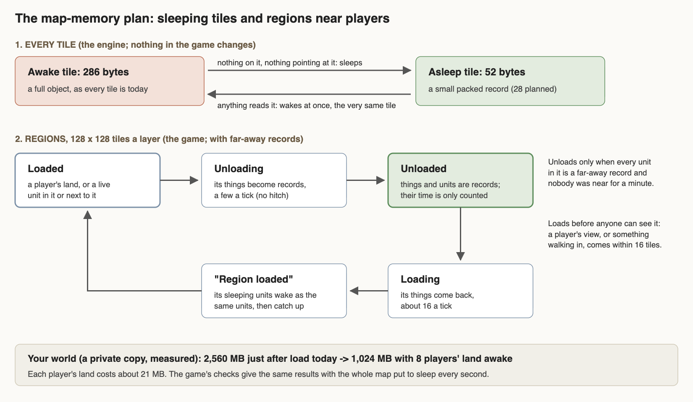
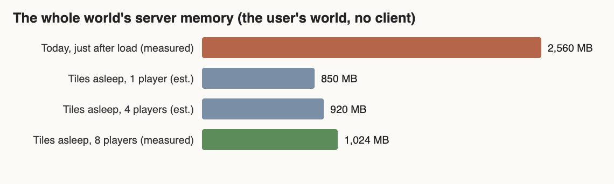
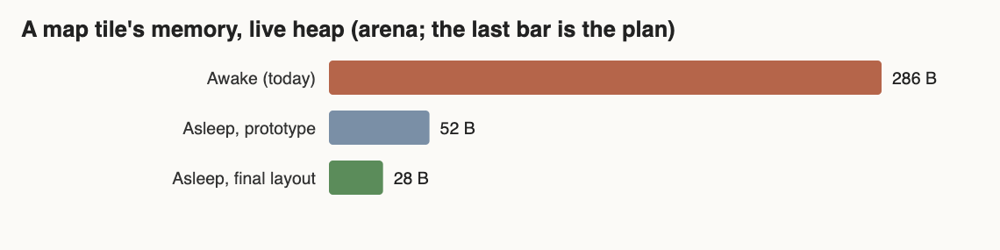

# Map memory (map-memory)

The world's map is most of the server's memory: every one of its 4 million tiles is a full object. This session built
and proved, in a private engine copy, tiles that **sleep**: a tile with nothing on it and nothing pointing at it shrinks
from 218 bytes of objects to a 20-byte record, and wakes instantly and invisibly whenever anything looks at it. The game
plays the same. On your real world (a private copy) the server went from **2.56 GB to 1.02 GB** with eight players'
land awake. The plan is in `planning/MAP_MEMORY.md`.

Status: **design + working arena prototype**; in the game folder only the small fix to how two procs read tiles (the coordinator's OK); the engine change waits for the coordinator.

The plan in one picture: every tile can sleep (top), and whole regions unload when everyone in them is a far-away
record (bottom), loading again before anyone can see them.

The first bar is your world just after it loads today; the others are the same world with the land nobody is near
asleep, for 1, 4 and 8 players.

Per tile: the gap between the first two bars is what every sleeping tile gives back.

## Done
- **In the game now (the coordinator's OK):** the world save's tile signatures and the world map's colours read the
  tile's values directly instead of making and keeping an extra object on every tile they touch. Same results, checked
  on every tile (see Numbers). Restore point: restore-points/before-tvars-reads-20261024.
- Agreed one contract with far-records for regions and far-away units: a region unloads only when everyone in it is a
  record; it loads first, then its records wake; records bank their time while their region is unloaded; places are
  coordinates, never live links. It is in `planning/MAP_MEMORY.md` section 4, with the step-by-step plan for wiring it
  all into the game in section 9.
- Measured where a tile's memory goes: the tile's object (144 B), its cell (40 B), its empty things list (32 B), plus
  what stays (its slot, its ref, its area's list, the client map's tile: 68 B).
- A private engine with sleeping tiles: a tile nobody holds becomes a small record; any read wakes it with the same
  ref, values, look and area. No game code changed.
- A real piece of the world as a test map: a 256x256 window of the real land, all four layers (mountains, desert,
  grass, water, trees; caves, lava and chasms below; peaks and sky above; hell), with the map's own things.
- A lived-in region on it (128x128, four layers): mined mountain columns, ramps, carved runs, a road, tended and felled
  trees, walls and floors, a lift, water, a dragon lair, a dug cave hall, items and piles on the ground, a campfire, a
  carpentry, a claim banner. Its things became records and its tiles slept; it woke and its things came back.
- Checked, all passing (`tests/map_memory_test.dm`):
  - every value of 73,984 tiles and of every thing on them the same after a sleep and wake;
  - the 3D view (three layers), the things in view and the HUD world map built across a sleeping region's edge are
    the same as awake;
  - a unit walked from awake land into a sleeping region, and mined a block there.
- The obey arena's 32 order checks with the whole map put back to sleep **every second**: the same result in all 32
  as without sleeping (the 6 that fail are the old chop cases that fail on every engine), no errors.
- Found two hidden per-tile costs in game code for the owners: the world save's tile signatures and the world map's
  colours read tiles in a way that leaves an extra object on every tile they touch.
- Found a hidden engine cost: the areas' tile lists kept room for 8.5 million tiles for the world's 4 million (171 MB).
  Trimming them is a one-line fix worth 75 MB on its own.
- Ran it twice on your real world (a private copy of the map and save; your saves checked unchanged).

## Numbers
| | Before | After |
| --- | --- | --- |
| a tile's live memory (arena, real map tiles) | 286 B | 52 B asleep (prototype), 28 B planned |
| what a sleeping tile's record takes | - | 20 B (first version 42 B) |
| putting the whole 262,144-tile test map to sleep | - | 45-98 ms |
| waking a 128x128 region | - | 1.6-5.6 ms (engine), 4-12 ms read tile by tile |
| a lived-in 4-layer region (65,536 tiles, 68 things): its tiles' objects | 16.8 MB awake | 1.6 MB asleep; tiles sleep in 4-21 ms, things in 43-75 ms |
| that region as a file (deflated) | - | 174 KB tiles, 1 KB things |
| the obey arena with the map slept every second | 26/32 | 26/32, the same cases |
| your whole world, server memory (no client) | 2,560 MB | 1,024 MB with 8 players' land awake (~850 MB with 1) |
| your whole world, every tile that can, put to sleep | - | 3,989,971 of 4,000,000 tiles in 1.9-4.1 s |
| what the world wakes by itself in a minute of play | - | 26,721 tiles, put back to sleep in 0.33 s |
| world save signing a 16x16 chunk (the fix, in the game) | 262 B a tile, 256 extra objects | 125 B a tile, none; the same signatures on all 262,144 tiles |
| world map colouring an explored area (the fix) | one extra object a cell | none; the same map on all four layers |
| a world save after play (the fix) | 456 tiles written | the same 456 |

## In progress
- Nothing running. Next steps are the coordinator's call (see Needs the user).

## Needs the user
- Nothing. The coordinator decides whether the engine change (and the one-line area-list trim, worth 75 MB on its own)
  goes into the next engine build with formations' v6; the order is in `planning/MAP_MEMORY.md` section 9.
