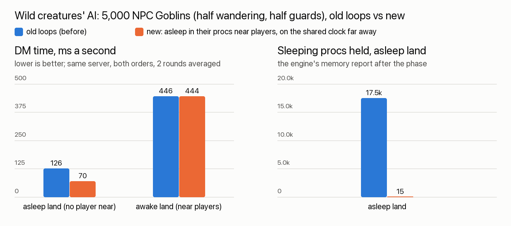
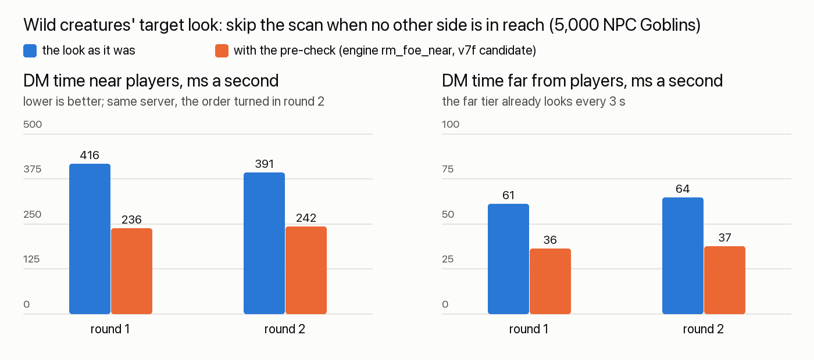

# rts-feel: 2026-10-24

Wild creatures far from every player now cost about half as much to run and hold almost nothing in memory. Creatures
near players behave and cost exactly as before. Next: making wild creatures near players cheaper (the user: "this isnt good").

## Done
- **Wild target looks, game side (landed 01:00).** Wild creatures now ask the engine "is anyone of another side within
  reach?" before their expensive look. On today's engine the answer is always "look", so nothing changes until v7 is
  installed; with v7 the same answers come about 40 % cheaper near players. Also fixed: a creature given a second wander
  loop now rests on each loop separately, as in the original.
- Disk: cleaned up ~4.6 GB of my test copies and leftover test folders.
- **Wild creatures' AI loops (landed 23:38).** Each wild creature's own loops (wander, guard, guard's way home, gear,
  "stay local") sleep as before while a player is near. Where no player's camera, units or workshops are near, they stop
  holding a sleeping proc and wait on the shared unit clock instead. They also look round every 3 s instead of every step
  if they have nothing to do. Walking somewhere is never slowed, so raiders still arrive on time.
- Rechecked after midnight on a fresh copy of the game as it is now: the timing test and the beast, capture, raid,
  orders and combat checks give the same results as before the change.
- Proof: a timing test runs the old loops beside the new ones on twin creatures. Every wake is on the same tick, including
  when a creature's land goes to sleep and wakes again mid-walk. The beast/taming, capture, raid, orders, combat and
  Guard checks at speed 4 gave the same results as before, row for row.
- Tried first and dropped: everything on the clock. It was exact, but 33 % dearer near players, because a clock run costs
  more than the engine's own sleep for loops that wake every step.
- Found: the 5,000-unit stress test's "wild goblins" were never wild (plain goblins use the owned walk loop), so its
  numbers said nothing about wild AI. New tests use the real wild NPC types.

## Numbers
- **The look fix on the installed engine (v7f, 07:2x):** 5,000 wild goblins near players went from about 37 to about
  24 ms a tick (-35 to -38 %); far from players -31 to -37 %. Same answers and dice rolls as before.

Left: what each phase costs the server (lower is better). Asleep land drops by almost half; awake land is unchanged.
Right: sleeping procs held far from players, 17,515 down to 15.

| 5,000 NPC Goblins, one server, both orders | old loops | new |
|---|---|---|
| far from every player, DM ms a second | 130 / 123 | 77 / 62 (−41 % / −50 %) |
| near players, DM ms a second | 473 / 418 | 477 / 412 (same) |
| guards' target looks a second, far away | 2,500 | 833 |
| sleeping procs held, far away | 17,515 | 15 |

## In progress
- **The chop hitch (your report, 08:4x): found, fix proposed.** It isn't the server and it isn't units changing to their
  chop pictures. Each time the selection changes, the HUD rebuilt the whole Controls drawer, about 100 command rows,
  even though the drawer is closed: 29-34 ms each time, sometimes twice in one frame. That's the 2-3 stutters you felt.
  The fix builds the drawer only while it's open. Tested in a copy: the stutters at each order drop from 8 frames over
  33 ms (worst 77 ms) to 1 frame of 36 ms. Landed 2026-10-25 10:15 (see devlog/2026-10-25/rts-feel.md).
- **Cheaper target looks for wild creatures (game side landed 01:00; on since the v7f engine was installed, 06:4x).** A wild
  creature checks first, in the engine, whether anyone of another side is within reach, and skips the expensive look
  when nobody is. Answers and dice rolls are exactly the same as before, in 10,029 test looks. Near players this cuts the
  wild creatures' cost by about 40 % (from about 40 to about 24 ms a tick for 5,000). It needs a one-line fix in the v7
  engine candidate: it didn't recognise wild creatures' sides, which are names like "{NPC Goblins}". Formations has the fix.
  
- Wild creatures near players (the user: "this isnt good"). Profiled: 5,000 wild goblins near players cost about
  45-50 ms a tick. 41 % goes on looking for a target (oview scans that find nothing), 30 % on wander steps, 21 % on the
  loops themselves.
- Proposed, waiting for the user: (B) creatures nobody can see wander and look more slowly, and snap back within a second
  of coming into view. With the cheaper looks, an estimated ~11-13 ms a tick. It changes things off screen (an unseen
  fight starts up to ~3 s later), so it's the user's call.

## Needs the user
- Nothing yet.
