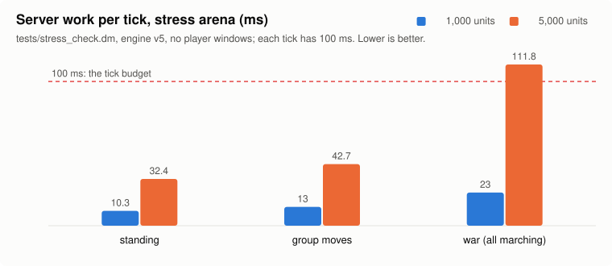
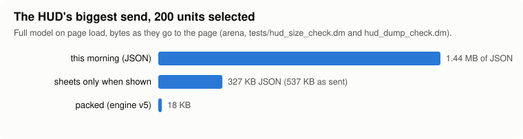

# server-cost, 2026-10-24

Tonight's theme was "don't redo what didn't change". Nine changes are in the game: orders, the skills pass, the
minimap, the first-step budget and its later batches, the friend's-tile rule, the new walk loop, the bed checks and
the track's passes. Each one does the same work in the same
order as before, just less of it, and each has a restore point. A standing 30,000-unit world was profiled by system,
and the biggest piece of it (idle units looking every tick) is gone with the new walk loop.

## Done

- **Engine v5 installed** (17:0x): formations' faster group orders, HUD sends packed by the engine, the memory patch.
- **HUD sends packed, HUD full send cut** (see Numbers).
- **Shared unit clock** for hunger, tiredness, bleeding, healing, beds and regeneration: every job runs on exactly the
  ticks its old loop did.
- **Tests on the app's engine**: the five behaviour checks give the same results on the replica's engine and the app's
  (reports/server-cost/engine-parity.md), and they now run at speed 4 by default.
- **In the game tonight** (each with a restore point, compiled and checked on game/ itself):
  - **Orders pass**: units with nothing to do skip the four checks that would return at once (36 to 24 ms a pass at
    5,000 idle units), and the touch loop only looks at units that moved.
  - **Skills pass, change-driven**: a unit whose 32 skill values didn't change since the last pass skips the rest. A twin
    test (old code against new on identical units, 1,200 rounds) found 0 differences. The pass now also pauses between
    units when the tick is full.
  - **Minimap**: a newly explored 16x16 area flips its one cell instead of rebuilding all 2,304.
  - **Lag signal** (Shed.dm): how far the server is behind real time. When it is behind, the HUD's and the 3D view's
    background parts refresh less often; orders, moves, health, combat and selection never wait.
  - **First steps at a click**: a click sets off as many of a group's first steps as fit in 8 ms of its tick (it was 2
    units). A group of 30 now starts in 13 ms on average (was 86 ms); an attack-move of 10 in 42 ms (was 62 ms).
  - **Never left on a friend's tile** (00:36): two lines of one side meeting head-on in a one-tile corridor could end
    with two friends stopped on one tile and no free tile beside them. Now the one with nothing to do walks through its
    own side to the nearest free tile, quietly, still saying "Got as close as it could". Before this, the new walk loop
    hit that case 150 times in the corridor check; now it's 0 for the game as it is and for both new walk loops.
    5,000-unit cost unchanged (standing 41.4 / 42.0 ms a tick, moving 46.0 / 46.7, war 113.4 / 112.2).
  - **Standing units cost almost nothing** (walk loop v2e, 00:5x): a unit with nowhere to go no longer wakes up to
    look. Its walk sleeps until something gives it somewhere to go. Idle looks go from 10 a second to 0. With 5,000
    units standing, the server's cpu falls from 122% to 58%; with 30,000, from 1,158% to 372%. Every first step after a
    click lands on the same tick as before (380 of 380, unit by unit).
  - **Beds checked only for tired units** (03:0x): every unit used to be asked "tired, and on a bed?" five times a
    second. A rested unit's answer is always no, so the clock now just books its next check without asking. Same ticks,
    same order. With 30,000 units standing that saves a fifth of the server's work (174.9 to 139.0 ms a tick).
  - **No more multi-second hitches from a big village** (03:2x): care, bags and builders now pause between units when a
    tick's share is used, and the carry pass only looks at units being carried. With 30,000 units the worst tick the
    player's track held went from 2.8 s to 0.16 s, and a standing tick from 144.6 to 124.5 ms.
  - **Big groups start together** (03:5x, found by formations): after the click's tick, the rest of a big group's first
    steps went out a fixed 24 a tick, so a 200-unit block's back rows waited 3 ticks or more. Now as many go each tick
    as fit in a quarter of it. The back rows' long waits went from about 350 in a sweep to none, and a 200-unit move's
    average start from 2.6 ticks to 1.2.
  - **Attack-moves don't look when nobody's there** (07:2x, with engine v7f): an attack-move used to scan 6 tiles round
    every unit every tick for an enemy. Now the engine first says whether any other owner's unit is in that square; if
    not, the scan is skipped (it would have found nobody). Attack-moves of 10 now all step off in the click's tick, and
    a 5,000-unit war costs 18% less (126.3 to 103.5 ms a tick).
- **Found and handed on**: the big-list key scan (to formations, fixed in v6), why 200-unit groups stalled (formations
  fixed it), the 3D terrain timing check failing on a loaded Mac (to world-look).

## Numbers

| Walk loop v2d (5,000 units, side by side, same load) | today's game | v2d |
|---|---|---|
| standing | 80.9 ms a tick | 70.0 ms (−13%) |
| group moves | 76.6 ms | 69.2 ms (−10%) |
| war (everyone marching) | 192.8 ms | 192.6 ms (same) |
| idle unit looks a second | 10 | 2.5 |
| first steps, unit by unit (380) | — | all identical |

| First step after an order (tests/walk_latency_check.dm, ticks of 100 ms) | this morning | first-step budget | now in the game |
|---|---|---|---|
| single move | 0 | 0 | 0 |
| group of 30, mean | 0.86 | 0.13 | 0.09 |
| attack-move of 10, mean | 0.62 | 0.42 | 0.12 |
| idle walk looks per unit a second | 10 | 10 | 0 |

| Standing 30,000-unit world (loaded Mac, before tonight's walk work) | ms a tick |
|---|---|
| idle units' walk looks (every unit, every tick) | 163 |
| waking all those sleeping loops ("other DM") | 299 |
| the per-player track (12 runs a minute instead of 120) | ~60 |
| bed checks (6,000 a tick) | 18 |

## In progress

- **First steps under 10 ms**: the budget will charge each step's measured cost; formations is making each unit's first
  step cheaper (a shared mates list and a one-tile first step); an engine pre-check skips an attack-move's look when no
  enemy is within 6 tiles.
- **Engine watch (v7 candidate, not installed)**: the engine tells the game which units had a watched variable written,
  so parked walk loops, the skills pass and bed checks only touch units that changed. Its completeness test passed.
  formations measured its cost: nothing when unused, but 15–19 ns on every variable write once anything is watched.
  That would eat the gain at 30,000 units, so the game won't use it until a leaner version (v7f) brings that near 0.

## Needs the user

- The engine watch (v7) needs your OK before it's installed, as every engine change does. Nothing to decide yet.
- The 2D layer: the click audit on the hidden-map build hasn't completed (twice it failed in its own setup, not on a
  click), so it isn't in yet.
