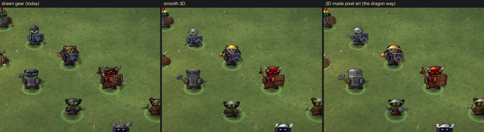
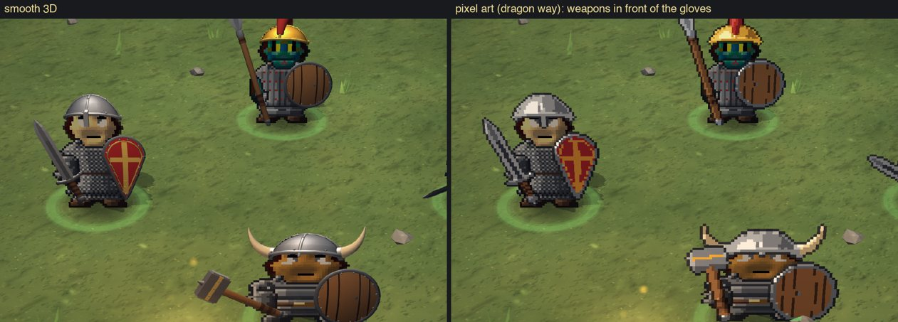
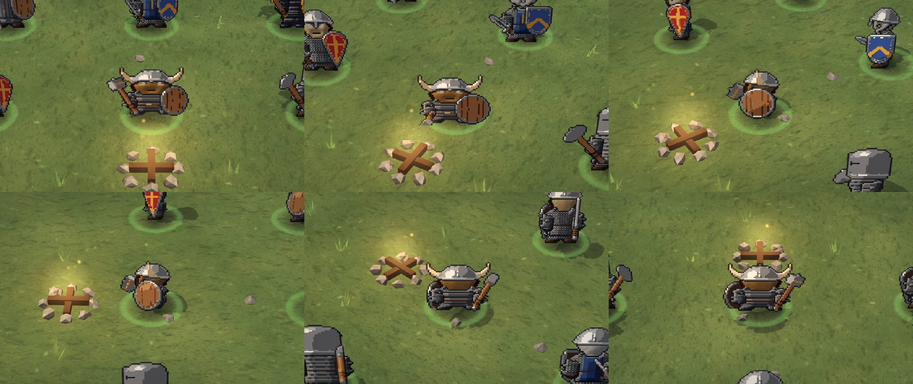
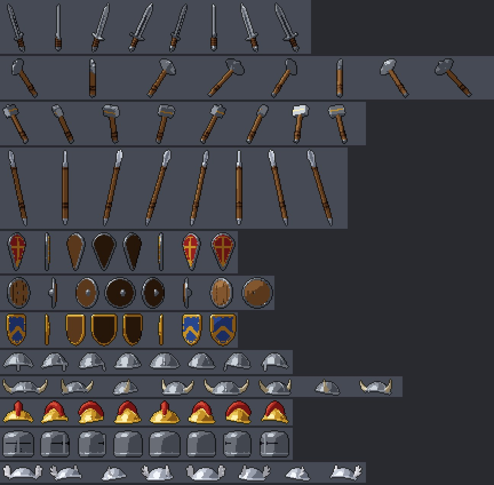
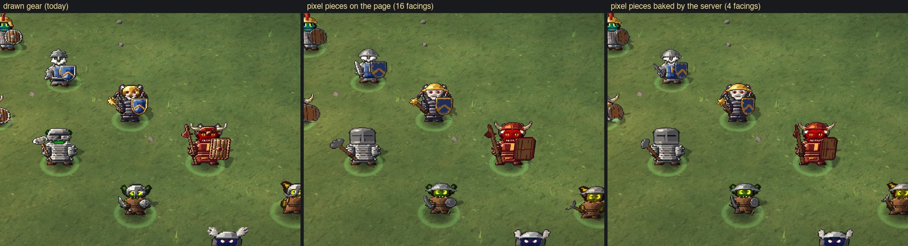
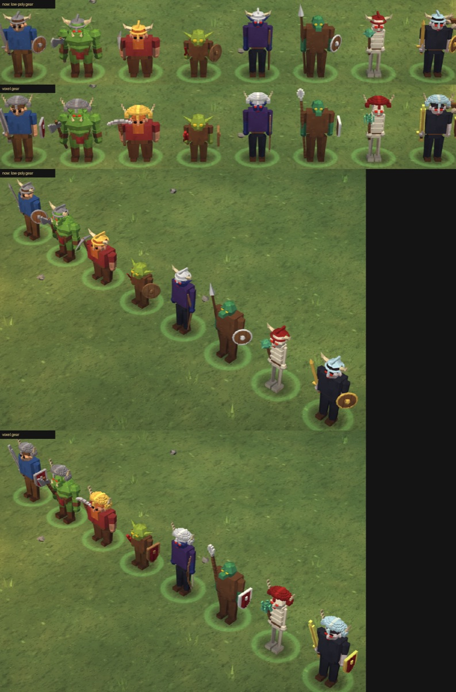
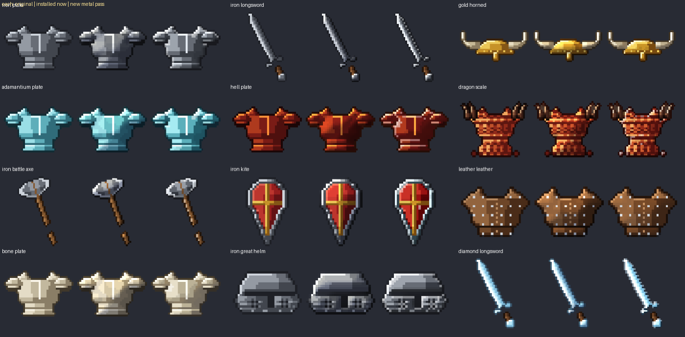
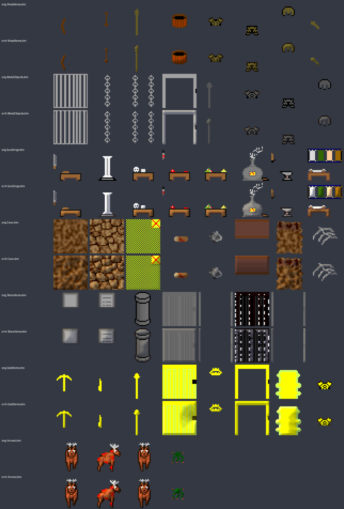
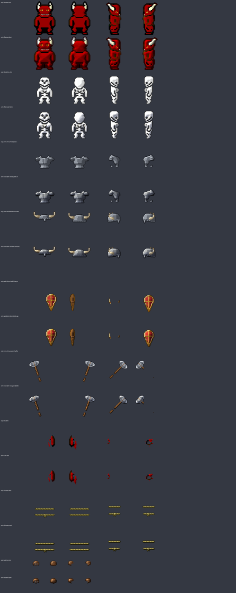

# Unit sprites, gear and world icons (unit-sprites)

Every unit, armour, weapon, limb and rope sprite, and the world icons the 3D view draws (items on the ground,
workshops, built walls, bag icons), is reshaded: rounded light and shadow, softer black gaps, a warm outline. Armour
and weapons then got their own metal pass: crisp edge light and a glint on metal, gentle shading on wood and leather.
The swastika icons the original game carried are gone from every file in the project.

## Done
- **3D weapons, shields and helmets on the 2D units: preview** (not in the game yet). The unit stays its sprite; what
  it holds and wears on its head is modelled in 3D (all 13 weapons, 5 shields, 6 helmets, from the drawn pieces'
  own measurements, with wrapped grips, fullers, rivets, banded helmets and trimmed shields), held at the sprite's
  own fist, forearm and head in every facing and walk frame, turning as the camera goes round. Weapons sit in front
  of the gloves; a piece on the far arm hides behind the body. Attacks swing the weapon up beside the head and down.
  Then made pixel art **the way the dragons were**: each piece rendered from 16 facings (weapons in 4 swing poses),
  coloured in flat bands from the same ramps as the drawn gear, hard pixels at the units' own pixel size, the dark
  outline, and the facing nearest the camera drawn on the unit. Helmets are rendered over a hidden head, so they
  stop at the brow. Both versions run on the GPU: 200 armed units cost 0.8 ms of page time a frame (drawn gear 0.6 ms).
  
  
  
  
- **3D pixel gear made cheap.** Timed directly in the page (frame times swing by about a millisecond while other
  sessions run games, and the timer counts in 0.1 ms steps): with the camera-only work done once a frame and a
  still unit's cards kept with its other records, the pieces cost 0.06 ms a frame at 200 units (0.14 microseconds
  a unit placed, plus 24 draw calls), 0.3 ms at 2,000. The user's idea, the server baking the pieces into the
  unit's own picture as it does the drawn gear, costs the page nothing more than today: bake64.py writes the 3D
  pixel pieces into Gear64 sheets (the four picture facings, walk frames, wind-up and blow), at each race's own
  fist, forearm and head. It turns with the body's four facings instead of sixteen.
  
- **Gear test arena** (browser pane, the game's real 3D page): drawn gear, smooth 3D live, smooth 16 facings, pixel
  from smooth (the smooth renders made pixel art the dragons' way: a fixed palette per piece, the outline), banded
  pixel, and baked by the server; turn, spin, zoom, tilt and night. The user prefers 16 facings.
- **Weapons in the real fists**: each race's fist is read off its own pictures (the whole body minus its armless
  picture is that arm; its far end the fist), per facing and walk step; the template's point kept where the arm is
  hidden or the original's armless picture lacks the other arm. Orcs, goblins, kobolds, frogmen, vampires, demons
  and gargoyles moved most (5 to 12 px on average).
- **Shields from behind**: drawn in front of the body (only the far-side view hides them), with a proper back:
  planks, two leather arm straps with rivets, a grip.
- The no-window preview had drawn every unit at half brightness (its recorded scene has no portraits, which the
  page takes as "no picture yet"); it now sends one as the game does.
- **Voxel weapons, shields and helmets: first preview** (not in the game; the user chose smooth 3D, then pixel art, instead). Sword, axe, mace, spear, dagger, pickaxe,
  bow, shield and helmet rebuilt out of blocks one sprite pixel big, shaded like pixel art, fitted to the same hand,
  forearm and head points as today's gear so they swing with the animations. Shown on the real 3D page in a
  no-window preview (headless Chrome), with the "models" look on: units only wear these 3D pieces in that look
  (Settings > Look > models); the default look draws the unit sprites, which use the reshaded sprite gear.
  
- **Armour and weapons metal pass installed** (531 files: worn 64 px gear per race and tier, the 32 px item pictures,
  the original game's armour and weapon icons). Metal keeps the sprite's own drawn plates and gets more contrast, a
  bright edge facing the light, a darker far edge and a glint; adamantium, hell, diamond and dragon count as metal.
  The hair, beard and female look layers kept the soft pass. Not built yet (builds on hold).
  
- **Swastika icons removed everywhere** (user's order): Icons/Nazi.dmi and Icons/NaziClan.dmi, 388 copies across the
  game, the Classic replica, tests, restore points and old apps; their entries in 186 manifests and reports; the asset
  library page; the copies inside 44 zip archives. Nothing ever used them. They came in with the 2013 commit "Change to
  Felix Rose's version". The replica's file list was updated for its rewritten shareable zip.
- **Clean-up in Remastered**: the welcome/rules popup line "calling people retards" now reads "call people names"; the
  carryable flag shows the plain Good Flag instead of the Soviet flag; the Soviet flag and the "Communists" clan banner
  and tapestry pictures are deleted. A full search found no racist words or symbols.
- **World icons installed** (143 files): items on the ground, workshops, built walls and the bag icons, reshaded.
  Doors, gates, trees, rock and floors are 3D models and painted textures, so they don't use these.
  
- **Unit, gear, limb and rope sprites installed** (669 files), app rebuilt and launched with a Human army.
  
- Every installed file keeps its exact size, transparency, states, facings, frames and timing (checked file by file),
  so all animations and missing-limb variants line up as before. Originals: `restore-points/sprites-before-enhance-20261024`
  and `restore-points/world-icons-before-enhance-20261024`.

## Numbers
| what | files | pixels reshaded | checked with |
|---|---|---|---|
| unit, gear, limb, rope sprites | 669 | 94 % | size/alpha/metadata vs originals |
| world icons | 143 (of 163) | 90 % | same |
| armour and weapons metal pass | 531 | 93 % | same |
| swastika icon copies removed | 388 files + 186 lists + 44 zips | | search for the name: 0 left |
| 3D gear pieces (preview) | 24 meshes, 1,040 pixel renders | | gear's own page time at 200 units: 0.06 ms (baked: none) |

## In progress
- 3D gear into the game, two ways ready: baked (bake64.py for every race, style and tier into Gear64, backed up
  first; no page change) or drawn by the page (the server sends each unit's pieces and leaves the drawn ones out;
  gear3d.js into remastered.html). Then a build. Body armour stays drawn for now.

## Needs the user
- Judge the reshaded sprites and the metal pass in the 3D view at game zoom, day and night, after the next build.
- Pick how the 3D pixel gear goes in: baked by the server (4 facings, no extra cost) or drawn by the page (16 facings, 0.06 ms at 200 units).
