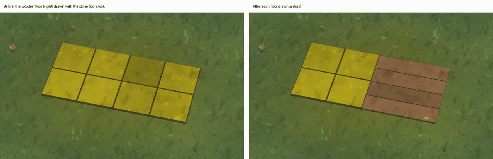
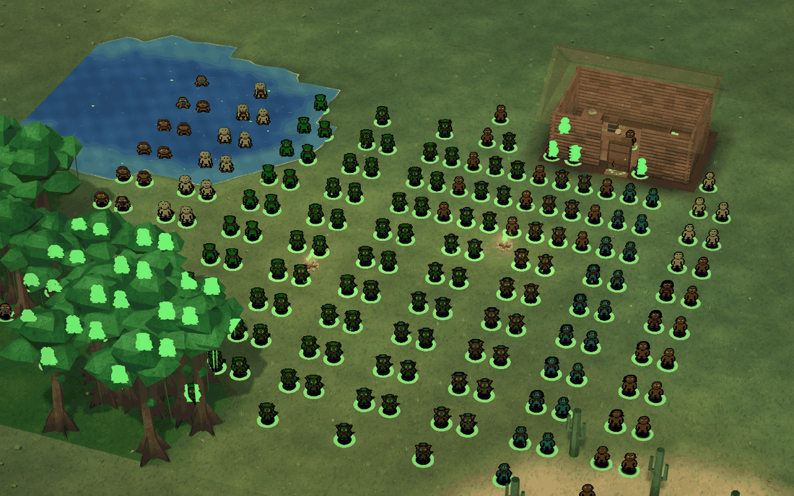
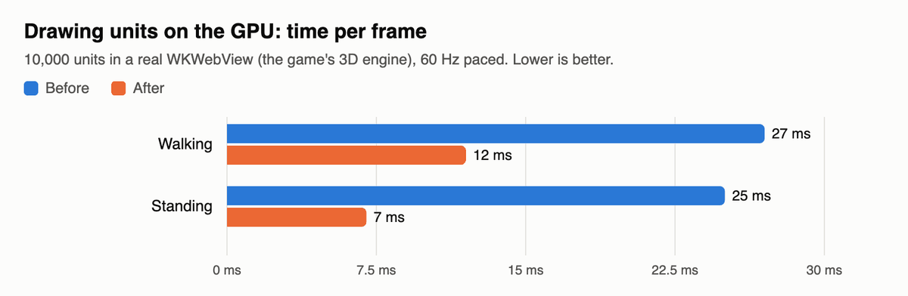
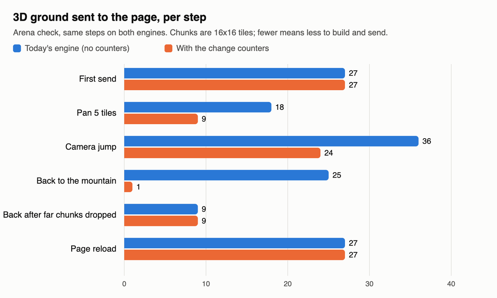
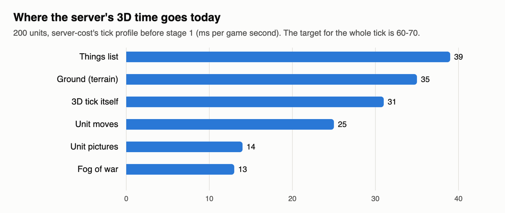
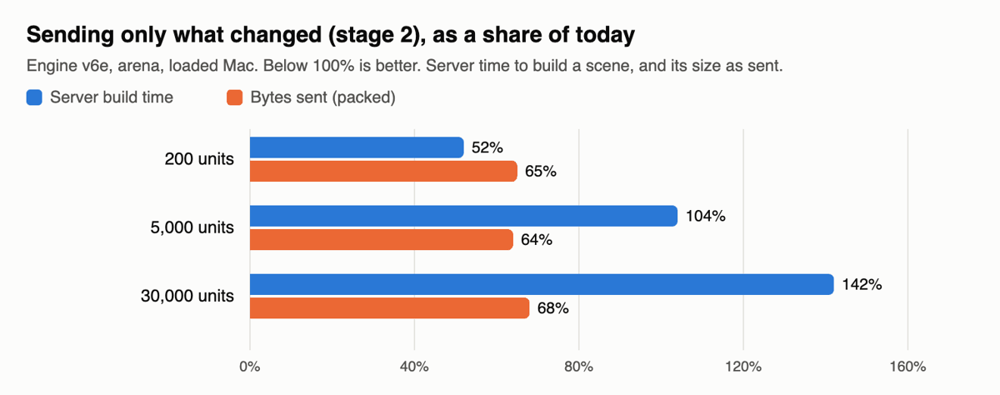

# World look (3D view): 2026-10-24

The 3D view got faster at big crowds today. Units are now drawn on the graphics card, and a 10,000-unit scene went
from 27 to 12 ms per frame. The server is learning to send only the parts of the ground that changed. The engine now
counts changes per 16x16 patch of map, so the 3D view will rebuild and send only patches that actually changed. That
part is in the game now. The counters themselves come with the next engine build.

## Done
- **3D ground as patches is in the game** (goes into tonight's checkpoint build). It works on today's engine, and once
  the new engine is in, the server rebuilds only the patches that changed. The 3D scene work now also stops at more safe
  points, so no single moment carries all of it. Its sends are compressed like the HUD's. Checked on the game itself:
  all 41 test steps match the old picture on both engines.
- **Engine change counters (built, tested, not installed yet).** The engine now counts changes for each 16x16 patch of
  ground and for each unit. Walking armies don't count as ground changes, so the ground stays quiet while units move.
  It goes into the next engine build (v6, put together by formations) and needs your OK like every engine change.
- **A floor-colour bug fixed along the way.** Two floors that looked the same except for being wooden could both be
  drawn like the first one. Now each is drawn as itself. Checked tile by tile over the whole test: only that one
  floor changed, everything else is identical.
  
- **3D ground sent as patches.** The page keeps the ground in 16x16 patches and puts the view together from them, so
  the picture is exactly the same. Checked step by step through:
  - mining and digging out a tile;
  - building walls and a workshop;
  - felling a tree and adding water;
  - panning, a camera jump, caves and back;
  - stairs on the floor above;
  - a page reload;
  - far patches dropped and sent again.
- **Units drawn on the graphics card** (earlier today, in the game). Each unit's picture, shadow and ring is one small
  record, and a unit standing still costs almost nothing per frame.
  
- **Health ring** on selected units (as you asked: "keep the ring but on selected units also show it").
- **Fog of war:** a missed corner tile and long-sight units fixed. Allies now share what they see, and share their
  memory of the map when they join (each keeps everything if you go to war).
- **Panning freezes:** the far view, horizon and texture uploads are now spread over several frames.

## Numbers
| What | Before | After | Test |
|---|---|---|---|
| Frame time, 10,000 units walking | 27 ms | 12 ms | real WKWebView, 60 Hz paced |
| Frame time, 10,000 units standing | 25 ms | 7 ms | real WKWebView, 60 Hz paced |
| Ground patches sent on a 5-tile pan | 18 | 9 | arena, same steps on both engines |
| Ground patches sent coming back to a place | 25 | 1 | arena |
| Ground changes the counters missed | — | 0 of 380 | arena, 911 random ground edits |

**Your 200-unit game on the server**, real window, a loaded Mac (compare the rows with each other):

| | 3D work each second | Slowest 3D moment | Moments over 100 ms (of ~1,750) | Behind real time (in 3 min) |
|---|---|---|---|---|
| Before tonight | 141 ms | 333 ms | 356 | 10.2 s |
| Ground as patches | 98 ms | 114 ms | 111 | 5.0 s |
| + 3D work spread out | 75 ms | 51 ms | 39 | 2.8 s |
| + new engine (6e) | 19 ms | 70 ms | 76 (mostly not 3D now) | 2.0 s |

The last chart is the server's 3D work today at 200 units. The ground bar (35 ms a second) is what the counters
remove: with them, the server rebuilds only patches that changed. I'll add the after numbers here once the 200-unit
profile has run on the new engine.

## Sending only what changed for units ("stage 2"): numbers for you to decide (it stays off)
You asked to see stage 2's numbers on engine 6e before turning it on. It sends each unit only when something about it
changed, instead of every unit twice a second.

| Units in view | Server time per scene, today → stage 2 | Size per scene (packed), today → stage 2 |
|---|---|---|
| 200 (your game) | 29 → 15 ms (slowest 59 → 24 ms) | 2.9 → 1.9 KB |
| 5,000 | 269 → 280 ms | 51 → 33 KB |
| 30,000 | 6.3 → 9.0 s | 264 → 179 KB |

- **Good:** at your 200 units the server's 3D work for units is halved, its worst moment goes from 59 to 24 ms, and the
  sends are a third smaller. On the client the scene update drops from 15 to 10.5 ms at 30,000 units.
- **Not good yet:** at 5,000 and up it costs the server more, because stage 2 turns every unit into text separately
  just to see what changed.
- **My recommendation:** keep it off for now. Next I'll make the server skip units that didn't change at all, using
  the new engine's change counters; that fixes stage 2's problem at large sizes and also cuts today's cost. Then turn
  stage 2 on.

## Units that didn't change now cost the server nothing (landed late tonight)
- The server no longer rebuilds the 3D description of units and objects that haven't changed. It uses the new engine's
  change counters to know. Checked against a fresh build every time in a busy fight: 0 differences out of 30,796
  reused.

| Units in view | Server time per scene, before → now |
|---|---|
| 200 | 21 → 13 ms |
| 5,000 | 198 → 91 ms |
| 30,000 | 1.9 → 0.5 s |

- With this in, "sending only what changed" (stage 2) would make everything better than today at every size: 6 ms
  at 200 units, a third of the data sent. It's still off; the coordinator is bringing you the choice.

## A lost-order bug fixed (after midnight)
- A unit made or arrived a moment ago, ordered to attack an enemy only it could see, used to give up at once and stand
  Idle: the fog of war hadn't counted it yet. Now it goes for the enemy. Checked with the capture, fog, combat, raid
  and order tests.

## Landed tonight
- **3D work on the server now spread out.** No moment carries more than about 10 ms of 3D work. When the server falls
  behind, the far view, the other floors and the fog update less often; your units, their moves and health never wait.
- **30,000 units in the 3D view** (below).
- Both are in the game's files and come with the next app build.

## 30,000 units on screen
- In the 3D view, units that stand still or simply walk now cost almost nothing per frame. Units entirely off screen are
  skipped. The picture is unchanged: every unit's drawing data matched today's exactly, walking frames included, and
  skipping off-screen units changed no pixel at all.

| Units on screen (real WKWebView) | Before: typical / slow frame | After: typical / slow frame |
|---|---|---|
| 10,000 | 11 / 13 ms | 5 / 10 ms |
| 30,000 | 35 / 40 ms (every frame too slow) | 12 / 27 ms (1 frame in 10 too slow) |

- The frames still too slow are the ones right after the server sends a new scene. "Sending only changes" (stage 2)
  is what fixes those; its numbers are being measured for you to decide on (it stays off until you do).

## In progress
- The engine with the change counters (6e) is installed. The 200-unit before/after profiles of tonight's server work
  are running in a real window.
- Next: the server skips units that didn't change (see stage 2 above).
- After that: 30,000 units on screen at a steady 60 frames a second (tonight's goal), then easing the fog and far-view
  refresh when the server is behind.

## Needs the user
- Nothing tonight. The engine v6 install will come to you as one change, through the coordinator.
