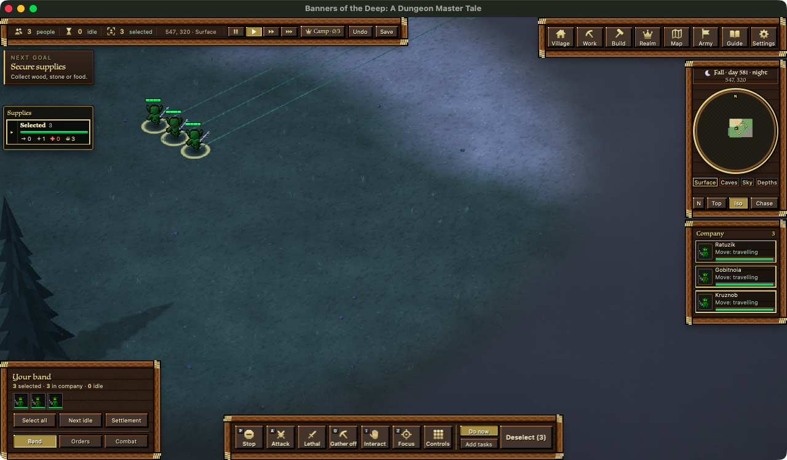
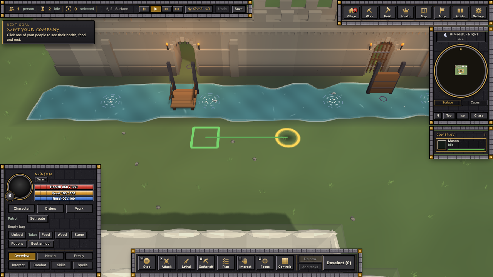

# 2026-10-25: the day's summary (coordinator)

**Where the app stands tonight: build 56, engine v12e** (v11 + the save fix + the unit grid). The day started on engine
v8 (the morning baseline below) and went v8 → v10 → v11 → v11 + save fix → v12e.

## The baseline build (07:36)
You asked to put everything that was ready in and rebuild, and start from that point. This is that build. Its state is
saved in `restore-points/baseline-20261025-0737/`.

New in it since the 06:50 build:
- **Engine v8.** Group-move planning runs in the engine: a 5,000-unit click 128 → 92 ms, 30,000 399 → 314 ms. Every
  unit goes to the same spot as before (checked on 20 layouts and 200 random moves).
- **Attack-moves skip the enemy search when no enemy is near (server-cost).** A 5,000-unit war 126 → 104 ms a tick
  (−18%); an attack-move of 10 starts in the click's own tick.
- **3D stage 2 (world-look).** For scenes of up to 4,000 things only the changes are sent: at 200 units the scene's
  server work 11 → 6 ms (worst 30 → 11) and a third less data. Bigger scenes get the whole list, which is faster there.

Checked on the installed engines: your own doors open for your villagers (16/16), wild creatures near players
~37 → ~24 ms a tick, walk latency passes.

## Also this morning
- The Mac rebooted at 06:39 and wiped every session's scratch folder and the .NET SDK. The SDK is reinstalled (your OK).
- Formations for armies bigger than 841 are parked: you want war-band-sized real formations (line, column, wedge,
  square, skirmish) instead.

## Midday
- The hidden 2D stat panel was removed. It sent every line of every panel each tick, and it grew the client to 19 GB.
  The game felt lighter at once: at 200 units the server's DM share went from 83% to 21%, and slow ticks from 184 to 6.
- Chat keeps the big events (limbs lost and by whom, deaths and killers, raids, captures, big limb hits, replies to your
  actions) and drops the noise (stun and sleep, blow-by-blow, hungry and tired).
- Health bars can be turned off, the selected unit included. Movement lines are StarCraft-style: shown after an order,
  fading in about 1.5 s, all of them while Shift is held, and one line for a big group.
- Engines v10 (land nobody is near sleeps) and v11 (chat goes the HUD's way) went in. The far-view arrows over your
  distant units are gone; Focus and a double-click in Company find units.
- Mining: a yellow outline on the block being worked. Plan mode: workers carve or build their own way up to blocks
  out of reach.

## This afternoon
- The placement grid now fades: the squares where your units will stand, and the numbers on queued stops, show when
  you give the order and fade out with the movement lines (about 1.5 s). Hold Shift to see them again. A group's
  formation squares do the same now; before, one stayed until its unit stood on it, up to 40 s.
  
- Family and house ids are safe for long-lived worlds: they were built from a clock that doesn't work in our engine,
  so after many restarts two units, or two houses, could share an id (a test founding 600 houses at once lost 18 of
  them the old way, none now).
- The game's background loops run on one clock (the ring fold), and the far land and far records answer to one
  "behind" signal.
- Villagers no longer freeze the server by piling on one tile, and idle workers wait for their work area to call them:
  with 2,000 workers a tick went from 285 ms to 48.
- The camera lands on a unit you double-click, Z or Focus, even while new ground is still loading.
- 3D weapons, shields and helmets on every unit (from the Unit sprites session).

## This evening (builds 29-38)
- Saves keep packaged icons by name instead of copying them: a 200-unit save is 20 MB, not 140.
- The v12 engine with the unit grid: 5,000-unit wars run 15% faster, and the worst tick at 200 units dropped from 551 ms to 92.
- The Sky level: mountains keep their heights and the Sky line sits above them (tall peaks 0% for now). Flyers fly up
  to it and out over open sky, with a faint grid while they're selected; you only see the Sky once one of your units
  is up there. Dragons fly 3/6/9 over the surface and 12/22/32 on the Sky.
- Level switching is smoother, the Sky view lost its rock slab and gained far land at its edges, and water past the fog
  or in a low sun no longer goes pale or white.
- Dead bodies lie down and can be used again (the new doll moves are off until they're fixed), and units drag bodies
  behind them.
- One card for a group Interact (203 units, not 203 cards), and one chat line per group action.
- Fist fights end: knocked out with Non-lethal, finished with Lethal. The old 2006 letter keys are off the keyboard.
- Heavy stone doors: shut until opened, then everyone passes.
- The launch audit: not ready yet; each blocker has an owner (planning/LAUNCH_AUDIT_2026-10-25.md).
- Builds come in batches now, about every half hour, and lock the Mac for a minute or two instead of five.

## Late evening (builds 39-40)
- The doll moves are back on, for you to test: deaths fall and keep their last pose, bodies stay clickable.
- Stone golems rise out of mountains, leaving a gap in the rock, roam near home, and become mountain again when felled
  (2 per 100-tile region, 24 at most).
- 13 new weapon-skill moves, and the elves' face and hair as they were before the reshade.

## Night (builds 41-47): combat that pays and hurts
- The arena's animations are in the game: knockback, golem throws, flung limbs, deaths by weapon, KO lying down,
  haulers carrying loads, shield bashes. Dropped weapons, shields and helmets lie where they land.
- Arrows and throws strike the body part the game picked; a target's Defence lowers an arrow's chance to hit.
- Wounds bleed by a formula, like armour: the health a cut took x (0.5 + 2.5 x how hurt the part was). Bleed-outs
  went from two thirds of duel deaths to under half.
- Severing: a sword or axe cut can take off a hurt arm or leg (45 blood). Limbs now fly in almost every duel, about
  half a minute in, instead of in half the duels near the end. Higher Defence makes a unit harder to maim.
- Bleeding out is a 60-second rescue window instead of a dice roll: the unit falls dying, "Bleeding out 45" over it,
  and a friend, a walker with a bandage or torch, or the Doctor can save it.
- Skills count twice as much: a level-25 fighter now beats a recruit 15 times in 16 (12 before), still in over a
  minute and often maimed. A 4x version made level 50 kill a recruit in 12 s with no limbs ever lost, so it stayed out.

## Still open
- Your play of build 47: how fights feel with severing, the rescue window and skills at 2x.
- Recruits beaten by a trained unit are rarely knocked out; they die to blows, which the rescue window doesn't catch.
- Your test of the doll moves in build 40 (switch: rm_g3_dolls in Gear3D.dm).
- An Enter chat box, with the new chat design (kingdom chat, pigeons, world chat by an item or a spell).
- Launch: Discord login, big-battle lag, a hand-played round of making, building and combat, and a test with several
  players on one server.

The numbers behind all of this: reports/coordinator/summary-2026-10-25.md.
