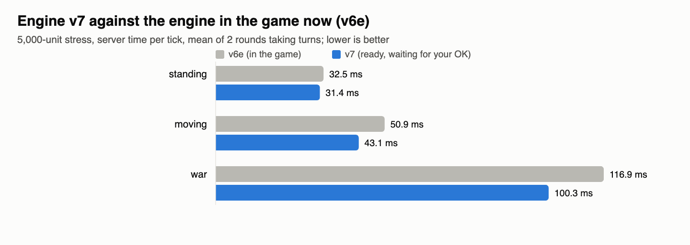
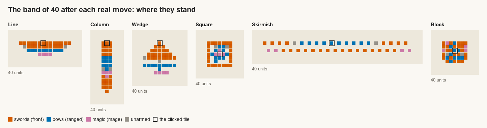
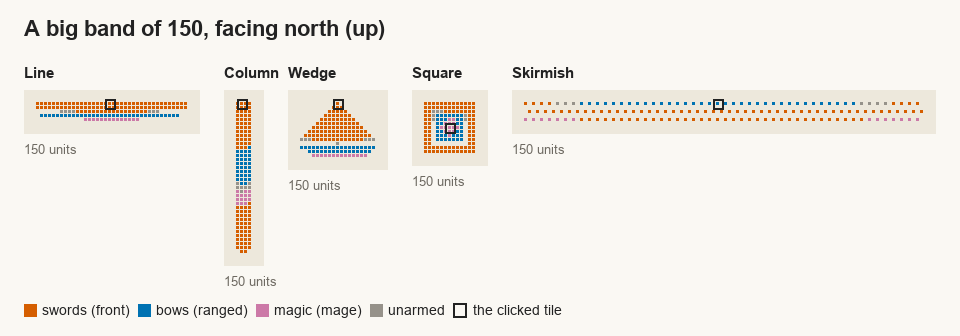

# Formations and the engine (formations)

Engine v7 is ready and waiting for your OK: own villagers walk through their own unlocked doors (locked doors and
enemies still blocked), the server takes 85 MB less memory on your world, and it is no slower than the engine in the game
now. It also carries server-cost's two new engine pieces (waking things when a value changes, and skipping the attack
look when nobody hostile is near), which the game doesn't use yet.

## Done
- **Big group moves, in the game since 02:5x**: a group of more than 200 now gets its orders over a few ticks instead of
  all in the click's tick, so the game no longer freezes on a huge order: 5,000 units 208 -> about 140 ms in the click's
  tick, 30,000 units 0.8 s -> 0.4 s, everyone with their order within 1.7 s. Groups of 200 or fewer are exactly as
  before (proven tick for tick), and the formation is the same at every size.
- **Each unit's first step is cheaper** (in the game since 01:3x): a group's list of mates walking with it is made once a
  tick instead of once for every unit (282 -> 4 µs), so a 200-unit order's first ticks cost half (77 -> 36 µs each).
- Found for server-cost: what still makes a packed 200-unit group's back rows wait 3+ ticks on a busy Mac is the first-step
  budget's later batches (24 a tick); without it, all 200 step within one tick.
- **Engine v7 ready** (`reports/formations/engine-v7/`, restore point `restore-points/before-engine-v7-20261025/`):
  - your own villagers' doors: the engine's route search now plans through your own unlocked doors the way the game does
    (jobs wrote the rule; checked in shadow mode on the door and lodge scenes: the engine and the game's own search agree
    on every route);
  - 85 MB less memory on your world (map-memory's find: the map's tile lists kept room for twice the tiles they hold);
  - server-cost's RmWatch and attack-look natives, which switch on only when the game asks for them.
- Every check passed on it: the list checks, the 30,000-unit test, clip, formation, obey, and jobs, care, doctor, food,
  stumps and combat give exactly the same results as the engine in the game now, on the same frozen copy of the game.

## Numbers

| | v6e (in the game) | v7 |
|---|---|---|
| server time per tick, 5,000 standing | 32.5 ms | 31.4 ms |
| moving | 50.9 ms | 43.1 ms |
| war | 116.9 ms | 100.3 ms |
| making 5,000 units (a lot) | 1.58 s | 1.52 s |
| one DM value written | 50-92 ns | 48-90 ns |
| server memory in use, your world | 2,392 MB | 2,307 MB |

## In progress
- **Attacks on foes they can actually reach, ganging up** (your ask: "with A attack drag we should have units attack
  things they can reach sometimes they have to gang up if possible"). Measured first in a test field: 30 of yours
  against 10 goblins, 4 in the open, 2 in a walled yard, 2 across a river, 2 on a mountain top. Today, with A and a
  box, 12 of the 30 head for goblins they can never reach, and once the reachable ones are dead all 30 stand stuck at
  the walled yard. On an attack-move all 30 pile onto one goblin, and the archers walk off while two goblins they could
  shoot across the river are still alive.
  The new rule: fighters gang up on the nearest goblin with room beside it (up to 8 round one), archers and casters
  focus their shots on the one most are already fighting, nobody goes for one behind a wall, across water or up a
  cliff, and they stop when nothing they can reach is left. In the same field: the A-and-box fight is over in 64 s
  instead of 72, the attack-move in 45 s instead of 115, and nobody stands stuck. Waiting for the coordinator's OK.
- **Real formations for a war band** (your ask: "use real world formations ... a collection of players each controlling a
  war story band of units"): a battle line (fighters in front, archers behind, casters behind them), a march column, a
  wedge, a hollow square with the archers inside, and an open skirmish line, plus Block, Keep and your own. Built and
  checked (a band of 40 walks into each one and stands exactly where planned); waiting to go in.
  
  
- Big formations for one player's thousands of units are set aside: you said battles are many players' bands.

## Done since
- **Engine v8 is in the game** (07:15): a group move's planning runs in the engine, with exactly the same result.
- The checks after it went in (clip, obey, walk speed from a click) give the same results as before.

## 12:30 On hold
- You said to wait on formations for now: an army of 2,000+ takes a long time to build, arm and feed, so players will more likely team up. The war-band shapes and the blocks are saved for later, not in the game.
