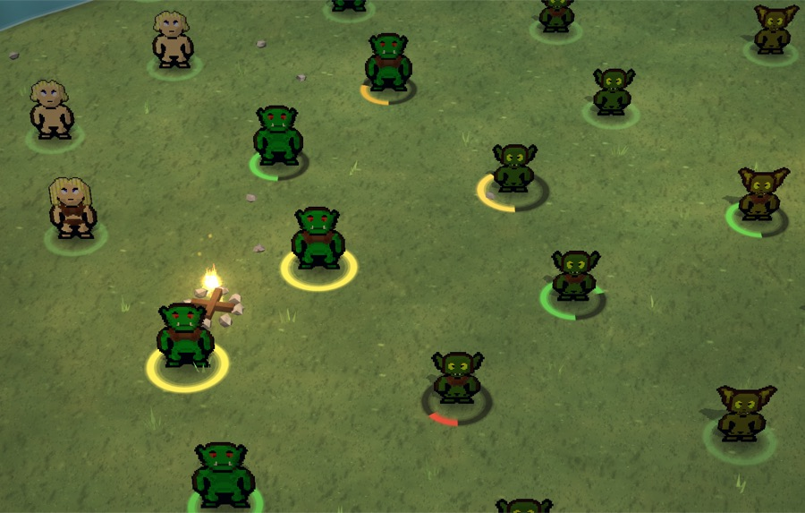
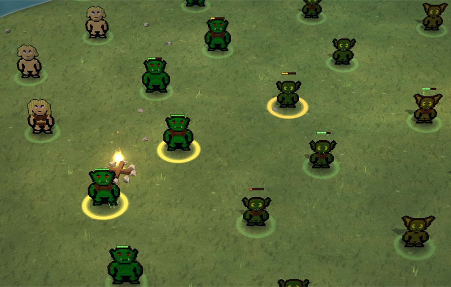
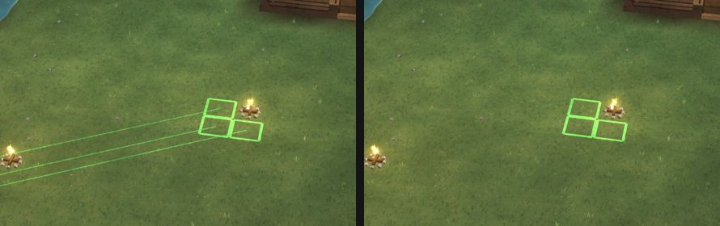
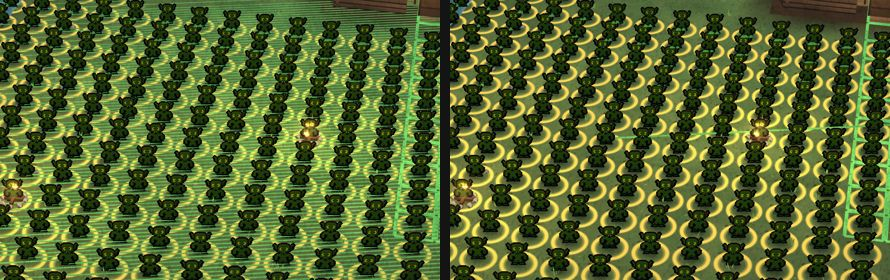
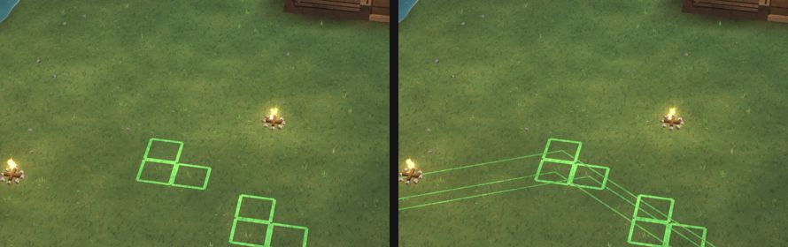
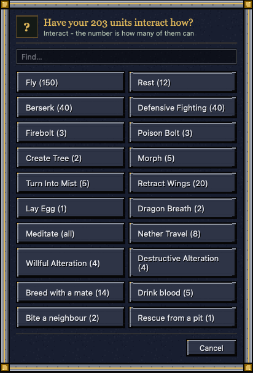
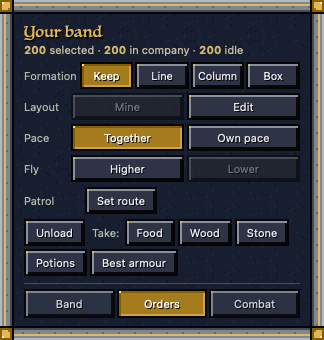

# hud-craft — 2026-10-25

You reported "the health bar is on when I turned it off in menus", then "also remove the health bars on selected".
Settings › Health had "on the ring" (which still kept bars over selected units) and "as bars". Now "on the ring" shows
no bars at all, the selected included; there's a third choice, Off (nothing over any unit); and your settings reach your
profile reliably, so they come back after a restart. In the game since 08:28; it reaches the app with the next build.

## Done
- **Health** (in the game since 08:28): "on the ring" (the default) now puts no bar over anyone, the selected
  included; their health shows on their ring like everyone's (a selected unit's yellow ring fills with its health).
  "As bars" is as before. New "off": no health bars or health rings over any unit; the plain ring under each unit stays
  (yellow when selected). The unit card always shows health.
  
  
  
- **Settings that come back after a restart** (in the game since 08:28): the game's window forgets the page's own storage when it quits,
  so the HUD copies its settings to your profile on the server. If that copy got lost on the way (another click at the
  same moment, or the app closing), it was never sent again, and your profile had none of your Settings choices. Now
  each change goes at once, again every 3 s until the server says it has it, and once more when the window closes. The
  same for the Sound settings.

- **Movement lines, StarCraft-style** (in the game since 09:10): the line from a selected unit to where you
  sent it (and on through its queue) shows right after the order and fades out over 1.5 s; hold Shift to see every
  selected unit's whole queue again; a group of more than 12 given one order gets one line from its middle instead of
  one each. The squares on the target tiles, the pings and the dig outlines stay as they were.
  
  
  

- **Nothing built for what's closed** (in the game since 10:55): the unit card builds only the tab you have open
  (another when you click it), the Groups list only while it is open, and the Orders page's Delivery and the Work page
  only while they show. What you see is the same, pixel for pixel. In the game with 200 units, after a selection change
  the frames slower than 33 ms went from 37 to 11 in 20 changes, and a click on another unit's update from 8 to 4 ms.

- **No more portrait work when an army sets off** (in the game since 12:47): when you send everyone somewhere, each of them
  turns to walk, and the server rebuilt every unit's portrait for it, though a portrait always shows them facing you.
  Now it is kept while only the facing changes: with 200 units, 35 ms of that tick is now 6 ms (139 ms in a real run
  with gear). Portraits look exactly as before (1,000 checked pixel for pixel, gear changes included).
- **Interact with your whole army: one question** (in the game since 19:49; the next build): with 203 units selected,
  Interact used to ask "Have [unit] interact how?" once for every one of them, 203 cards in a row. Now it asks once:
  "Have your 203 units interact how?", every choice with how many of them can ("Fly (150)", "Meditate (all)"), and the
  answer goes to everyone it fits, a few a moment so the game never stalls, with one line at the end ("Fly: done for 150;
  53 couldn't."). One unit selected works as before. Tested with 203 and 1,000 selected, and in the game itself.
  
- **Fly higher or lower as a group** (in the game since 19:27): with flyers selected, the band card's Orders tab has a
  Fly row (Higher / Lower), one height a click, from the top up to the Sky and back down.
  
- **A lighter HUD update** (in the game since 16:36; the next build): the Company list now keeps only the rows you can
  see up to date (about 30 of 200; the rest catch up as you scroll), the minimap draws its land once instead of every
  update, and the HUD measures its layout once per frame instead of two or three times per update. In the game with 200
  units, a click on a unit's update went from 13 to 7 ms, Select all from 17 to 9 ms, and the slowest frame after a click
  on a unit from 49 to 33 ms. Everything looks exactly as before, pixel for pixel. Select all still has a slow frame:
  that's the drawing itself, the next thing to look at.
- **Focus and double-click always take you to the unit** (in the game since 15:42; the next build): with the camera
  locked on a unit (F9 / Chase), going to another unit by a double-click on it, or Focus with one unit selected, now
  moves the lock to that unit (Focus with more selected frees it); before, the camera kept following the old one. A
  double-click on a unit on another level now takes you there (before: nothing). And a view still being built when you
  jump (zoomed out over new ground) can no longer pull the camera back to where it was. Checked with real clicks and
  keys in the game: a double-click on the Company row, Z and Focus each end right on the unit.
- **The 2.6 s freeze in a test run** wasn't the game: it was the test tool reading the server's memory at the end.

## Numbers
- Movement lines, 200 selected with their lines showing (the game's web view): the 3D frame's own work 2.95 -> 1.13 ms
  (one line drawn instead of 200), 2.52 -> 0.87 ms once faded.
- Checked in the game's own web view (WKWebView) with a real village scene (12 units hurt or selected): "on the ring"
  differs from before only by the selected units' bars (904 pixels, gone); "as bars" is as before (pixel for pixel,
  apart from the campfire's flicker); "off" removes 2,631 pixels of bars compared with "as bars".
- A restart, tested both halves: on the page, 23 checks (every Settings choice and Sound reach the server; a lost save
  is sent again; after a restart with empty storage every choice is back, Health still off); on the server, 9 checks in
  a private test world (saved to the profile, read back by a new session, refused values leave the last good one).

## Needs the user
- Nothing. Try Settings › Health, and clicking from unit to unit, once the next app build is out (the coordinator queues it).
