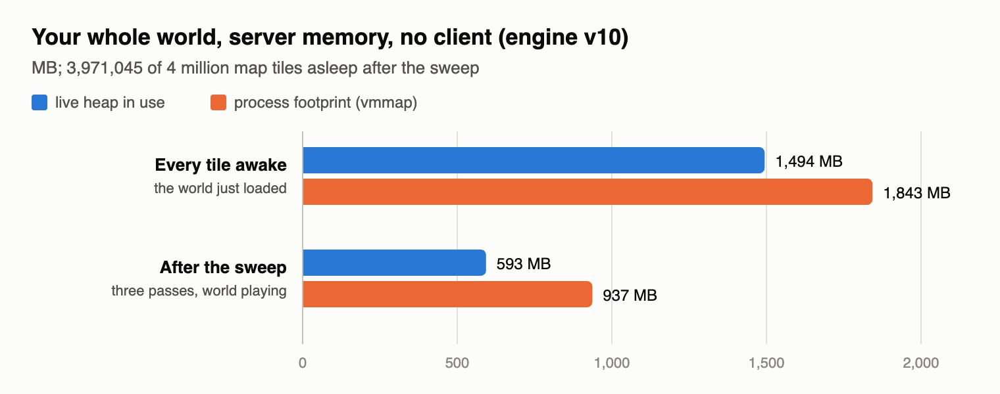

# Map memory: sleeping tiles, ready for your OK (map-memory)

The sleeping-tiles engine (version 10, built on the engine in the game) is rebuilt and checked. It keeps the map's quiet
land as small records instead of full tiles, and wakes a tile the moment anything reads it, so the game plays the same.
It is waiting for the coordinator's and your OK; nothing is in the game or the engine yet.

## Done
- **Restarted the v10 build** after your go-ahead: rebuilt with the proper .NET SDK (the reboot had wiped it; the first
  build used another copy found on the Mac, which passed the same checks).
- **Every check on it, with the whole map put to sleep every second while the game plays** (much harsher than the
  real game, which sleeps land only after a minute with nobody near):
  - the map memory arena test: 15/15 (a tile 218 B awake, 20 B asleep; sleep, wake and read back byte for byte the same;
    the 3D view and HUD world map the same across a sleeping edge; a unit walks into sleeping land and mines there);
  - clip 11/11, formation all as expected, gathering 3/3;
  - obey and breaking: the same cases fail on the engine in the game now, with no sweep at all, so those are the game's
    and not this engine's (obey: the 6 chop cases; breaking: 8 mining and tree cases).
  - 0 errors anywhere; in the formation check alone the game woke 337,319 tiles and they were put back to sleep.
- **Your whole world** (a private copy, nobody connected, the sweep as it would really run): 60 s after the sweep could
  start, 3,971,045 of its 4 million tiles were asleep, and the server's memory went from 1,843 MB to 937 MB. Your saves
  were checked unchanged. The sweep caused no slow ticks; the few the run had were the world loading, creatures looking
  for targets, and my own memory readings.
- The change still fits today's game: put onto a fresh copy of it, it compiles with no errors.
- **Found on the way, for the gathering work:** in the 20-villager gathering test, stone mining depends on how busy the
  server is. With 4 ms of pointless extra work a tick and nothing else changed, villagers mined about 12% less stone but
  stored slightly more. The sleeping tiles themselves change nothing there: that busy work alone, with no tile asleep, does the same.
- **The 2-second freeze when you join, seen in this morning's profiles, was the measuring tool itself** (it pauses the
  server to read its memory). Moved, the freeze moved with it. Joining onto sleeping land costs nothing you can see.
- **What does stall a join: loading your save.** About half a second, because 13 of your items each carry a whole copy
  of the item sprite sheet inside the save, an old copy too: those items still show the art from before 10-24.
  Without the copies the save shrinks from 3.3 to 1.4 MB and loads 3x faster.
- **The save fix is built and checked, waiting for your OK.** Saves now name the game's own pictures instead of copying
  them: your save would go from 3.3 to 1.3 MB, logging in from about 1.0 s to about 0.3-0.5 s of server time, and your
  13 cave items, 3 Humans and 6 leather pieces would show today's art instead of the original game's sprites. Every
  other value in the save stays the same (checked one by one), and an older engine still reads the new saves.
- The profiling tool no longer pauses the game at the start of its measurements (fixed in tools/tick_profile.py).
- **The save fix is in (17:40, your OK):** saves now name the game's pictures instead of copying them. Your units' save
  goes from 3.3 to 1.3 MB the next time the game saves, and your 22 old-art things show today's sprites. A 200-unit
  village's save: 140 MB -> 20 MB, and loading it 3.3 s -> 1.7 s the first time, 2 s -> 0.5 s after. Everything else in
  a save loads exactly as before (checked value by value), pictures the game makes itself still save, and the old
  engine still reads the new saves.
- **Logging in, faster (tried in copies, waiting for OKs):** the server now warms up its loading at start and reads your
  save in the background while the game keeps running. Your login's freeze: 555 ms -> 104 ms. A 200-unit village (a 20 MB
  save): 2.6 s -> 1.1 s; what's left is building the 200 units, which can't safely be spread over several moments yet.
- **Wrote the systems-map entry** (`reports/map-memory/systems-map-entry.md`): what the sweep decides, when, its caps
  and switches, and how it shares Awake.dm's map and the planned who-sees grid instead of asking "is anyone near" itself.

## Numbers

| | Engine in the game (v8) | v10 with the sweep |
| --- | --- | --- |
| a map tile nobody is near | 218 B | 20 B |
| obey arena | 26/32 | 26/32, the same cases |
| breaking arena | 26/34 | 26/34, the same cases |
| clip / formation / gathering | pass | pass |
| your whole world, server memory (no client; left: v10 with every tile awake, as on v8) | 1,843 MB | 937 MB |

## In progress
- Nothing running. The engine and the game change wait in `reports/map-memory/staged/engine-v10/` for the OKs.

## Needs the user
- The install OK for engine v10, after the coordinator's: about half the server memory on your world, the game the same.
