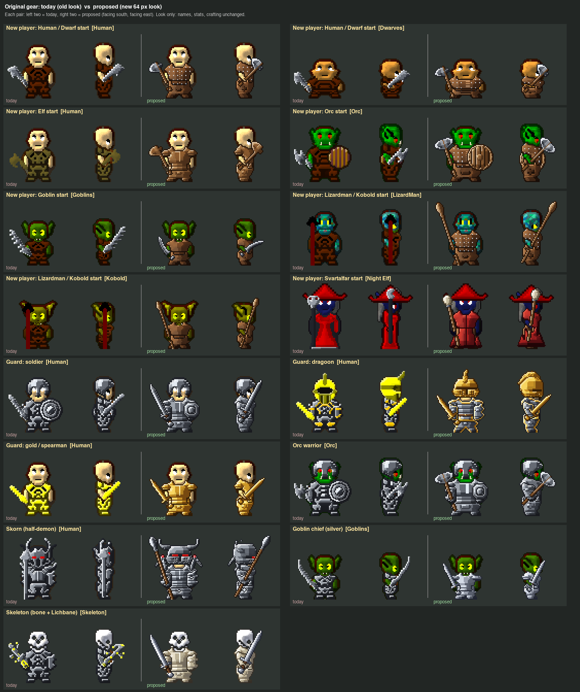
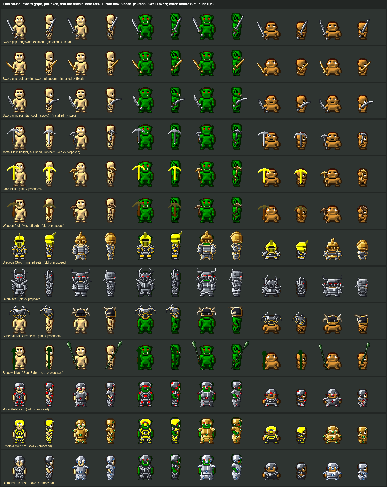

# The original gear in its new looks (old-gear-looks)

New players' starting units, guards and monsters no longer wear the old-look armour. Every original weapon and
armour piece that has a close match now draws with the new 64 px pictures in 3D. Names, stats, crafting and the
inventory pictures are unchanged. It is in the game folder; the app has not been rebuilt yet.

## Done
- **A look table for the original gear**: 161 original pictures each have a new look (tier, style, slot). Leather goes
  to leather, wooden to wood, metal to iron, gold to gold, robes to the robe of their colour. Hats, hoods, capes,
  wooden/elf/bone bows, the butcher knife and the quiver have no close match yet, so they keep their old look.
  
- **Built to match their names and old designs**: the Gold Trimmed (Dragoon) set is iron with a gold edge, under an
  all-gold closed helm with a gold fin. The Ruby, Emerald and Diamond sets carry real gems where the old Ruby set had
  them: brow and cheek guards, shoulder tips and belly, knees and shins. Skorn is spiked steel under a closed horned
  helm with red eyes. The Supernatural Bone helm is black steel with gold, its horns sweeping out and down. The original
  picks are one material like the old ones, and the Wooden Pick is all wood. Bloodwhisker is dark green, and Soul Eater
  has a green blade.
  
- **Swords sit in the hand**: on the new swords, scimitars and daggers the fist was at the guard, and the grip and pommel
  hung down to the feet. The fist now closes on the middle of the grip. This fixes the crafted new swords too,
  the Runeblade, Flametongue and Voidedge included: their effects moved with their blades.
- **No aura on the enchanted weapons**: the glow ring round the blades of the Runeblade, Flametongue, Frostbite Axe,
  Stormcaller Spear, Voidedge and Dawnbringer is gone. Their runes, flames, frost, lightning, smoke and stars stay. The staffs are unchanged.
- **Pickaxes the right way up**: the new pick's head curved up like a U. It is now the old picks' upright T, its points
  curving down.
- Checked in the arena with no game window: every race's fresh start and eight guard and monster kits draw their new
  looks; the catalogue's gear, the 2D pictures and hair are unchanged; the existing gear checks still pass.

## Next
- A look in the real client once the app is rebuilt (builds are on hold; ask first).
- Optional: new looks for the bows, the Necro and Astral staffs' old colours, Lichbane's gold hilt, the Gladiator chest.

What do you think of the Dragoon and the Skorn? Do they still feel like the guards you remember?
