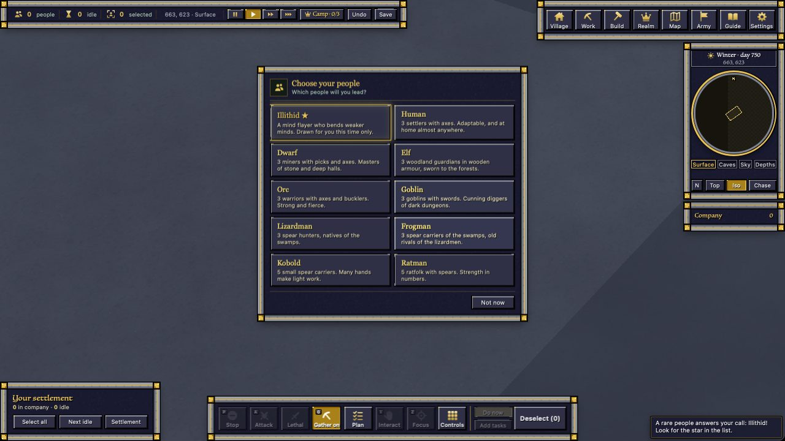
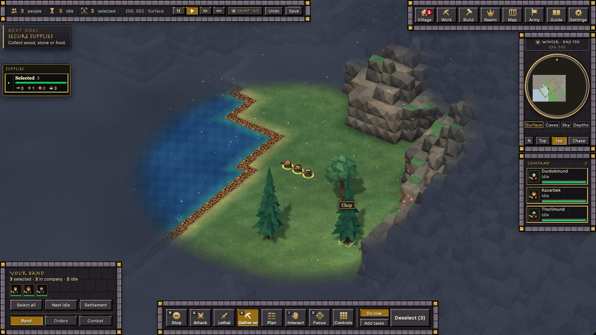
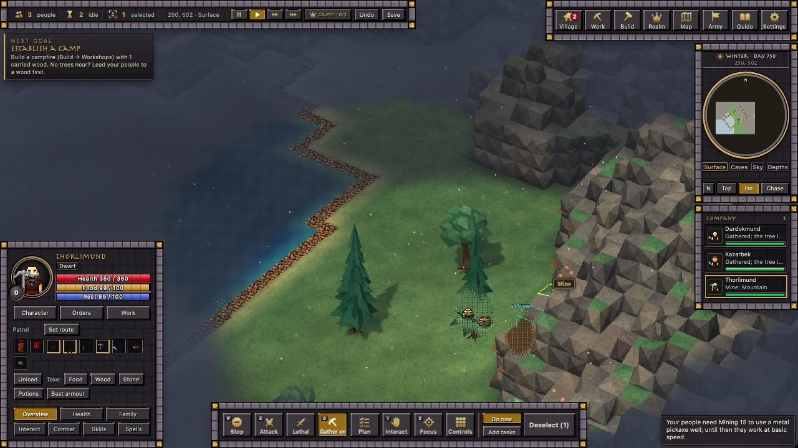
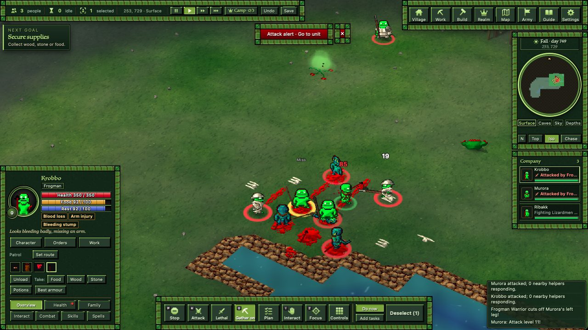
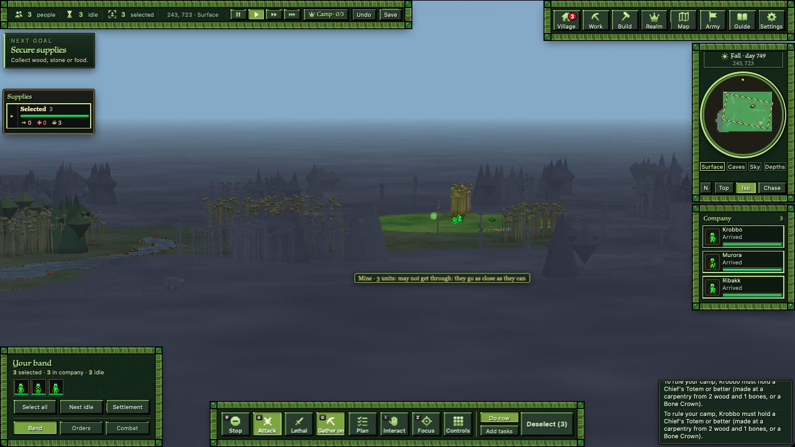
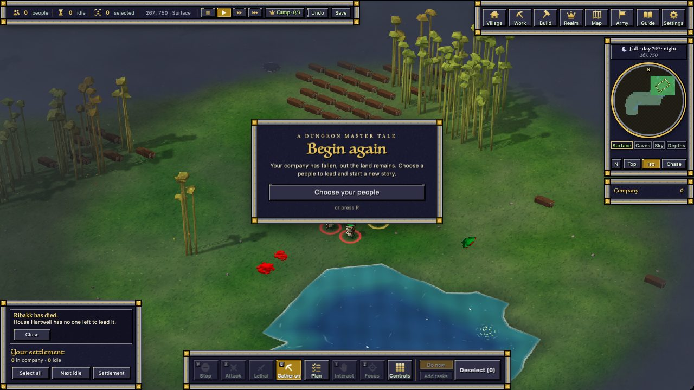
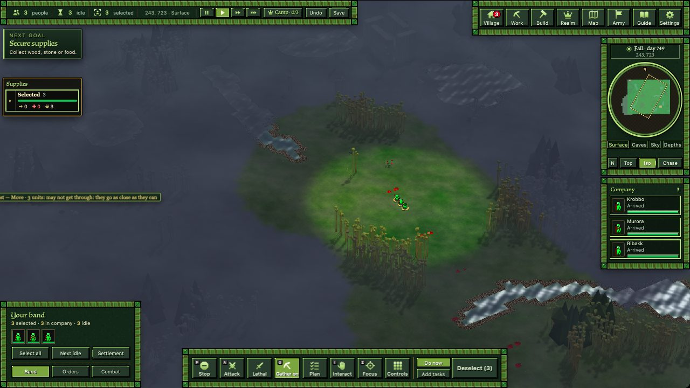

# playtest — 2026-10-25

A launch-readiness pass over build 30, played as a new player on a throwaway profile, with the user taking over the
window for the first round. It isn't launch ready yet. The dead stay standing (build 30's new death moves), and a new
company can be wiped six minutes after it arrives. Most loops otherwise work.
Full write-up: `planning/LAUNCH_AUDIT_2026-10-25.md`.

## Done
- **Scored every core loop for launch** (1–5):
  - 4: gathering, needs and healing, capture, families and rulership, saving and loading
  - 3: onboarding, making, building, the 3D view
  - 2: combat
- **Ranked 5 launch blockers and 8 polish items**, and filed each to the session that owns it (board, Requests).
- **18 arena checks run on today's game:** raids, care, doctor, family, fog, jobs, save round trip, safe start,
  attack, combat pace, throwing, weapon cap, rulership, heirs and capture pass. Capture fails only its known knocked-out case. The failures in
  fishing and limb gear are out-of-date tests, not the game. The combat check can't start at all; the fix is a one-liner.
- **Fixed three messages** (in the game, not yet in an app build):
  - The poison spore plant said "PoisonSporePlant spews corrosive posion spores" every 2 seconds. It now says it
    properly, at most every 30 seconds.
  - A tended tree now says how to fell whole trees.
  - "1 bones" now reads "1 bone".

The race card on a fresh start: one line per people; this time a rare Illithid was drawn.

Gathering works as planned: hover a tree and it says Chop, with the outline on exactly the tile that will be worked.

Mining a mountain takes one block per click, and the block being worked is marked.

## What went wrong in the first minutes

Six minutes after arriving: the company walked east, pressed A (Attack mode came on without notice), and the next click
marched them into a hostile band. Two were dead a minute later, and all three soon after.

Letter keys still run the old game's commands: A turns Attack mode on, D tries to crown a leader (one notice per
unit), W and S open chat prompts. An RTS player's hand goes to WASD.

When everyone is gone, the "Begin again" card comes up. The heir card before it worked too ("Long live Ribakk").

A small look issue: water just outside sight draws pale white, like snow, while explored ground is blue-grey.

## Numbers
Combat pace, 8 duels each, arena at real speed:

| matchup | first limb lost | fight ends | how they end |
|---|---|---|---|
| iron swords | 70 s | 85 s | 6 dead, 1 fainted, 1 still going |
| swords in full metal armour | 67 s | 89 s | 5 dead, 1 fainted, 2 still going |
| bare fists | none | mostly never | 7 of 8 still going |

200 units (today's runs from other sessions, build-30 game):

| what | number |
|---|---|
| server, a quiet village | 15 % busy on average, slowest tick 105 ms, never behind |
| server, orders every 10 s and the camera moving | 28 % busy, 1.7 s behind over 4 minutes |
| frame time in the real app | 17 ms median (60 fps is 16.7); 40–50 ms frames after selection changes |
| logging in with 200 units | 5 s on an old save, 1.7 s once the game has saved again |

## In progress
- Nothing running. My test window is closed and the input slot is free.

## Answered by the user
- **Bare-fist fights must end** ("bare fist should end why wouldnt they?"). The cause is the original game's rule that a
  punch can't take a body part below a floor. After a few hits every punch does nothing, so two fighters stand there
  crippled, still punching, for minutes. Handed to stump-care, who set the combat pace.
- **New realms get no protection** ("new realms are hostile.. and brutal normally no hand holding"). The early wipe
  isn't a blocker any more, and the request for safe starts is withdrawn.
