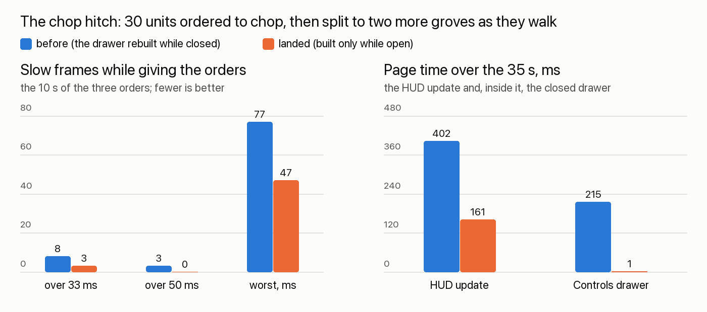

# rts-feel — 2026-10-25

You reported "a hitch in actions when i click on a units to chop wood when they are moving there ... maybe 2-3 times".
Found and fixed: it was the HUD, not the server or the units. In the game since 10:15; it reaches the app with the next
build.

## Done
- **The chop hitch** (in the game since 10:15). Every time the selection changed, the HUD rebuilt the whole Controls
  drawer (about 100 command rows), even though the drawer was closed and nobody could see it. That took 29-34 ms each
  time, sometimes twice in one frame: the 2-3 stutters you felt as each order went out. Now the drawer's rows are built
  only while it's open, and fresh each time it opens, so it always shows what's true right then. The day/night icon
  outside it still follows every update.
  - Measured in the real game window: 30 units ordered to chop, then split to two more groves as they walk. Frames over
    50 ms while giving the orders 3 -> 0, the worst frame 77 -> 47 ms. The drawer's time over the 35 s went from 215 ms
    to 1 ms.
  - Checked: the drawer shows the same rows as before after selection changes (in the app's own browser engine), and
    hud-craft's sweep of every HUD panel at four window sizes looks the same, with no errors.
  
- **Builders waiting for stone** (in the game since 12:01; world-look found it behind your "yellow things"). With walls
  planned and no stone, every builder rechecked every planned task twice a second and worked out the same "no stone"
  ten times over. Now each builder works it out once each time. 30 builders and 300 planned walls: 119 -> 14 ms each
  time; builders already waiting at their walls 43 -> 22 ms. Builders still go for stone the moment it lands on the
  stockpile, and every answer was checked against the old code's (24,382 of them, none different).
- **The world's timers on one clock** (in the game since 15:30; the clean-up you asked for). Three things that each ran
  their own timer now run on the one clock the units already use:
  - idle units noticing they've been given somewhere to go;
  - doors shutting behind your villagers;
  - far-away units being put to sleep.
  Nothing plays differently: each runs on the very same moments as before (checked side by side), units set off just as
  fast, and a 5,000-unit world costs the same standing.

- **The Sky level** (in the game since 19:06; your four asks). Flyers at their top height fly up to the Sky level, and
  back down with Fly lower. Up there they fly clear over the peaks: 14 to 18 tiles up, and a dragon goes 3, 6, 9 over the
  surface and then 12, 22, 32 up there. On the Sky level a click on open sky sends your flyers there, one to a tile;
  walkers get the red "can't" and stay. A faint grid shows the open sky while only flyers are selected. And the Sky is
  earned: its button, the world map's Sky layer and the "," key only open once one of your units is up there, and the
  camera comes back down when your last one leaves.

- **The old letter keys are off the keyboard** (in the game since 20:24, build 38; your call at 20:15). After a click in the 3D view, W
  used to open a message prompt, S a shout, D crowned everyone selected and R started you over. Now the 2006 letters
  do nothing, and their commands stay in the menus. C and X do the cutaway and the x-ray wherever you clicked last.
  W, S and D don't pan; the arrows and the window edge do. A is as it was. The Enter chat box comes later, with
  kingdom chat and pigeons.

## Needs the user
- Still yours from yesterday: (B) creatures nobody can see wander and look more slowly, snapping back within a second of
  coming into view. It changes things off screen (an unseen fight starts up to ~3 s later), so it's your call.
