# Unit sprites: ragdolls and the animation arena (unit-sprites)

The units can now fall, fly and die as ragdolls made of their own sprite, archers draw and loose real arrows, and
every weapon skill has its own move, with arms that carry the weapon and legs that step and brace.
All of it is in a test arena; nothing is in the game yet.

## Done
- **2D ragdolls from the sprites** (preview only). Each unit's standing picture, with its drawn armour, is cut into
  head, torso, two arms and two legs for every facing. The race's own armless and legless pictures say which pixels
  are which limb, and the armour goes with the limb it covers. At a death the picture becomes a flat doll. Its plane
  moves through 3D (tipping over, flying, spinning, landing flat) while the limbs and head swing on their joints
  inside it. Seen from its back, a doll shows the unit's back picture. The 3D weapon, shield and helmet ride on the
  part holding them, then come loose as real 3D pieces that tumble, bounce and settle flat.
  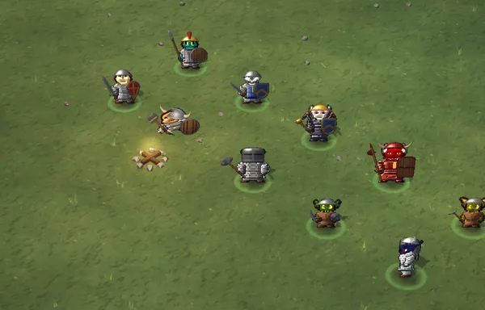
- **The animations**: fall (away from the blow), crumple (the knees give), spin and drop, knocked back, a hammer
  launch (thrown a few tiles on an arc), a dragon throw (high and far), arm off and leg off (the limb flies on its own),
  knocked out (falls, lies, gets back up), flinch, and today's death for comparison.
  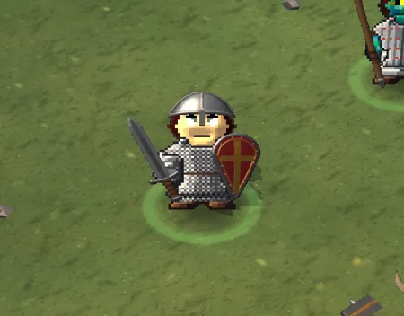 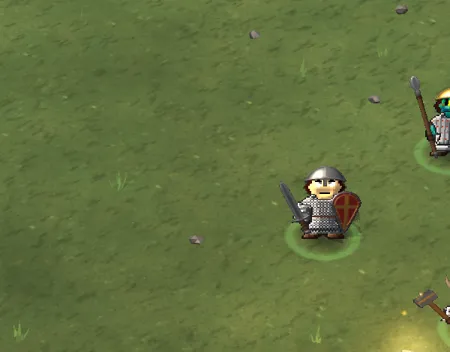
  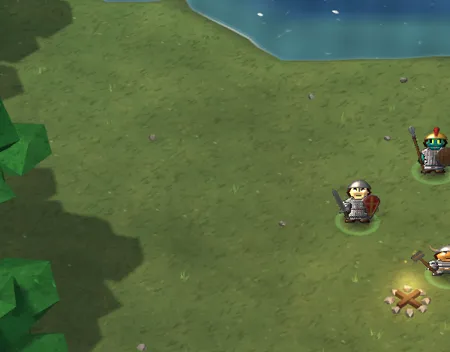 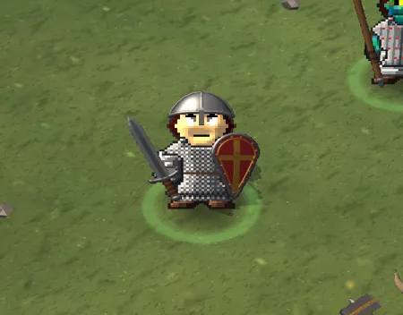
- **Archer shot**: the archer turns to its target and raises the bow in front of it, then draws the string back with
  the arrow on it (the bow bends further as it draws). It looses and brings the bow down. The arrow flies on an arc,
  about 16 tiles a second, and stays in what it hits. A killing shot drops the target as a "shot" doll with the arrow in it.
- **The archer shoots with its own sprite**: the arms now bend at the elbow, each cut in two. The archer turns to its
  target, the bow arm comes up straight at it with the bow in hand, and the drawing arm reaches to the string and
  pulls back to the cheek. The string bends back to that hand with the arrow on it, then it looses (the hand flies
  back) and lowers the bow. A side view's hidden far arm uses the near arm's pixels behind the body. Under each arm
  the body is filled from its own pixels, so a raised arm leaves no hole.
  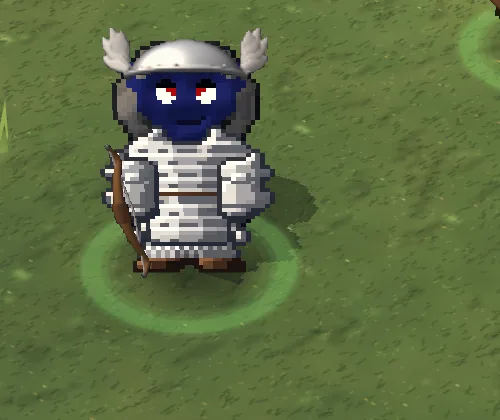 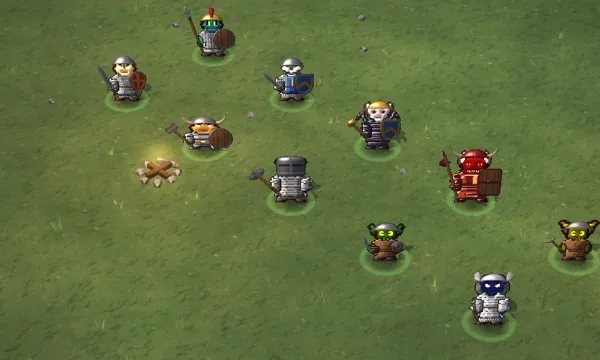
- **Weapon skills** (art/gear3d/skills.js), one move per skill of the game's: sword slash and thrust, axe chop, mace
  smash, the warhammer's launch (the target flies), spear thrust, halberd sweep, two dagger stabs, a jab and cross,
  a double claw rake, a shield bash, and throwing a spear, axe or knife. Each has a wind-up, the blow and a
  follow-through. The edge leaves a fading trail. At the blow the target flinches, or falls the way that blow kills.
  The defender can block (sparks off the shield), parry (sparks off the blade), dodge (a miss), or let armour turn it
  (a glance and a flinch).
  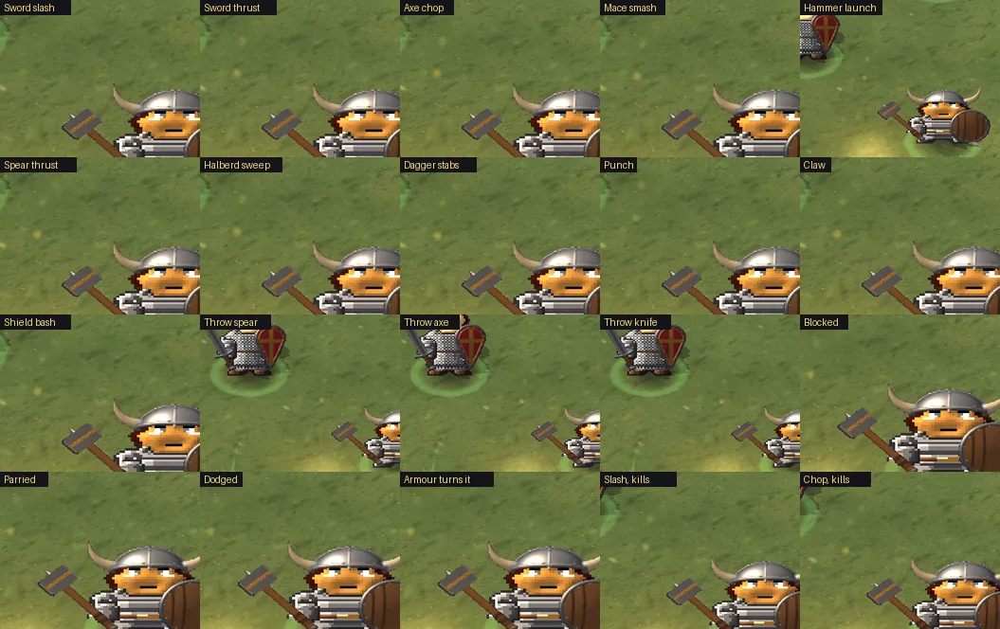
- **Arms that carry the weapon**: the arms were found in front views only; side and back views had none, so the
  weapon swung while the drawn arm stayed on the body. In side view the race's armless pictures only paint a red
  stump at the shoulder, so each arm is now cut as its armour sleeve plus the arm drawn under it, from the stump
  (the shoulder) to the fist, bending at the elbow. Under the arm the body is the race's armless picture with the
  chest armour's pattern carried across, so a raised arm leaves no hole. The weapon slides into the fist as a move
  starts and back as it ends.
- **Legs that brace**: each leg now bends at the knee. Through a move the feet stay planted: the front foot steps
  in, the back foot stays braced or slides back, and the stance is measured in the unit's own leg length, so a dwarf
  takes a dwarf's stride. The hips sink as far as the stance needs for both knees to stay bent (the front knee
  forward over its foot, the back leg stretched out behind), and shift back as the body leans into a blow (forward
  on a lean away), so the weight stays between the feet. A block braces low and a dodge sways back on its feet.
  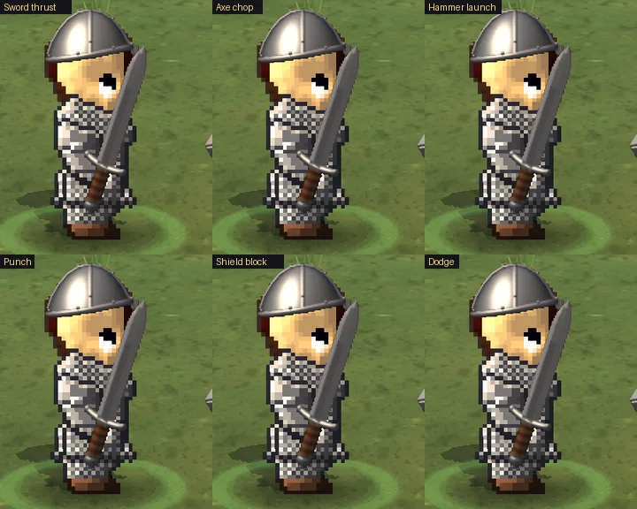
- **Side-view grips in the real fists**: side on, the standing weapon was held where the old arm finder guessed,
  sometimes at the shoulder (the dwarf) or behind the body (the orc). fists.py now finds each race's side-view arm
  the way the ragdolls cut it and puts the weapon in its fist, for all 13 races and all three walk frames (3 to 8 px
  moved on average). Front and back views are unchanged.
  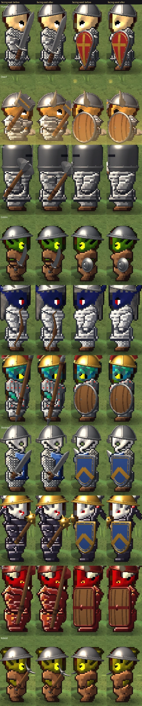
- **Rough spots fixed**: the unit's ring stays under it through a move instead of blinking off; the lean and lunge
  ease out instead of snapping back at the end; a knocked-out unit drops its weapon again (and picks it up as it
  stands); lost limbs fly in a bigger arc with blood (not for vampires, bones or stone); dropped gear that comes to
  rest becomes a flat picture on the ground (as a dropped item is drawn); dead bodies stop being worked out once
  they settle.
- **Every piece in every material, and the magic weapons in 3D**: the 3D gear now covers everything the game hands
  out. Each weapon, shield and helmet is drawn in every material the game makes it in (read from the game's gear
  list), so dragon, dragonbone, spiderfang, dragonhide, spidersilk and bonehide pieces no longer fall back to iron.
  The 13 magic weapons are new 3D pieces made to match their 2D designs: the crystal, orb, skull, flame, nature,
  dragon and spider staffs, and the rune sword, flame sword, frost axe, storm spear, void blade and holy mace.
  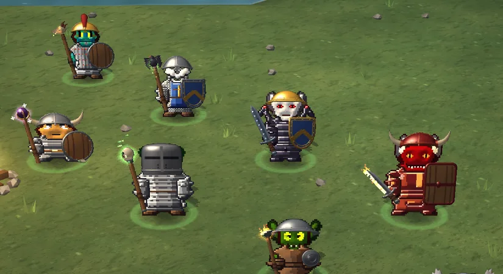
- **The magic weapons keep their 2D pixel effects**: each 3D staff and enchanted weapon shows the game's own pixel
  effect (the 2D magic sheets' glows, sparkles, pixel flames, wisps, runes, frost, bolts, smoke and venom), cut
  round the weapon held straight up and laid along the 3D piece as it turns and swings, its pixels the piece's own
  size, added on as the game adds its effect sheet. The swords, axe, spear and mace show their effect without the
  aura round the blade (the user: "the effects good the aura no"); the staffs keep their head's glow.
  
- **Soul Eater and Bloodwhisker** in 3D, as their 2D pictures: the arming sword in venom green, the spear with a
  green head on a dark green haft.
- **Casting**: a staff's spell move: raised back over the shoulder, then thrust at the target with the free hand
  thrown forward; the staff's own pixel effect leaves its head as the spell, flies on a low arc with fading copies
  behind, and bursts on the target bigger. The target flinches, or falls the way that spell kills (frost and death
  crumple, dragon fire knocks back, an orb's light spins it). In a fight the enchanted weapons' trails take their
  own colour.
  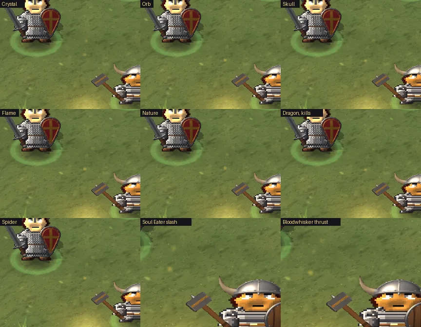
- **Blows a unit lives through** (most blows; a unit dies only once): a hammer launch, a knock-back or a dragon throw
  that doesn't kill sends it flying with its weapons still in hand; it lands, lies a moment and gets up where it came
  down. A cutting blow can take a limb without killing: an arm (it staggers, its weapon falls with the hand, and it
  stands on and fights without the arm) or a leg (it staggers and stands on the other). The stump bleeds and the unit
  bleeds out after a while unless bandaged (vampires, bones and stone never bleed); the lost limb stays where it
  fell. The killing blows that take a limb stay as they were. In the arena: the Alive row's new buttons, Bandage,
  and the Blow row's "Maims" (the axe chop, sword slash and claws take an arm, the halberd sweep a leg).
  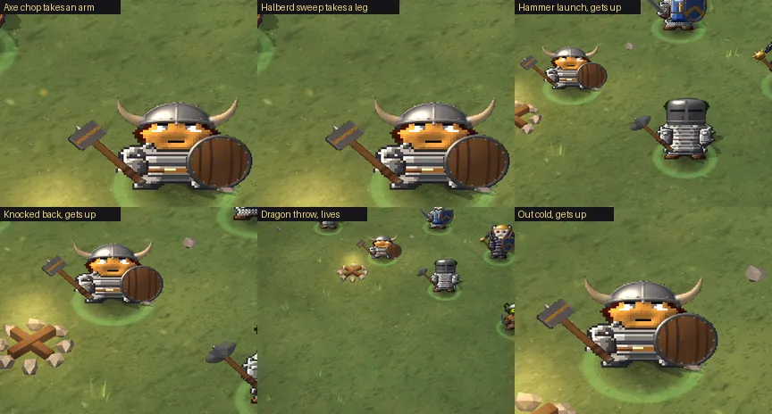
- **Getting up**: out cold or after a launch it lives through, a unit gets up as a move, not by swinging upright
  like a plank: it pushes up on one hand with its knees drawn in, comes up to a kneel with one foot forward, then
  stands; a weapon it dropped flies back to its hand and stays there. The hand-back from a doll to the unit's own
  picture no longer leaves a frame with nothing drawn.
- **The archer's bow and arrow**: the bow faces the real target, upright with the arrow level through it, and the
  arms follow: with the target to the side, the bow arm points at it and the string is drawn back past the shoulder;
  with the target toward or away from the eye, the bow is held in front of the chest and the string drawn to the
  cheek. Which picture the unit shows decides it: side on, the bow and arrow are in front with the drawing arm and the
  bow arm stays tucked behind the body (it is drawn from the near arm's pixels, so in front it looked like a second
  hand); from its back picture, the body hides the bow, the hands, the arrow and the drawn string.
  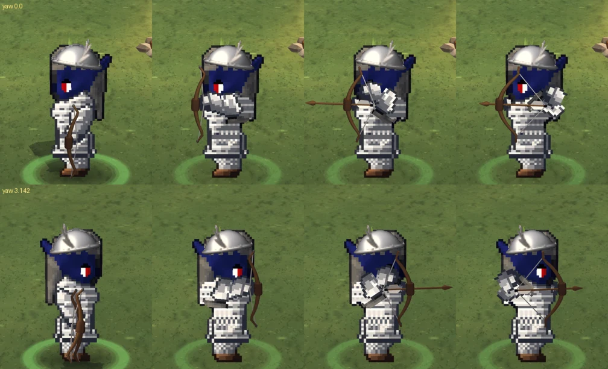
  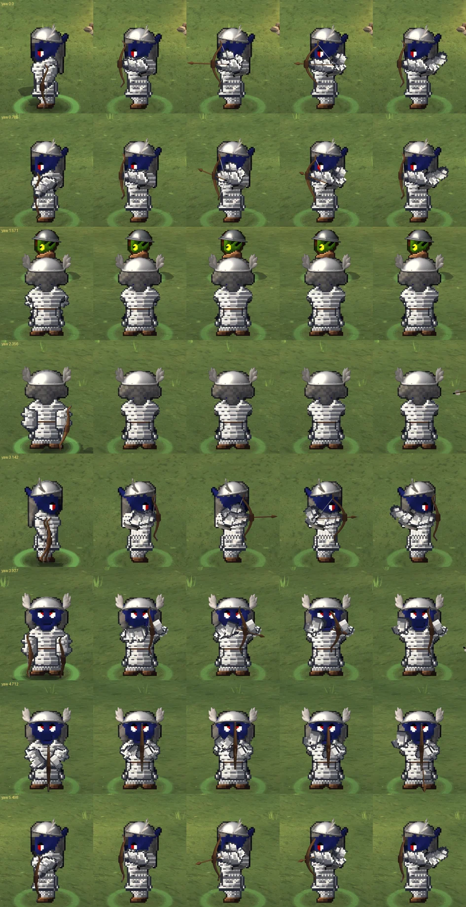
- **Where arrows and throws land, and blocking them**, by the game's own rules (Combat - Bows.dm, Throwing.dm): an
  arrow lands on a leg, an arm, the head, the chest or the belly at the game's odds, and sticks in that part; a
  thrown weapon on a leg, an arm or the chest, and drops. A shield blocks either (the target raises it to meet the
  shot; an arrow sticks in the shield and falls when it comes down, a thrown weapon bounces off), armour turns an
  arrow (sparks, and it glances off) and a miss flies past and comes down in the ground beyond, the target ducking
  aside. In the arena: the Lands on row, and the Defender buttons now work on shots and throws.
  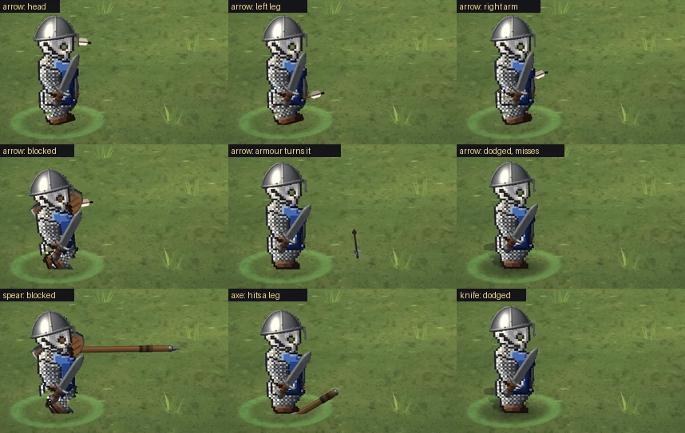
- **Stuck arrows go with the unit**: an arrow in a body rides with the unit as it walks and turns (on the other
  side once it faces the other way) and falls out after 20 seconds. This is the player's page alone: the server
  never hears of it (in the game only the rare arrow that lodges is a real item, as before).
  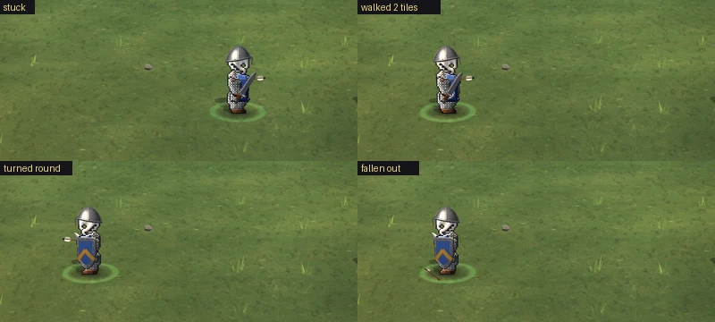
  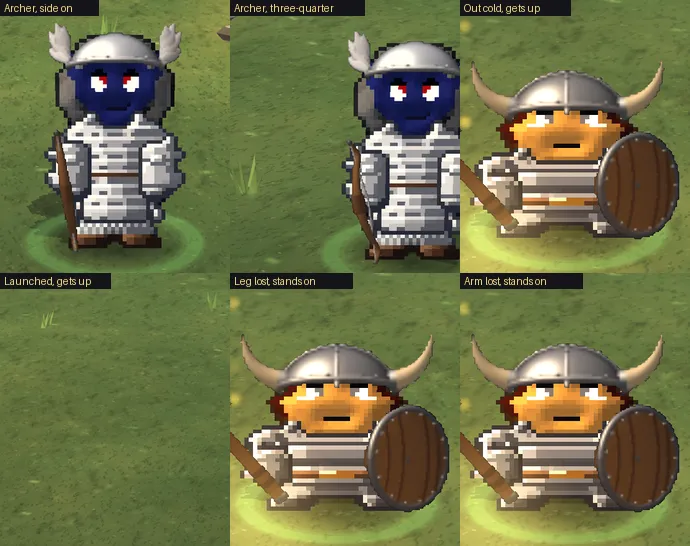
- **Deaths that aren't a blow**, one for each of the game's other causes of death (its DeathType list): the unit
  acts it out on its own sprite, falls its own way, and its body takes the colour of it. Bleeding to death sways and
  sinks in a pool of blood; poison and food poisoning retch, drool and spew green and crumple; starving and
  tiredness sway and sink; cold shivers hugging itself, frosts over blue and topples stiff, frost glittering;
  fever and overheating hold a hand to the brow, flushed and sweating; burning flails in flames and falls charred and
  smoking; lightning throws the arms out rigid in a flash of sparks and topples stiff, charred and smoking; the heart
  clutches the chest and pitches over; choking (vapours, the lungs) holds its throat, coughing; brain damage
  twitches and crumples; goo melts it into a green puddle; holy energy makes it glow, rise in light and sink into a
  pale puddle; a skeleton crumbling into bonemeal rattles and drops into a heap of bones; old age sits down, then
  lies down slowly. In the arena: the "Dies of" row. "Today's death" (the darkening sink the game uses now) is no
  longer needed for any of these; at most it stays the cheap way far-off crowds or beasts without dolls die.
  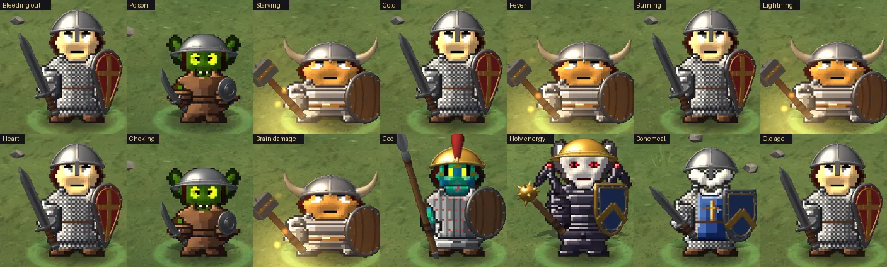
- **The game's own pixels for their effects**: the fire is the game's own fire pixels (the frame-animated flames of
  burning ground and dragon breath, rb-breath-dragon.png), licking up the body as it burns and on the charred body
  after, with embers and smoke; the other deaths take the same set's frost, sparks, poison, plague, acid, holy light
  and dust.
  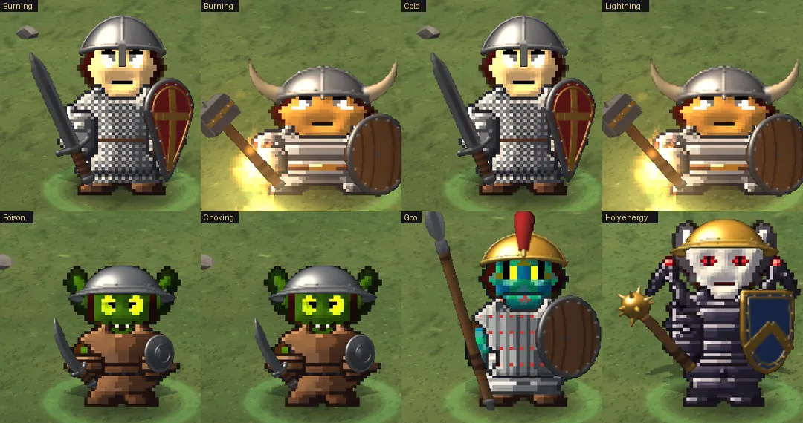
- **Work with the tool in hand** (art/gear3d/work.js): mining (the pick swung down into the rock, chips, dust and
  the odd spark), chopping (the axe driven into the trunk, wood chips), smithing (the hammer on the anvil, sparks),
  building (knelt, hammering at the ground, dust), and fishing (the rod cast, the float flying out and bobbing on
  its line, a bite with a splash, the fish reeled in on the line). Each job goes round till it is stopped. New 3D
  pieces: a smith's hammer, a fishing rod, and for carrying a log, stone, ore, a big barrel and a fish; the sack is
  the game's own pixel sack. Carrying: it bends to lift the load from the ground in front, holds it before it in
  both hands (its tools put away) and walks off with it; struck, it drops it. In the arena: the Work row.
  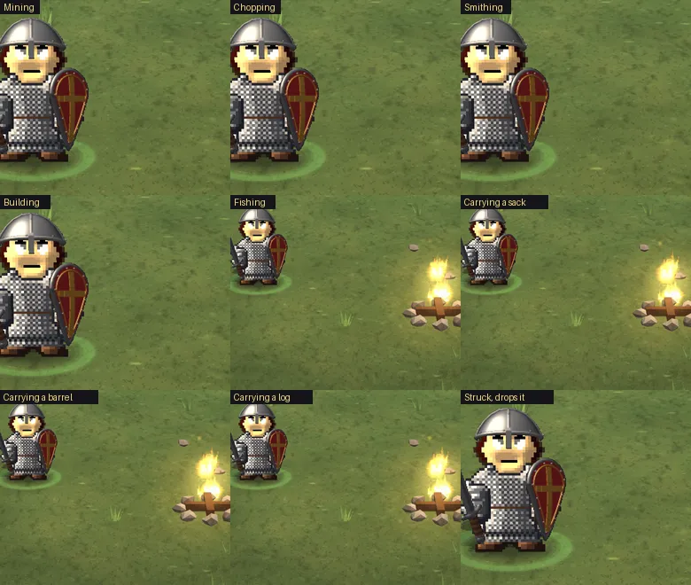
- **All three of the game's fishing methods** (Fishing.dm: rod, net, harpoon): the rod as above; spear fishing with
  the game's harpoon (a new 3D piece: a long haft, a barbed head), raised point down, driven into the water with a
  splash, pulled up with the fish on the point; net fishing, the net bundled in both hands, thrown out to open into a
  ring of cord over the water, left to sink, hauled in hand over hand closing round the catch, then laid at its feet
  with the fish on it.
  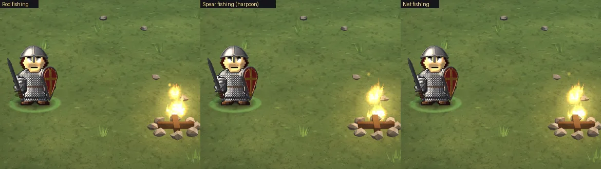
- **Weapons from behind**: seen from its back, what a unit holds before it is now behind its body, as the bow is: only
  what sticks out past its outline shows (standing and in every move).
  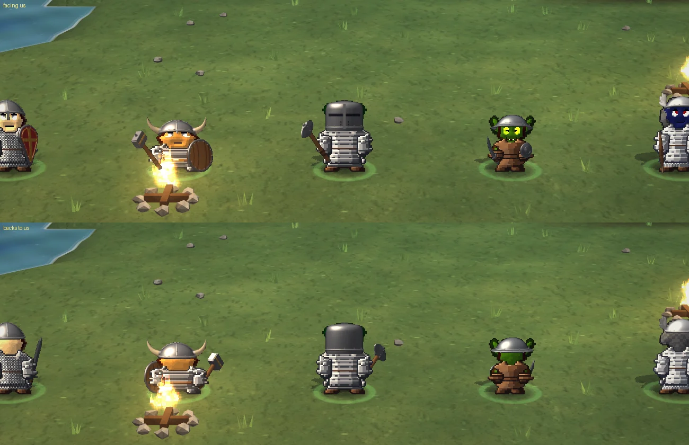
- **Three looks for the pieces, side by side** (the arena's Pieces switch): smooth pictures (44 MB), pixel-art
  pictures (9 MB) and the live 3D models (3 MB, real light, turning smoothly). Both picture sets are renders of the 3D
  pieces from 16 sides; the user chose the pixel-art pictures for the game.
  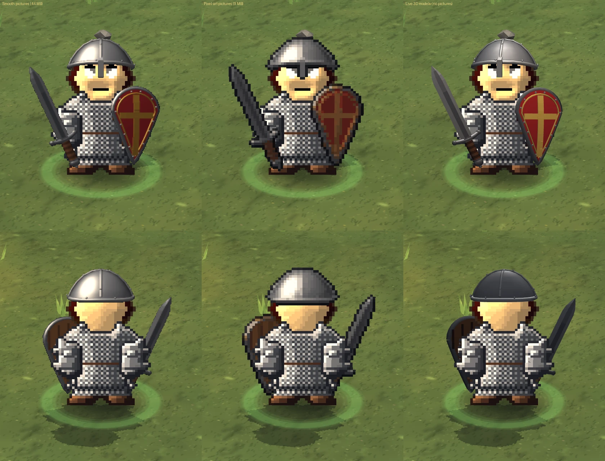
- **Fixes**: a unit hit while it strikes no longer plays two animations or shakes its head (one doll a unit; the hit
  rocks it a little away from the blow); the sword slash is a slash (over the shoulder, level through the target),
  not a downward stab; a thrust or slash toward or away from the camera goes into the depth, as the archer's shot
  does (the hands before the chest, the blade at the target, the shield arm left up; a shield means one hand on the
  sword); swords sit a little down the grip as the 2D ones do, so facing us they are no longer held low.
  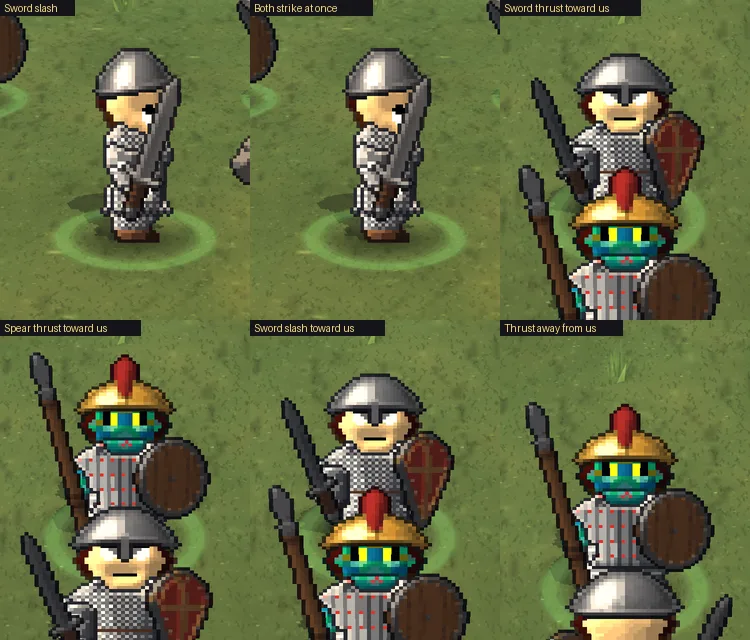 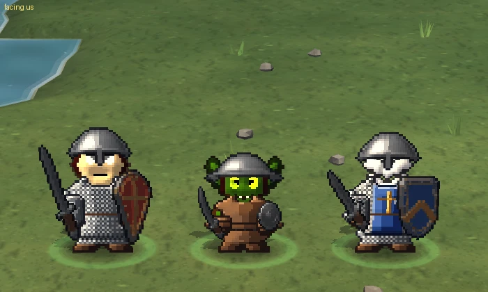
- **No more wiggle**: a unit holding a pose (a block, a parry, the end of a blow) eased each joint with a spring
  that overshot, and the chained joints set each other wobbling; now each joint eases straight onto its angle. A
  flinch, a knockout or a wounded unit lying down had springy limbs too: now damped, so a blow jolts them once and
  they settle (visible back-and-forth down from 4 to 7 times a limb to none). All of this runs in each player's own
  window, not on the server.
- **The archer's arms stay on**: the elf's long hair was taken for the top of its arm, so the arm turned about the
  back of its head and floated off the body as it drew. Arms with no red stump in their race's pictures now turn
  about the figure's own shoulders, and nothing above the shoulder (or down the back, side on) counts as arm.
- **Pickaxe**: the 3D head arched the wrong way (a U); it now arches over the haft with its points curving down
  toward the hand, as the 2D pick.
- **Animation arena** (art/gear3d/arena-anim.html, served by the "gearanim" preview entry): a button for each
  animation and each weapon skill; how the defender meets the blow and whether it kills; the blow from the front,
  back, left or right; the next unit or all at once; slow motion; reset; and camera turn, spin, zoom and tilt.

## Numbers
| what | count |
|---|---|
| ragdoll parts | 10 per unit and facing (elbows and knees), 40 part sheets for the 10-unit lineup |
| animations in the arena | 11, plus the archer's hit and kill, plus 14 weapon skills and 4 defences |
| arrow flight | about 16 tiles a second, on an arc |
| 200 deaths at once | 2.5 ms a frame while falling, 0.9 ms once lying (was 3.7), 60 fps held |
| 1,000 deaths at once | 10.7 ms while falling, 2.8 ms once lying, 60 fps held |
| 3D pieces | 37 (13 weapons, 13 magic, 5 shields, 6 helmets), 732 picture strips at 16 facings |
| rendering all of them | about 2 minutes smooth (34 MB), 1.5 minutes pixel art (7 MB) |
| 3D pieces with Soul Eater and Bloodwhisker | 39 |
| gear cost, pixel pictures | 0.1 ms a frame at 200 units, 0.5 ms at 1,000 (live models 0.4 and 1.0) |

## In progress
- Into the game: the server would send each unit's part sheet (cut as it composites the unit's picture) and the
  events that start an animation (the kind of blow and from where; for a hammer launch or a dragon throw, where the
  unit lands, so the game, not the page, decides positions).

## Needs the user
- Judge the animations in the arena (open it from the Browser pane).
- Say which ones to keep, and whether hammer launch and dragon throw should be skills.
- Watch the weapon skills (the grid above, or the Weapon skills row in the arena) and say which moves need work.
- Look over the magic weapons, their pixel effects and the spells (the Magic and Spells rows in the arena) and say which to change.

## Into the game (16:00-16:50)
- You chose the look: palette pixel art pieces, in each tier's own colours, on the smooth world.
- Stage 1, in build 25: every unit holds its weapon, shield and helmet as 3D pixel art pieces instead of drawn ones.
- Stage 2, in the game folder for the next build: every race gets dolls. Each unit's doll is cut from its own picture, armour and all, so every race and armour works.
- The server's blows now play as moves: the swing with the unit's own weapon, the block, parry or dodge, the flinch and the fall. Deaths from bleeding, poison, cold and the rest act out their own way.
- A dead unit's doll lies there as its body until the body is gone.
- Still to come: work and climbing in the game (climbing seen only from behind), and the climbing stone as something players craft.

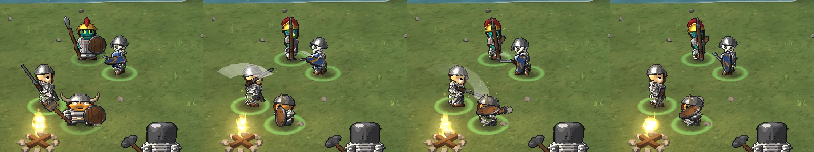

## Work, climbing and the stone door (17:00-17:20)
- Work in the game now plays with the tool in hand: mining and chopping at the rock or tree, fishing (rod, harpoon or net, by the way the unit fishes), smithing at a forge, hammering at other workshops, and building at the piece just put up.
- Climbing plays at the server's own pace and is always seen from behind. Climbing gear brings the rope and pitons; a race that climbs by itself goes up bare-handed.
- The stone door is the climbing stone now: the rough rock with its ledges in a stone frame. It slides aside when opened. Stone doors are made at a workshop as before.

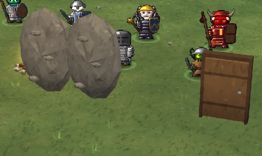

## Heavy stone doors (17:30-17:50)
- The stone door is the climbing stone now: no frame, the rock at its own size, about 2 tiles tall, filling the doorway.
- It is heavy. It stays shut until something strong enough opens it, and then everyone passes until it is shut again:
  - a unit with Strength 40 or more, or Magic 20 or more, standing beside it;
  - a lever or pressure plate on a rune circuit touching it (2 mana);
  - a turning power train beside it, which makes it open by itself for your own units, like any door.
- Your own lock on a stone door is now a seal: a sealed door opens for nothing until you unseal it. Doors you had locked before stay sealed.
- Shut doors are taken as locked when paths are planned, so weak units walk around them instead of getting stuck.

## World bosses: the stone golem (19:00-19:40)
- You made the golem in Blender. It is now the mountain guardian in the animation arena, with its own 64 stones on a skeleton, carved spirals and cracks shaded dark.
- It never attacks. It walks, and it shakes off whoever climbs it, so the danger is the fall and the traps on the way up to the weak points: the spiral stones on its back, chest, crown and right forearm.
- When it dies, it falls, and a mountain of the world's own rock blocks rises where it lay. Whoever stands there is carried up onto the tops.
- Its feet hold 2 x 2 tiles each, and only while planted: a lifted foot holds nothing, and each footfall says which tiles it came down on. Units can walk between and under its legs.
- On its own it stands a while, then walks a stretch.
- Not in the game yet: spawning when resources run low, the server's foot tiles and push-off, real climbing, traps, the mountain as real terrain.

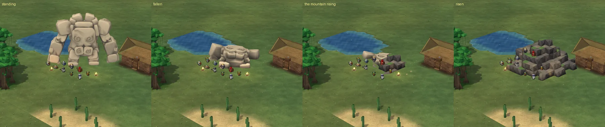
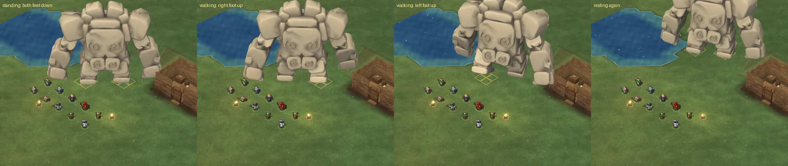

## The golem's slam, and the golem as a great beast (19:40-20:45)
- The fist slam is its own attack: both fists go up overhead while the tiles they will hit glow red, giving you time to run. Then they come down together in front. Whoever is on those tiles is thrown far and lives; anyone beside them is knocked back. Afterwards it stays bent over with its fists on the ground, slow to get up.
- Little rock handholds on its back and legs: a climber who gets to one, or is told to hold on, isn't shaken off.
- It is now one of the game's great beasts, like the dragons. Its two feet are its parts, and you fight it foot by foot. It knocks down the trees it walks through, and anyone its foot comes down on is knocked aside.
- It never strikes. It shakes weak units off its feet; strong ones keep their footing. With people in front of it, it turns to them and slams: walls on those tiles come down the way a siege breaks them, and tables, doors and workshops there are smashed.
- When it falls, a real mountain of the world's own blocks rises where it lay, up to seven blocks high in the middle, and the people there end up standing on the tops.
- It wakes when the world's rock starts running out, far from everyone's people.
- Ready to go in; it lands with the next build.

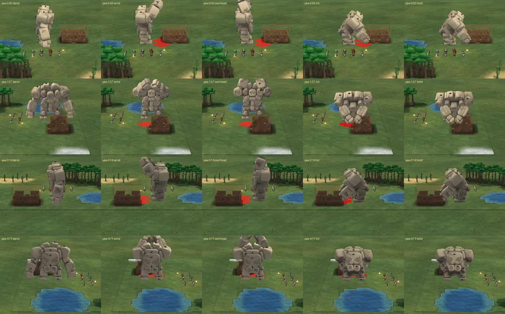
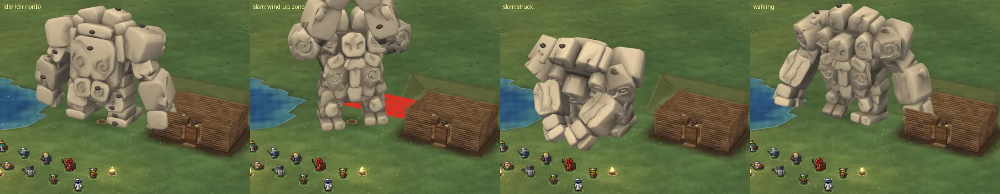

## Golems rise out of mountains; weapon moves; elf faces (20:45-21:20)
- Stone golems now rise out of the mountains themselves. A golem stands up out of the rock, and the blocks it's made of leave a golem-sized gap behind it. Then it roams the land near where it rose. When it falls, it becomes a mountain again, so golems carry mountains from place to place.
- A couple wake in each part of the world over time, far from everyone's villages. Where nobody is near, they stand still.
- Every weapon move now has its own animation: Lunge, Heavy blow, Riposte, Cleave, Skullcracker, Skewer, Flurry, and the magic weapons' Rune bolt, Fire wave, Frozen hamstring, Call lightning and Bone spear. Try them in the arena's new "Weapon moves" row.
- The dolls are back on in the game, and a unit that falls in a death stays lying the way it fell.
- The elves' faces and hair are back to how they looked before the reshade, which had made the face puffy and the hair blotchy.

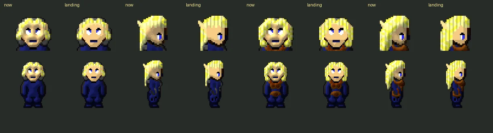

## Combat math and battles at scale (22:00-22:30)
- Arrows and throws now go Ranged against Defence, the same as melee, and armour turns arrows by the Defence and Armour skills.
- Real battles in the test arena, from 1 v 1 up to 50 v 50. A lone duel takes 10-35 s, but a 50-unit battle is over in about 2 minutes: the front lines gang up, and it snowballs.
- Archers at starting skill hit about 8% of the time.
- The full math, the results and the settings to try: [combat-math.md](combat-math.md)

## Training tried and undone; bleeding out, a minute to save them (22:30-23:15)
- Training was built to count for a lot more: skills about 4 times as much, more blows landing and each doing less. In the test arena, 20 trained units beat 40 fresh ones in under half a minute. But duels got shorter and nearly always ended in death, so it was taken back out (wounds and severing stay). The numbers: [combat-math.md](combat-math.md).
- A unit that would bleed to death now collapses instead, out cold, with a minute to be saved. Its card and the words over it count the seconds down ("Bleeding out 45"), and one line goes to your log.
- Anyone of yours can save it with something that stops bleeding: a bandage, a torch, a fire close by, a poultice, a healing draught or the Elixir. A friend within 3 tiles does it at once, someone carrying one walks over, and the Doctor drops everything for it. Saved, it gets up weak, with little blood, and the blood comes back slowly.
- Nobody comes, and it dies at the minute. It can't save itself, and enemies can still finish it off or rope it as a captive.

## Bandaging: tried taking time, kept instant; battles with bandages (23:30-00:45)
- First I tried making treating a friend take the helper time, the way bandages do in World of Warcraft. The helper steps beside the wounded unit and kneels: 4 s for a bandage, 3 s for a torch. It doesn't swing while it kneels, and a hit stops it, with the bandage kept for another try. Patching yourself from your own bag is still instant.
- After the battles you chose to keep it instant, with a new rule: a hurt unit that is still on its feet uses its own bandage, torch or potion on itself at once. That goes for ordinary wounds too, as soon as it is bleeding badly, not only for a lost limb. Once it's down, bleeding out or knocked out, it can't help itself. With nothing of its own it calls for help, once: a friend close by patches it, or someone carrying a bandage walks over, or the Doctor comes.
- Then the battles again, with 2 bandages for everyone: 5 v 5, 20 v 20 and 50 v 50, 6-11 fights of each kind, three ways (no bandages, instant bandaging, kneeling to bandage).
- Bandages save about half of the units that fall bleeding out, on both sides alike. Kneelers are struck and stopped about 1 time in 3.
- They don't soften the snowball. Fights last as long, the battle still goes one way, and the winner keeps about as many or more (50 v 50: about 20 of 50 left without bandages, 23 with kneeling).
- The sword Lunge is the last blow in about 2 deaths of 3.

## Melee: one roll to land, a d20 for where (00:50-01:40)
- A sword swing now works like an arrow. First one roll decides whether it lands at all: about 1 in 4 between two recruits, more often with Attack, less often against a good Defence. Then a d20 picks the one place it lands: a leg, an arm, the head or the body. Before, each body part rolled on its own, and now and then one swing hit two places.
- Duels, 16 fights each between recruits: sword fights 74 s before and 71 s after, armoured 68 s and 70 s. Most still end with someone knocked out, and limbs come off in most fights.
- Against trained units it changes little. A level 25 unit wins 5-7 of 8 before and 7-8 of 8 after, and sometimes loses a limb doing it. A level 50 wins every fight in about 30 s, before and after, and is almost never maimed. That comes from the weapon moves, which always land, not from this roll.

## Moves hit like blows, criticals, armour saves (02:00-03:30)
- Weapon moves (Lunge, Heavy blow, Cleave and the rest) now hit like any blow, on a place picked by the d20 and through that place's armour. They can cut a limb off. They no longer always land: their chance comes from Attack and the weapon's skill against the target's Defence. A recruit lands about a third of its moves, a level 25 about 4 in 10.
- A natural 20 is a critical: it lands whatever the odds and hits half again as hard. "Critical!" shows over the target.
- Armour can save a limb. When a blade would cut off an arm or leg in armour, a d20 rolls against the armour: in good plate, 13 or more. On a save, "Armour save 14" shows, and the limb is crushed instead of cut off. It stays on but is useless (the shield drops) until it mends in sleep or with a poultice.
- Found along the way: the duel test's "armoured" units had been wearing plate worth nothing (new pieces get their armour only from a smith). That's fixed now.
- Duels, before and after:

| Duel | Before | After |
|---|---|---|
| Recruits, sword | 72 s | 55 s, a limb off in every fight |
| Recruits, plate | 110 s | 72 s, 6 limbs saved by armour |
| Level 25 vs recruit, sword | 64 s, wins 7 of 8, never maimed | 53 s, wins 6, maimed 3 |
| Level 25 vs recruit, plate | 101 s, wins 3 of 8 | 98 s, wins 5, maimed 1 |
| Level 50 vs recruit, sword | 26 s, wins all | 39 s, wins all, maimed 1 |
| Level 50 vs recruit, plate | 61 s, wins all | 50 s, wins all, maimed 1 |

## New units start at level 1; RuneScape's XP pace (03:30-04:30)
- New units now start at level 1 in Attack, Strength and Defence. Before, a new human started at Attack 20, copied from its Sword. A unit still keeps its race's Sword practice, which comes back as Attack rises. Units you already have keep their levels.
- Combat XP now comes at RuneScape's pace: a quarter of what it was. So a recruit can't learn Lunge in the middle of its first fight any more.
- Duels with everything in (8 fights each):

| Duel | Before | After |
|---|---|---|
| Recruits, sword | 72 s | 63 s |
| Recruits, plate | 110 s | 130 s, 8 limbs saved by armour |
| Recruits, fists | 98 s | 112 s |
| Recruit vs Orc Scout | 86 s, recruit wins all | 106 s, recruit wins all |
| Level 25 vs recruit, sword | 64 s, wins 7 | 50 s, wins all, maimed 2 |
| Level 25 vs recruit, plate | 101 s, wins 3 | 56 s, wins all, maimed 1 |
| Level 50 vs recruit, sword | 26 s | 28 s, never maimed |
| Level 50 vs recruit, plate | 61 s | 34 s, never maimed |

- Recruit fights are back to a good length. Trained units now beat a recruit faster than before, because a recruit is truly level 1 now (it used to start at 20).

## Raiders get real combat levels, by rank (04:40-05:40)
- Raiders and monsters nobody owns used to sit at level 1, which is why a recruit beat an Orc Scout every time. Taking their levels from their old skills made warriors and leaders 99, enough to wipe out whole teams. So they now get levels by rank instead:

| Rank | Attack / Strength / Defence |
|---|---|
| Villager | 5 / 5 / 5 |
| Scout | 10 / 10 / 8 |
| Hunter | 12 / 10 / 8 (good with a bow) |
| Warrior | 25 / 25 / 20 |
| Guard | 35 / 30 / 45 |
| Commander, Chieftain | 50 / 50 / 40 |
| Kings, Lords, Warlords | 75 / 75 / 65 |

- Each race adds its own touch: orcs hit harder, goblins strike truer, dwarves are tougher, lizardmen and frogmen shoot better, and kobolds and ratmen are a bit weaker all round.
- What it aims for: three new units together beat a lone scout; three warriors wipe out a new village in the open, but not one with walls or trained units; guards hold their doors; a boss needs a trained army.
- Your own units and animals aren't touched.

## Facing and flanking, with an awareness roll (05:50-07:00)
- Units now have a front, sides and a back. A unit faces where it last walked, and takes half a second to turn toward a new foe.
- Hit from the side, it loses its shield block (half of it on the shield side) and half its dodge. Hit from behind, it loses both, and the attacker scores a critical on 18-20 instead of only 20. "Flanked!" or "From behind!" shows over it.
- Awareness: when hit from the side or behind, the unit rolls a d20 to meet the blow in time. A recruit manages about 3 in 10 from the side and 1 in 10 from behind; a Defence 50 veteran about 55 and 35. On a success, "Turned to meet it!" shows. Veterans also turn faster.
- Duels barely change.
- In the battles (3 of each, 20 against 20), attacking the flank won 2 of 3 with facing on and 0 of 3 without. A rear attack won 1 of 3 with facing, 2 of 3 without. Veterans held against a flank attack every time either way. Three of each isn't enough to be sure.

## Facing, part two: caught from behind, and charges (10-26 night, staged)
- Caught unawares: a unit doesn't notice a foe behind it until it takes a blow (or one comes at its side). Units hold their line and react only to foes they've noticed.
- Charges: a unit that runs at least 2 tiles into a foe it hasn't fought yet gets "Charge!": its sides are covered for a moment, and that first blow lands a little more often and hits 25% harder. Only the first contact counts. Before that fix, units "charged" 150-300 times a fight; now 30-80.
- Battles, 20 against 20 in plate, 10 of each:

| Attack | Facing off | Facing + these two |
|---|---|---|
| Head-on (holder B wins) | 8 of 10 | 10 of 10 |
| At the flank (attacker A wins) | 3 of 10, 2 draws | 4 of 10 |
| From behind (attacker A wins) | 4 of 10 | 6 of 10 |
| Veterans flanked (holder wins) | 10 of 10 | 10 of 10 |

- Holding the line got stronger and a rear attack wins most, but a flank attack doesn't pay off clearly yet: once the lines meet it turns into a scrum, and both sides land as many side blows.

## Morale, tested in battle (10-26 night, staged)
- You decide whether a blow kills or knocks out, with the Lethal toggle. Morale no longer turns a killing blow on a broken unit into a knock-out by chance.
- Battles of 20 against 20 in plate, 18 of each:
  - The side that cuts off the first limb or kills first used to win 2 in 3; with morale it wins half.
  - Fights last about a sixth longer.
  - Criticals nearly halve, because two in three units lose their nerve at some point, and shaken or broken units never crit.
- Against raiders, 9 in 10 Orcs break and run. In the test arena they had nowhere far to run to and were caught.

## Parting blows: tried and dropped (10-26 night)
- The idea: stepping out of an enemy's reach gives them a free swing, so retreats and routs cost something.
- The odds came out as planned. But in a real battle, units shift around all the time, so it fired 400-700 times a fight and halved how long fights last. Dropped; it never went into the game.

## Facing, tested properly: 30 battles of each (10-26 morning)
- At 30 battles per case, facing doesn't change who wins. Attacking the flank wins 12 of 30 with it or without it, and the same from behind. Once the lines meet it's a scrum, and both sides land as many blows to the side and back.
- Going round the side or back does beat a head-on attack (40% against 10-20%), but only because of where the fight starts.
- Sword parries now follow facing like the dodge: full from the front, half from the side, none from behind. In the game since build 56.
- Pinning (a unit fighting someone in front won't turn its back to anyone else) changed nothing, even with half the army hitting the line's back: a two-deep line's back row just turns to meet them. Staged, not in the game.
- Next idea, for the next developer: a bonus for surrounding a unit, plus high ground.
