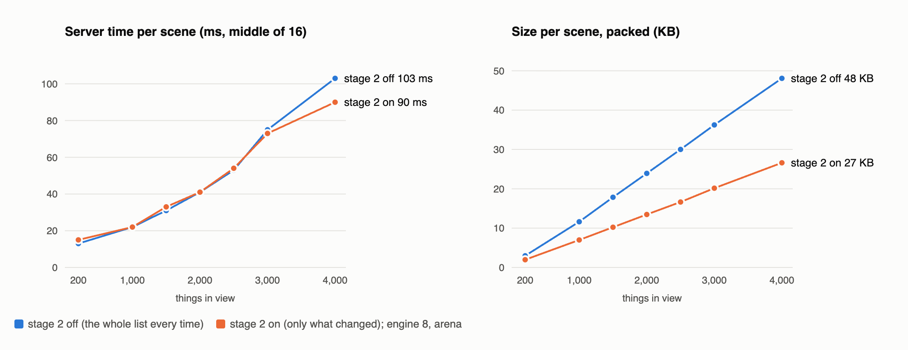
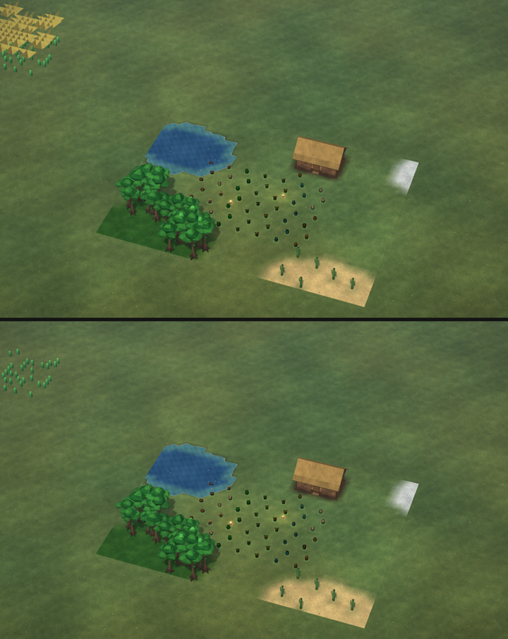
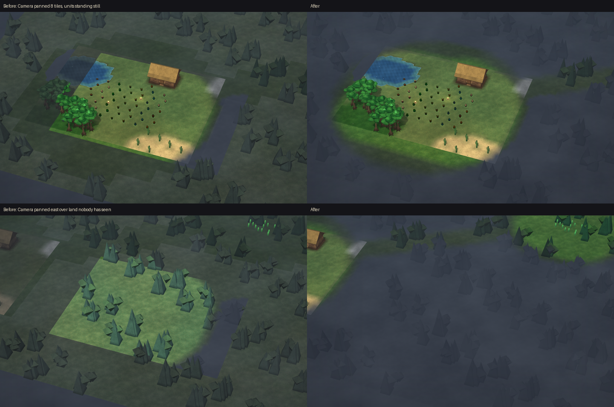
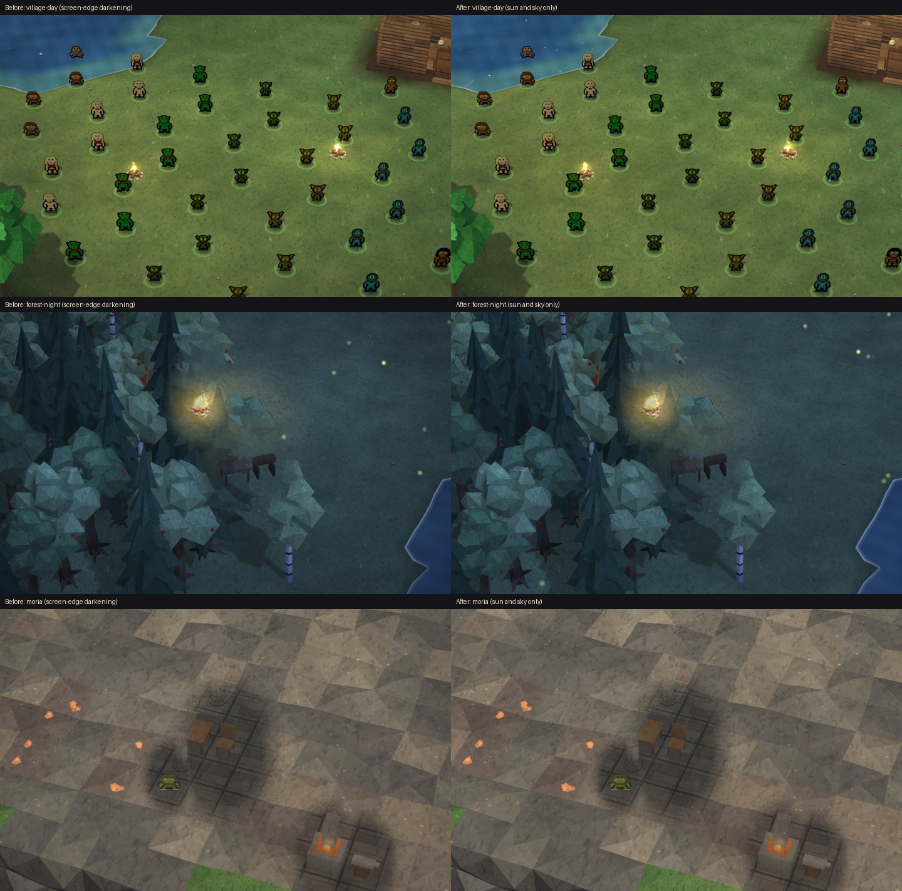
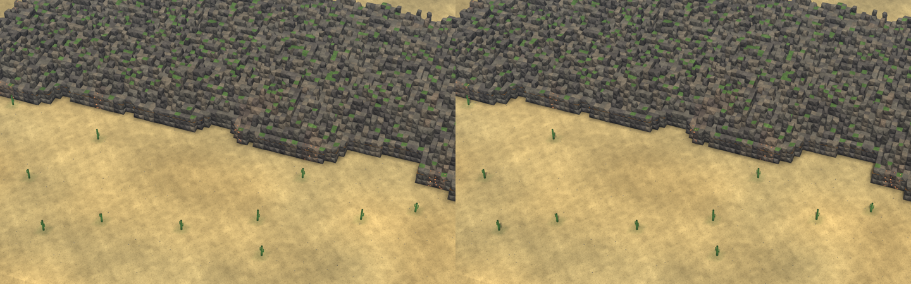
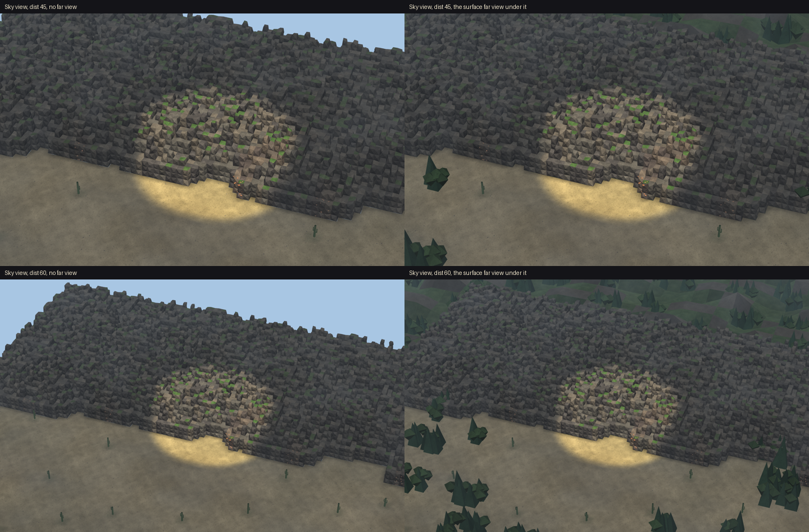
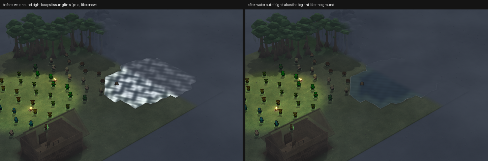
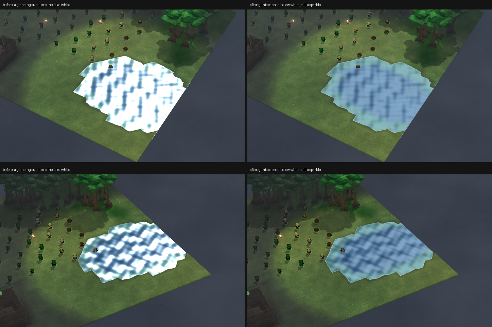

# World look (3D view): 2026-10-25

## "Send only what changed" for units is on (stage 2)
You said "put all the things in", so stage 2 is now on. The server sends a unit or object to your 3D view only when
something about it changed, not the whole list twice a second.

- **On for views of up to 4,000 things.** Above that it sends the whole list, as before. I measured where stage 2 stops
  paying off on today's engine (8): up to 4,000 it costs the server the same or less, and every send is 35-45% smaller.
  Earlier, at 5,000 on the old engine, it cost more, so it switches off above 4,000. Once off, it comes back on below
  3,600, so a view close to the limit doesn't keep flipping.
- **Your 200-unit game:** the server's work for the scene drops from 11 to 6 ms, its slowest moment from 30 to 11 ms,
  and each send is a third smaller.
- **Checked on the game itself:** at every one of 48 test steps the page puts together exactly the picture the old way
  gives. That includes going over the limit, coming back just under it, and coming back on.
- If anything looks off, `RM_3D_DELTAS=0` turns it off without a rebuild. There's also a restore point.

| Things in view | Server ms per scene, off -> on | Send size, off -> on |
|---|---|---|
| 200 | 13 -> 15 (same, within the clock) | 3.0 -> 2.0 KB |
| 1,000 | 22 -> 22 | 11.6 -> 7.0 KB |
| 2,000 | 41 -> 41 | 23.9 -> 13.5 KB |
| 3,000 | 75 -> 73 | 36.3 -> 20.1 KB |
| 4,000 | 103 -> 90 | 48.1 -> 26.6 KB |

- The first table row counts the whole scene (ground, fog and so on included), timed on a busy Mac with a 1 ms clock.
  The 200-unit bench counts only building the scene: 11 -> 6 ms.
- It's in the app build of 07:36 (you said "stage 2 looks good put it in").

## The 19 GB game window: fixed
Your 200-unit game made the game window itself grow to 19 GB in about three minutes. The Mac then ran out of memory, the
server froze for 16 seconds, and the window lost the server.

- **The cause:** the old 2D stats panel from the original game. Remastered never shows it (its pane is squeezed to
  nothing), but the server still rebuilt it ten times a second: every unit you own, plus about 45 lines for each unit
  you have selected. With 200 selected that's about 9,000 lines, ten times a second, and the window re-drew every one.
- **How we know:** both times it blew up, it started right after you box-selected about 200 units. In your second game
  the window sat at 0.7 GB until you selected; with 115 selected it grew about 80 MB a second. When you pressed Deselect
  it stopped growing at once.
- **The fix:** the server stops building that hidden panel. Nothing you can see changes, since the HUD already shows
  all of it. On the server alone that saves about 40 ms of work every second with 200 selected (test map).
- **Fixed** (you said "okay fix it"), checked with a 5-minute game run: all 203 units selected and ordered five times,
  and the window stayed at about 0.7 GB the whole time (it grew 36 MB in 5 minutes, where before it grew 80 MB a
  second). It never lost the server. The server's hidden work dropped from 162 to 9 ms a second, and its slow moments
  (over 100 ms) from 250 to 13. It comes with the next app build.

## Hitches when the map loads: fixed
You said: "yea i knew hitches on map load right we need to fix this somehow".

- **What it is:** the first time the 3D view shows a piece of mountain, the server works out how tall each rock column
  is by looking at every tile around it, up to 5 tiles out. A 16x16 patch of mountain took up to 157 ms in one go, so
  the game froze for a moment as you panned onto new land. At the start of a game, every unit's look is new too, and
  their pictures were made in bunches of 64: 200-700 ms in one go.
- **The fix being tested:** the 3D view now stops for the tick in the middle of a patch (every 32 tiles) and after each
  unit's picture, and goes on next tick, so no single moment carries it. On the test map: the worst moment for new
  mountain went from 117 to 24 ms, and for new units from 435 to 76 ms. The picture comes out exactly the same: all
  48 test steps match, even with the work cut into the smallest pieces.
- **The catch, and what I'm doing about it:** spread out, the same work takes longer to finish. Panning fast over new
  land, the ground then arrived only every 3 seconds. So while new ground is being built, the 3D view now gets a bigger
  share of each tick (30 ms instead of 10), still with no moment over about 50 ms.
- **Measured in a real game window** (your world, 200 units, joining and then panning across the map):

  | | Before | With the fix |
  |---|---|---|
  | Moments over 100 ms | 7 (4 from new ground) | 1 (none from new ground) |
  | The biggest bite the 3D view takes in one moment | 285 ms | 58 ms |
  | Time until you first see the 3D view | 2.0 s | 2.1 s |
  | Scenes that took over a second to build | 21 of 406 | 13 of 401 |

  It's in the game (with the coordinator's OK), checked again on the new engine (v10): no moment from new ground, the
  biggest bite 62 ms, and only 1 scene in 439 slow to build (before: 21 in 406). It comes with the next app build.
- **One join hitch is left, and it isn't the 3D view:** a moment of about 2 seconds right as you join, in the server's
  other work. The coordinator is passing it to its owner.
- **Also found:** the rock-height lookup can look only at the new ring of tiles at each distance instead of the whole
  square again. On your own map: exactly the same heights for all 626,237 mountain tiles, and 1.8x faster (most of
  your mountains are deep rock, which needs the whole look). The mining checks give the same results. It's waiting
  for the coordinator's OK, as its own change.

## One sight grid: a proposal for you (nothing changed in the game)
You think unit looks, the camera and the minimap stack up into hitches. I checked: of 277 slow moments in today's
200-unit games, 19 had two or more of them working hard at once. Most were one thing spiking alone (mostly the 3D
ground, fixed today). So stacking happens, but it isn't the main cause.

- Today **seven separate passes** each work out "who is near" or "who can see what" by themselves, about 40 ms of server
  work a second at 200 units.
- **The proposal:** one grid of where every unit stands, kept by the engine as they move, and one answer to "who sees
  this", the fog's (already built once per alliance). Every pass reads those instead of scanning the map again. Land
  near you keeps waking in its own wider circles, so nothing anyone can see ever goes to sleep.
- **The biggest win needs no grid at all:** with fog on, the explored map is marked twice, once by the fog and again by
  a scan round every unit every 2 seconds. That second scan is 9 ms a second at 200 units and about half a CPU core at
  5,000. It can simply go.
- **Also found:** underground, the fog marks the explored map through rock, so cave shapes behind a wall may show dimly.
- Four choices for you are at the end of `planning/ONE_SIGHT_GRID.md`.

## The explored map, marked once (in the game since 10:26)
You chose: drop the double marking first, and underground by line of sight only.
- **With fog on, the explored map is now marked once**, by your side's fog circles, and no longer again by a scan round
  every unit. On the test map it comes out exactly the same: 11,054 explored tiles both ways after 20 steps of 200
  units wandering. The work it saves: 13 ms a second at 200 units, 280 ms a second at 5,000 (down to 3).
- **Underground, no more seeing through rock.** A cave room behind 3 tiles of rock used to come out 41 of its 64 tiles
  "seen before"; now none, while everything your unit can actually see is still marked.
- The fog checks (15) and the 3D page check all pass. In the game files, and in the next app build.

## The yellow things (first guess: planned walls; see the correction below)
You said "i think these yellow things cause lag". They're walls you've planned that are waiting for stone: see-through
boxes, and each tile's end shows as a little vertical divider.
- **Drawing them costs almost nothing:** 300 of them add a fifth of a millisecond to a frame.
- **But you're right that they come with lag.** Every builder assigned to them, every half second, goes through every
  planned site looking for stone: the stockpiles, then all around themselves. With no stone anywhere, the answer never
  changes, but they keep asking. With 30 builders and 300 planned walls that's about a fifth of the server's time.

  | Builders | Planned walls | Server work each second |
  |---|---|---|
  | 0 | 300 | 3 ms |
  | 10 | 300 | 70 ms |
  | 30 | 300 | 198 ms |

- **The fix I proposed** (it's in the building code, so it goes to its owner): work out once per half second what each
  site needs and whether there's any stone, not once per builder; and let a builder with nothing to build wait a few
  seconds before asking again, unless stone arrives. About 20 times less work for the same answers.

## The yellow things, corrected: the arrows over far-off units
You told us: "the yellow lines are when units are in a distance a big yellow arrow points down on each unit".
- **What they are:** when your units are beyond the detailed part of the 3D view, they're drawn as small far-off
  figures, and each of yours gets a gold arrow that stays the same size on screen however far away it is. A crowd of
  them side by side makes that zigzag strip.
- **They aren't the lag either:** with 300 of your units far off, frames take about 1 ms more at the worst moments, and
  none came near a slow frame. What usually comes with them is a camera zoomed far out, which means the biggest scenes.
- **Your choice what they become:** keep them; make them smaller; show them only over units you've selected; one arrow
  per group of units standing together; or remove them and keep just the figures.
- The builders waiting at planned walls (above) are still a real cost, and that fix still stands.
- **Also ready:** a small speed-up for the gold outlines on blocks your units are about to dig: they're kept instead of
  rebuilt every frame (identical in 9,510 checks), and at 300 digs the 3D view does about 1 ms less work a frame.

## The far-off arrows go (in the game files, next app build)
You said: "nah the arrows are to much we have the focus button and we can double click a unit in company to find them".
- The gold arrows over your far-off units are gone; the small figures stay exactly as they were (checked vertex for
  vertex: the same bodies and heads, only the arrows' triangles missing).
- The figures are now built once when the server sends a new scene, not again every frame.
  
- Next I'm measuring the game zoomed all the way out with 200 units, since that's when you saw the arrows and felt the
  lag: every slow moment on the server and every slow frame, named.

## Zoomed all the way out: where the lag is
I ran your world with 200 units, the camera at its widest, panning and standing, with the army ordered every minute.
- **The stutter you feel zoomed out is the page applying each scene:** twice a second the server sends the new scene,
  and at the widest zoom the 3D view takes 40-70 ms to take it in, so a frame or two is late each time. That happens
  even when the camera stands still. Up close it's much smaller.
- **On the server**, a whole-army order zoomed out gives about 3 seconds of slow moments: every unit starting to walk
  at once, the 3D view sending all 200 moves, and the HUD redoing units' portraits.
- Next: find which part of taking in a scene costs the 40-70 ms (the ground, the fog, the units or the far view), then
  fix that part.

## The fog that followed the camera (in the game files, next app build)
You said: "camera movement the field of view or the fog follow camera instead of only being viewable on units".
- **You were right, and there were two causes.** When you moved the camera while your units stood still, the lit
  circles round them slid along with the camera until one of them moved. And everything outside the area the camera
  loads was drawn as "explored", so the dark never-seen mist ended in a box that travelled with the camera.
- **Now sight comes only from your units:** the lit circles stay on them wherever the camera goes, land nobody has seen
  stays in mist all the way to the horizon, and the land your units walked through stays explored, near or far.
  Far-off groups of yours light up their own circle too.
- Checked in a real app window as well as the test browser; when everything is explored, the picture is exactly the
  same as before, and the far fog is redrawn twice a second at about 1 ms, never every frame.
  

## No more dark screen edges (in the game files, next app build)
- The view used to darken slightly toward the edges of the screen, more at night and underground, so the middle always
  looked brighter wherever the camera went. That's gone: light now comes only from the sun and the sky (and fires).
  

## Zoomed out: why panning stutters, and the first fix (ready, waiting for the OK)
- **Found it:** zoomed all the way out, standing still is smooth. The stutter comes while the camera moves: each step,
  the 3D view rebuilt the tops of every mountain in sight from scratch, about 4,000 tiles of them.
- **The fix:** the mountain tops are now built in small pieces like the ground, so a step only builds the strip that
  just came into view. A pan step went from about 40 ms to about 20 ms in the app's own browser engine, with the land
  drawn exactly as before (checked down to every corner of every triangle).
- **Next:** spreading what's left of each step over a few frames, so panning zoomed out feels as smooth as standing.
  
- **Landed:** the mountain-top fix above is in the game files for the next build.
- **Next piece ready (waiting for the OK):** zoomed out, the land coming into view is now built over a few frames
  before it's put in, instead of all at once in one frame. On the way I found a small old bug: after a pan, a thin
  strip at the edge of the loaded land could keep showing the ground from one step before. That's fixed too.
- **Landed:** building the land ahead over a few frames is in the game files, with the edge-strip fix. Panning zoomed
  out no longer does all its building in one frame.
- Next: one real game run zoomed out with 200 units, to count the stutters against this morning's run.
- **Checked in the real game** (zoomed all the way out, 200 units, the camera panning): stutters while panning went from
  about 2 in every 100 frames to about 1 in 200, and none of the ones left came from the 3D view's own work. The check
  was shorter than planned (another test window opened over it), so it's a first look, not the final word.

## The Sky level, fixed (in the game files, next app build)
You said: "fix and add it".
- **No more empty pale edges:** up on the Sky level, the land past the loaded area now shows the surface's distant land
  out to the horizon, the same as from the ground.
- **No more dark slab:** once the mountain-heights step lands with it, ordinary mountain tops are open sky from up
  there, the ground is drawn far below, and your people on mountains stand on top of them.
  

## Water out of sight no longer looks like snow (in the game files, next app build)
- **The problem:** in the playtest, rivers and ponds just past what your people can see drew pale white, brighter than
  the sunlit grass beside them. The sun's sparkle on the water was still showing through the fog.
- **Now:** water you can't see takes the same blue-grey fog as the land around it. Explored water is a shade darker and
  bluer than the ground, so you can still tell where it is. The sparkle only shows where your people can see.
  

## The sun on water no longer turns a lake white (in the game files, next app build)
- **The problem:** with the sun low and in the water, a whole lake you can see turned white, brighter than anything
  around it.
- **Now:** the sun still sparkles on the water, but never brighter than a pale blue, and calm water looks the same as
  before.
  
