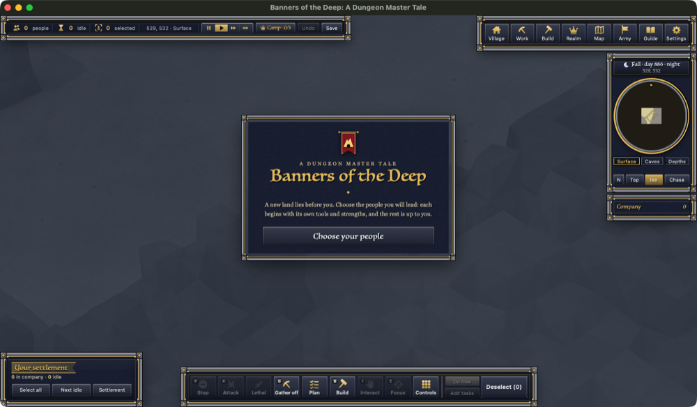

# Polish night, 10-26 → 10-27: the summary

You asked (19:00): "please make agents i just want to do a polishing sweep everything that needs polishing polish it",
then for zones, a HUD rework, better loading and start-up screens, combat speed and fair skilful combat, WoW-level
polish, data on speed, and a clean stop before the usage limit. This page is the short version; each worker's devlog
in this folder has the detail and pictures.

**The app is build 68.** Builds 63, 64, 65, 66, 67 and 68 each passed check_app (your saves unchanged) and the launch
check (3D on, 0 errors). Every earlier app is kept in `restore-points/appN-before-buildN+1-*`.

## What changed for a player

- **Looks:** the HUD rework (per-race forged frames, gilt corners, tab strips, quieter idle states; every panel and
  button where it was), a new loading screen (the painted world, a bar that moves only with real load stages, true
  one-line tips), a new launcher window, and race/start/story cards that show each people's own units.
- **Gather zones:** your no-Tend regrow redo is in (build 67): trees felled whole, zone workers replant and tend
  saplings. A 64-tree wood: 128 → 325 logs in 30 min; workers off the zone 83% → 2%. Plus six zone fixes (yards no
  longer inside a neighbouring zone, unreachable trees skipped, real rates on the zone rows, fishing no longer "+0/min").
- **Work loops:** builders wait at their site and say what's missing (3,522 s standing idle → 0), toasts 535 → 105 in
  30 min, miners' bags no longer clog with ore, Make orders find wood on any stockpile cell, job rows show live status.
- **Combat (no number changed):** units turn to a standing foe instead of hacking a fallen one (so falls can be saved);
  arrows, throws and spells follow your every-fall-saved rule; Non-lethal archers fight instead of standing around;
  "Tie to that tree" works; cards say "Knocked out" / "Bleeding out". Your pick: Defence 50+ units have no morale.
- **Start and coming back:** Start over → Not now no longer leaves you with no company; answered cards no longer flash
  back; the migrant question is a HUD card; the Guide's hints name real buttons.
- **Everything else:** about 150 old typos and a dozen wrong names fixed, Rename house finally works, the message box
  no longer hides under the bar, the Fights log shows fights, big-group orders reach every unit, own units on a
  mountain stay visible and clickable, torches fade instead of blinking, cart loads arrive whole, gear falls from a
  cut-off arm, 10 creature and magic fixes, 10 village fixes, 10 items fixes.

## Numbers (speed, measured)

| What | Before | After | Where |
|---|---|---|---|
| Fights, server DM time per tick | 100% | 75-84% | combat-speed (9 speedups, identical fights on 4 seeds) |
| 100 v 100 battle | build 62 | ~13% cheaper in 63; p95 tick 19% lower in 66 | perf-watch |
| Village work pass, 8 Humans | 3.5 ms/tick | 2.6 ms/tick | loops |
| Settlement pass alone at 2,000 workers (10 passes) | 64-74 ms | 34-52 ms | zones (regrow redo) |
| Whole server tick, 2,000 workers gathering (build 66 → 67) | 100% | avg +43%, p95 +53%, worst tick 0.5-0.7 → 1.3-1.5 s (speed 4) | perf-watch, 3 pairs: workers store 58% more (13.4k → 21.3k pieces), so ~20% cheaper per piece; likely the regrow redo. Decision 4 |
| Whole server tick, 200 workers gathering (build 66 → 67) | 100% | avg +8%, p95 +19% | perf-watch (1,320 → 1,990 pieces stored) |
| 3D look of all 585 gear types | 5.4-7.9 ms | 1.9-2.3 ms | errors |
| HUD script per update, 203 units (one / all / none selected) | 1.7 / 2.0 / 2.0 ms (64) | 2.9 / 3.1 / 3.5 (65) → 1.9 / 2.2 / 2.3 (68, within noise of 64) | perf-watch found it: five `:has()` rules on the race card, fixed in 68 |
| HUD page size | 1,332 KB | 1,657 KB | new art (+325 KB; costs no script time) |

Server memory (114 MB at 200 units, 400 MB at 2,000), walk latency and the battle: the same within noise in every
build. Build 68's compiled game is identical to 67's (only the HUD page changed). Perf-watch's full tables: `perf-watch.md`.

## How it was kept safe

- 50 landings, each through one lander: exact-text patches, a restore point per landing, the gate (compile, scripts,
  HUD join, combat 32/32, plus each area's checks), automatic put-back on failure. 0 landings failed.
- Every landing was reviewed against your rules (a free automatic check plus four review passes, Sonnet reviewers with an
  Opus refuter): **50 of 50 kept, none put back.**
- The night paused cleanly at 89% of the 5-hour limit (22:08) and restarted itself at 23:53.
- Disk: 27 → 12 GB free over the night (scratch copies); an alarm watched it; only Claude-made copies were removed.

## Decisions waiting for you (ranked)

1. **Villages can't finish their first building alone**: furniture orders can't pull workers (a house 36/41 at 5 min,
   then 25 min waiting for a table and chair). Four options in `polish-loops.md`.
2. **Quitting saves a dying unit**: a dying or knocked-out unit comes back standing at 1 HP. Fixing it is a save-format
   change (one more value). `polish-start.md`.
3. **Training vs gear**: one on one it works as you asked (20 levels ≈ a full iron set), but in groups training wins
   almost every time, and gear above iron barely shows (GearAny halves it below its level). Tables and options at the
   top of `combat-rules.md`.
4. **Regrow side effects**: (a) with too few villagers, the wood row keeps its tenders (stone 618 → 24 in one test).
   Should a waiting tender help a short row? `polish-zones.md`. (b) At 2,000 workers the server tick is 43% heavier on
   average and its worst ticks reach 1.3-1.5 s at speed 4, because the workers bring in 58% more. Are those spikes
   acceptable, or should they be smoothed first? `perf-watch.md`.
5. **HUD proposals with pictures**: a realm overview, the roster as a sortable table, one CK3 top bar, split bar labels,
   a WoW portrait. `hud-rework.md`.
6. **Combat questions**: downed units get knocked back a tile; a destroyed brain/heart can be bandaged; a stagger counts
   as "down" for capture; units stack on one tile in melee (spreading them changes surround numbers); an Ashen's burn
   ignores Lethal; slightly more post-fight bleed-outs in combat-speed's table (likely chance; re-run battle_rescue).
7. **Mountain stone zones**: how much of a mountain a zone should take (three choices with numbers). `polish-zones.md`.
8. **Smaller calls**: two "house" names; one board with four names; two settings both called "Stance"; F5/F7/Tab still
   on 2006 commands (F7 opens a send-file prompt); empty group number clears the selection; crafting odds 45% at the
   carpentry but 4% from the Work tab; cave mouths and room grades (a bracket bug whose fix moves things in your world);
   the launcher's darker painted look; more lore or fewer rules in the loading tips; the browser lobby still says
   "Kin & Stone" (needs a tools/relay change); the portrait level badge shows 0 for new villagers.

## Where things are

- Each worker's devlog: `polish-*.md`, `hud-rework.md`, `screens.md`, `combat-speed.md`, `combat-rules.md`,
  `perf-watch.md` in this folder; pictures in `img/`.
- The team board: `reports/polish-night-1026/BOARD.md`; every fix's patch, README and proof under
  `reports/polish-night-1026/<area>/`; restore points `restore-points/before-polish-*`.
- One mistake: the HUD agent removed another agent's scratch folder (`ch2/`) while cleaning; it was test scratch, not
  game files or your work.
