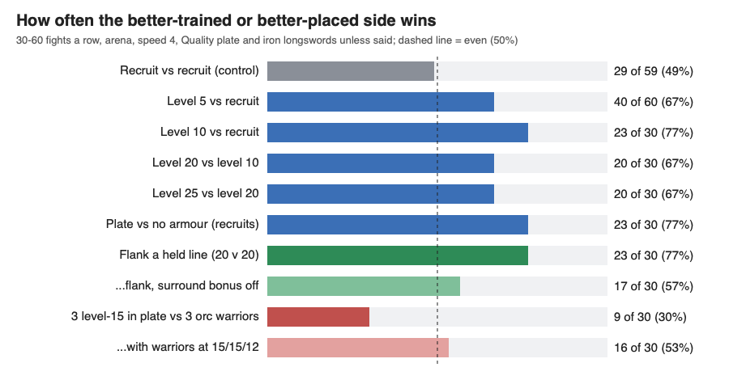

# Combat rules: fair and skilful fights (polish night, combat-rules)

Measured how fair and how skilful fights are today with about 900 test duels and battles. Fixed one bug in an approved
morale rule and built your new rule that morale doesn't touch veterans (Defence 50+). Everything else is staged as
options with tables for you. I also wrote the trait plan you asked about
(`planning/TRAITS_PLAN_2026-10-26.md`).

## Decisions waiting for you

0. **Training against gear (your ask: "units trained should be powerful too, but then a better geared unit can
   win").** In a duel it already works like that: a level-50 unit in a new realm's starting kit (leather top and
   legs, iron axe) is an even match for a level 25-35 unit in a full set of real gear. In a group, training wins
   almost every time, and the gear tiers above iron hardly show anywhere. No change made; two questions below.

   *Duels, 30 each. Each cell: how many the level-50 in the starting kit wins (median length).*

   | Level 50 in the starting kit against | Level 25 | Level 30 | Level 35 |
   |---|---|---|---|
   | Iron set and longsword (iron is level 10-15 gear) | 19 of 30 (45 s) | 13 of 30 (35 s) | 10 of 30 (35 s) |
   | Adamantium set and longsword (level 50-55 gear) | 18 of 30 (40 s) | 17 of 30 (44 s) | 12 of 30 (40 s) |
   | Hellforged set and longsword (level 70-75, the best) | 19 of 30 (44 s) | 14 of 30 (40 s) | 16 of 30 (38 s) |
   | The same starting kit (training alone) | 24 of 30 (35 s) | - | 21 of 30 (40 s) |

   *The same, 5 against 5 (12 battles each):*

   | Level 50s in the starting kit against five | Level 50s win | Length |
   |---|---|---|
   | Level 25, iron and longsword | 11 of 12 | 50 s |
   | Level 30, iron and longsword | 12 of 12 | 52 s |
   | Level 30, iron and battle axe (same weapon kind as theirs) | 10 of 12 | 65 s |
   | Level 30, adamantium and longsword | 10 of 12 | 56 s |
   | Level 30, Hellforged and longsword | 9 of 12 | 58 s |
   | Level 30, Hellforged and battle axe | 10 of 12 | 60 s |
   | Level 35, adamantium and longsword | 10 of 12 | 80 s |

   *The reverse (gear on the trained side) and what gear is worth on its own:*

   | Duel, 30 each | First side wins |
   |---|---|
   | Level 50 in iron vs level 35 in the starting kit | 28 of 30 |
   | Level 50 in Hellforged vs level 35 in iron | 19 of 30 |
   | Level 50 in iron vs level 25 in iron (training alone, both geared) | 24 of 30 |
   | Level 50 in iron vs level 50 in the starting kit | 22 of 30 |
   | Level 30 in iron and longsword vs level 30 in the starting kit | 24 of 30 |
   | ...armour alone: iron set vs the starting kit, both with an axe | 18 of 30 |
   | ...weapon alone: longsword vs battle axe, both in iron | 18 of 30 |
   | Level 50 in Hellforged vs level 50 in iron | 15 of 30 |
   | Level 30 in Hellforged vs level 30 in iron | 14 of 30 |
   | 5 v 5, level 30 in iron and axe vs level 30 in the starting kit | 7 of 12 |

   - Nearly every fight ends with the loser bleeding out (savable for 60 s); 0-4 duels in 30 end in a knock-out.
     Each side loses about 1.3 limbs a duel, and the winner fewer (0.9 against 1.8 when one side is clearly better).
   - **One on one, 20 levels of training is worth about a full iron set and longsword.** Each alone wins about 2 duels
     in 3. Armour and weapon count about the same (18 of 30 each).
   - **Gear above iron doesn't count.** A unit below an item's level uses it at its level / the item's, never below
     half (GearAny, your 10-26 pick), so Hellforged at level 25-35 works at 50%: about iron's numbers. Even at level
     50 (67%) Hellforged ties with iron, 15 of 30. Two reasons: a blow's damage is mostly Strength and skill (the
     weapon is a small part of it at level 50), and armour takes armour/(armour+100) off, with each worn piece counting
     6 times its Defence: an iron breastplate (12) takes 42% and a Hellforged one (21) 56% at full strength, but only
     46% at level 50 and 39% at level 25-35 (corrected 10-27: I first wrote 11% and 17%, leaving out the 6 times).
   - **In a group, training decides.** The level-50s win 9-12 of 12 against every gear set, and it isn't the morale,
     veteran or surround rules: with morale off (11 of 12), surround off (12 of 12) or on the game from before
     tonight's morale landing (11 of 12) it comes out the same. In a duel the first fall ends it; in a group a
     wounded veteran fights on and the lead grows. At the same level, gear gives only a small edge in a group (7 of
     12).
   - "Steel" isn't in the game. I used adamantium as the step between iron and the best (Hellforged).

   **Questions for you:** (a) should a full set of top gear count more than iron, for example by its effectiveness
   floor (now half) or its armour share? (b) Should five trained units beat five geared ones every time, or should
   a group fight swing on gear as a duel does?

   **Skill at small and big scale, and the cost, for each option** (your ask: "fair and require hi skill from
   runescape small groups to the big groups"). Iron longswords and Quality plate; 30 fights a row unless said.

   | The more skilful side wins | Today | Morale lines at half | Quicker swings |
   |---|---|---|---|
   | Duel: level 5 vs a recruit | 40 of 60 | not re-run (morale hardly moves in a duel) | 24 of 59 |
   | 3 v 3: level 5s vs recruits | 20 of 30 | 17 of 30 | 16 of 30 |
   | 3 v 3: all on the most hurt foe vs each on the nearest | 13 of 30 | 18 of 30 | 18 of 30 |
   | 20 v 20: level 5s vs recruits | 13 of 24 (two sets of 12) | 8 of 12 | 8 of 12 |
   | 20 v 20: level 10s vs recruits | 12 of 12 | - | - |
   | 20 v 20: into the end of the line | 21 of 30 | **26 of 30** | 20 of 30 |
   | 20 v 20: head-on into the line (control) | 16 of 30 | 17 of 30 | 12 of 30 |
   | **Cost:** ms a tick, 400 units fighting (two runs) | 20.6 and 17.7 | 17.9 and 22.6 | 17.5 and 18.6 |
   | ...worst tick (two runs) | 403 and 128 ms | 149 and 235 ms | 130 and 214 ms |
   | ...ms a blow (strike chain) | 0.165 and 0.151 | 0.143 and 0.172 | 0.151 and 0.176 |
   | ...ms a unit's morale second | 0.102 and 0.089 | 0.091 and 0.103 | 0.092 and 0.094 |

   - **Small groups:** skill shows. Five levels wins 2 fights in 3 one on one and in 3 v 3, as does better gear.
   - **Big groups:** a small edge is lost in the crowd (level 5s win 13 of 24 at 20 v 20), a big one takes it all
     (level 10s, 12 of 12), and where you hit counts: the end of a line wins 21 of 30, head-on 16. Morale lines at
     half make that positioning pay more (26 of 30); quicker swings cost the small edge one on one and in 3 v 3.
   - **Focus fire doesn't pay today** (13 of 30): sending all three at the most hurt foe walks them round the fight
     and costs swings. Nothing to fix; skilled play here is placement, not target picking.
   - **Cost: no measurable change for any option.** The same game varies 15% run to run on this busy Mac (20.6 and
     17.7 ms a tick); every option is inside that. Quicker swings make 14% more swings, but each blow costs the same
     and the swing timer is checked as often, so the strike chain's total stays the same. NPC warriors at 15/15/12
     only change the numbers a raider is made with (3 level-15s vs 3 warriors: 9.9 ms a tick today, 11.9 with the
     option, one run each, within noise). How measured: `tests/cr_fair.dm` times every strike and every unit's
     morale second with `world.tick_usage`; `tests/cr_prof.py` reads the tick profiler (speed 1, 1% = 1 ms), from
     the start of the battles to the median battle's end; 10 battles of 20 v 20 both attacking, two runs per game.

1. **Morale lines at half?** Morale now almost never moves in an even fight, so the tug of war doesn't happen. With
   the lines at half (Shaken and Emboldened at 15, Broken and fury at 30), the side that wavers first wins nearly half
   its fights. Option: `reports/polish-night-1026/combat-rules/options/morale-lines-half/`.

   | 20 v 20 recruits | Tonight | Lines at half |
   |---|---|---|
   | Units ever Shaken / Broken | 3-5% / 0% | 9-10% / 4% |
   | Units ever Emboldened / in fury | 1-2% / 0% | 4-7% / 1-4% |
   | The side shaken first wins | 8 of 30 | 12-14 of 30 |
   | Fight length | 163-180 s | 182-200 s |
   | NPC orcs that rout (of 240) | 1 | 5 |

2. **NPC warriors at 15/15/12 (now 25/25/20)?** The NPC-levels plan's own aim was "three warriors wipe a fresh realm
   but not one with level-15 units". Today they also beat level-15 units in Quality plate 2 fights in 3. Option:
   `options/npc-warrior-levels/`.

   | 30 squad fights each | Today | Warriors 20/20/15 | Warriors 15/15/12 |
   |---|---|---|---|
   | 3 recruits vs 3 orc warriors | warriors 30 of 30 | 30 of 30 | 30 of 30 |
   | 3 level-15 in plate vs 3 orc warriors | warriors 21 of 30 | 22 of 30 | 14 of 30 (even) |

3. **Quicker swings? My read: no.** Battles get longer, not equally long, and the luck doesn't drop. The patch is ready
   if you want the snappier feel anyway: `options/quicker-swings/`.

   | | Today | Quicker (a third more swings, three-quarters damage) |
   |---|---|---|
   | 20 v 20 battle length | 156 s | 182 s |
   | Level 5 beats a recruit | 40 of 60 | 24 of 59 |
   | Level 10 beats a recruit | 23 of 30 | 23 of 30 |
   | First limb or fall decides a recruit duel | 22 of 28 | 26 of 29 |

4. **Should race stats count on top of NPC role levels?** 20 orc scouts (levels 10/15/8) beat 20 level-10 humans in
   Quality plate in 7-10 of 12 battles (two runs). The orc race's own Strength, Defence and organ health and the axe's
   cleave add a lot on top of the levels. A fresh realm of 3 still beats a lone scout 30 of 30 (the plan's aim holds).

5. **Veterans in a pass.** Ten level-50s still lose to a hundred recruits in a 3-wide pass, so there are no "Spartan
   300" moments yet. In a 3-wide pass the middle veteran still faces 3 foes (ahead plus two diagonals), so the
   surround bonus doesn't cancel there. The table is below; it's a question for you, not a fix.

6. **Lethal fist-fighters knock out, never kill.** Fists "knock out first" (build 36, "perfect"), so a Lethal brawler
   never kills: 30 of 30 fist duels ended in a knock-out. Keep, or let Lethal fists kill like the toggle says?

7. **Traits** (your 21:40 idea): the plan, with its 4 questions at the end, is in `planning/TRAITS_PLAN_2026-10-26.md`.
   Nothing is built (freeze).

## Landed

Both landed together as one patch, `combat-rules-morale`. The gate passed (compile, scripts, HUD, combat 32/32,
stumps 23/23). Restore point: `restore-points/before-polish-combat-rules-morale-20261026-213357`. Not built yet; it
goes in the next batched build.

- **Fallen units no longer count as fighters for morale (bug fix).** Two approved rules are "fighting 2+ foes at once:
  -1 a second" and "outnumbered 2 to 1: -1 a second". Both counted units lying knocked out or bleeding out. Since
  every fall became savable (build 59), a unit beside one live foe and one fallen foe lost morale as if fighting two.
  Most of the Shaken units in even battles came from this miscount (10% before, 3% after); who wins doesn't change.

  | Check (10 seconds of morale) | Before | After |
  |---|---|---|
  | One foe standing beside it, one bleeding out beside it | -9 | 0 |
  | One foe standing, two knocked out near it | -10 (outnumbered) | 0 |
  | Two foes standing beside it (control) | -9 | -9 |

- **Veterans have no morale (your rule, 21:3x: "morale shouldnt matter for vets", Defence 50+).** A unit at Defence
  50 or more stays Steady: no Shaken or Broken, no Emboldened or fury, no held-back blood, and an NPC veteran never
  routs. Its own criticals, severs and kills still lift its friends and shake its foes. Its card's morale line reads
  "Steady: a veteran (Defence 50+), morale doesn't move it". Switch: `rm_morale_vet` (0 turns it off).

  | Check | Before | After |
  |---|---|---|
  | Defence 50 unit pushed down 40 | Shaken | Steady (0) |
  | Defence 49 unit pushed down 40 (control) | Shaken | Shaken |
  | Defence 50 unit pushed up 70 | Emboldened | Steady (0) |
  | Its kill lifts the friend beside it | yes | yes |
  | 10 veterans vs 100 recruits in the open | lose 10 of 10, 9.5 recruits downed | lose 10 of 10, 8.8 downed |

- **Cost of both: no measurable change.** 400 units fighting, two runs each: 18.6 and 18.7 ms a tick before,
  20.6 and 17.7 after; a unit's morale second 0.095 and 0.096 ms before, 0.102 and 0.089 after.

## Numbers

All runs are in `reports/polish-night-1026/combat-rules/runs/`, made with the new battle tool `tests/cr_fair.dm`
(arena, speed 4). It covers duels, battles, flank, pass, NPC and squad cases, logs who wins, and has a table maker.
Iron longswords and Quality plate unless said; 30 fights a row.

**Skill and luck, one on one:**

| Duel | Better side wins | Length | First limb or fall decides |
|---|---|---|---|
| Recruit vs recruit, plate (control, both runs) | 29 of 59 | 68-70 s | 46 of 57 |
| Recruit vs recruit, no armour (control) | 17 of 30 | 52 s | 25 of 30 |
| Recruit vs recruit, bare fists (control) | 8 and 14 of 30 (two runs) | 79-83 s | every one a knock-out |
| Level 5 vs recruit | 40 of 60 | 70-78 s | 49 of 59 |
| Level 10 vs recruit | 23 of 30 | 55 s | 24 of 29 |
| Level 20 vs level 10 | 20 of 30 | 56 s | 27 of 30 |
| Level 25 vs level 20 | 20 of 30 | 49 s | 22 of 30 |
| Level 50 vs level 50 | 15 of 30 | 43 s | 18 of 30 |
| Plate vs no armour (recruits) | 23 of 30 | 45 s | 23 of 30 |
| Holding vs walking in (recruits, plate) | 15 of 30 | 70 s | 24 of 29 |

- A recruit duel turns on about 9 landed blows (1 swing in 6 lands). The first limb off or fall decides about 8 duels
  in 10, so a small edge (5 levels) wins 2 in 3, not more. Bigger edges win about 3 in 4.

**Strategy in battles (20 v 20 recruits):**

| Battle | Attackers win | Length |
|---|---|---|
| Head-on into a held line | 12 of 30 (10 of 30 after the fix) | 180 s |
| ...surround bonus off | 7 of 30 | 206 s |
| Into the end of the line (flank) | **23 of 30** | 172 s |
| ...surround bonus off | 17 of 30 | 239 s |
| Both sides attack (even) | 29 of 60 | 156-163 s |

- Positioning pays: hitting the end of a line wins 23 of 30 against 12 head-on. The surround bonus (landed this
  afternoon) is a big part of that (17 of 30 without it) and makes fights a quarter shorter.
- This morning's finding that the holding side wins 25 of 30 head-on is gone: 12-18 of 30 now (falls and tonight's
  "leave the fallen" fix changed it). There's no first-strike edge either: holding vs walking in duels is 15 of 30.

**Veterans (10 level-50s vs 100 recruits):**

| Where | Veterans win | Recruits downed a fight | Length |
|---|---|---|---|
| Open, today | 0 of 10 | 9.5 | 56 s |
| Open, veterans without morale | 0 of 10 | 8.8 | 54 s |
| 3-wide pass (this afternoon, combat session, before falls) | 0 of 10 | 23.1 (25.5 with surround off) | 593 s |

- Tonight's pass re-run didn't finish: with many test worlds on the Mac, game time ran at about 0.6x and ten
  10-16 minute pass fights don't fit in the 15-minute test cap. So the pass row is this afternoon's, and the
  "veterans without morale" pass case wasn't measured. In the open, the new veteran rule changes nothing measurable.
- What the numbers say: a pass makes a veteran worth about 2.3 recruits (1 in the open), not "full strength". The
  3-wide pass still lets 7 recruits reach 3 veterans (ahead and both diagonals).

## Checked and fine, or nothing to decide

- **The sword riposte "from behind"** and **pinning**: both only matter with facing on, and facing is off. Nothing to
  decide unless facing comes back.
- **High ground** (this afternoon's numbers, combat session, not re-run): 20 holding a 1-block rise fronted by ramps
  beat 20 attackers 29 of 30 with the +5 off and 30 of 30 with it on. Holding a rise wins anyway, so the bonus can't
  show in that test (fights 355 s off, 342 s on). A test where the hill is attacked from both sides would.
- **Routing**: NPCs rout so rarely now (1 orc in 240) that being "chased down" doesn't come up. See decision 1.
- **The handoff's NPC battle numbers were wrong.** "Humans win 18/18, 92% of orcs rout" came from a test where the
  orcs' AI was asleep (no player near, Awake.dm), so they never struck back. With them awake (`rm_awake_keep`), the
  orcs win most fights (decision 4). Noted on the board for the other test writers.
- **NPC-level aims**: 3 recruits beat a lone scout 30 of 30 in 28 s; 3 warriors wipe 3 recruits 30 of 30 in 44 s. Both
  hold. Only the level-15 aim fails (decision 2).
