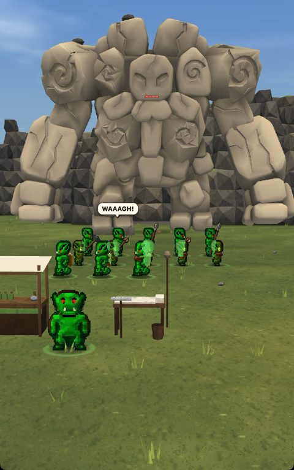
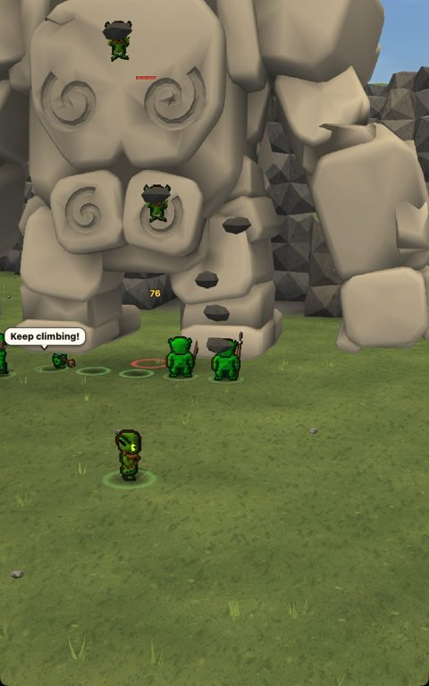
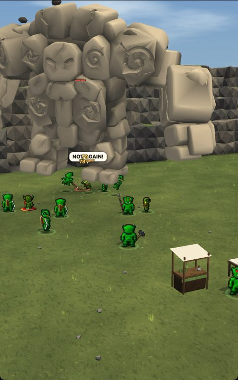
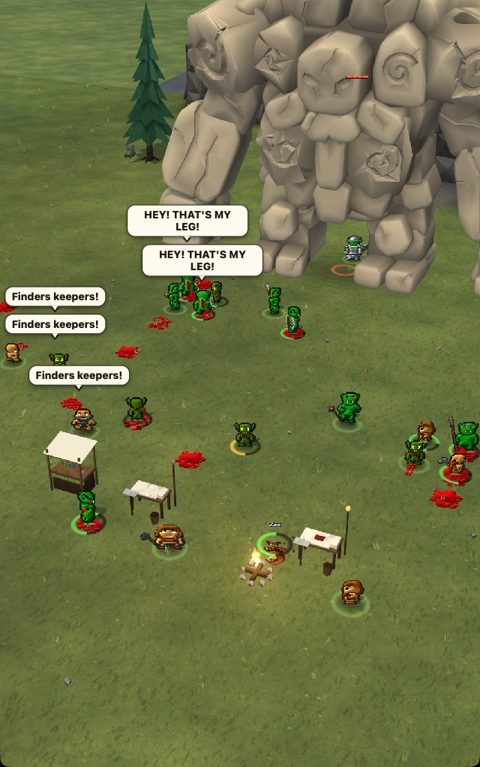
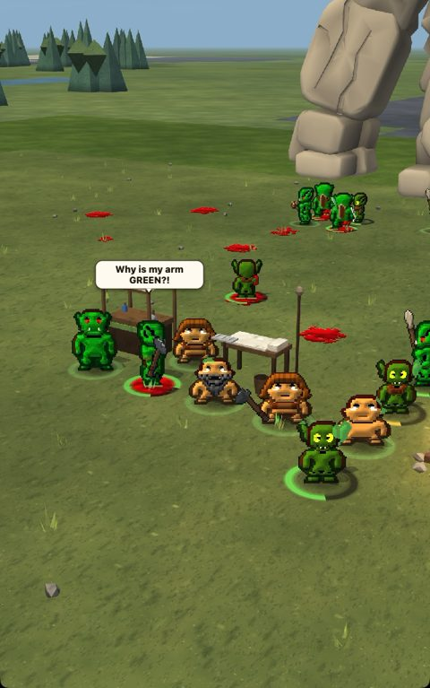

# Golem battle scene and TikTok series (2026-10-26, golem-battle session)

A watchable battle scene in the real game. A tribe of orcs and goblins camps under a mountain, the mountain stands up as a stone golem, and they go at it. It plays from a temporary copy of the game, so `game/` and the owner's saves are untouched. Three vertical episodes were recorded from it.

## Done
- **One click to watch:** `standalone/remastered/Golem Scene.command`. It opens the game with a test player (Chronicler) in a portrait window and plays all three episodes (about 4 minutes after a minute of loading). Close the window to end, double-click again to replay.
- **Videos** (1080x1920, no sound) in `marketing/golem-series-2026-10-26/`:
  - `golem-e1.mp4`, 1:21, "camping next to the wrong mountain": the mountain stands up ("IT HAS TOES!"). Orcs go for its heels, archers shoot, goblins climb its back. It shakes them off and they are launched, two lose a limb in the fall. It slams, the wounded are carried back to camp and the Doctor sews the limbs back on.
  - `golem-e2.mp4`, 0:39, "they sent the big one": Big Grok in iron plate climbs it, holds on through the shaking, and it walks off with him ("I meant to do this!").
  - `golem-e3.mp4`, 1:24, "not again": a second golem stands up ("NOT ANOTHER BIG TOES!"). A dwarf clan wants it too, and limbs come off on both sides. Everyone grabs whatever limb is nearest ("Finders keepers!" / "HEY! THAT'S MY LEG!"), and the Doctor sews a goblin arm on the orc chief ("Why is my arm GREEN?!").
- **The golem keeps its own rules:** it rises out of the mountain (RmGolemRise), shakes off whoever is at its feet with the game's grip test, slams on its own timing, and the launches are the game's.
- **Scene-only rules** (from the golem design, not in the game):
  - Climbers ride its back using the page's climbing (bosses.js).
  - Being thrown off its back hurts by the height reached; a hard landing can take a limb with the game's sever, and a lethal fall downs the unit dying.
  - In episode 3 every hard landing takes a limb.
  - Carrying uses "Carry them"; the grafts are the Doctor's own surgery.

 
  

## Numbers
| Take | Ground | What went wrong |
|---|---|---|
| 1 | flattened field | camera too close; the climb shot was behind the mountain |
| 2 | flattened field | climbers visible; carries failed (the Doctor got there first) |
| 3 | desert mesa | rock between the camera and the fight (stopped by the owner) |
| 5 | natural meadow | carries work; climb camera off to one side |
| 6 | snowfield | reads as a blank arena; the walking golem knocked its own rider off |
| 7 | meadow (pinned) | used for the episodes: 0 game errors, 0 page errors |

## Needs the owner
- A few speech bubbles near the left edge are cut off by the window in take 7. The clamp's units are fixed for the next take (not yet seen in a run).
- Next scene asked for: they meet a dragon.

Files: `tools/trailer/golem/` (golem_run.py, ZZGolemScene.dm, make_cut.py, captions.py), take 7 clips in `reports/golem-battle/clips/`.
