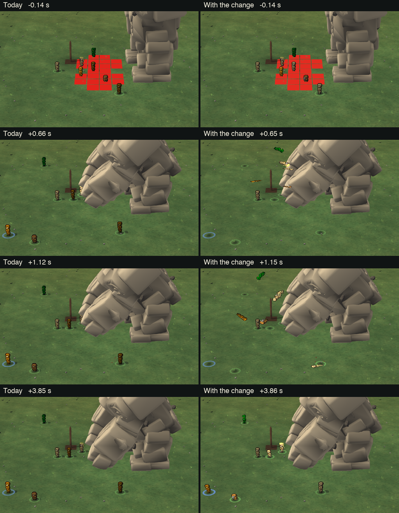

# Golem launch (2026-10-26, golem-launch session)

The user: "i notice we didnt add the launch animations when hit by golems".

## Done
- **Found why:** the launch landed on 10-25 with the arena animations, but it never played in the game. The thrown
  unit's new tile reached the page before the record of the throw, and the page then looked for the unit on its new
  tile in a list made before it moved. It found nobody, so the picture just jumped (5 tiles) or slid (2 tiles).
  Measured on the real page with a recorded slam: 0 of 6 thrown units launched.
- **Fixed (staged, not landed):** the server now tells each player's page the moment a golem throws someone, and the
  page plays the launch at once. The unit flies from where it stood onto the tile the server put it on, lies there,
  then gets up. This covers the fist slam, shaking climbers off, a foot coming down, and a unit pinned against a wall
  (up and down on the spot). Same replay: 6 of 6 launched, each within the first frame, landing within 0.01 tile of the
  server's tile, never shown sliding or jumping, also when the HUD or a scene comes late.
  
- Checks: arena check 18 of 18, the golem's own check 26 of 26, the page script checks.
  Switch: `rm_golem_launch` (Golems.dm).
- Everything is in `reports/golem-launch/staged/` (README, land script, checks, a side-by-side GIF).

## Open for the user
- Parked at the feature freeze (about 14:15); the user then said to land it as a bug fix to the 10-25 animations, so it
  went to the coordinator as READY for build 58 (about 14:55).
- Heavy-blow knock-backs (warhammer) likely have the same bug. Not tested yet.
- A thrown unit may act again on the server (1.8-3.0 s) before its picture has got up (3.6-4.6 s). Keep it, or make
  the stun longer or the get-up quicker?

## Evening
- **Drag ragdoll, die-in-place, down-dying look, fall away from the blow, finished as it lay** landed for builds 60-62
  (the user's "no just go let me watch it"). The ring round a downed unit's body (the user: "the circle was still in
  the center of the tile versus circling that piece of thing on the ground") is staged for the last build
  (`reports/golem-launch/staged-drag/`).
- **Golem feet on the ground and golems breaking rock** (the user: "stones feet are not on the ground it hovers and
  also golems need to break stone mountain tiles"): staged in `reports/golem-launch/staged-rock/`. The feet floated
  0.36 tile; now the lower foot rests on the ground (measured 0.000). Its feet and fists break the mountain's rock
  they come down on, and it smashes through rock it walks into (arena check 10 of 10).
