# HUD rework (hud-rework, 2026-10-26 night)

You asked at 20:25 for a HUD rework, then: "make the hud look like ai didnt do ... polish worthy of world of warcraft"
and "redesign ... make it follow the best use for human eyes, give it character, make it unique". Every panel, button
and place stays where it was; the look is redone: forged frames with gilt corner plates and crafted buttons in each
race's own colours, panels lit from above, real tabs on the unit card, quiet outliner rows, bars as gauges, and the
unit's name on a small swallowtail banner (Banners of the Deep). Three bigger ideas are waiting for you as pictures.

## Landed

- **hud-rework** landed 23:55 (all 15 CSS pieces, one marked block at the end of art/hud/src/041-style.css; nothing
  else touched). Gate: compile ok, jscheck 10/10, hudjoin ok, settings 23/23, combat 32/32. Restore point
  restore-points/before-polish-hud-rework-20261026-235410. Goes into build 65.
- Re-checked on the live page after landing (with the 23:30 view3d/controls landings in): 0 new clipped text or
  overlaps in 5 scenes x 1024x640 and 1280x720 (the only issue, Gather dock over the task bar, was there before).

## Done

- **Crafted race materials.** The frame and buttons used to be a small pixel tile blown up 2x (steel bars, gold
  squares). Now each race gets its own drawn set from its own colours: a forged rail with a gilt line, riveted corner
  plates with a gilt diamond, buttons with a metal rim lit from above, gold faces when pressed. All nine races checked.
- **Panels have depth**: light from above, darker at the foot, an engraved gilt line inside the frame.
- **Unit card has a clear order now**: name banner and bars first, the three main buttons, quiet chips for the small
  bag actions, and the seven tabs as a tab strip on the card's edge (the open one lit), not two more rows of buttons.
- **Company list**: no more box around every unit; selected units get a gold edge and a soft glow, fighting ones red.
- **Bars** are gauges (glass track, lit fill, faint tenths, softer label); bag slots are sunk into the plate, worn
  items glow gold.
- **Alerts**: the attack alert's X is a small close button on its corner (it was a second box beside it); the food
  alert is one plate with its X inside; the war line and Paused match.
- **Pages built for big villages** (your Songs of Syx goal, and "this hud looks plain?" on the Village page): the
  page tabs are a tab strip like the card's; the roster filters are a two-column ledger with the counts lined up in a
  column (30 or 3,000 read the same); sunk search boxes with a gold focus ring; the bulk bar is a toolbar; roster rows
  are a list with alternate shading instead of a framed card each. Same for the Log's filters. The job board on
  the Work page is a ledger too: every zone's name, workers bar, count, status and per-minute rate in the same columns.
- **Small finishes**: the speed buttons are one control, page section titles get a gold rule that fades out, the
  Next goal card and the minimap's season plate are little plaques.

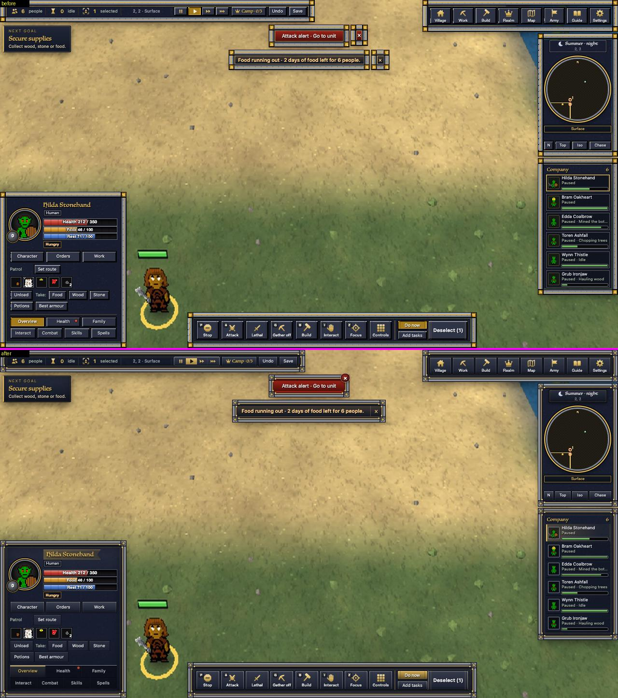

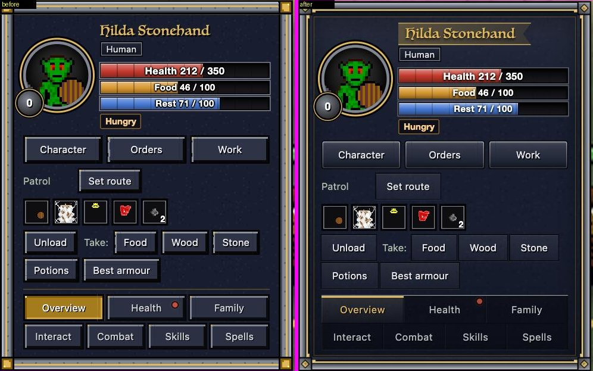

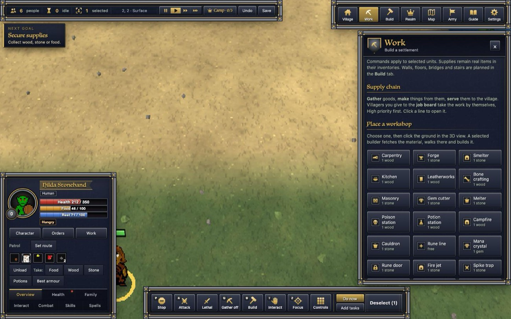

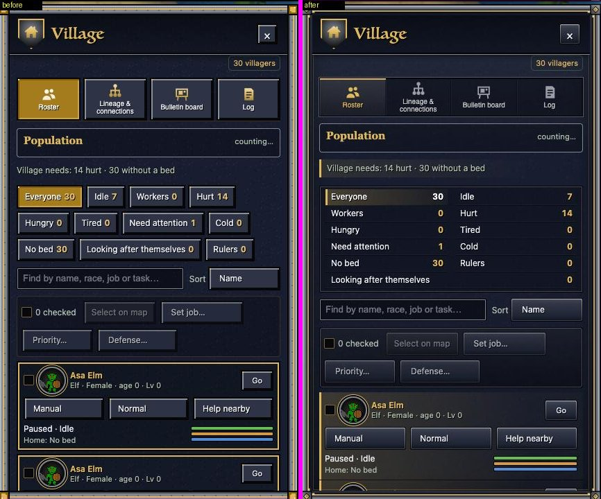

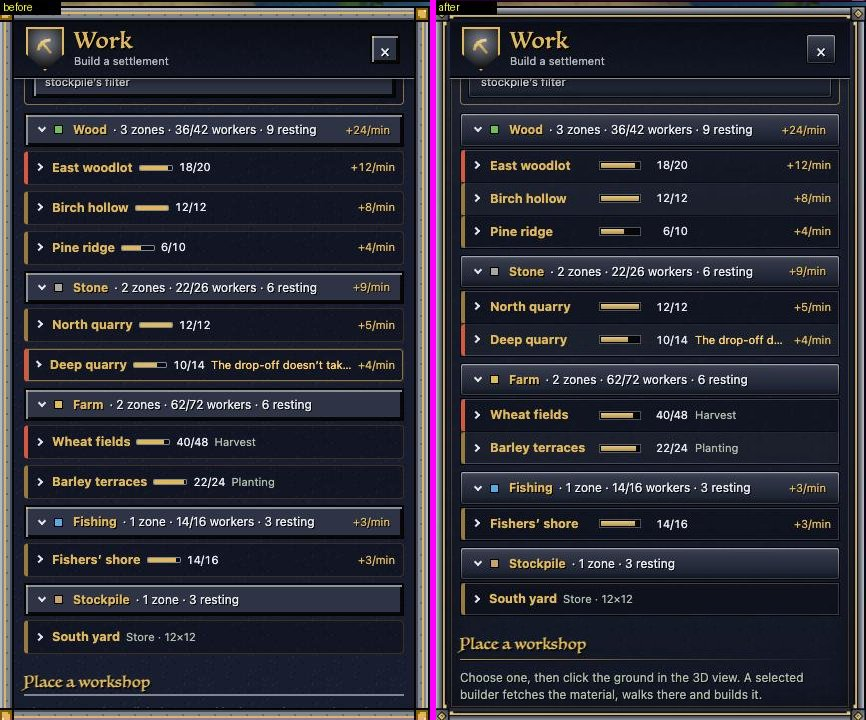

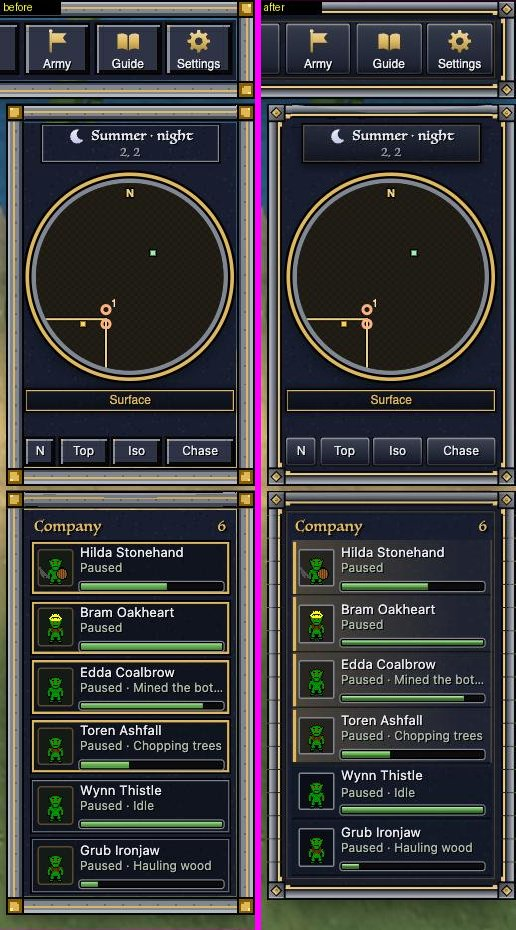

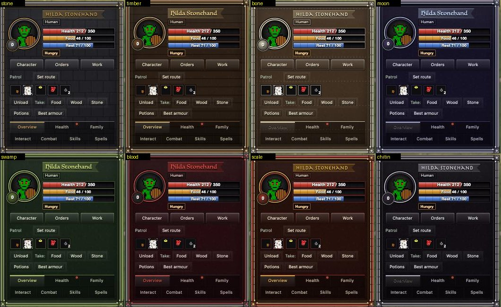

## Numbers

| Check (headless Chrome, real models, the game's 9 px text floor emulated) | before | after |
|---|---|---|
| 40 HUD scenes x 3 window sizes: console errors | 0 | 0 |
| clipped text / overlapping panels that are new | - | 0 / 0 |
| panels that move during 12 live updates (4 sizes) | 0 | 0 |
| unit card height at 1280x720 | 314 px | 312 px |
| HUD script per update, one unit selected / Select all (200 units, real server sends) | 1.9 / 2.9 ms | 1.9 / 2.8 ms (no measurable change) |
| style + layout per update | same within noise | same within noise |
| paint over a 42-update run | 72.2 ms | 73.8 ms (same; a first try with live vector art cost +24 ms and was replaced by pre-drawn images) |

## Waiting for you (pictures; not landed), ranked for running 2,000+ people

1. **Realm overview**: one screen with the people counts, every good's made/used per hour and how long it lasts,
   every workplace's workers and output, and a "Needs you" list. What a Songs of Syx-sized realm needs first.
   (A new feature, so after the freeze; the numbers in the picture are examples.)
   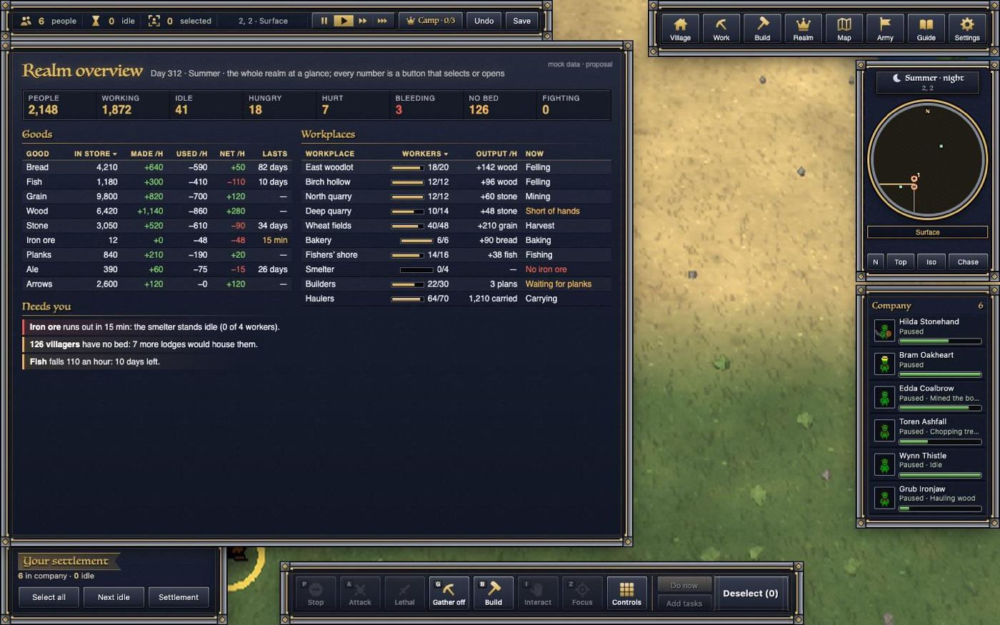
2. **Roster as a table**: one line per villager, columns that sort, filters and search over it, bulk actions at the
   foot. Today each villager is a 130 px card.
   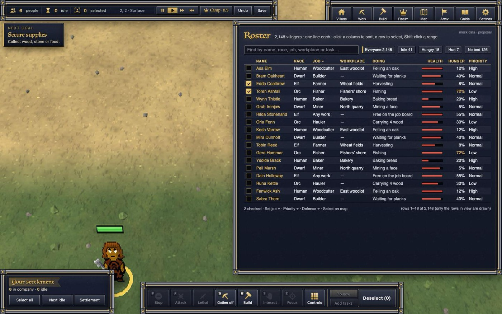
3. **One continuous top bar, CK3 style**: the counters, the season, speed, Camp, Undo and Save on one band across the
   whole top, joining the menu (today: two separate blocks with map between them).
   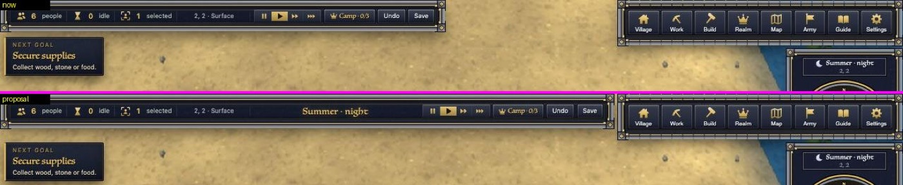
4. **Bar labels split: "Health" left, "212 / 350" right.** The most readable small fix; my top pick of the small ones.
   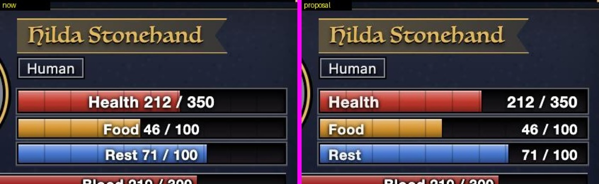
5. **Experiment: WoW-style portrait** bigger and breaking out over the card's corner in a double gold ring.
   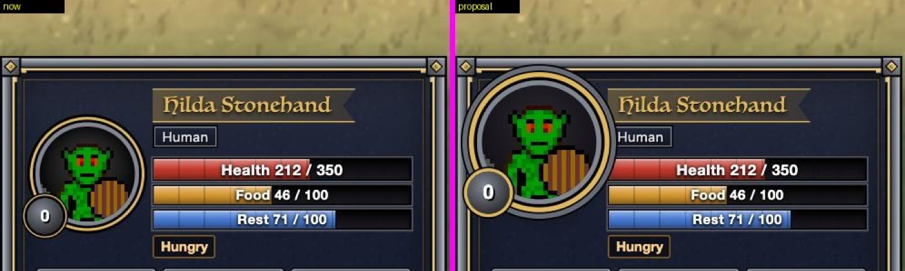

## Needs you

- Pick any of the three proposals above (each folder in `reports/polish-night-1026/hud-rework/proposals/` says what
  it takes).
- The start card and the race/story cards (the screens chat's) use the same frame and button art, so they took the
  crafted look too. Say if you want them kept on the old pixel look.
- Not checked in the real game window (no real runs tonight): the crafted art is vector, so it should be as sharp in
  the game's WebKit as in Chrome; the lead's build check will show it.
