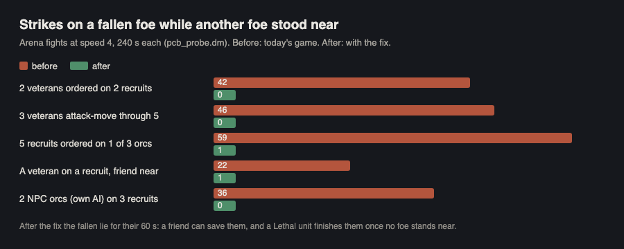

# Polish night: how fights play out and read (polish-combat)

Fights now respect "every fall can be saved" in a real battle: units no longer hack at a fallen foe while other foes
stand by, so a friend has the 60 s to save the fallen, and the Lethal finisher steps in only once the area is clear.
Throws, arrows and move effects that bring a unit down now leave it dying too, Non-lethal archers fight instead of
standing frozen beside their foe, and the unit card says "Knocked out" / "Bleeding out" instead of a stale order.
No combat number was changed.

## Done

Each proven on a copy of today's game, before and after, then landed through the lander and its gate: the first at
20:20 (in build 63), the other six in one landing at 00:04 (for the next build).

- **The fallen are out of the fight while foes still stand.** Units with an attack order, an attack-move or an attack
  box, and NPC raiders and wild creatures on their own AI, kept striking a foe that had fallen (bleeding out, knocked
  out) while other foes stood right next to them. A fallen unit could not be saved, a capture your Non-lethal unit had
  just knocked out was beaten to death by your own Lethal units, and your units wasted swings on bodies while the
  enemy cut down their friends. Now they turn to a foe still standing; the fallen lie for their 60 s, a friend or the
  Doctor can save them, and a Lethal unit finishes them once no foe stands near (the owner's build-59 rule). With no foe
  standing near, nothing changes: duels and fist fights end exactly as before.
- **Shots, throws and move effects that kill now fall too.** A javelin, throwing axe, rock, ballista bolt or catapult
  splash, an arrow through the heart or lungs, and a move's lightning, astral or smite hit killed at once, though the
  rule spares them. They now leave the unit dying for 60 s like a sword blow. Kill XP and the death log are unchanged,
  and the heart-shot line reads "X is shot through the heart!" instead of "... and instantly killed!".
- **Non-lethal archers fight.** An archer on Non-lethal, or any archer given a Capture order, walked up to its foe and
  stood beside it for good: a bow strikes no blow and Non-lethal never shoots. Now it takes up a carried blade or its
  fists for the fight and its bow again afterwards.
- **The card says when a unit is down.** A unit lying knocked out or bleeding out read its last order ("Fighting Orc
  Warrior", "Attack-move") on its card and in the Company list. Now it reads "Knocked out" / "Bleeding out". Its foe
  no longer shows "Fighting" a body, and logs "Won against ..." when the foe falls (it said "Fight over").
- **"Tie to that tree" no longer stalls.** Leading a captive to a tree or post could stop for good when the leader
  stood beside the spot but in the captive's way (or another captive did): neither moved, and the captive was never
  tied. Now the leader steps round to the far side of the spot. In the capture test the tie went from 15 s (and
  sometimes never) to under 4 s.
- **Attack orders' card lines.** An archer using its bow's move read "Casting at ..."; it now reads "Shooting at ...",
  and so does one shooting plain arrows (it kept its old line before). A unit whose foe falls while others stand near
  ends its order on "Brought down <foe>" (it said a bare "Idle"), as a Non-lethal one says "Knocked out <foe>".

- **Speed: look once.** The fallen-foe check now looks for a standing foe once per target search instead of once per
  fallen candidate (a creature's search with 8 fallen in view: 200 -> 150 us).

## Numbers

| Test (arena, speed 4) | Before | After |
|---|---|---|
| Strikes on a fallen foe while a foe stood near (pcb_probe.dm, 7 small fights, two runs of 240 s) | 109 + 58 | 1 + 1 |
| Shot / throw / move kill checks (pcf_check.dm: javelin, astral, chain lightning, fever, stale shooter, throw on the dying) | 2 / 6 | 6 / 6 |
| Non-lethal archer ordered on a recruit: blows / knocked out (pcb_probe.dm S9) | 0 / never in 240 s | 20 / at 47 s |
| Archer with a Capture order: blows / knocked out (S10) | 0 / never | 13 / at 30 s |
| Card checks for a downed unit and its foe (pcs_check.dm) | 2 / 5 | 5 / 5 |
| Captive led to a tree, leader and another captive in the way (pct_check.dm, 2 cases) | never tied in 30 s | tied in 4.2 s |
| capture_test's tie-to-tree line, time to tie | 15.4 s x3, one fail at 40 s | 3.4 s, 3.6 s |

## Speed (the owner's 21:00 ask)

- The new checks cost microseconds: 1-2.5 us per attack tick on a standing target (the usual case), 35-115 us once when
  a target falls with foes near, 25-50 us once per fall (arena micro-benchmark, a crowd of 40).
- A creature's target search with 8 fallen and 1 standing foe in view: 200 -> 150 us a call after the "look once"
  speed fix in the batch.
- Whole fights (7 small fights, 31 units, 240 s at speed 1, tick profiler, interleaved before/after on tonight's busy
  Mac, load 5-30): before 0.9-2.9 ms per tick on average (worst 71-142), after 1.7-4.5 (worst 69-562). The numbers moved
  with the Mac's load, in systems these fixes never touch as much as in attack orders, so they don't show a clear cost;
  the after runs did average higher in each pair. By design the fallen now stay on the field 60 s and attackers walk on
  to new foes. Build 63, which carried the first fix, measured its 100 v 100 battle about 13% cheaper than 62
  (perf-watch, all of 63's changes together).

## In progress

- Nothing. Both landings passed their gate (compile, jscheck 10/10, HUD join, obey 32/32, stumps 23/23, combat 32/32).

## Checks after landing (live game/, 00:05-01:00)

| Check | Result |
|---|---|
| morale, facing, kitarmour, falls, surround, underdog, ko_weapon, throwing (its own TH lines), capture (41 lines) | pass |
| My own: pcf (shots/throws 6/6), pct (captive to a tree 2/2), pcs (card 5/5) | pass |
| parry_check | failed once (Sword 99 from the front 16.7% vs 18.4% +-1.5), passed on the rerun: the same sampling flake as at 21:0x |
| bleedout_check | 21/22: case 10 (a walker binds a bleeding friend) fails since the batch. Not a regression: the friend's wound can stop by itself before the walker arrives, and the arena's fixed random stream flips with any build's extra random draws. Live without the batch passes, each half of the batch passes alone, and a trace of the case alone shows the opposite flip (without the batch the wound stopped by itself; with it the walker bound it). Note left for the lead: the check could hold the bleed on. |

## Needs the owner

- **A stagger counts as "down" for a capture.** A Capture order (or a click on the foe) binds a foe that is only
  staggered (knocked back by a hard blow, a mace's stagger, a rock), not knocked out: in the probe a swordsman's first
  non-lethal blow took 108 of 350 health, knocked the recruit back, and the take came at 3 s with the recruit at two
  thirds of its health. With a rope it would have been tied awake. The capture test uses a stun as "down" on purpose,
  so this looks like the 10-23 design meeting the 10-25 knock-back. Keep, or capture only the knocked out, webbed and
  trapped?
- **Archers step in to use their bow's move.** The Pinning shot reaches 6 tiles, the iron bow 7: an archer ordered on a
  foe 7 tiles off walks a tile in to use the move instead of shooting plain arrows from where it stands ("Closing in
  to shoot at ..."). Moves first, or the bow's full reach first?
- **A destroyed brain or heart can be saved.** Falls (build 59) spare every foe-dealt death except a lost head, so a
  blow that destroys the brain ("bashes X in the head killing X's brain!!") or slashes the heart open leaves the unit
  dying for 60 s, and a friend's bandage brings it back. The original's line "X dies from lethal wounds!" still prints
  first (left for the words agent). Should a destroyed brain or heart die at once, like a lost head?
- **Battles may run a little differently now.** With the fallen left alone while foes stand, a foe knocked out in a
  battle gets up after 30 s unless someone finishes it once the area is clear, and friends get their 60 s to save the
  dying. That is the build-59 rule working; the battle tables (fight length, deaths) were measured with the old
  behaviour and could be re-run (battle_rescue_check, battle_morale_check) if you want fresh numbers.

## Checked and fine (no change needed)

- A friend within 3 tiles with a bandage saves one bleeding out at once, with or without stumps and with a foe
  beside it (7 / 7 cases, pcr_check.dm). In the battle probe the friend's one bandage had already gone on the fallen
  unit's first stump before it fell, so there was nothing left to save it with.
- An archer with arrows shoots point-blank when a swordsman reaches it, and switches to its blade when the arrows run
  out (as the rule says); the "frozen" alarm my probe raised was its bow moves, not a stuck unit.
- No unit stayed down past its time: no knock-out over 30 s, no one dying past 60 s, no one lying fainted with
  neither (watchers in every probe run).
