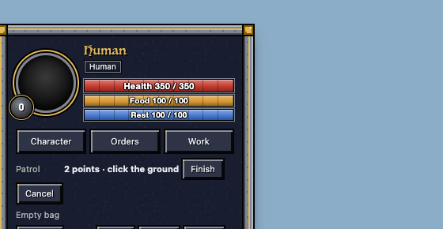

> RESUME (22:4x): done: all 5 fixes landed (stop-ends-patrol, patrol-draft-esc, f3-f6-page-keys, stairs-elsewhere,
> carry-ends-patrol). Queued: nothing; no runs or landers left. Next: nothing in my list; the owner's five questions are
> under "Needs the owner".

# Polish night: controls and movement (polish-controls)

How units obey and move, checked end to end tonight: orders, Stop, patrols, control groups, the keys, walking and
climbing, flying and fog. The existing checks for this area pass on today's game, apart from three older ones written
before a design change (below). The rough spots a player would hit were patrols coming back after you told the unit
otherwise, a patrol route that could trap your clicks, units standing for good at walled-in stairs, and two keys the
HUD shows that did nothing in 3D.

## Done (each proven on a copy of today's game, before and after, then landed through the lander and its gate)

- **Stop ends a patrol** (landed 20:27). Stop (P, the Stop button, or Stop on the unit card) on a patrolling unit only
  paused it: a moment later it walked its route again. Now Stop ends the patrol. A patrolling unit that changes hands
  also drops its old owner's route (before, a captured or given unit walked the old route for its new owner). Saved
  patrols still come back after a login (loading doesn't count as a change of hands).
- **Esc while drawing a patrol route** (landed 20:31). Press "Set route", click a point, then Esc: the unit was
  deselected, the route bar (above) vanished with its card, and every later click, even on one of your units, became
  "Patrol point 3...". Now Esc cancels the route and keeps the selection; deselecting any other way cancels it too.
- **Errands end a patrol** (landed 22:38). A patrolling unit told to carry a downed friend, drag a body or go and use a
  workshop set off, then turned round and walked its route. These now end the patrol, as a move or attack order did.
- **Units no longer stand for good at walled-in stairs** (landed 22:30). Sent to another level, a unit heads for the
  nearest stairs by distance. If those were walled in (a closed building, a walled yard) it stood beside the wall for
  good, "No way through yet; trying again", even with free stairs a few tiles away. Now, after 10 s with no way to
  them, it tries the other stairs that lead there. Arena: stuck for the whole 90 s before; on the level below in 20 s
  after. With every stairs walled in it keeps trying, as before.
- **F3 and F6 in 3D** (landed 22:08). The Guide button shows an F3 key, the Guide and the loading tips say "F3 opens the
  Guide", and the Actions list says F6 is the Illithid mental abilities. Both did nothing while the 3D page had the
  keyboard (always, in play). They work now.

## Numbers

| Check (arena, speed 4 unless said) | Today's game | Notes |
|---|---|---|
| Orders always go through (obey) | 32 / 32 | also 32 / 32 with tonight's fixes in |
| Friends walk through each other (clip) | 11 / 11 | a group of 30 past a crowd in 135 ticks, nobody left sharing a tile |
| Control groups (headless) | passed | |
| First step after an order (walk latency, speed 1) | passed | single move 0 ticks; group of 30: mean 0.13 ticks |
| Own doors | passed | |
| Group attacks on reachable and unreachable foes | passed | |
| Mountain levels, Sky layer | passed | |
| Fog of war | passed | 200 units + 60 others: 5 ms a tick |
| Roads | passed | |
| Flyers over walls and water (a probe of mine) | passed | ordered and walked |

| Patrol case (arena probe) | Before | After |
|---|---|---|
| Stop a patrolling unit, wait 20 s | walked off on its route again | stays stopped |
| The unit card's Stop on a patrolling unit | walked off again | stays stopped |
| Give a patrolling unit to another player, wait 20 s | walks the old route | stays, no route |
| Draw 2 points, deselect, click the ground | click taken as "Patrol point 3" | route cancelled, the click is a click |
| Esc while drawing (HUD page) | deselects, route stays | cancels the route, selection kept |
| Carry a downed friend while patrolling | nobody carried, back on its route | carried |
| Drag a body while patrolling | nobody dragged, back on its route | dragging |
| A workshop's Use card while patrolling | never got there | got there |
| A patrol left alone (control) | loops 4 times in 30 s | the same |

| Stairs case (arena probe; the goal on the level below) | Before | After |
|---|---|---|
| Nearest stairs walled in, free ones 8 tiles off | stood by the wall all 90 s | down in 20 s |
| Nearest stairs open (control) | down | down |
| Every stairs in reach walled in | stands, "No way through yet" | tries the other pair, then stands (same) |

| Key on the HUD page (headless) | Before | After |
|---|---|---|
| F3 | nothing | opens the Guide |
| F6 | nothing | Illithid mental abilities |

## Speed (the owner's 21:00 ask: every fix's effect, measured)

- **F3/F6 keys and Esc on the page**: no measurable change. Headless Chrome, 3 runs each, live page against the page
  with the fixes: updateHUD 0.21 to 0.32 ms per model on both, a key press 0.006 to 0.009 ms on both. The spread
  between runs is bigger than any difference.
- **Stop, the patrol route, errands ending a patrol**: no tick code touched. The new lines run only when the player
  gives that command, never in the track, order or walk passes.
- **Stairs elsewhere**: no measurable change. In ordinary play the new code never runs; a climb with no way to its
  stairs for 10 s searches once for other stairs (and once per further pair it fails to reach), then stops looking.
  Worst case I could build, 30 units whose only stairs in reach are walled in, 60 s, the orders pass timed each tick,
  two runs each on a loaded Mac:

  | | run a | run b |
  |---|---|---|
  | today's game: avg / worst | 3.45 / 178 ms | 3.29 / 191 ms |
  | with the fix | 4.87 / 425 ms | 2.85 / 147 ms |

  The same code differs by 2 ms between runs (build 64 and ten other sessions' checks were running), so this is noise;
  the added work is 30 one-off searches in that minute.

## Old checks that expect the game before a design change (not changed tonight)

- **Camera level** (tests/camera_level_test.dm): expects the Sky button and "," to take the camera to the Sky with no unit
  up there. Since the Sky is earned (10-25) both refuse until a unit of yours is up there, which is right.
- **Flying** (tools/check_flying.py): expects a fourth dragon height of 30; since 10-25 dragons fly 3/6/9 over the
  surface and higher on the Sky level. Its "flies over a wall" case fails in its own small test world only: in the
  usual test arena flyers cross walls and water by order and by walking (my probe above).
- **Lifts** (tools/check_lifts.py): a unit lifted up a cliff stops one tile short of the far side of the top. Since 10-24
  mountain tops have block heights and a unit steps up a block only by a carved ramp, so it stops at the higher block:
  the walking rule working, the test written before it.

## In progress

- Nothing. All five fixes above are in the live game; the last two landings ran the area's full movement gate on it
  with all five in (clip 11/11, obey 32/32, walk latency 5/5, combat 32/32). Stop and Esc went into build 63; the rest
  wait for the lead's next build. Probes, proofs and logs: reports/polish-night-1026/controls/.

## Needs the owner

- **Pressing the number of an empty group clears your selection.** With five selected, pressing 5 (no group 5 yet)
  deselects all five ("Group 5: 0 selected"; arena probe). That is what the 2006 game did; StarCraft keeps the
  selection. Keep it, or keep the selection?
- **Your units pile onto one tile in melee** (your rule: own units clip through but never rest on one tile). Arena:
  six longswords against six raiders, each sent at its nearest foe, 45 s: in 331 to 388 of 450 ticks two or more of
  the six share a tile, up to five, and they strike from it. Why: all six pick the same foe and the same shortest
  way; friends may step through each other's tiles while their route goes on, so they march as one stack and arrive
  together; the "step off a shared tile" rule only moves a unit that hasn't stepped for a second, and fighters keep
  stepping. Spreading them round the foe would change how many strike from which side, which is the surround and
  flanking numbers, so it's yours (and combat's) to decide, with a battle table first. Not changed tonight.
- **Villagers can wedge against a wall walking to bed, food or a fire** (found and measured by the loops chat; I read
  the walk code, not re-run). These walks go in a straight line at the target, not along a route, so a wall in between
  holds them (in loops' test one villager stood 13 minutes outside a house with its bed inside, tiredness 19 to 1). The fix is routed care walks: a walking change
  bigger than tonight's polish. Not changed; worth doing next.
- **Three 2006 commands are still on keys** in the game window's key map (skin.dmf), like the letters you took off on
  10-25: Tab (auto-dig add/remove), F5 (use auto-dig) and F7 (send a file to another player, with a yes/no on their
  side). They only fire when the old game window has the keyboard, not the 3D page, so players rarely hit them. Take
  them off the keys too (they stay in the menus)?
- **A patrolling unit given a job keeps its patrol** (read from the code, not run): setting a job doesn't touch the
  route and the patrol tick doesn't look at jobs, so whenever the job gives it no order it walks its route again. Stop,
  a move, an attack and (tonight) carrying, dragging and a workshop errand end a patrol; a job doesn't. Should setting a
  job end the patrol too?
