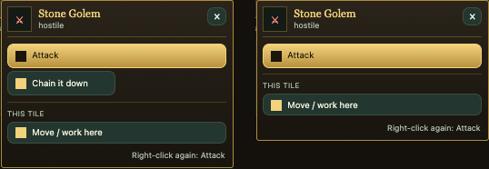

# Polish night: creatures and magic (polish-creatures)

RESUME (stopped 22:0x for the usage limit; restart ~23:53):
- Done: 6 fixes landed (golem menu, gargoyle limb 3D, brew throw, wings label, web-shot reason, Dragon Breath message); all 16 proven in the arena (CRP/CRQ/CRR, 0 runtime errors); READMEs and this devlog written.
- Queued, not landed (fix folders in reports/polish-night-1026/creatures/): chained-no-specials, dragon-words, magic-words, then gas-trap-deaths, vampire-stumps, nature-staff-loops, rune-door-held, brew-bottles, gargoyle-stone-rows, magic-target-3d. Land with `zsh reports/polish-night-1026/creatures/land_seq2.sh <folders...>` (retries on lock timeout); `land_polish.py check` each first (anchors drift).
- Next: land those, then update the "pending" column here, move work2 to the Trash, post DONE on the board, send the final report. Not landing: staged-dragon-tint (needs the owner's eye).

Creatures, beasts and magic now do what they say. Units no longer stand on at 0 health after gas, a spike trap or a bad
brew. A dragon you've chained but not tamed can't breathe fire. Turned vampires don't bleed. The Nature Staff no longer
makes crops grow faster and faster for good. Brewing with several bottles works, and a few buttons that did nothing or
gave the wrong message now act or say why.

Status: LANDING (this file is updated as each fix lands; the table below says which are in).

## Done

Each fix was proven in the arena: before on a copy of tonight's live game, after on a copy with the fix. Tests:
`reports/polish-night-1026/creatures/tests/crea_polish_test.dm` (CRP), `crea_polish2_test.dm` (CRQ),
`crea_polish3_test.dm` (CRR); each fix folder has a README with the details.

| Fix | What the player saw | Now | Landed |
|---|---|---|---|
| Zero-health deaths | A unit brought to 0 health by a poison cloud, rot, smoke, scalding air, a spike trap or a brew it drank stood on at -4 / -15 / -25 health: no body, no death, and skipped by care | It dies like any other death; the log names the gas, "a spike trap" or "a bad brew" | pending |
| Chained dragon | A dragon chained down but not yet tamed could still breathe fire (F key) and use Dragon Breath, Fly and Lay Eggs from its card | No special or abilities while chained; they come back once tamed | pending |
| Turned vampires | A unit turned vampire (bitten, or Unholy Blood) still got bleeding stumps and could bleed to death | No stumps and no bleeding, as a born vampire | pending |
| Nature Staff | Each touch of the staff's aura started one more endless regrow timer on a plant: crops near where it stood ripened faster and faster forever | One growth step per touch, as meant | pending |
| Brew bottles | After drinking one of several brews, the Alchemy box showed the empty bottle and hid the others; a full bottle refused more with empty bottles in the bag; the Cauldron couldn't refill a drunk bottle; an altar heated brews like a fire | The box shows a brew that holds something; a full bottle moves on to an empty one; drunk bottles refill; only a campfire or real fire heats | pending |
| Rune door | Closing an open rune door with someone in the doorway spent its mana and did nothing, silently | It says someone is in the doorway, and spends nothing | pending |
| Magic target in 3D | Right-click "Set magic target" on a unit more than 9 tiles from the camera's centre said "Target is no longer visible."; with nothing selected, "Magic target chooser is closed." | It reaches whoever the 3D view lets you right-click; with nothing selected it says "Select a unit first." | pending |
| Gargoyle stone limbs | A gargoyle's broken stone limb showed a red (bleeding) or amber (bandaged) bar on the Health tab | The grey bar of a closed stump | pending |
| Gargoyle limb in 3D | A gargoyle's limb broken off never flew off its figure in 3D | It flies off as anyone's does, drawn as stone | pending |
| Golem menu | Right-clicking a stone golem offered "Chain it down", which was then refused | Not offered on golems (dragons and great spiders keep it) | pending |
| Web shot reason | A spider short of silk aiming its web shot was told "Nothing happened: out of reach or blocked." | It says it needs 10 silk | pending |
| Brew throw | Pressing Throw again didn't cancel a brew throw: the next click anywhere burst it | Pressing it again cancels | pending |
| Wings label | A winged unit whose most is under 100 (a vampire of a smaller race) kept "Mangled (95/95)" on fully mended wings (dragons and gargoyles, 150 and 155, were fine) | "Good" once mended | pending |
| Dragon Breath button | The Interact tab's Dragon Breath did nothing, silently, without a magic target close by | It tells the owner to set one | pending |
| Words | "has become an dark drake" (x8), "immmunity", "breaths a", "1 device answer.", soul stones "a elf / a orc" | Fixed | pending |

## Numbers

Arena checks, before (live game copy) → after (with the fixes):

| Check | Before | After |
|---|---|---|
| chained dragon: breath ready / aims / card abilities / ability used | yes / yes / Rest, Fly, Dragon Breath / yes | no / no / none / no |
| gas cloud on a unit at 2 health | stands at -4, no body | dies, body on its tile |
| spike trap on a unit at 10 health | stands at -15 | dies |
| poisoned brew drunk at 5 health | stands at -25 | dies |
| turned vampire loses a leg | stump bleeding ("Very Mildly") | no stump, no bleeding |
| bitten while a stump is open, one tick | blood 300 → 296 | blood 300 → 300, bleeding stops |
| rune door, close with someone in it | mana 20 → 18, no message | mana 20 → 20, "Someone stands in the doorway" |
| vine 125 s after 40 staff-aura touches (reset to 0) | 5 (full: stacked timers) | 1 (its own one step) |
| two brews, first drunk: box shows / Drink | "Empty Bottle" / nothing | "Healing Draught (15)" / healed 10 → 70 |
| full bottle + Empty Bottle, Add | "The bottle is full." | goes into a fresh bottle |
| Cauldron, Fill with a drunk bottle | "has no Empty Bottles" | filled |
| brew heat beside an altar only | 140 | 0 |
| gargoyle stone limb row | red "open" | grey "sealed" |
| Set magic target 13 tiles out | "Target is no longer visible." | set |

## Speed (the owner asked for data)

None of these fixes sits on a hot path, and I did not run timing tests (they would need a quiet Mac; the arena slots were full all night). What each does to speed, by reading the code:

| Fix | Effect |
|---|---|
| Nature Staff | Server load goes down: each aura touch used to add one more endless 2-minute timer to a plant (about 7 per plant per minute of a bearer standing near); now none. Not measured in ms. |
| Zero-health deaths, vampire stumps, chained dragon | No cost: a few comparisons in code that already ran every tick (gas, spikes) or on a click |
| Brew bottles | A short bag scan per Alchemy click, on a click only |
| 3D magic target | One range lookup instead of view(), on a right-click only |
| Rune door, Dragon Breath, web shot, brew throw, wings label, gargoyle rows/limb, words | On a click or a message only; no measurable change |
| Golem menu | One extra comparison when the right-click menu opens, in the page; no measurable change |

## In progress

- Landing through the lander, one at a time. The coordinator held the land lock for its cleanup chains from 19:05, so
  landings queued behind it.

## Needs the owner

- **Dragon-coloured gear is red again in 3D.** Gear made from white, black, green... dragon scales should take the
  dragon's colour. The dragon armour pictures were re-shaded on 10-24 (550 shades instead of 5), and the recolour still
  swaps only the old 5 reds, so nothing changes: a "White Dragonscale Breastplate" is drawn red (test
  `dragon_coloured_gear`: 0 of the old reds found, 2 pixels changed). A fix needs a new recolour (the engine's colour
  matrix can do it) and your eye on the result, so it is not in tonight's fixes.
- **An Ashen's burn ignores the Lethal toggle.** An Ashen half-demon's blow may set its foe burning; the burn can then
  kill a unit the Ashen only knocked out, with no 60 s dying window, and it also burns a unit that drank a Dragonheart
  Draught ("fire can't take them"). Left to the combat rules (sent to combat).
- **Wings mend by themselves.** Every winged unit's wings heal 2 points every 10 s, awake or not; the "no automatic
  healing" rule says limbs mend in sleep. Built for dragons before that rule. Not changed.
- **Own units and a tamed dragon's feet.** A great beast's leg and wing tiles block everyone but the beast, your own
  people included (they step aside); the "own units pass through" rule may want them to pass. Not changed.
- Old test expectations, not game bugs: taming's leg_never_cut / lame_cant_walk / health_says_crippled (60 blows no
  longer cripple a leg since the slower wound pace), half-demons' marked_feeds (a kill is now a 60 s fall, so the Marked
  feed when the foe really dies).
