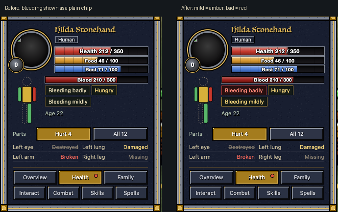

# Polish night: runtime errors and silent failures (polish-errors)

The game is quiet: two days of test and app logs (about 4,200 files) hold 31 runtime errors, and only one was still in
today's game. Tonight's fixes are all about a unit dying at the wrong moment: before, a death in the middle of a pass
could stop that pass for everyone after it, so fighting, walking, orders or the job board went silent for a while. Also:
the Health tab now shows bleeding in amber or red instead of a harmless grey chip.

## Done

- **Orders pass survives a death in it** (landed 21:11). When one of your units died during its own turn of the orders
  pass (a blow, a fall), the pass stopped there: every unit after it missed that half-second's fighting, walking and
  stepping off a friend's tile. Seen in the surround battle test. Now the pass skips the dead unit and goes on.
  Speed: no measurable change (orders pass median 5 ms before and after; at most +0.4 ms on 200 walking units).
- **Bleeding shows how bad it is** (landed 20:53). The Health tab's bleeding chip was always the plain one, as harmless as
  "Asleep", next to an amber "Hungry". A missing bracket made its severity 0. Now mild bleeding is amber, bad bleeding red.
  Speed: no new work, no change.
- **A big order reaches everyone** (landed 21:41, in build 64). An order to more than 200 units is handed out over a few ticks. If one of
  them died while waiting its turn, everyone after it never got the order, with no message: 4 of 219 got it in the test.
  Now the dead one is skipped and all 219 get it. Speed: no measurable change
  (at most 0.12 ms over a 220-unit hand-out).
- **The job board's recount finishes** (landed 21:49, in build 64). In a realm of 250 or more, the once-a-minute recount pauses between
  units; a death at that pause stopped it halfway, leaving the free pool short (249 of 299) for a minute. Fixed.
  Speed: under 0.01 ms a recount.
- **No more 3D-look error for items without a picture** (landed 00:44 on 10-27). Items with no icon file threw an error on every 3D
  look of their wearer (6 a run in the taming test, also in the start agent's arenas). Only test-made items have no
  icon, so play doesn't see it; the tests are quiet and faster (the 3D look of all 585 equipment
  types: 5.4-7.9 ms to 1.9-2.3 ms a pass).
- Checked and fine (no change needed): the raid list after its raiders die (it
  empties and the raid loop stops), every compile warning that looked like a bug but wasn't (a type note on 8 lines,
  guarded client access), a play-like battle, village and raid with the passes spread over ticks: 0 errors.

## Numbers

Runtime errors by scene: the last two days of logs, then tonight on the fixed copy (arena, speed 4):

| Scene (test) | Before | After | Where | Note |
|---|---|---|---|---|
| Surround battle (battle_surround_check, open, 10 fights) | 1 | 0 | orders pass | the natural case; 0 again tonight |
| A unit dying in each of its own 4 orders steps (new test) | 4 errors, 0 of 2 later units ticked | 0, 2 of 2 | orders pass | landed; 0 on live too |
| A 220-unit order with a death while it is handed out (new) | 1 error, 4 of 219 got it | 0, 219 of 219 | order hand-out | |
| The job board's recount, 300 units, a death at its pause (new) | 1 error, free pool 249 of 299 | 0, 299 of 299 | job board | |
| Taming (taming_test) | 6 | 0 | 3D look | same 36 pass / 4 fail both times |
| Bleeding chip severity (new test) | 2 of 7 right | 7 of 7 | Health tab | not an error, a wrong value; 7 of 7 on live |
| Battle rescue (10-26 05:39) | 7 | 0 | care pass | fixed before tonight (build 55) |
| Pause-delete / app 24 (10-25) | 6 | 0 | 3D scene | fixed before tonight |
| Play-like battle, 24 v 24 twice, spread passes + 3D scenes (new) | - | 0 | | 21 dead, 6 game min |
| Play-like village, 300 on Any work, 67 dying (new) | - | 0 | | 4 game min |
| 61 other arena scenes on the fixed copy | 0 | 0 | | capture, doctor, war, siege, raids, flying, caves, fishing, HUD dumps, use-on, fog, j2, yards... |
| Test-only errors (duels, golem without its 3 layers, a draft jobs test, lodge, construction) | 18 | - | the tests | not the game; see below |

Speed (server ms, arena A/B of the game with and without these fixes, runs interleaved on a loaded Mac):

| What | Before | After | Verdict |
|---|---|---|---|
| Orders pass, 400 units / 200 walking (3 x 300 passes) | median 5 ms | median 5 ms | no measurable change; worst-case bound +0.4 ms |
| The added check (Rm3DGone), one call | 0.35-0.54 microseconds | | |
| 3D look of all 585 equipment types, one pass | 5.4-7.9 ms (worst 112-181) | 1.9-2.3 ms (worst 13-21) | faster: no thrown errors |
| 220-unit order hand-out, recount of 300, Health tab x200 | | | no measurable change (inside the run-to-run noise) |

Compile warnings in the new code: 3 real bugs (the bleeding one, fixed; two "Detailed" checks, below). The rest are old
(268 "..() does nothing" in the 2006 code) or harmless (client access the compiler can't see is guarded; a type note).

## In progress

- Nothing: all five fixes landed and were checked again on the live game (each test 0 errors; taming 36 pass / 4 fail
  as before).

## Needs the owner

- **Cave mouths can sit on a player's walkway or ramp.** The check meant to keep cave mouths off built or decorated
  tiles never fires (the same missing bracket as the bleeding chip, in the cave-mouth placement). Fixing it is one
  bracket, but mouths are placed from a fixed seed, so one spot refused moves every mouth after it: in your world the
  cave mouths could move once. Fix it (mouths may move) or leave it?
- **Room grades don't count decorated floors as built.** The same bracket in the room check: walkway or lift tiles
  inside a room never count as built floor. Fixing it can raise a few rooms' grades (and their mood bonus) a little.
  Fix or leave?

## Notes for the team (not the owner's call)

- Combat's duel tool (pace_test) lost fights to an engine error inside the test (11 times in 4 runs at 02:32, an index
  out of range while reading a variable): those matchups' rows are missing from that night's tables. Engine-side.
- The taming test fails 4 of 40 on today's game (leg cuts, lame walking, the crippled word, dragon-coloured gear);
  same before and after my fixes. Told creatures on the board.
- Test-only errors seen: the golem check run without its third layer, a draft jobs test with an empty row, the lodge and
  construction tests needing their own tools' setup. Not the game.
