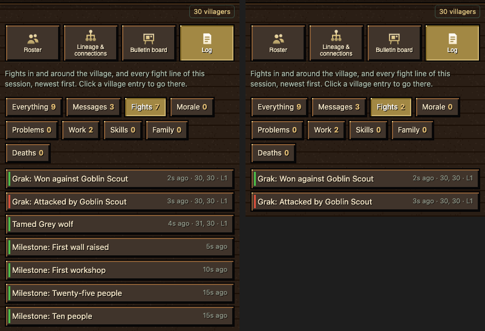
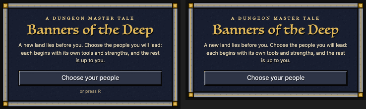
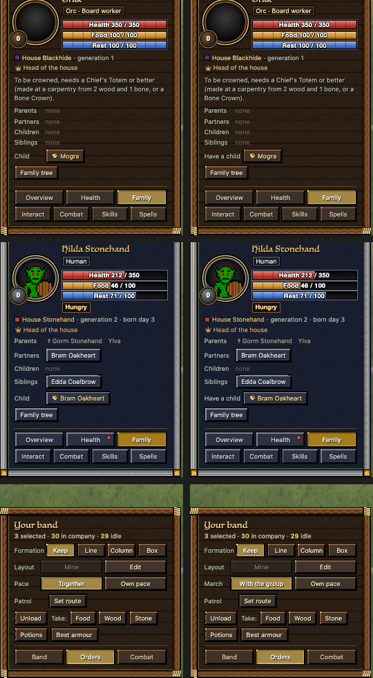
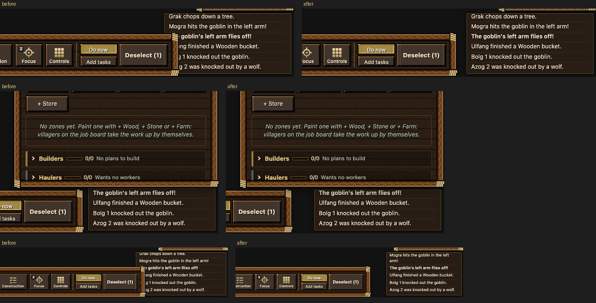
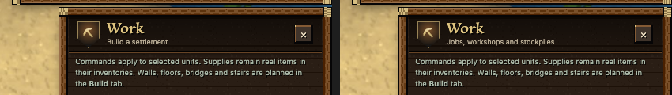
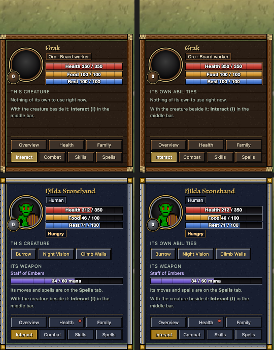
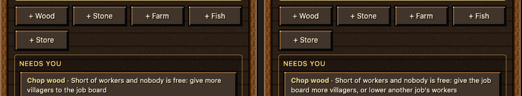

# Polish night: the HUD (polish-hud, 10-26 evening)

Every HUD panel was rendered headless at 1024x640, 1280x720, 1440x900 and 1920x1080 with the test models and with real
models taken from a 30-orc arena village, then checked for errors, overlaps, silent buttons and stale state. The HUD
was already in good shape (0 console errors in 160 scenes); what was left were wrong data in one filter, dead hints,
a covered message box, a rename that never worked and a few labels that read wrong. All nine fixes landed (00:23).

## Done

- **Village › Log › Fights showed good news as fights.** Milestones, tamed animals, sales, treatments and burials are
  all logged as "good news", and Fights took every one. It now holds fights and won fights only, and each filter's
  line says what it shows ("Showing Work only, newest first").
  
- **No more "press R".** The R key has done nothing since build 38, yet the Begin card said "or press R", the first
  goal said "Press R, or click...", and the welcome line said "Press R to choose your people". They now say to click
  Choose your people. The Guide's Shortcuts also name G (Gather) and B (Build bar) at last.
  
- **Family tab: "Child" → "Have a child".** The row of buttons for having a child with a nearby mate was labelled
  "Child" right under "Partners: none / Children: none", so a mate read as the unit's child.
- **Band card says March, like the unit card.** The same walking setting was "Pace: Together" on the band card and
  "March: With the group" on the unit card; both now say March / With the group.
  
- **The message box is never covered.** The bottom bar sat 36 px off the middle of its room, so at 1440x900 and
  1024x640 the main bar (with Plan) and the Build bar ran over the start of every chat line, and an open page hid
  the box's top lines. The bar is now centred between the unit card and the message box (the Build/Gather bar's own
  buttons lost 4 px of side padding each, like the others), and with a page open the box stays below it.
  
- **Village › Lineage › Rename house works.** It never did: two buttons send the same command and the game always
  took the realm's own house name, which refused the family house's id as "longer than 24 letters".
- **Name boxes answer.** Name the house (Realm), Rename house (Lineage) and Rename (a unit) did nothing at all when
  pressed empty; they now put the cursor in the box and say what to type. Enter in the Lineage box renames too.
- **Work panel's subtitle.** It read "Build a settlement" beside the separate Build panel; it now reads "Jobs,
  workshops and stockpiles".
  
- **Interact tab heading.** A villager's own abilities were headed "This creature"; now "Its own abilities", like
  "Its weapon" and "Its own magic" beside it.
  

- **"Short of workers" gives a way out that exists.** Work › a job short of workers always said "give more villagers to
  the job board", also when all of them were on it already; it now says "give the job board more villagers, or lower
  another job's workers" (found by polish-loops in an 8-villager play round).
  

## Numbers

| Check (headless Chrome, real arena models) | before | after |
|---|---|---|
| Fights count in a village with no fighting (4 milestones) | 4 | 0 |
| Fights list with 1 won fight, 1 attack, 1 tamed wolf, 4 milestones | 7 entries | 2 entries |
| Message box covered (7 sizes x 3 cards x 3 bars, Plan on the bar) | 18 cases | 0 |
| same with the 9 px text floor emulated | 21 cases | 0 |
| Main bar to message box at 1440x900 | -16 px (covered) | +20 px |
| Lineage Rename "Ironhide" (arena) | stays "Blackhide" | "Ironhide" |
| Empty name boxes that answer | 0 of 3 | 3 of 3 |
| HUD text telling the player to press R | 3 places | 0 |

**Speed** (HUD script time per update, before → after every fix above; headless Chrome, real arena models, 300
updates a round, 4 rounds each, alternated): no measurable change. The house rename runs only on its click (nothing
per server tick).

| Scene | before (ms per update) | after |
|---|---|---|
| Unit card, 1 selected | 0.335 | 0.330 |
| Band card, 30 selected | 0.292 | 0.297 |
| Village › Log on Fights | 0.466 | 0.451 |
| Work page | 0.516 | 0.492 |
| Realm page | 0.444 | 0.433 |
| Build bar on | 0.345 | 0.338 |
| Gather bar on | 0.383 | 0.357 |

Regression sweep on the page with every fix: 188 HUD scenes at 1280x720, 1440x900 and 1920x1080 with the 9 px text
floor emulated: 0 console errors, no new overlaps or clipped text.

## In progress

- Nothing. All nine fixes **landed together at 00:23 (10-27)** as one batch (reports/polish-night-1026/hud/hud-batch;
  each fix's folder and README kept): gate compile, jscheck 10/10, hudjoin, combat 32/32, settings 23/23 all pass;
  re-proven first on top of the HUD rework and the words batch (same results). Not built yet: goes in the next build.

## Needs the owner

- **The portrait's level badge shows 0 for every new villager.** It is the 2006 game's kill level (Leveling.dm),
  while the new combat levels start at 1. Two different "levels" on one card; which should the badge show?
- **"Everything" in Village › Log is the village's events only.** Messages (the session's chat) and this session's
  fight lines are not in it, while Fights does include those fight lines, so a player can see "Everything 6 · Fights 9".
  Make Everything include the session's fight lines (and Messages?), or rename it "Village"?
- **Two names for "your house".** Realm › Your house sets the realm's own house name; the Lineage card shows the main
  family house with its own random name (e.g. "Blackhide"). They are separate today.
- **A job villager's status reads "Idle" between tasks.** The unit card and the Company list show a unit's last order
  line, so a fisher read "Idle" for 29 minutes while fishing (polish-loops' play round). Switching them to the job's own
  line changes what "Idle" means for the Company list's Idle filter and needs polish-loops' work-news first; not done
  tonight, written to the board for whoever lands work-news.
- **Settings' last line is always half under the Close button** ("Keys: the Guide (F3) lists every shortcut..."). The
  panel scrolls, so it is reachable, but it looks cut. Move it up under the title? (Left for the HUD rework.)
