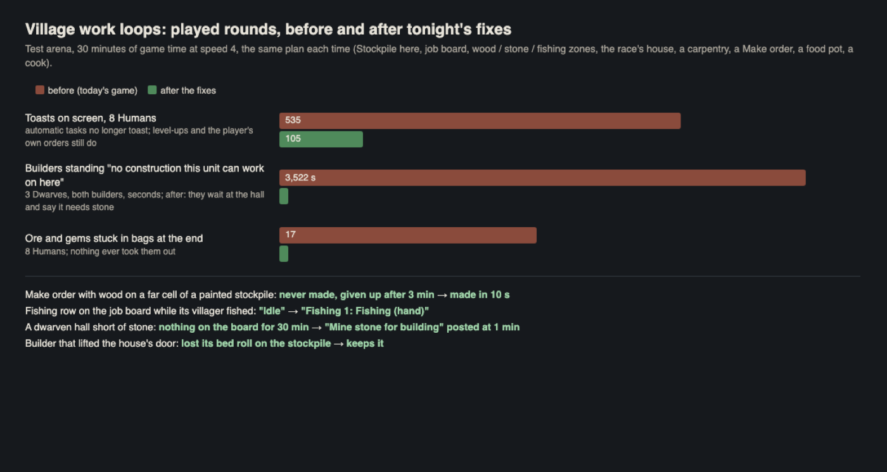

# Polish night: the village work loops (polish-loops)

I played fresh villages in the test arena the way a new player sets one up (Stockpile here, everyone on the job board,
wood, stone and fishing zones, the race's house and a carpentry from the Build tab, a Make order, a standing order, a
food pot and a cook) and let each run 30 minutes of game time at speed 4: 8 Humans, 3 Dwarves (a real fresh start) and
6 Orcs. Work now ends without a toast for every task, the job board's rows say what their villagers really do, Make
orders use wood anywhere on a painted stockpile, idle builders wait at their site and the site asks for its stone,
miners stop filling their bags with ore nothing takes, and builders keep their bed rolls.

The bars: toasts on screen, builders standing idle, ore stuck in bags. The lines under them: the smaller fixes.

## Done

All eight landed together at 01:04 as `loops-batch` (gate: compile, page checks, combat 32/32, buildings 26/26, food 7/7,
obey 32/32; restore point `restore-points/before-polish-loops-batch-20261027-003438`). Not built yet: the lead's next
build takes it. Patches, proofs and READMEs in `reports/polish-night-1026/loops/<fix>/`.

- **No toast for every automatic task.** Every job-board task that ended toasted "<name>: Gathered half: tended trees
  are left to grow back..." or "Collected Stone", "Delivered 3 resource items": 467 of the 545 toasts in the 8-Human
  round (about 15 a minute) were these, and "Building needs tables: posted a carpentry order" went past among them. Now a
  job's own tasks end quietly (the villager's line and its job row still say it); a player's own orders and level-ups
  still toast. (work-news)
- **Job board rows say what their villagers do.** The Fishing, Builders, Haulers and Make rows showed their villager's
  last finished task, or the "Idle" every unit starts with: the Fishing row said "Idle" all round while its fisher caught
  the fish the cook cooked. Now: "Fishing 1: Fishing (hand)", "Waiting for stone for forge: none in the stockpiles".
  The Haulers row no longer says "Wants no workers" while it wants one for a yard with goods and has nobody. A fishing
  zone's notice counts fishing spots ("with 3 rock faces" before). A builder goes back for "its metal axe", not "its
  metalaxe". (work-news)
- **Make orders find their wood on a painted stockpile.** A station order looked only at the drop-off tile and the 8
  round it, but carriers put loads on a painted stockpile's nearest cell: the order sat "Waiting for materials on the
  stockpile" beside wood the board counted, then gave up. It now takes from the store nearest the station, as builders
  and cooks already do. (station-any-store)
- **Idle builders wait at their site, and the site asks for what it lacks.** A builder only took a site it had material
  for: with none ready it stood wherever it was (often on the stockpile) as "Builder: no construction this unit can work
  on here", and a site no builder had joined never posted its order for stone. Now it waits at the site saying what's
  missing, the site posts "Mine stone for building" on the Make tab, and a builder with no plans steps off the stores.
  (builders-wait-at-site)
- **Miners stop carrying ore nothing takes.** A job-board miner lifted every find, but the drop-off takes wood and
  stone only, so iron, gold and gems stayed in its bag for good: after 25 minutes its bag was full and every block's
  stone was left lying ("pack full, the rest is left here"). A job's own digging now leaves those where they fall, as
  the zone pickup and haulers already do; a player's own mine order still lifts everything. (miners-leave-unstored)
- **Builders keep their bed rolls.** Setting things down to lift a door, a builder left its bed roll on the stockpile as
  "goods" for good (and another villager then slept on the stockpile in it). Only goods stay on the store now; its own
  things come back with its tools. In the next round every villager still had its bed roll at the end, and the one born
  without one claimed a bed in the new house. (aside-keeps-own-things)
- **The planning notice says who will build it.** "Assign a worker in the Build tab, or give a villager the Builder
  job" showed even when the job board's Builders were about to take it up, and never named the Builders row (which wants
  nobody until it's set, so a new village's planned lodge just waits). Now: "Builders on the job board take it up.", or
  "Set Builders on the job board (Work tab), ..." first. (crew-hint)
- **A tired villager walking to bed says so.** Its job row read "Paused for manual orders" though nobody gave it an order;
  now "Tired: going to bed". (tired-walk-status)
- **Heavy stone doors ask in the HUD's card.** "Unseal it?" and "Seal / Destroy" came up in the native Choose window,
  the only door menus not in the ask card. (stone-door-card)

## Numbers

Played rounds (`reports/polish-night-1026/loops/play_round.dm`; 30 min of game time, speed 4, the same plan each time).

| What | Test | Before | After |
|---|---|---|---|
| Toasts on screen | 8 Humans | 535 | 105 (level-ups, plans, the player's own orders) |
| Ore and gems stuck in bags at the end | 8 Humans | 17 | 0 |
| Builders' time as "no construction this unit can work on here" | 8 Humans, 2 builders | 1,652 s | 0 (at the house: "Waiting for table for timber house") |
| Same | 3 Dwarves, 2 builders | 3,522 s | 0 ("Waiting for stone for dwarven forge-hall") |
| A board order for the hall's stone | 3 Dwarves | never | "Mine stone for building: 20" at 1 min |
| Timber house built | 8 Humans | 19.7 min | 18.7 min |
| Stored at 30 min: wood / stone / food | 8 Humans | 211 / 301 / 27 | 217 / 294 / 36 |
| Elven lodge, nothing given by hand | tests/lodge_test.dm | 4.0 min | 4.1 min |
| Dwarven hall built | 8 Dwarves (after only) | | 18.8 min, 12 of them waiting for a table |
| Orc war lodge | 6 Orcs (after only) | | 32 of 41 pieces by 5 min, then 24 min waiting for 8 beds (37 of 41 at 30 min) |

Server cost, the same 8-Human round with the tick profiler: the player's whole track pass 34.8 -> 26.0 ms per game second
(3.5 -> 2.6 ms a tick), builders 18.2 -> 11.6, job steps 5.1 -> 2.9; world.cpu mean 24.8 -> 20.4. Not slower (the Mac
ran 6-7 other tests meanwhile, so the worst ticks are noise).

Focused checks (obey arena; `loops_fixes_check.dm`, `station_cells_check.dm`, `aside_check.dm`, `tired_walk_check.dm`):
on today's game 2 of 10, 3 of 4, 1 of 3 and 1 of 2 of their checks pass; with the fixes, all of them (and
`crew_hint_check.dm` 4/4). Also on the patched copy: gather_zone_test 18/18, buildings, food, obey 32/32, clip,
construction, stone doors 11/11.

What the rounds showed that is fine: zones fill from the job board with no clicks, wood and stone come in, yards fill,
the carpentry and the food pot get built, furniture orders are posted by the building itself and made, the cook cooks
the fishers' catch and fills the food pot, hungry villagers eat at the pot, villagers without a bed roll sleep rough
until a bed is free, the saved game brings work back (polish-start's save round trip: "work_resumes_after_reload"
passes).

## In progress

- Landed at 01:04 as one batch (about 25 landings were queued on the shared land lock tonight); re-proved on the game as
  it was at 23:55 before it went in (loops_fixes_check 10/10).
- Passed to other areas (notes on the team board): the unit card and roster still show a job villager's last task or
  "Idle" between tasks (hud); the job board's "give more villagers to the job board" when all are on it (hud/words);
  zone rows and zone behaviour now belong to polish-zones; a tired villager with no bed roll can wedge against a house
  wall for good (controls: villagers walk to beds in a straight line; in one round one stood 13 minutes at the wall,
  rest falling from 19 to 1, while the bed was a wall away).

## Needs the owner

- **Who works when there aren't enough hands.** Every round showed the same thing: the plan wants more workers than
  the village has, and the job board gives the rows workers in their order, at the same priority. Then:
  - 3 Dwarves (wood 3, stone 2, fishing 1, builders 2 wanted): the two builders held two of the three villagers for 29
    minutes with nothing they could build (the hall needs stone; nobody was on stone). Stone stayed at 0, the hall and
    the food pot never started, two dwarves starved to 1 hunger (no food source).
  - 8 Humans and 6 Orcs: the furniture orders a building posts are High priority, but a High row may only take workers
    from Low rows, and every villager was on a Normal row. The timber house waited 14 minutes in one round and
    over 26 in another for its table, chair and beds, the Orc lodge 24 minutes for 8 beds, while two miners piled up
    300 stone nobody needed. The beds got made only when the stone zone ran out and freed its miners (then 8 beds took
    2 minutes).
  - 8 Dwarves: the dwarven hall stood 3 minutes from done for 12 minutes, waiting for a table.
  - 3 Humans with a plan that fits (2 on wood, 1 builder; one later made cook): the timber house was 36 of 41 pieces by
    5 minutes and stayed there for the next 25, waiting for a table and a chair that nobody was free to make. A real
    fresh start doesn't finish its first house without the player freeing a villager by hand.
  - After tonight the board says so (the site's own order on Make, "Nobody free on the job board", the amber "needs you"),
    but nobody moves by themselves. Options: (a) High rows may also take from Normal rows after a while, as they take from
    Low; (b) the Builders row stops holding villagers while no site can be worked; (c) a builder with nothing to build
    gathers what its site lacks; (d) leave it to the player, with the board telling them.
- **Ore is never stored.** The drop-off takes wood and stone ("mixed"), or stone and ore ("mining") but then no wood;
  "Stockpile here" makes "a store for anything" but nothing carries ore to it. Mined iron, gold, silver, gems and rock salt
  lie where they fall and rot after about half an hour: 24-40 pieces a round from one 9 x 9 outcrop (before tonight
  some of it also went into the miners' bags and stayed there). Should the drop-off (or "any" stores) take ore?
- **Furniture is ordered one kind at a time.** A building orders its next piece of furniture only when a builder reaches
  it: the Elf lodge ordered its table at 1.6 min, beds at 2.1, door at 3.6 (1.9 of its 4 minutes waiting on the
  carpentry). Ordering everything it needs when it's planned would cut that; it changes how long buildings take, so it's
  yours.
- **A villager moved to the cook (or farmer, hunter) job keeps its old load.** A woodcutter made cook carried 195 of 220 in
  logs for 24 minutes. Cooks carry wood on purpose (the food pot's fire), so it needs a rule: unload first, or not.
