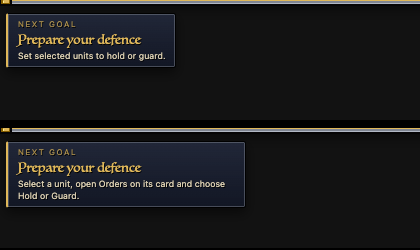
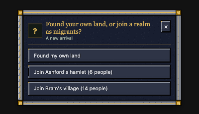

# Polish night: a player's first ten minutes and coming back (polish-start)

A new player's start, walked race by race in a test world (no real window): the race card, the story, the company and
its kit, every Guide goal through the HUD's own commands, then starting over, losing everything and beginning again,
saving and reloading, and time away. The existing checks for this area pass. The rough spots were a start-over button
that threw the company away, question cards that came back after being answered, two Guide goals that pointed at
things a player couldn't find, one start question still in the old 2006 window, and old 2006 help lines.

## Done

All eight landed with their gate (compile, page scripts, HUD join, combat 32/32; settings 23/23 for page changes);
the first six are in build 63 and passed the lead's review, the last two (toast, away words) landed at 00:20 for the next build.

- **"Not now" after Start over no longer throws your company away.** Choosing a new people from the menu with a company
  alive asked "Start again?", then the race card; but the old company was already gone before the race was asked, so
  "Not now" (or Esc) left you with nobody. Now the people is chosen first and the old company is left only then.
  Test world, the game's own start: before 3 units → 0; after 3 → 3.
- **Answered question cards stay closed.** The race card, the story's Begin and every "Choose" card flashed back for a
  moment after a click (a HUD update from before the game had the answer still carried the question). Now an answered
  card stays shut, and only a question still asked 3 s later shows again (so a lost answer is never stuck).
- **The Guide's "Prepare your defence" goal says where Hold and Guard are**: on a unit's card, Orders. The tab bar hides
  the Orders page in the game, so "Set selected units to hold or guard" sent new players looking for nothing.
  
- **The crafting goal's example is a wooden bucket**, not a spade: Lizardmen can't make spades, every people can make a
  bucket.
- **"Found your own land, or join a realm as migrants?"** (a new arrival in a world with an open settlement) is now a
  HUD card like the race pick, not the old BYOND list window.
  
- **Illithid and Devourer start lines** name the real controls (F6 or Mental abilities, Choose magic target, Tear meat
  from carried corpses) instead of a command bar, right-click targeting and a "Tear All Meat button" that don't exist.
- **One toast when the head of the house dies**, not two saying the same thing ("... now leads House ..." and "Long
  live ...!"); the heir banner and the Village log line stay.
- **The away card** says "Cooks cooked 6 pieces of meat" (was "6 meat").
- The "press R" texts (R is menu only since the key map) were found here too and handed to the HUD session, which fixes
  them on the page.

## Numbers

| Check (test world, today's game) | Result |
|---|---|
| Safe start (start spots, grace, swamp, room for logs) | passed 10/10 |
| Families (births, deaths, lost father, rename, reload) | passed 9/9 |
| Heirs and succession (eldest child, named heir, banner) | passed 6/6 |
| Ranks and milestones (camp to kingdom) | passed 9/9 |
| Realms (join, fealty, leave, house) | passed 8/8 (and after the migrant card) |
| Save, quit, reload twice (work resumes, captives, stockpile, zone, plans) | passed 11/11 |
| Units, workshops, ground items across saves | passed |
| Time away (felling, mining, farms, cooks, hunters, builders, meals) | passed, nobody starved |
| Rulership | 43 ok, 17 failing (the test's kills became 60 s falls in build 59): fixed by polish-village, 64/64 after |

The start walk (the game's own start, every people; speed 4 for the second half):

| People | Company | Room for 3 logs | First goals by the HUD's commands |
|---|---|---|---|
| Human, Dwarf, Orc, Goblin, Elf | 3 | yes | all reachable |
| Lizardman, Frogman | 3 (carry a log already) | yes | all reachable; Lizardmen can't make the old example (a spade) |
| Kobold, Ratman | 5 | yes | all reachable |
| Dragon, Spider queen, Devourer, Svartalfar, Illithid | 1 | (no extra room, as before) | no settlement goals (as meant) |

0 runtime errors in the walk.

Speed (owner's question, measured):

| Change | What was measured | Before | After |
|---|---|---|---|
| Answered cards stay closed | HUD script per update, headless Chrome, 5 x 200 updates, interleaved | 0.184 ms | 0.185 ms (no question), 0.181 ms (answered card) |
| Goal hints (defend, craft) | same | 0.18 ms | 0.18 ms (text only) |
| Start over, migrant card, rare-start lines, succession toast, away words | server ms per tick | - | no change: none of them runs on a tick (only at a start, a death or a catch-up; traced in the code) |

## In progress

- Nothing left open. The start walk (a test world that drives the game's own start for every people, then the goals,
  Start over and Begin again) is kept in reports/polish-night-1026/start/walk/ for the next round.

## Needs the owner

- **Quitting saves a dying unit.** A unit brought down "dying" (60 s to be saved) when the game is saved and quit comes
  back standing at 1 health, no longer dying, and is still alive minutes later; a knocked-out one wakes too. The dying
  clock isn't kept in the save (it lives only while the game runs). Test world, the game's own save and load: before
  the save "dying, out cold, 1 health"; after the reload "not dying, standing, 1 health", alive 70 s later. Keeping it
  needs one more thing in the unit save (a save-format change, so not tonight). Options: keep the seconds left in the
  save; or on load, put a unit at 1 health back to dying; or leave it.
- **Begin again keeps the old stockpile.** After the whole company is lost and a new people is chosen, the stockpile
  (and with it Drop off, auto-unload, the stores builders fetch from) stays where the old village was; the new company
  lands far away on the real map (in the test world 48 tiles). The Guide goals already met and the rank stay too. Should
  a new start clear the stockpile (and maybe the old plans), or is keeping the old land meant ("the land remains")?
- **Crafting odds differ between two ways of crafting the same thing.** At a carpentry's Craft menu a level-1 crafter
  succeeds 45% of the time (the softened start in Rarity.dm); the Work tab's production queue (and the job board's make
  rows, which use it) still uses the old 4% for the bucket, spade, spike and beam. In the walk, all 3 queued spades failed
  in 8 of 9 carpenters' tries (Lizardmen can't queue one). Not changed (a number).
- Company and number groups don't survive a reload. By design (the game says "Groups last for this session"); saving
  them would be a save-format change.
