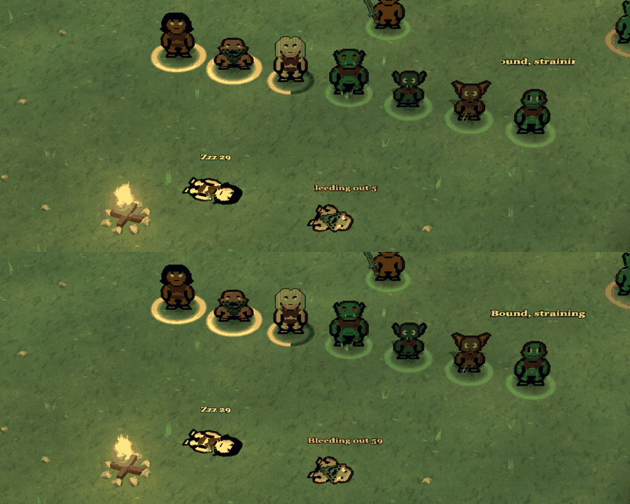
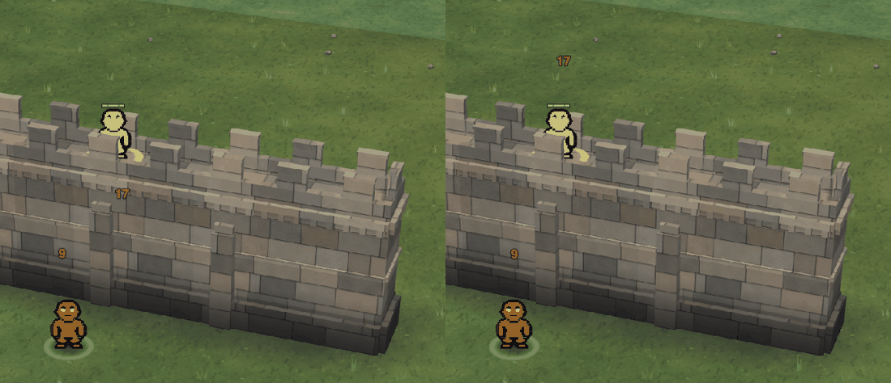
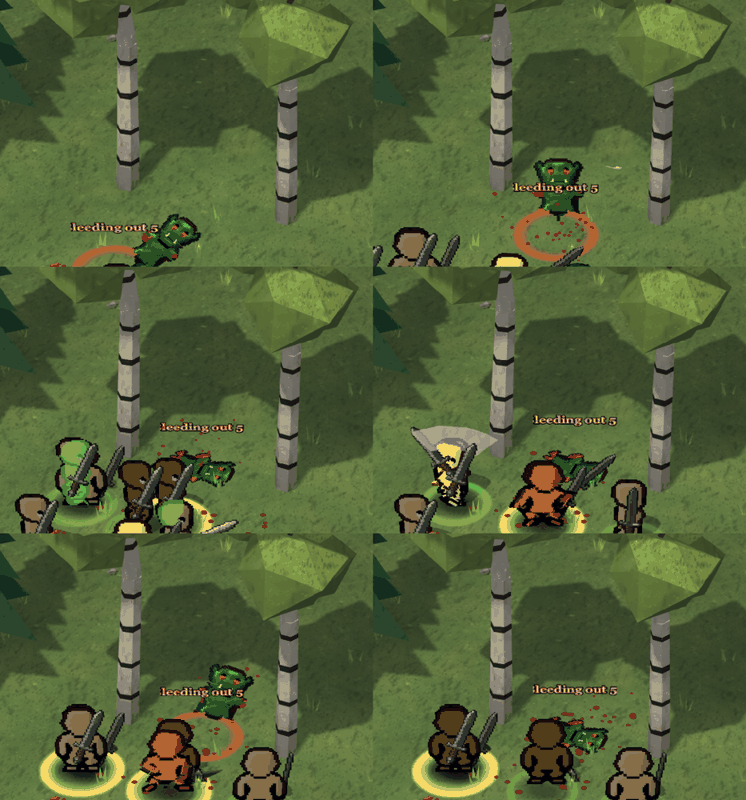

# Polish night: the 3D view (polish-view3d, 2026-10-26 evening)

Your people up on a mountain no longer vanish behind taller rock, and a click on one of them picks it. Long words over
a downed unit ("Bleeding out 59") show in full, a wall defender's damage numbers rise over its head instead of on the
wall below it, torches in a busy hall no longer blink as you pan, and changing level no longer drops the sky for a frame.

## Done
- **Long words over units show in full.** The countdown over someone bleeding out read "leeding out 5" (the first and
  last letters were cut off), and a straining captive's "Bound, straining" lost its ends too. Long words now get a wider
  label; short ones like "Zzz 29" look exactly as before.
  
- **Your units up on a mountain stay in sight.** One of yours standing in a hollow on a mountain, with taller rock
  between it and the camera, simply disappeared: the rock only thinned out for units on the ground, and the green
  "behind something" outline skipped anyone off the ground. Now the rock in front thins for them too and the green
  outline shows, on the surface and in the Sky view, the same as for units on the ground.
  
- **A click on your unit up on a mountain or a wall-walk picks it**, from the Sky view too. The click used to go through
  to the rock under it (a move order, or nothing); selecting one took a box drag. Units on the ground pick exactly as before, and a click on
  an enemy up there does what it did before.
- **Damage numbers stay on a wall defender.** A unit of yours on a wall-walk that took a blow had its number pop up on
  the face of the wall below its feet. It now rises over its head, the same as on the ground.
  
- **No lost sky frame when changing level.** Going into the Sky view (or back up from the caves) could skip drawing the
  sky for one frame, and the sun's shadows could miss a redraw, with a WebGL warning in the console. Fixed at the root
  (the sky and the shadow pass no longer trip over buffers the level change let go).
- **Torches don't blink in a torch-lit hall.** The 3D view lights the world with the 8 lights nearest the camera; in a
  hall with more torches than that, panning switched torches' light on and off at once. Now the one about to drop out
  fades over its last few tiles. Scenes with 8 lights or fewer look exactly as before.
- Each fix has its write-up, before/after picture and checks in `reports/polish-night-1026/view3d/` (word-fit,
  rock-own-units, pick-raised, pick-sky, float-on-unit, gl-attribs: one landing, batch1, 22:24; light-fade, 22:38). Both
  passed the gate (compile, scripts, page join, combat 32/32, 3D sends 9/9 and 48/48) and go into build 65; checked again
  on the live page after landing: every fix there, a recorded fight and the level changes with 0 errors.

## Numbers
| Check (headless Chrome, the real page, fresh arena scenes) | Today | Now |
|---|---|---|
| Bleeding-out word, letters shown | "leeding out 5" | "Bleeding out 59" |
| Dwarf on a mountain behind 7-high rock, pixels of it on screen | 0 | seen through the thinned rock |
| Click at that dwarf's drawn spot picks (surface view / Sky view) | nothing / nothing | the dwarf / the dwarf |
| Click on units on the ground / on an enemy on a wall-walk | picks it / nothing | the same |
| Wall defender's damage number, height on screen | 180 px below its head (on the wall) | 61 px over its head |
| Torch light switching on or off at once while panning across the Moria hall (24 tiles) | 8 times | 0 (one fade step of 0.31) |
| Refused WebGL draws after a level change (sky / shadow pass) | 1 / up to 12 | 0 / 0 |
| A recorded arena fight replayed into the page (12 units, 115 blows, 2 deaths, 2 knock-outs, 8 limbs): page / console / WebGL errors | 0 / 0 / 0 | 0 / 0 / 0 |
| All 30 saved replay scenes loaded and swept through zoom 6-60, turns and tilts: errors | 0 | 0 |
| 3D frame script time, median (mountain scene / village with 200 units) | 0.4 / 0.5-0.6 ms | 0.4 / 0.6 ms: no measurable change |

## In progress
- Nothing half done; both landings are in. The probes (scene dumps, a fight recorder, a page replay, WebGL call checks) are in
  `reports/polish-night-1026/view3d/tools/` for whoever looks at the 3D view next.

## Needs the owner
- **A downed unit struck again gets knocked back.** Someone out cold or bleeding out who takes a heavy blow is shoved a
  tile by the game, and its body pops upright to fly there before lying down again (seen twice in the recorded fight).
  Should a downed unit be knocked back at all? Passed to the combat polish agent; nothing changed.
  
- **Rings for units off the ground.** Units up on a mountain or a wall-walk (and units seen below from the Sky view)
  have no ring under them, selected or not; the selected and the hurt show a health bar over their heads instead.
  Everywhere else it is ring only, no bars over the selected. Same rule for them too, or keep it as it is?
- **Your units bunching on one tile in a fight.** In the recorded melee, Alice's swordsmen stood 3 to 5 on one tile
  for long stretches; in 3D the ones behind show as green outlines through the one in front. The controls agent traced
  it: all six take the same foe and the same route and strike from one tile (they keep moving, so the step-off for
  resting units never fires). Spreading them changes who strikes from which side, so it is your call (flank and
  surround numbers), listed in their devlog too.
