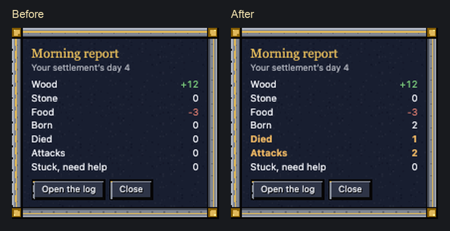
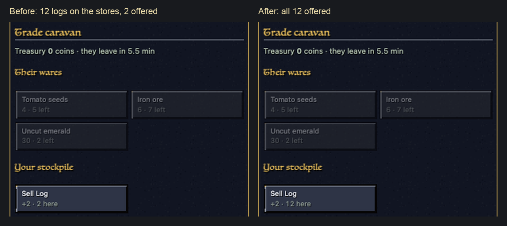

# Polish night: village life and rule (polish-village)

Village life now reports what really happened: one death is one death, one raid is one attack on the morning card, and
a busy day no longer forgets its births. The law of succession stops promising a mood change while moods are off, the
trade caravan buys from your whole stockpile and still sets up when your walls keep it out, raid credit goes only to
the realm that was raided, new villagers stop sharing names, a villager bleeding out reads "dying", not "knocked out",
and a siege engine stops saying "Needs crew" once its crew is back.

Status: done. Eleven fixes landed 21:52 (restore point restore-points/before-polish-village-polish-20261026-213117), plus a test fix
at 00:44. Each fix has a README in `reports/polish-night-1026/village/<fix>/` (what the player saw, what changed, before → after).

## Done

- **Rulership check works again** (test only, landing): the rulership check had 19 of its 64 checks failing since
  build 59's falls, because its "killed" heir was left dying for 60 s. One line in the test; 64 of 64 after.
- Ten fixes proven on clones and landing as one area patch (`reports/polish-night-1026/village/village-polish/`, as
  the lead asked: one patch per area): death-log-once, day-card-counts, board-standing-quiet, law-no-mood, look-dying,
  caravan-stores, raid-won-own, names-unique, siege-status-fresh, and the rulership test fix (table below).

## Picture

The HUD's real Morning report card (headless Chrome, the patched page) for one busy day: 2 born, 1 died, a raid and a wolf.
Left: what it said before (200 level-ups had pushed the day off the 150-line log). Right: after.

The Realm tab's trade caravan box with 12 logs on a painted stockpile: before it offered the 2 on the stockpile's own
tiles, after all 12. (Both pictures: the HUD page in headless Chrome, fed the numbers the arena probes measured.)

## Numbers

Arena probes on the app's engine (`reports/polish-night-1026/village/probes/`); before = a copy of today's game, after =
the same copy with the fixes.

| What (probe) | Before | After |
|---|---|---|
| One poison death + one fever death (village_probe) | 4 death lines, card "4 died" | 2 lines, card "2 died" |
| Changing the law with moods off (village_probe) | "... unsettles your people: mood -10 for a week." | "Your realm now keeps the law of Might." |
| Wood the caravan offers to buy, 12 on the stores (village_probe) | 2 | 12 |
| Caravan at a walled-in stockpile (village_probe) | still waiting outside after 10 min | set up at its closest spot after 5 min |
| Raid on realm Q only: "raids beaten" for P / Q (raidwon_probe) | 1 / 1 | 0 / 1 |
| Villages of 20 with two units of one name, Dwarf / Human (names_probe, 20 each) | 4 / 5 of 20 | 0 / 0 of 20 |
| Morning card after a busy day: 2 born, 1 died, a raid, a wolf, 200 level-ups (daycard_probe) | "A quiet day" | "2 born · 1 died · 2 attacks" |
| Morning card, same day without the level-ups (daycard_quiet_probe): one raid + one wolf | "19 attacks" | "2 attacks" |
| Hovering a villager bleeding out, 60 s to save (look_probe) | "knocked out, bleeding badly" | "dying, bleeding badly" |
| Log lines from one "keep 10 wood" order hovering at 10, 10 game minutes (standing_probe) | 25 identical Board lines | 0 (still listed in the Work tab) |
| Siege ram's hover status, crew back, wall at 2,400 of 3,000 HP (siege_status_probe) | "Needs crew: keep one of your people beside it" | "Attacking a wall at 30,20" |
| Rulership check (tests/rulership_test.dm) | 45 of 64, never completes | 64 of 64 in 9 s |

All ten together on a copy of today's game: family 9/9, heirs 6/6, rulership 64/64, trade 8/8, raids 8/8, village
20/20 (graves, forensics, tavern, brawls), market 6/6, board 10/10, siege as expected, compile with the same 295
warnings; the HUD's law buttons in headless Chrome: no mood line with moods off, no script errors.

## Speed (server cost of the fixes)

Arena, the app's engine, `probes/cost_probe.dm`: ms per call, today's game vs today's game + the fixes (a 0.1 s clock over
many calls: the 300-call rows are good to about 0.3 ms).

| Path | Before | After | Note |
|---|---|---|---|
| Caravan goods list (RemasterTradeData, 80 logs on the main stockpile and a painted yard) | 2.0 ms | 2.3 ms | only while a caravan is set up (6 min every 2 days); it now reads the yard too, which was the bug |
| One village log write (20,000 calls) | 0.125 ms | 0.035 ms | the day's counts replace re-reading the 150-line log each morning |
| Naming a new unit in a realm of 30 | under 0.3 ms | 0.33 ms | once per birth or new army; skipped in realms over 400 |

Everything else (death line check, law and look words, standing-order log, siege status, raid credit) is a few
comparisons on events that happen once in a while: no measurable change.

## In progress

- Nothing. Verified on the live game after landing: family 9/9, heirs 6/6, trade 8/8, raids 8/8, market 6/6, board 10/10, rulership 64/64, village 20/20 (after a test-only fix: the words batch changed 'Traitor!' to 'Traitor:').
- Found and noted for other areas on the team board: two strings that show a "?" box in game (Formations.dm, a raw
  Latin-1 dot; the compiler reads UTF-8), the migrant prompt still using the old native window (start), word fixes in
  my files (words), the rulership check's drift (start).

## Needs the owner

- **Two kinds of "house".** Each player has a family house from the lineage (picked from a list for the race, e.g.
  "House Stonebeard", renamed in Village > Lineage) and a realm house (the login name until named on the Realm page;
  it is the "{Name}" on every unit, banners, claims and war messages). Messages mix them: a death says "Durimbek now
  leads House Stonebeard", the heir's circlet says "whoever of House kiwimango holds it". Option: name them as one
  (naming either names both), or say "realm" where the realm house is meant. Not changed: it is a design choice.
- **The Council law still scores mood.** Under Council the heir is "the grown unit they like best (mood, family,
  level)". Moods are off, so every unit made since 10-20 has mood 60, but units from older saves keep whatever mood
  they had, which still tips the choice. Option: leave mood out while moods are off, and the tip says "(family, level)".
- **A raid that just gives up counts as beaten.** Raiders who don't win stop marching after 10 minutes and roam where
  they are; the village then gets "A raid beaten" (the Town rank needs one), as it does for raiders captured or routed.
  Is "survived it" what beaten should mean?
- **Each villager's fight lines fill the village log.** Every villager in a fight writes its own lines into Village >
  Log ("Aldric: Attacked by Goblin Scout", "Aldric: Fighting Goblin Scout", "Aldric: Won against Goblin Scout"):
  measured, one 40 s fight of 10 villagers writes 30 lines (fightlines_probe); skill level-ups also go there. The log keeps 150 lines. Option: the
  per-villager lines stay on the villager's own card, and the log keeps one line per attack on the village. (The
  morning card no longer depends on the log: day-card-counts.)
- **The blocked caravan** now sets up where it stopped (the friendlier choice). The other choice is that it turns
  back with a message; say if you prefer that.
- **Bloodline can put a baby at the head of the family.** "Eldest child" takes any age, while the heir's circlet and
  the Might and Council laws need a grown unit (age 5+). Confirm or ask for grown children first.
- **Tavern brawls pick anyone beside the drunk**, other realms' people and raiders too (as the design note says).
  Confirm, or keep brawls among the village's own.
- Player-run economy (prices, taxes, tolls): what exists and where each idea would plug in, in
  `reports/polish-night-1026/village/ECONOMY_NOTES.md`. Design only.
