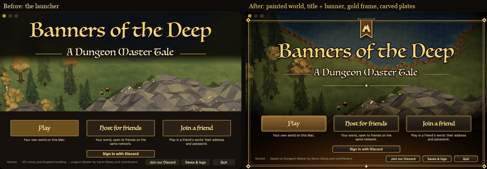
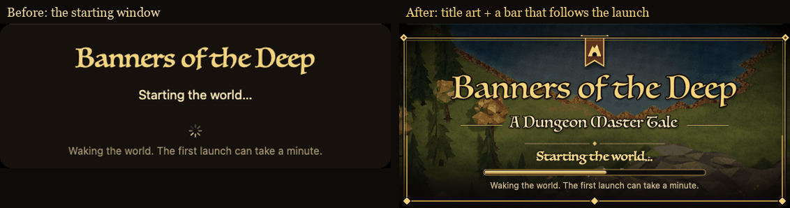
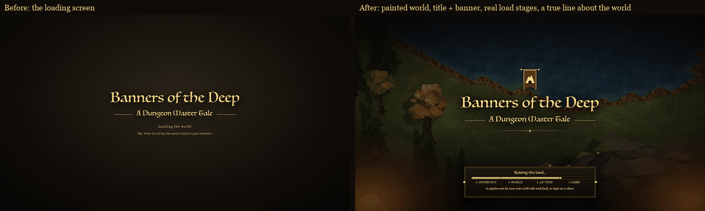
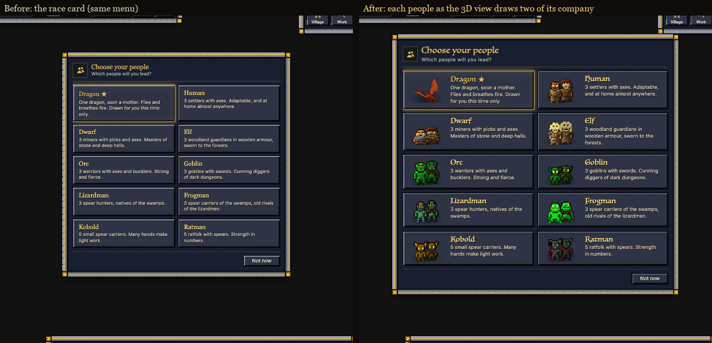
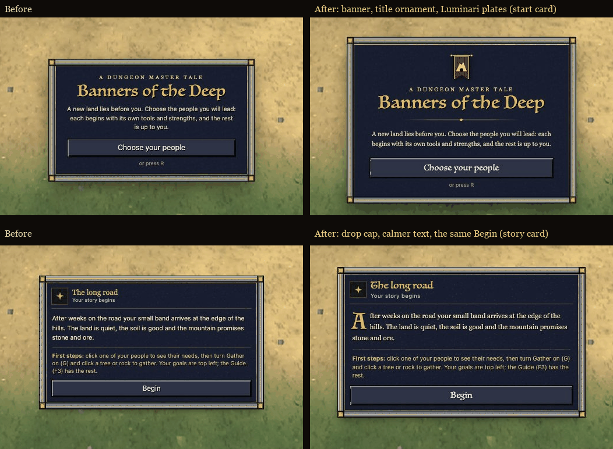

# Screens: the launcher, the loading screen and the first cards (polish night, 10-26)

You asked at 20:25 for a much better loading screen and start-up screen. The first four things a player sees now share
one look: the game's own world, painted, under the title and the house banner, in gold frames. The loading screen
shows the load's real stages and a short true line about the world. The race card shows what each people looks like,
using the game's own sprites (faces untouched).

## Done

- **Launcher (the start-up window)**: the painted world now fills the whole window, with forest, lake, the ore-flecked
  mountain and two travellers between the title and the buttons. The house banner hangs from a gold frame. Play, Host
  and Join are carved bronze plates that light up under the pointer and sink when pressed. The footer buttons match
  them, and the footer line is shorter. If the art is ever missing, the fallback now says "Banners of the Deep" (it
  still said "KIN & STONE"). Every button, key and sign-in works as before.
  
- **The small "starting" window**: it shows the title art and a bar that moves only with the launch's real stages
  (getting ready, waking the world, opening the game window). It hides exactly when it did before.
  
- **Loading screen (the boot cover)**: the painted world drifts slowly behind the title and banner, with warm light
  from the corners. A framed plate shows four real stages: Interface, World, 3D view, Land. The bar fills only as each
  stage really happens, so it never runs ahead. Every 9 s a short true line about the world appears ("No wound heals
  by itself here", "The fallen are not yet dead: a friend has sixty seconds to save them", "No rope, no captive"...).
  There are no how-to hints. It lifts at exactly the same moment as before, with a calm fade, and stops catching
  clicks the instant it starts fading.
  
- **Race card**: each people shows two of its starting company, exactly as the 3D view draws them (the game's own
  enhanced sprites and starting gear). The dragon and spider queen come from their own beast pictures, the Devourer
  from its original sprite. The card is wider, the names are in the title font, and rare peoples keep their star and
  glow. With many choices, or in a small window, the cards go into three columns so the list doesn't scroll.
  
- **Start card and story card**: the start card has the banner over the title, a gold ornament and a title-font
  button. The story card opens with a gold drop cap. All words and buttons are the same as before.
  

## Numbers

| Check | Before | After |
|---|---|---|
| Loading screen shows real progress | no (dots only) | 4 stages: page, first world data, 3D view on, land drawn |
| Commands the page sends while loading (headless) | ready, then 2 | the same: ready, then the same 2 |
| Console errors (headless, 3 window sizes) | 0 | 0 |
| Smallest text on screen, 1024x640 window | 7.8 px (race card blurbs) | 9.2 px (WebKit's floor is 9) |
| Race card, 10 choices, 1024x640 to 1920x1080 | no pictures | a picture for every people, no scrolling |
| Launcher test build (the app's own compile command) | builds | builds, no warnings |
| HUD page size | 1.36 MB | 1.59 MB (+222 KB: the painted backdrop 82 KB and race pictures 77 KB, as text in the page) |
| Page load to its first command (ready), headless, median of 12 interleaved runs | 106 ms | 103 ms (no measurable change) |
| Page parsed (DOMContentLoaded), same runs | 125 ms | 112 ms (no measurable change) |
| Loading screen's progress timer, cost per tick (4 a second, only while it shows) | none | 0.0006 ms |

## Landed (night of 10-26 to 10-27)

| Fix | Landed | Gate | Checked on the live game afterwards |
|---|---|---|---|
| Loading screen (`screens-boot-cover`) | 00:19 | compile, jscheck 10/10, hudjoin, settings 23/23, combat 32/32: pass | the four stages run in order, it stops catching clicks as it fades, the page still sends ready first, 0 console errors |
| Launcher (`screens-launcher`) | 00:23 | compile, jscheck 10/10, hudjoin: pass | the live `Launcher.m` builds with the app's own compile command, no warnings |
| Start, race and story cards (`screens-start-cards`) | 00:31 | compile, jscheck 10/10, hudjoin, settings 23/23, combat 32/32: pass | every people has its picture, no scrolling, smallest text 9.2 px at 1024x640, 0 console errors |
| Race card speed fix (`screens-race-many`) | 02:19 | compile, jscheck 10/10, hudjoin, settings 23/23, combat 32/32: pass | perf-watch found the race card made every HUD update with 203 units about 1 ms slower (3.0 / 3.1 / 3.5 ms with one / all / no units selected). Now 2.0 / 2.1 / 2.3 ms on the live page, back to before; the card looks the same at 10, 11 and 14 choices |

The page changes are in the game now. The launcher reaches the app with the lead's next build. Restore points:
`restore-points/before-polish-screens-{boot-cover,launcher,start-cards}-*`; the old launcher files are also in
`reports/polish-night-1026/screens/launcher/restore/mac-app/` (the restore points don't cover `mac-app/`).

## Needs the owner

- **Look**: is the painted, darker world on the launcher right, or do you want the plain bright screenshot back behind
  the new frame and plates? It's one art switch: the frame, banner and plates stay either way.
- **Loading lines**: the fifteen lines are all rules the game really has today. Want more lore and fewer rules, or
  none at all?
- With all five rare peoples drawn at once (very rare), the race list scrolls slightly in the smallest window
  (1024x640).
- If the game is ever renamed again, the brand tool redraws the launcher in its old layout. The note in
  `reports/polish-night-1026/screens/launcher/README.md` says how to redo the new one.
