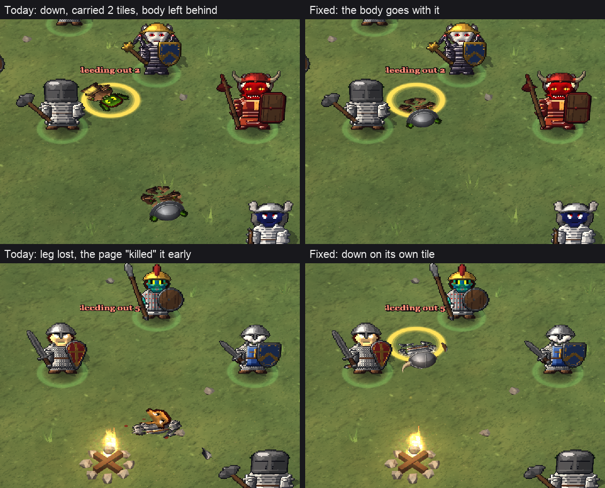
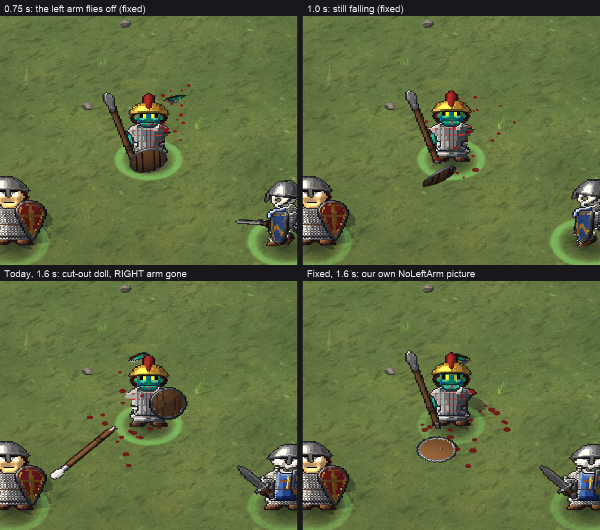
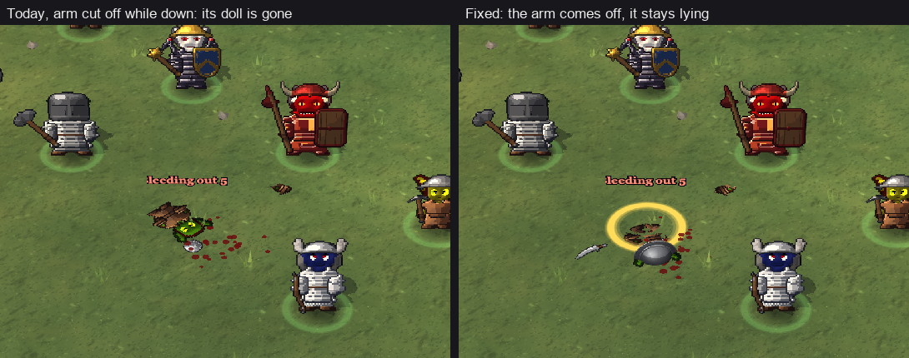

# world-look-sky, 2026-10-26

- Picked up the 3D world look and Sky work from the old world-look and sky-ideas chats (20 and 38).
- Read where it stands at build 56: every world-look change from 10-25 is in the app; the Sky level is earned,
  sits 10 blocks up over untouched mountains, and the Sky view shows the land below with its far edge.
- Nothing changed in the game today. Status and the first cloud questions went to the owner.
- Found: the test scenes used for mountain and Sky pictures were wiped by the reboot; they get rebuilt before the
  next picture check.

## Ring in one place, body in another (13:00-13:45)
- The owner saw a downed unit's ring and "Bleeding out" tag on one tile and its body lying two tiles away.
- Cause: when a downed unit is carried (the Doctor, "Carry them") or dragged, its lying body stayed where it fell,
  and its standing picture was drawn in the ring too. A second route: 15 s after losing a limb the page decided on
  its own that the unit had died, while the game kept it fighting.
- Also asked: with the fix, a unit that loses a limb goes straight back to the game's own missing-limb picture
  (instead of a cut-out stand-in until it takes a step).
- Fix staged (four small changes in the doll scripts), tested without a game window; handed to the combat session.
  Not in the game yet.

## Limbs from the right side; review for hud-controls (13:45-14:20)
- The doll always cut off the right arm or leg, whatever the game took. With the fix it cuts the side the game names,
  and a lost left arm drops the shield (the right drops the weapon). The arm still flies off a living unit with its
  blood.
- Reviewed hud-controls' fix for work dolls lagging behind (chopping short of the tree, staying behind after a step)
  with real dolls: it works, and it fits with the doll fix. It is in the game since 13:58.
- The doll fix went to the coordinator for build 58 (the last one before the freeze).

## The animation's limb stays; dropped gear stays (14:30-15:00)
- In the real game, a carried body now stays right under its ring (it used to trail up to a tile between updates).
- The owner asked for the animation's limb on the ground instead of the 3D limb item. Now the arm cut from the unit
  lies where it landed until the limb is picked up or rots, and a knocked-out unit's weapon stays where it fell until
  it gets up. Both landed for build 58.

## The limb in 2D, the knocked-out weapon, clicks (15:00-15:30)
- The limb still showed as a grey 3D bone: the server gave every bone item a 3D model. A lost limb now never gets one;
  the animation's limb lies there, and a click on it now finds the limb (it found the bare tile before). Landed 15:16.
- The owner's new rule: a knocked-out unit's weapon falls as a real item anyone can take; if it's still there when the
  unit comes to, it picks it up and holds it again. Staged and checked (arena 9/9, knock-outs, bleeding out, capture).
- All items are now clicked where they are drawn (items drawn off their tile's middle, gear that fell). Staged.
- The owner's list of stacked items on a second right-click went to the HUD session.

## Build 59 pieces, and staying down (15:30-16:20)
- Landed for build 59: a knocked-out unit's weapon is a real item on the ground (checked again after the "every fall
  can be saved" change: 12 cases, never lost twice), and every item is clicked where it is drawn.
- New, waiting for the owner's look: a unit lying out cold or bleeding out keeps the pose it fell into when it's hit
  again, or loses a limb where it lies. Before, it half got up and its body swapped for the old flat picture, or its
  body vanished. Dying where it lies stays the golem session's switch, off until the owner has seen it.
- Seen while checking: while a body is carried, its ring runs about half a tile ahead of it. Sent to the golem session.

## Limbs left where they fall, bodies that stay down (16:00-16:40)
- A body dragged away now leaves its cut-off limb on the ground where it landed, and a limb someone picks up no longer
  stays drawn on the body. In build 61.
- A downed unit that's hit again, or loses an arm, keeps the pose it fell in. In build 61, on the owner's go.
