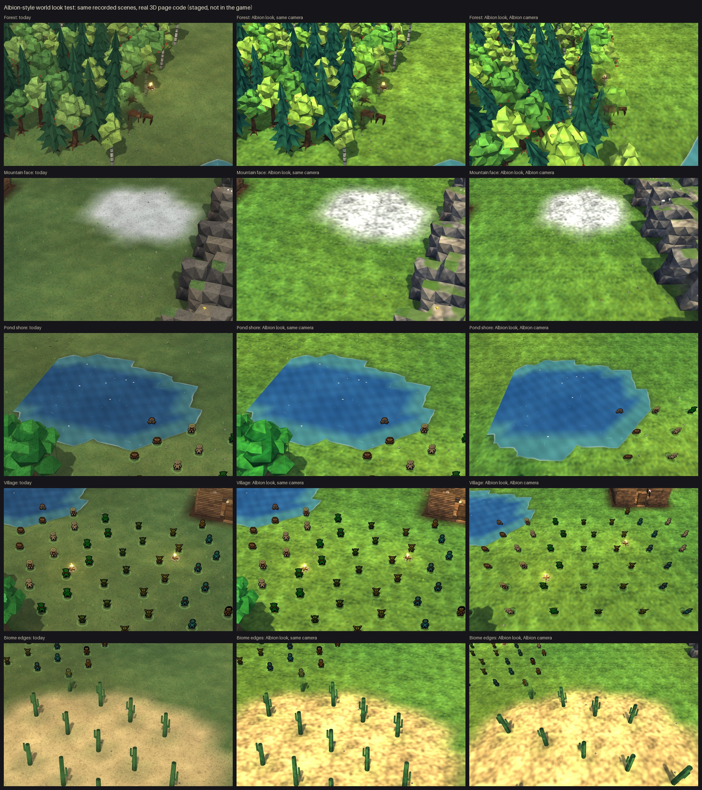

# albion-look: Albion-style world look test

Look test only: the real 3D page fed recorded scenes, today's look vs an Albion-style restyle (ground, trees, rock, water, light). Nothing landed in `game/`; units untouched.

## Done
- Staged test arena: `reports/albion-look/staged/arena.py` (build / shots / serve); 10 patches on a copy of `remastered.html`, 3 painted ground textures.
- Style sheet and verdict: `planning/WORLD_LOOK_ALBION_TEST.md`.
- Sheet: 5 scenes x (today, Albion look, Albion look at a steep camera), 0 page errors.

## Numbers
| What | Value |
| --- | --- |
| Patches on the page copy | 10, all matched once |
| Page errors over 15 stills | 0 |
| Rebuild + all stills | ~90 s |

## Outcome
- Owner: "the lotr look is better". Albion look rejected; the world stays LOTR/BFME. Nothing to undo (never landed).
