# HUD rework, second pass (hud-rework, 2026-10-27)

Morning: a second polish pass on last night's reworked HUD, with fresh eyes. Then you looked at the five ideas from
last night ("i like the buildes these are all mock hud right?") and said **"build them"**. All five are now built for
real on my copy, and each lands on its own so any one can be taken back alone.

## Polish pass (polish2)

- **The job board no longer uses a slow CSS rule.** Last night's ledger lined its columns up with `:has()`, the kind
  of rule that cost the race card +1.2 ms per update. It now lines them up without it. Same columns, and the Store
  row now lines up with the others too.
- **Empty lists look finished.** "No messages yet", "No zones yet", "No captives" and the empty job board are a sunk
  plate with a small gilt diamond, not a dashed placeholder.
- **Settings matches the other panels.** Its title and the Sound heading get the gilt rule and the race's title font.

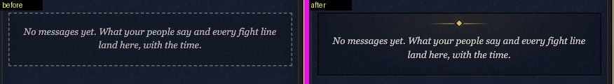

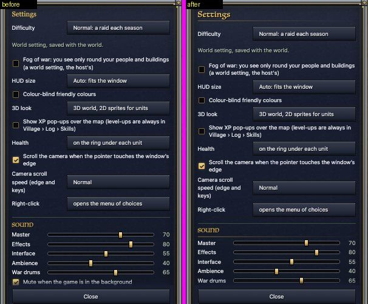

Checked and fine: 147 scenes at 1024x640 and 1920x1080 with the game's 9 px text floor show no clipped text, and the
only overlaps are tooltips and the sticky page heading, which are meant to overlap.

## The five ideas, built

1. **Bar labels in two parts.** The name sits at the left and the numbers at the right, in fixed-width figures. The
   text still reads "Health 212 / 350", so the checks that read it still pass, and a live update only rewrites the
   numbers.
   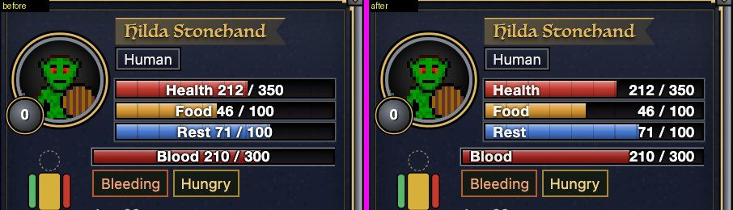
2. **One long top bar, like Crusader Kings 3.** It runs from the left edge to the menu: counters at the left, the
   season and time of day in the middle with a sun or moon, speed, rank, Undo and Save at the right. The camera
   position it showed is already on the minimap's plate, so that copy is gone from the bar.
   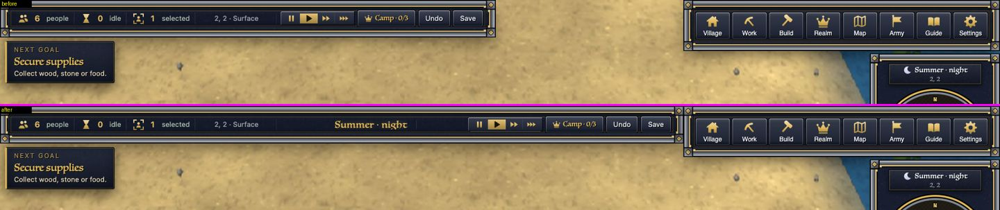
3. **The portrait breaks out over the card's corner,** like WoW's player frame. It is 20% larger, in a gilt ring
   and then the race's metal, and the name and bars move right to make room. The sprite is the original.
   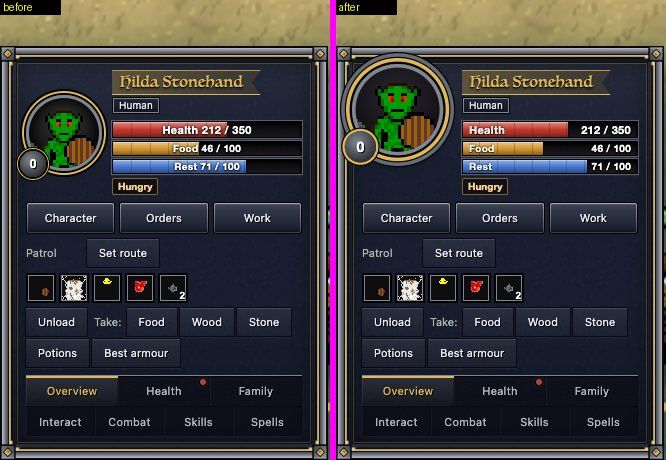
4. **The roster is a table.** While the Roster tab is open the panel widens, the filters take four columns, and
   every villager is one line: box, face, name with race, age and level, job, priority, stance, what they're doing,
   health/food/rest, Go. Click a column head to sort, and Shift-click boxes to check a range. The game already sends
   only the rows in view, so 30 or 3,000 villagers cost the same.
   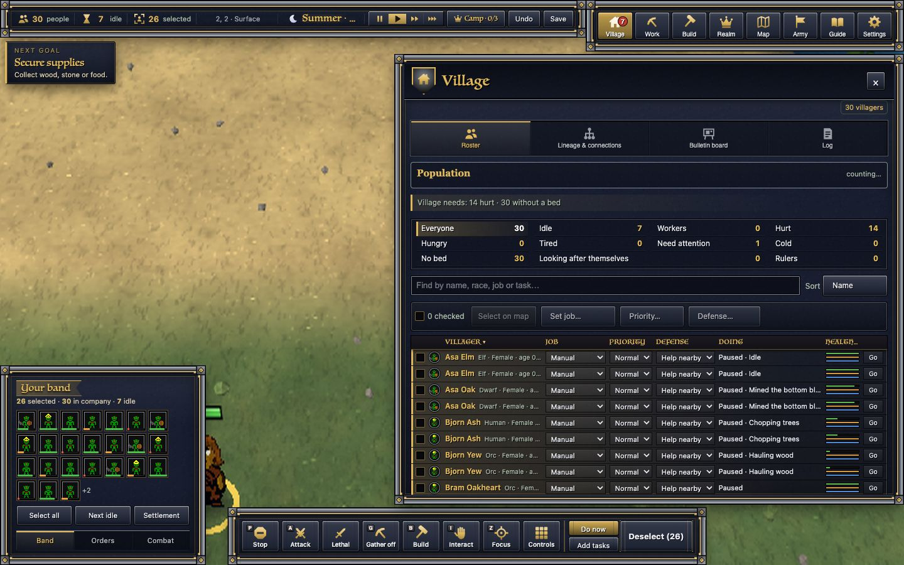
   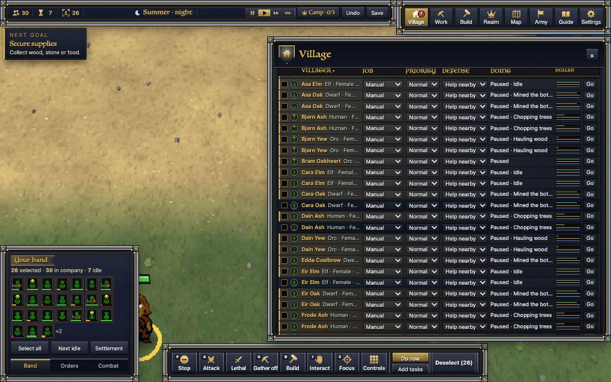
5. **The Realm overview.** The Realm page's first tab (the old content is the second tab, "Rank & house") puts the
   realm on one screen:
   - **A band of counts:** people, working, free, idle, hungry, low health, bleeding, cold, fighting. Click one to
     select those people.
   - **Needs you:** the worst numbers in one line each, such as "3 bleeding", "37 idle while workplaces are short of
     18 hands" or "Bread runs out in about 1.2 h", each a click to the people or the place.
   - **Goods:** what's on your stores, the change per hour and how long a falling one lasts, sortable.
   - **Workplaces:** every zone's workers against wanted, output per minute and what it's doing. Click a row to open
     it on the Work page.

   The goods counts are the one new piece of game code (`RealmOverview.dm`). It counts the stores at most every 10 s,
   only while the Realm page is open, and measures the change over the last 10 minutes. It touches nothing on
   today's busy list.

   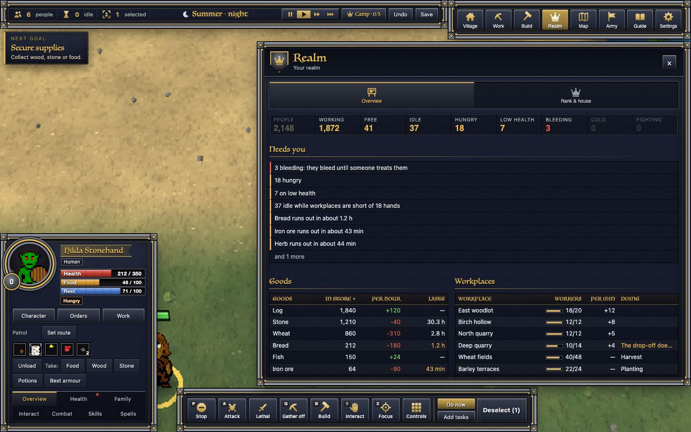
   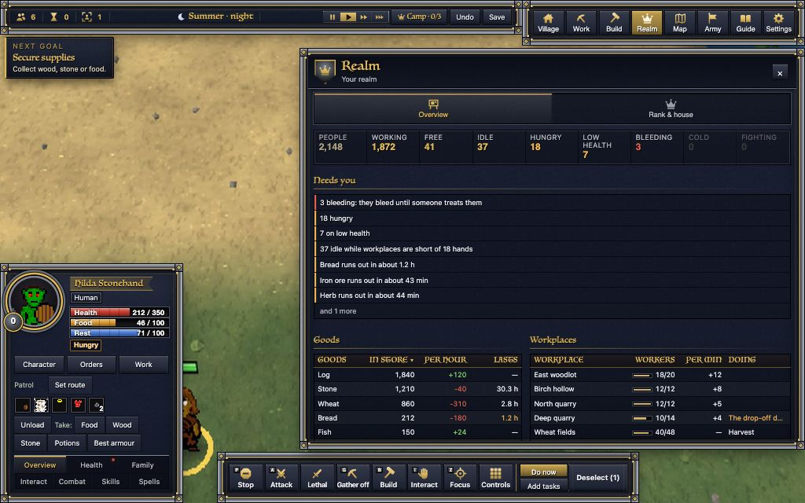

## Numbers

HUD script per update, 203 units, headless Chrome, 15 rounds, ms (one unit selected / Select all / none):

| page | run 1 | run 2 |
|---|---|---|
| live (build 68) | 2.5 / 2.3 / 2.5 | 2.3 / 2.2 / 2.4 |
| with polish2 | 2.2 / 2.3 / 2.6 | 2.1 / 2.3 / 2.5 |

With bar labels, top bar, portrait and the first table rules in: one unit / Select all 2.3 / 2.4 and 2.3 / 2.3 against live 2.5 / 2.3 and 2.3 / 2.2: the same.
All five in, 147 scenes at 1024x640 and 1920x1080 with the 9 px floor: no new clipping except the roster table's
race/age line, which ends in "…" on purpose when the name column is narrow (the full line is on hover).
The overview's server side: arena check 9/9 (counts, biggest first, 10 s cache, change per hour, used up, old counts
dropped, Realm page only). No new `:has()` rules. The roster table and the overview draw only while their tab is open, and the overview redraws
only when its numbers change.

## Landed

All landed (gate each time: compile, jscheck, hudjoin, combat, and settings for the HUD ones, all pass). They go into the next build.

| landing | time | restore point |
|---|---|---|
| hud-polish2 (job board without :has(), empty plates, Settings) | 09:47 | restore-points/before-polish-hud-polish2-20261027-091941 |
| hud-barlabels | 09:49 | restore-points/before-polish-hud-barlabels-20261027-094742 |
| hud-longtopbar | 09:55 | restore-points/before-polish-hud-longtopbar-20261027-094914 |
| hud-portrait | 10:01 | restore-points/before-polish-hud-portrait-20261027-095537 |
| hud-rostertable | 10:07 | restore-points/before-polish-hud-rostertable-20261027-100145 |
| hud-realmoverview (+ RealmOverview.dm) | 10:12 | restore-points/before-polish-hud-realmoverview-20261027-100738 |
| lotr-sprites (all 665 sprite sheets + the 3D gear palettes) | 14:16 | restore-points/before-polish-lotr-sprites-20261027-141124 |
| hud-weapon-walk-swing (swing, tip off the face, longsword grip) | 14:16 | restore-points/before-polish-hud-weapon-walk-swing-20261027-141639 |
| hud-3d-sharp-buffer (3D at the screen's own pixels) | 14:17 | restore-points/before-polish-hud-3d-sharp-buffer-20261027-141652 |
| hud-3d-defined-pixels (crisp pixel art, one-pixel edge blend) | 14:17 | restore-points/before-polish-hud-3d-defined-pixels-20261027-141705 |
| hud-armed-walk (weapon arm kept at the side while walking; 288 sheets) | 14:52 | restore-points/before-polish-hud-armed-walk-20261027-145143 |

Checked on the live page after all six: HUD script per update, 203 units (one / Select all / none, ms), before
3.2 / 2.5 / 2.6 and 2.7 / 2.3 / 2.5, after 3.2 / 2.4 / 2.6 and 2.6 / 2.4 / 2.5: the same, 0 console errors. 10 key
scenes x 1024x640 and 1920x1080 with the 9 px floor: nothing new clipped except the roster's race/age line (by design).
Not checked in the game's own window (no app build from me; the lead builds).

## Needs you

- (Settled: you said "keep mini map season". The minimap plate keeps the season; the top bar shows it too.)
- The goods' change per hour is measured only while the Realm page is open, so the first minute after opening it
  reads "measuring". Counting in the background would need the allocator's tick, which is busy code today.

## Sprites, refined like the race frames (preview only, nothing in the game)

You asked (10-27): "i like how you made the races look more refiened.... can you do that with the sprites now?"
A first preview on today's 64 px race bodies. No shape is redrawn and nothing is blurred; the faces keep their
features and the originals' dark-red outline stays. Only the colours change, the way the HUD's race materials were
made:
- each skin and material gets a designed colour ramp, with cooler shadows, warmer highlights and the most colour in
  the mid-tones;
- pure screen colours (the orc's and frogman's neon greens) come down to natural ones;
- a fine lit edge runs along the top, with a little bounce shadow low and right;
- the outermost outline takes a deep shade of the colour it touches.

Top row today, bottom row refined (close-up), with game size underneath:

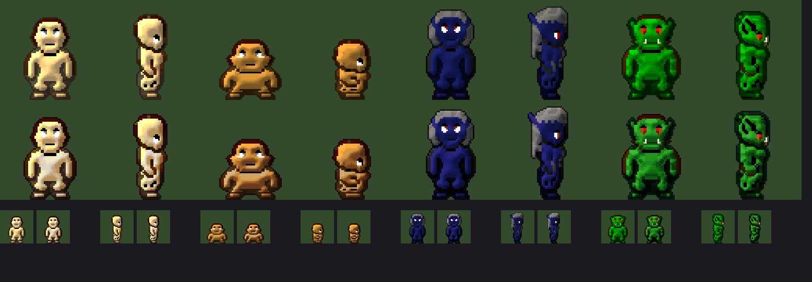
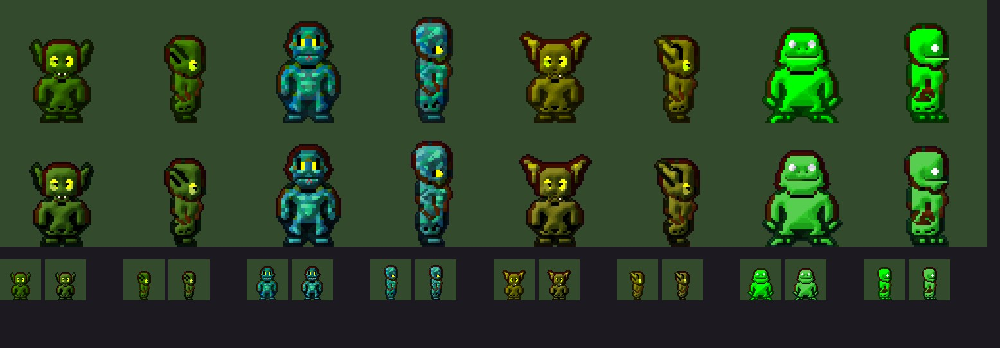

Script: reports/polish-night-1026/hud-rework/sprites/refine_preview.py (writes only a picture). Gear, limbs and the
other race variants would need the same pass so worn armour matches the bodies.

## The LOTR look on every unit (landed 14:16)

You asked, step by step (10-27): refine the sprites like the race frames, "a bit stronger", "build it on max",
"apply the LOTR look as well on all the armor weapons and sprites", "dont forget all the races", "maybe to dark?",
"keep polishing", "refine it i dont think its perfect to lotr polish". Where it stands:
- Every race body (all 86 Races64 sheets with their variants), every race's gear (546 Gear64 sheets in 13 race folders),
  the limbs (14), the item icons (19) and the 3D gear's 37 tier palettes are recoloured pixel for pixel: no shape is
  redrawn, nothing blurred, faces keep their features, every sheet keeps its states and frames.
- The look: designed colour ramps with cooler (film teal) shadows and warmer lights; by material, forged steel with
  bright edge glints, aged gold, deep leather and walnut wood, ivory bone, muted dyes; metal by race (orcs' blackened
  Mordor iron, elven silver, warm dwarven iron); the 2006 dark-red halo round every body now in that body's own deep
  shade; a cool rim light on the shadow side; a little wear at the bottom of each piece.
- Fixed on the way: the kobold's eyes (a guard keeps every face feature, whatever its colour), gold that went copper,
  shades that sank to black, skins that went too dark (they now keep their own lightness).

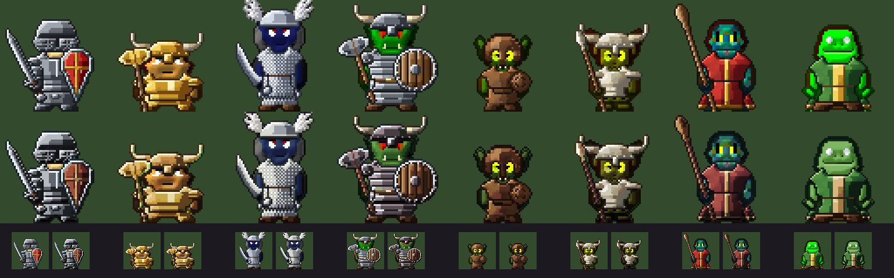
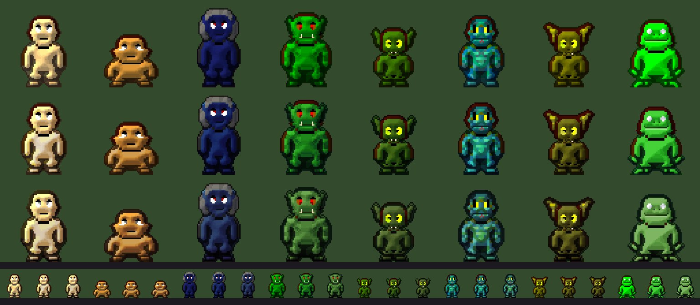
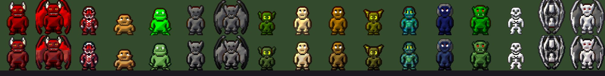
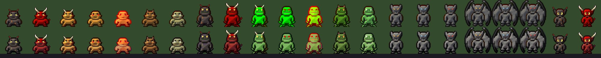
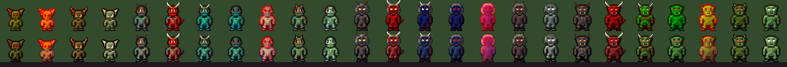

**Weapons walk with the stride** (you: "the weapons in the front view needs to animate dynamicly with the walking cycle",
"needs to be more dynamic looking"): the held weapon (the 3D view's pixel-art piece) tilts about the fist with each
stride, about 8 degrees from the front or back and 17 from the side, on a little spring so it lags the hand and
settles when the walk stops; standing it barely breathes; a shield sways less, the other way.

Tools: reports/polish-night-1026/hud-rework/sprites/ (refine_dmi.py, kits_preview.py, ZZParade.dm + parade_run.py for
the 3D stills, install_refined.py for the landing). Landed 14:16 as lotr-sprites and hud-weapon-walk-swing.

## The 3D view at full screen, and weapons held right (landed 14:16-14:17)

You asked (10-27): "less blurry from the camera angle if we are zoomed out a little", "the weapons tips need to move
towards center a little", "i want it look clean and detailed from zoom out to zoom in", "no smooth but defined", "make
the pixel sprites in game be defined no blur", "the sword hilt is not on hand", "it was just the sword was to low".
Checked in the real game at your screen's size (1920x1140 window), the same frames drawn three ways in one run.

- **Sharp at full screen.** The blur was the 3D view drawing fewer pixels than the screen has: at a full screen's Auto
  HUD size (1.27) it drew 79% of them and the window stretched the picture. It now always draws the screen's own pixels.
  Full screen held 60 fps that way (16.7-18 ms frames). A governor that dropped the size on late frames only made the
  picture soft (those late frames are the window's compositing, not the 3D), so it is gone.
- **Defined pixels.** Every art pixel stays a crisp block; only the edge between two pixels blends, over at most one
  screen pixel, and the outline is smoothed. Plain nearest pixels (the middle row below) are crisp too but uneven: some
  pixels doubled, some dropped (the knight's visor, chainmail, faces). Your pick: the edge blend, or nearest.
- **Weapons.** They swing with the stride; seen from the front the tip leans a little toward the body's middle but never
  over the face (spears crossed the eyes on one step); the longsword and rune sword sit 3 pixels higher so the grip is in
  the fist. Drawing the grip behind the body was tried and dropped (it clipped).

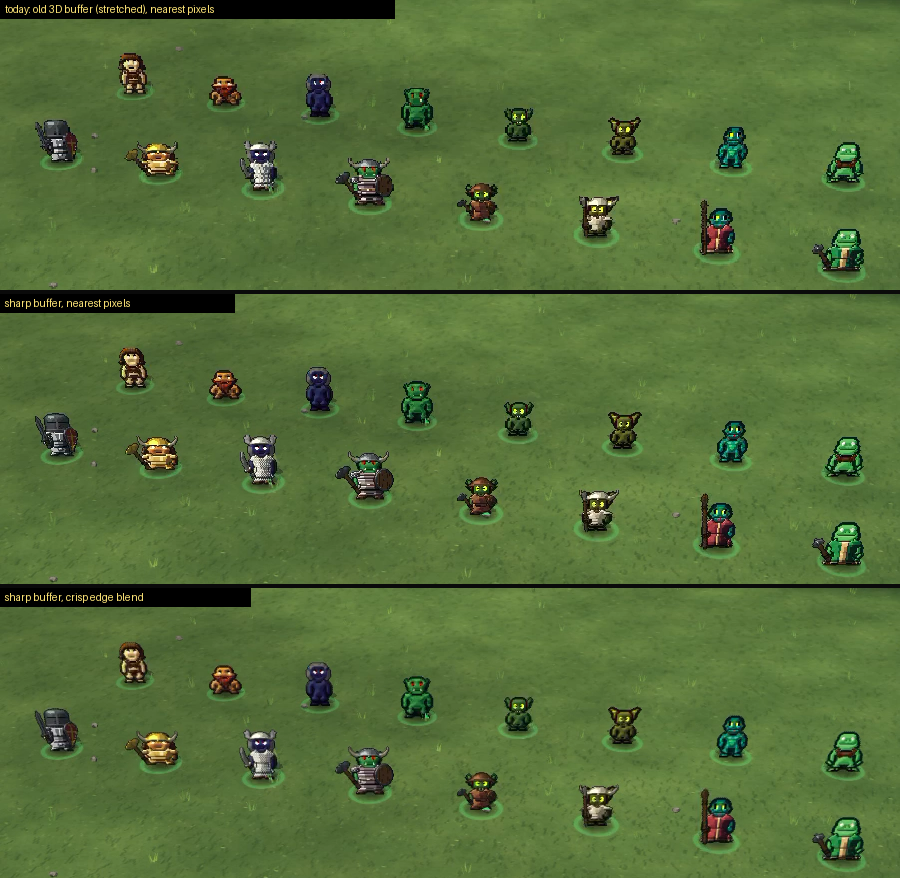
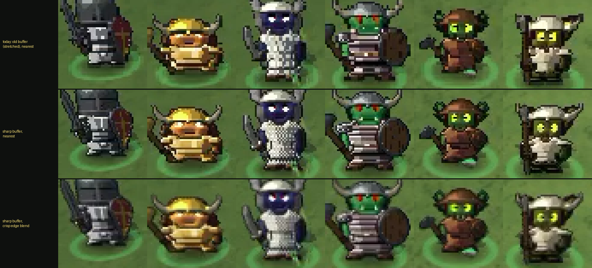
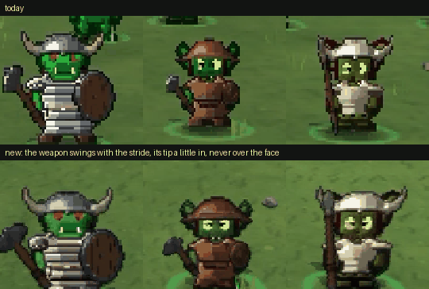
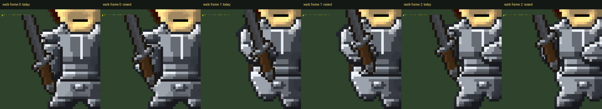

You picked the edge blend ("Land all four"); all four landed at 14:16-14:17, gates passing (restore points in the
Landed table above), for the next build. Parked: pre-made half and quarter sprites for the furthest zoom, which would
stop the slight sparkle on eyes and belts while panning (prototype in reports/polish-night-1026/hud-rework/sprites/farzoom/).

## The armed walk (landed 14:52)

Your idea (10-27): "we need a new animation for when they have weapons held". A unit holding a weapon now walks with
that arm at its side, gripping, while its legs and other arm walk. Before, the weapon hand swung across the body every
other step, taking spears over faces and swords across chests.

- Made from the sprites' own pixels, nothing redrawn: each body sheet (80, every race and variant) gains an Armed walk.
  The standing frame's right arm goes on the walk frames, moved with the body's 2 px step, and the place the walking arm
  covered comes from the sheet's own armless frame. Each right-arm armour piece (208 sheets) gets the same.
- Found on the way: some races' armless walks lead with the other leg, and only in some facings, so frames are paired
  per facing; side-on, the armless picture paints a large red stump, now filled from the body beside it.
- The server uses it for units holding a 3D weapon; the 3D weapon follows the kept hand and keeps its stride swing.

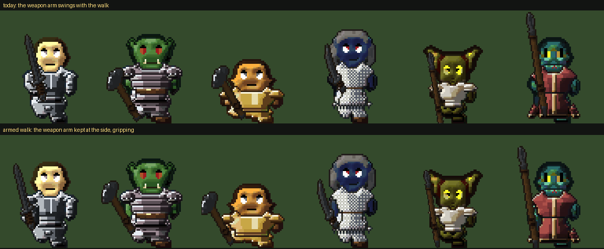

Checked offline only: you were playing, so no game windows from me; it compiles and passed the gate. You'll see it in
the game after the next build. Tool: reports/polish-night-1026/hud-rework/sprites/armed/ (armed_walk.py, walk_gif.py).

## The HUD's look, round two: old buttons, real size, our own lettering (landed)

You played full screen and said the HUD "looks to big ... looks like stretch", the font "looks AI ... no soul no flavor",
"it looks mechanical", and that "the old raised buttons looks butter than the rebuttons modern textures". All of it is in.

- **The old raised buttons are back**, exactly as they were before the 10-26 night rework (card buttons, the small bag
  chips, the card's tabs, the action bar), with everything else from the rework kept (portrait, split bars, name banner,
  frames). A smoothed redraw of them was tried and turned down ("nope i dont like the raised refined").
- **Full screen no longer stretches.** Auto HUD size used to blow the HUD up to 1.33x on your 1920x1200 screen, stretching
  the pixel-drawn frames and buttons; now Auto never goes above 100%, so a bigger window shows more world and every
  frame, button and portrait stays on whole pixels. A bigger HUD is still one pick away in Settings.
- **The loading screen is sharp at full screen**: its painted world was a 1280x720 picture blown up 1.67x; it is now
  painted at 2048x1280 from the same render, and the title is the full-size logo.
- **Our own lettering.** Everything you read is Alegreya, a calligraphic book face, with upright numbers from EB Garamond
  (Alegreya's own make a 0 look like an o). Headings are Herculanum, the one you liked, with our own capitals in front
  of it: A, E, M, R and T drawn in its hand, each with a Lord of the Rings touch (a hooked apex on A, the uncial E's
  tongue curling out, a curled M with a round-footed V, R's leg sweeping long, T's bar bowed and hooked). The smaller
  text has its own four (A, M, R, T) drawn with a broad pen like Alegreya's. Not one of the old faces is left: the
  minimap's N, the words over units and the key hints changed too. Herculanum's file is Apple's licence, so nothing of
  it is copied; our capitals are our own drawings. The fonts travel with the page, so every player gets them.
- The 2D map that showed through when you resized the window is hidden while the 3D view runs; the 60 fps session
  landed it, and the GPU got about 10 points back.

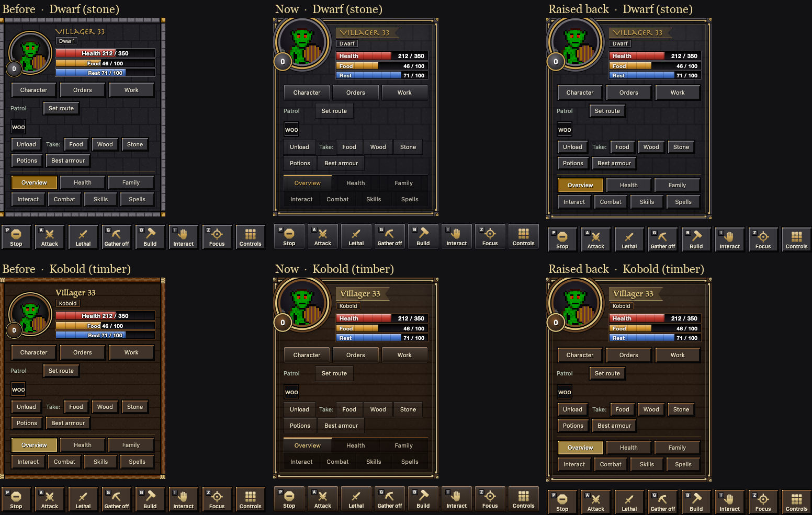
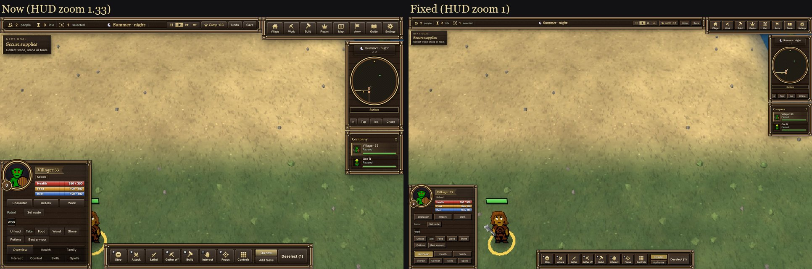
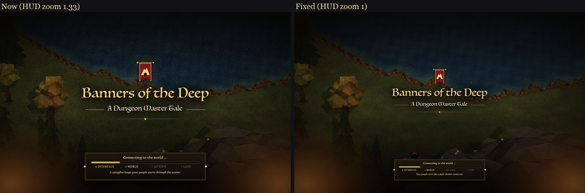
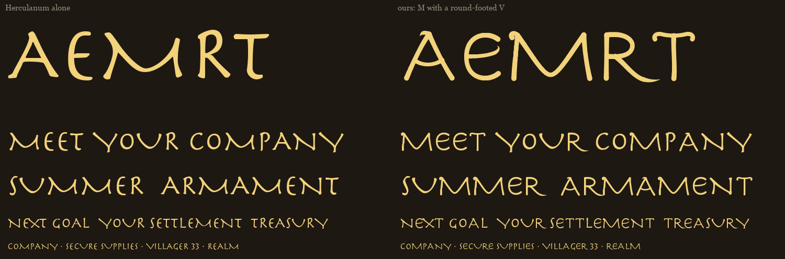
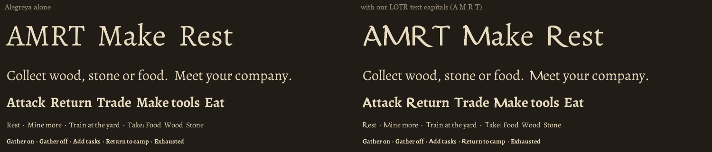
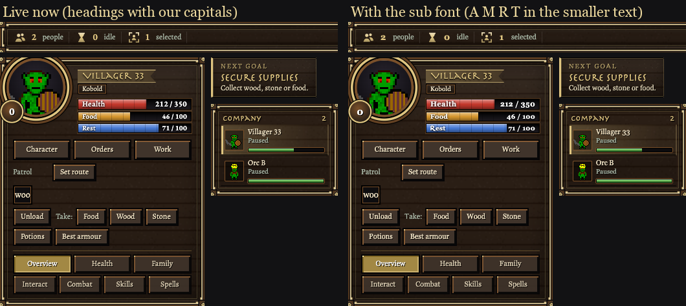

| Landed (10-27) | What | Restore point |
|---|---|---|
| hud-raised-fullscreen 13:42 | old raised buttons, Auto size never above 100%, sharp loading screen | restore-points/before-polish-hud-raised-fullscreen-20261027-134116 |
| hud-lettering 13:50 | Alegreya + EB Garamond figures, Herculanum headings, fonts sent with the page | restore-points/before-polish-hud-lettering-20261027-134639 |
| hud-capitals 14:03 | our LOTR capitals A E M R T in the headings; minimap, 3D words, key hints in the new lettering | restore-points/before-polish-hud-capitals-20261027-140231 |
| hud-subfont 14:09 | our A M R T in the smaller text (one variable font, regular to bold) | restore-points/before-polish-hud-subfont-20261027-140942 |

Every gate passed (compile, scripts, page join, settings 23/23, combat 32/32). Before each landing: 72-76 HUD scenes at
four window sizes (1024x640 to 1920x1200) showed no new clipping, overlaps or errors against the live page. App 79 has
the first two; build 81 brings the capitals and the sub font. The sprite and 3D fixes (LOTR sprites, weapon swing,
sharp buffer, defined pixels) are going in from the sprites session on your "land it and all the fixes we made".

## The map turned, with an ocean, beaches and rivers (landed 18:03)

You asked (10-27): rivers, oceans and beaches first (then ships); "rotate the map where the winter is north"; "lakes in
moutains is okay as well"; "start fresh". Landed as map-turn-water (restore point
restore-points/before-polish-map-turn-water-20261027-174211), all eight checks passing.

- All four layers turned a quarter left together, so winter is north and the caves, sky and ways down still line up.
- An ocean along the south and east with sandy beaches and a few islands; rivers from the snowfields and from four new
  mountain lakes down to the sea, widening near the coast, with fords. Deep sea and rivers can't be walked; shallows and
  fords can be waded. Towns, forts and anyone standing about were kept 4 tiles clear.
- Your saves were set aside first, nothing deleted: Application Support/Dungeon Master Remastered/
  saves-before-map-turn-20261027-1741. The next launch starts a fresh world.
- Fixed map spots move: new x = 1001 - old y, new y = old x.

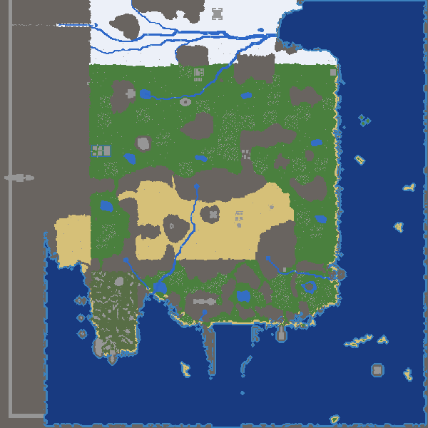

Next ideas from your reference pictures: forests in clumps with clearings, winding rivers with muddy banks, meadow
colour, valley mist and low clouds, roads and fields, gentle hills last. Ships after that.

## River banks and flowing water (10-27 evening)

You said: "river tiles on the side needs work and also the water fall and the animations dont work".

- The brown cobble band along every river and lake is gone. It wasn't the bank at all: it was the cave rock under the
  surface poking up through the banks where they slope into the water. Banks now stay grass right down to the water.
- Banks slope in by how much water each spot faces, so a river running at an angle gets a smooth, curving shoreline
  instead of tile-by-tile stair-steps. The rivers themselves are drawn as smooth curves now.
- Rivers flow: every river and ford tile knows which way it runs, and the ripples and long streaks drift downstream,
  slowing near the banks and where a river meets the sea. Lakes and the sea stay still.

Before and after (same spot):

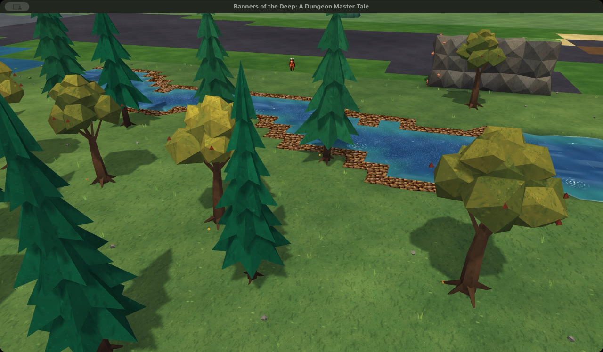
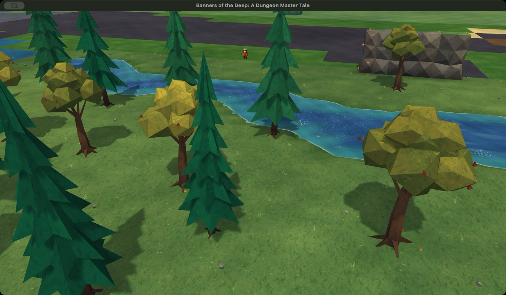
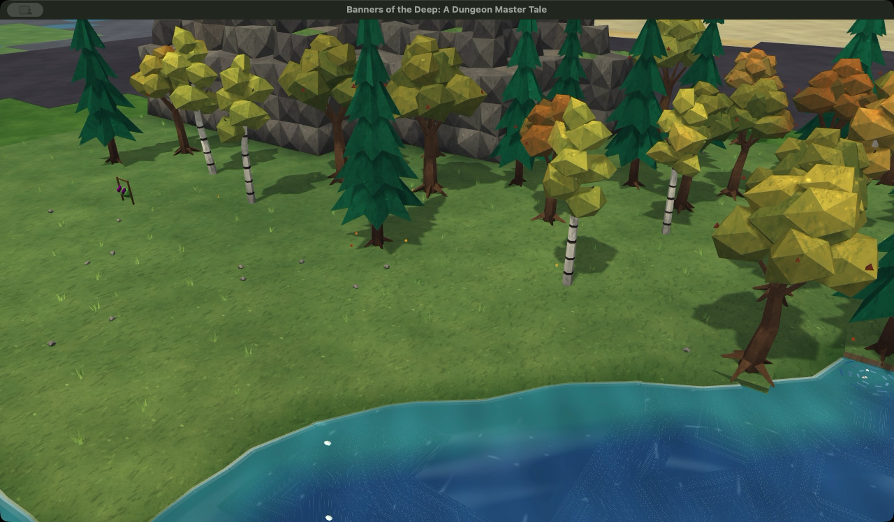
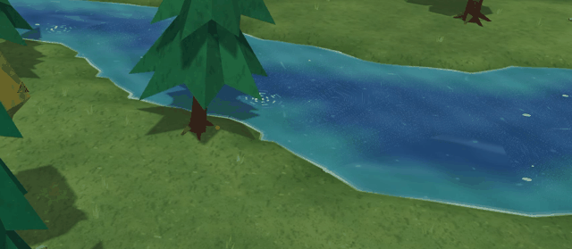

## Mountain lakes and waterfalls (10-27 evening)

You said: "raise the mountain lakes and make the rivers drop down the rock face as waterfalls", then, of my first try
(a box of water standing out from the mountain): "it needs to a lake and then part of the river in the mountains". Then:
"i can still see thrugh it and the bubbles at the bottom", and "i do not like the water glint".

- The three mountain lakes now lie up to 4 blocks high, in a basin of rock. The rock round them keeps the height it had
  before the lake was cut, and always stands at least a block over the water.
- Each lake's river runs out through a rock gorge and steps down one block at a time to the valley floor at the mountain's
  foot. Each step is a waterfall: streaks pouring down, white water spreading over the pool at the bottom.
- Raised water is always held in by rock or more water; it never stands over open ground. A lake open to the land or
  another lake along its side stays low.
- The water has no sun glints, sparkles or white specks any more.

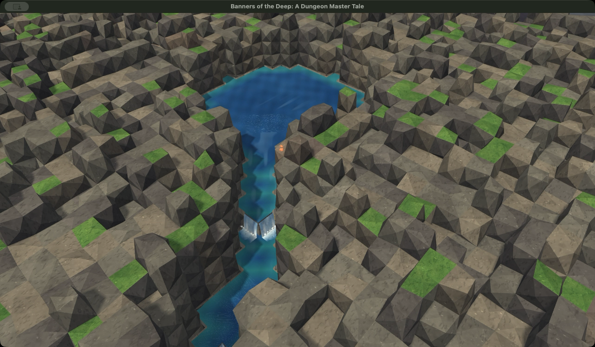
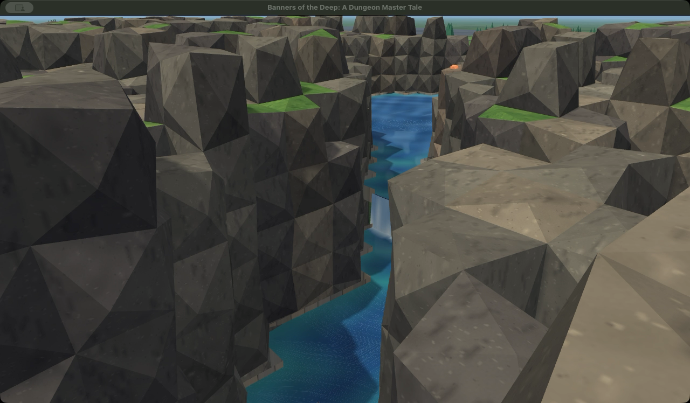
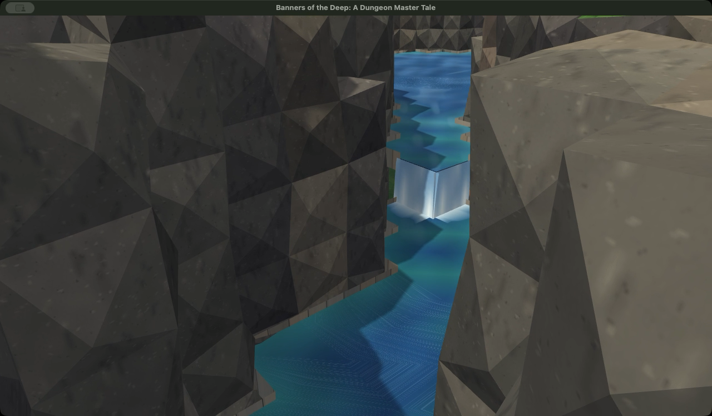
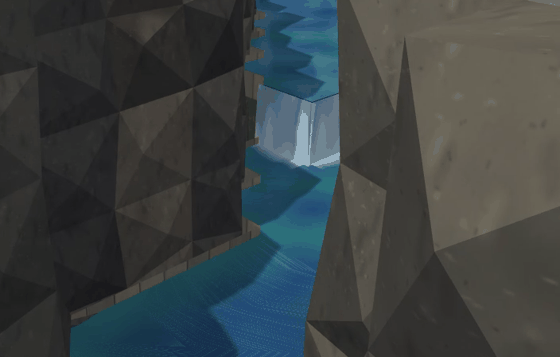

## Cloud wisps far out (10-27 evening)

You said: "on zoom out 60 we should be able to see cloud wisp". Zoomed far out, thin wisps of cloud now drift high over
the land, each over its own cloud shadow. They start to show past zoom 30 and are fullest from 55 out; never up close,
never in the caves, fainter at night.

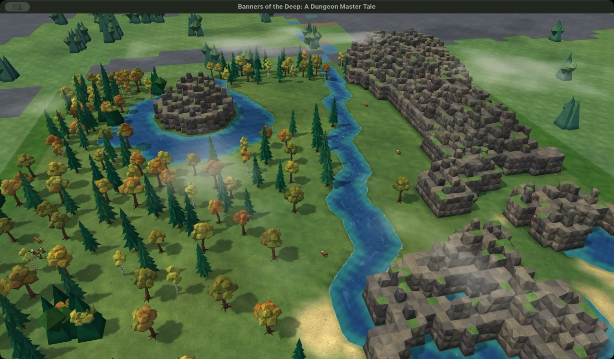
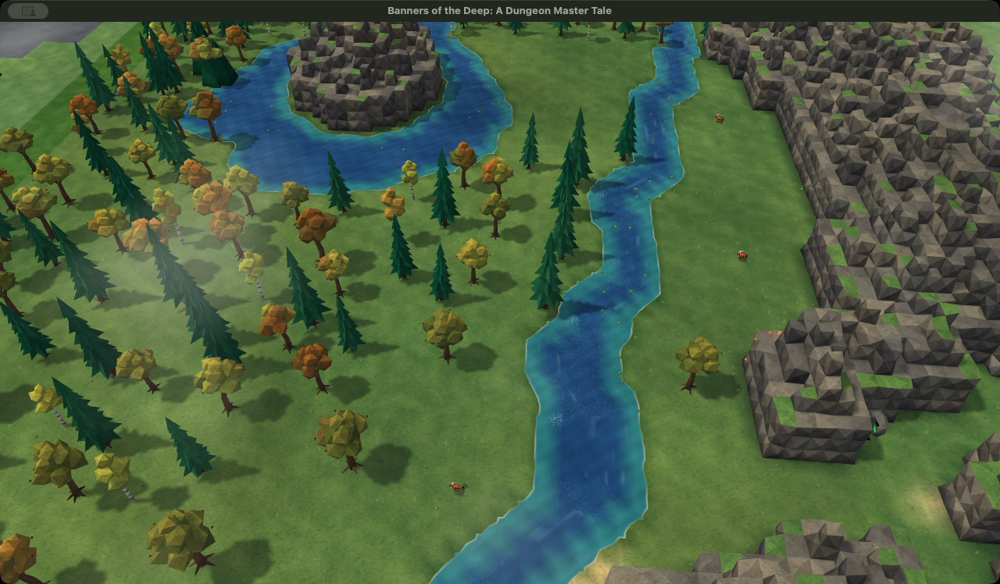
