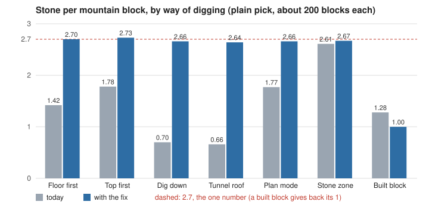

# mountain-stone (10-27)

Every natural mountain block now gives about 2.7 stone, whichever way it is dug. A block a build plan laid gives back its 1 stone. Stone zones dig each tile's three reachable blocks, top block first, with no cave-ins or critters from their own digs. This fix is staged and not landed. Fix folder: `reports/polish-night-1026/fixes-1027/mountain-stone/fix/`.

The blue bars all sit on the 2.7 line, except the built block, which sits at 1.

## Done

- The fixes plan's section 3, step 1, as approved. One stone number for every natural block: 2 from its work (half-way and at the end) and a 70% chance of one more. A built block gives back 1.
- Mountain-face, redone against today's code. A zone takes block 2, then 1, then the floor block. It uses the zone row text that already landed.
- A zone's digs bring no cave-in and no critters. Clicks and Plan mode keep both.
- A new block-stone check (about 200 blocks each way, plain and gold picks). The arena mount scene was re-measured at 1, 5 and 20 workers, for 8 and 30 minutes.

## Numbers

| Test (arena, speed 4) | Today | Fix |
|---|---|---|
| Stone per block, ground floor first (plain/gold) | 1.42 / 1.38 | 2.70 / 2.69 |
| ... top first | 1.78 / 1.90 | 2.73 / 2.72 |
| ... Dig down | 0.70 / 0.74 | 2.66 / 2.64 |
| ... tunnel roof | 0.66 / 0.70 | 2.64 / 2.74 |
| ... Plan mode | 1.77 / 1.94 | 2.66 / 2.66 |
| ... stone zone | 2.61 / 2.64 | 2.67 / 2.70 |
| ... built block | 1.28 / 1.45 | 1.00 / 1.00 |
| Zone digs: critters / cave-ins | 0 / 0 (it dug only floor blocks) | 0 / 0 (the 2006 finds ran: 33 iron) |
| Mount scene, 1 worker, 8 min (stored, 3 runs) | 240, 241, 227 | 228, 222, 216 |
| ... 5 workers, 8 min | 324 | 818 |
| ... 20 workers, 8 min | 325 | 966 |
| ... 1 / 5 / 20 workers, 30 min | 327 / 327 / 322 | 743 / 965 / 959 |

In the mount scene, pieces lying at the end were 5 or fewer in every run, and nobody got stuck.

## Needs the user

- One worker for 8 minutes stores about 6% less than today, because the block 2 it now digs first goes at the plain pace. Your question 3 (should good picks dig upper blocks faster?) would settle it. With 30 minutes, the fix is 2.3x today.
- Built blocks still roll the 2006 ore finds on their last block, so building and digging can still make iron. That needs your question 2.
