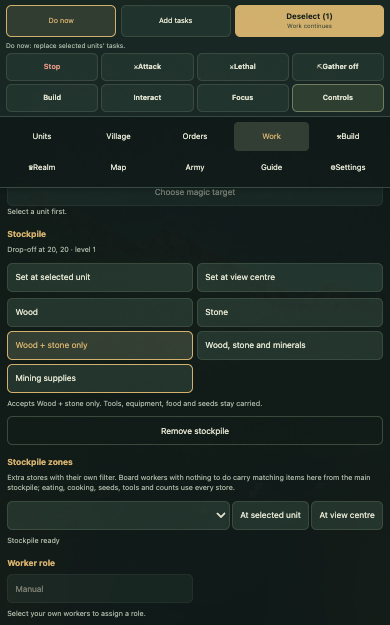

# Ore is stored now (ore-stores, 10-27)

The plan's section 2, items 1-6, as the owner approved them. The default drop-off ("Wood, stone and minerals") and a
quarry's own yard now take ore, uncut gems and rock salt. The smelter and the gem cutter fetch the right things.
Vampires and werewolves are never sent to silver. The fix is staged and not landed:
`reports/polish-night-1026/fixes-1027/ore-stores/fix/` (README, patch.json, checks).

## Done

- One shared list of raw materials (`Delivery.dm`), read by every drop-off setting, the quarry's yard and the Ore yard.
- New choice "Wood + stone only" keeps the old meaning. Old saves on the default get ore at once (the id stays `mixed`).
- Quarry yards in old saves take ore too; nothing in the save is rewritten.
- A new arena check (17 rules), an ore census for the play rounds, an outcrop check and a HUD check for the five
  buttons.

## Numbers (base -> fix)

| Test | Before | After |
|---|---|---|
| 30-min rounds (Humans x2, Dwarves, Orcs x2): ore, gems, salt stored of dug | 0% (40-53 pieces left lying each round) | 100%, 100%, 100%, 92%, 100% |
| Outcrop, 2 miners, 10 min: left where it fell | 69, 56 | 1, 1, 0 |
| Outcrop: stone stored | 354, 366 | 318, 332, 309 (bags carry ore in too) |
| Rounds: stone stored | 279-305 | 275-300 (one run excepted, see the README) |
| Rounds: wood stored | 277-386 | 266-359 (4-11% lower; not seen at 200 workers) |
| Smelter order, 20 stone + 3 iron on the store | 0 ingots, "missing materials" | 3 iron ingots |
| 200 workers: track ms/tick (3 pairs) | 2.04 / 2.76 / 2.36 | 2.18 / 2.75 / 2.89 (mean +10%, noisy) |
| Existing checks | | all as before (the yard haulers step already fails today, on both) |

## Needs the owner

- Ring orders at the gem cutter can't fetch their cut gem and ingot any more ("only uncut gems", as approved).
- Wood in the small rounds came out a little lower; it may be noise. Two more round pairs would settle it.
- 2,000-worker tick cost not measured (another job's timing run held a slot).
