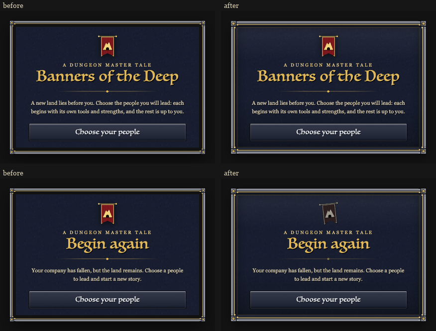
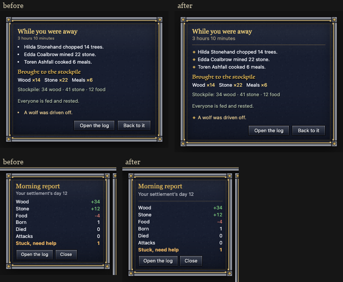
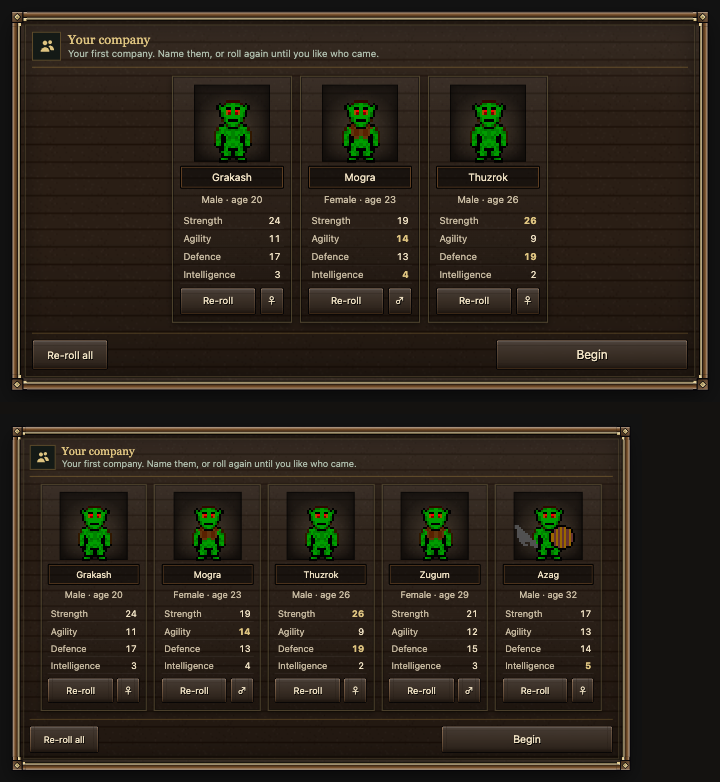
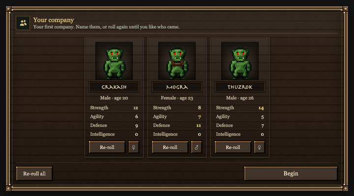
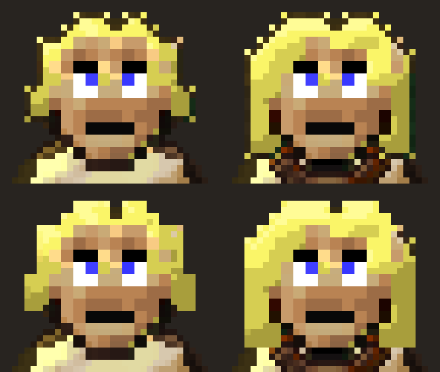
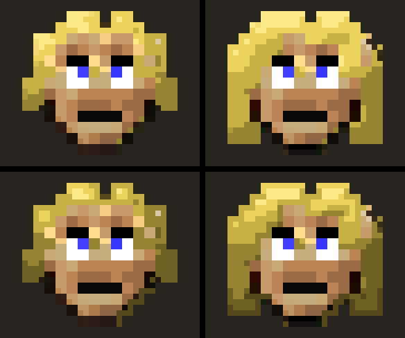
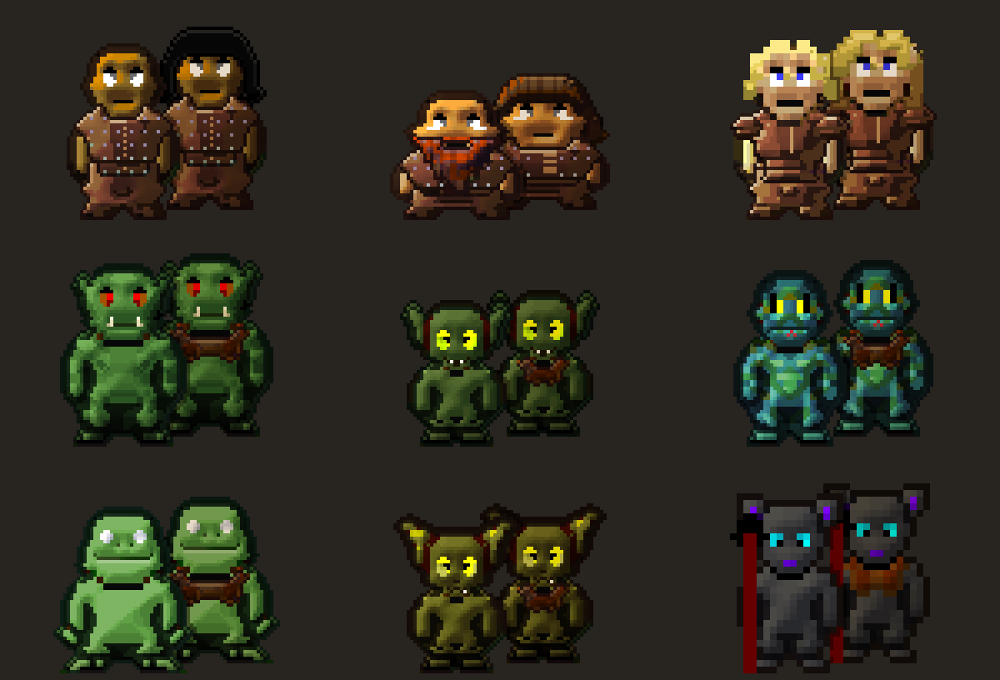

# Screens, second pass (10-27): the start, death, away and morning cards

A second look at the first screens a player meets. The start card now has the same crafted frame as every other card.
"Begin again" (your company has fallen) no longer looks like the welcome card. The "While you were away" and Morning
report cards match the rest of the family, and their small text no longer drops under WebKit's 9 px floor.

## Done

- **Start card frame**: tonight's HUD rework gave every card a new crafted frame lit from above, but the start card
  was left out. Its old rail left a stripe between frame and card where the map showed through. It now has the same
  frame, light and inner gilt line as the rest.
- **Begin again**: after a defeat the banner hangs dimmed and askew, and the title and its ornament are ashen. The
  words are the same.
  
- **While you were away and the Morning report**: a gilt hairline under each header, as on the story card, and gold
  diamonds instead of white dots on the away lines. Their smallest text was 7.1 to 8.8 px in the smaller windows, and
  WebKit doesn't draw text below 9 px. Now it's 9.2 px or more at every size.
  

**Landed 09:44** as `screens-pass2` (all gate checks pass; restore point
`restore-points/before-polish-screens-pass2-20261027-085751`). On the live page afterwards: away and Morning cards
9.23 / 9.6 px at 1024x640 / 1280x720, start card both ways 9.23 px, no errors.

## Numbers

| Check (headless Chrome) | Before | After |
|---|---|---|
| Smallest text, away card, 1024x640 / 1280x720 / 1440x900 windows | 7.1 / 8.0 / 10 px | 9.2 / 9.6 / 12 px |
| Smallest text, Morning report, same sizes | 7.8 / 8.8 / 11 px | 9.2 / 9.6 / 12 px |
| New problems in the start, story, race, away, morning and ask scenes (snap.py) | | none |
| HUD script ms per update, 203 units, one / all / none selected (median of 15 rounds, fix measured first) | 2.4 / 2.4 / 2.5 | 2.3 / 2.4 / 2.5 |
| The same on the live page after landing, with vs without the block (two orders) | 2.3-4.2 / 2.4-2.6 / 2.5-2.7 | 2.5-4.3 / 2.3-2.5 / 2.6-2.7 |
| HUD page size | 1,654.9 KB | 1,656.7 KB (+1.8 KB) |

## Page weight

Two of the page's three big pictures came from the screens work last night: the painted loading backdrop (82 KB) and
the race pictures (78 KB), about 215 KB of the page once written into it as text. The third, the title logo (83 KB),
is older. I tried shrinking all three.
Saving the backdrop again at a lower JPEG quality gains about 1 KB before it visibly blurs, and the race pictures are
already the size a Retina screen needs. WebP would save about 60 KB in all, but the game uses no WebP anywhere today and
I can't prove it in the game's own WebKit without a real game window, so I left it.

## Landed 11:18: the first-company card (owner idea; the owner lifted the freeze)

After the race pick, a card for each of the 3 to 5 starting villagers: their own sprite, a name you can type over,
sex, age and the four stats their race rolls (the best in the company in gold), a re-roll for each, a switch to roll
them as the other sex, Re-roll all, and Begin, which goes on to the story as now. Landed as `screens-first-company` (gate compile, jscheck, hudjoin,
settings, combat all pass). Proven on a clone first: an arena test of re-roll one / sex switch / all (11/11: kit kept,
old unit gone, names, the card's rows), the card at 9.2 px+ with 3 and 5 villagers, every control sends the right
command, HUD ms flat (2.1-2.5 both ways), page +5.2 KB. Details in `reports/polish-night-1026/screens/first-company/`.
The numbers and names below are samples.

## Landed 14:26: the company card on the LOTR look, bare

The owner: "use the new Lotr sprite we have and have them bare". The card showed the old 32 px portraits, armour and
all. Each villager is now drawn from the new LOTR body sheet as the 3D view draws it, with hair, beard and underclothes
but no armour or weapons (they still carry their kit). Proven on a clone (arena 15/15, two looks for three people).
HUD time per update was the same (2.3 / 2.4 / 2.3 ms against 2.4 / 2.5 / 2.3).

The race card's pictures are remade from the same LOTR sheets in the same layout (`screens-race-lotr`, landed 14:48 in
the lead's batch).

I was wrong earlier about elves, lizardmen and frogmen: they do roll their own stats (measured), so that question is
gone. The stats in the first mock picture were made-up samples, higher than any real roll.

## Landed 14:48: lower starting stats (owner's pick)

A new company's Strength, Agility and Defence are now two thirds of the race's roll (frogman Defence 0.55), Intelligence
as before. Only a new start and the company card's re-rolls; births and raiders keep the old rolls. Measured on the live
game, 20 of each people:

| People | Strength | Agility | Defence |
|---|---|---|---|
| Human | 5-10 -> 3-7 | 7-11 -> 5-7 | 4-9 -> 3-6 |
| Dwarf | 7-14 -> 5-9 | 3-6 -> 2-4 | 7-13 -> 5-9 |
| Elf | 2-4 -> 1-3 | 9-14 -> 7-9 | 5-10 -> 3-7 |
| Orc | 7-14 -> 5-9 | 5-8 -> 3-5 | 6-12 -> 5-7 |
| Goblin | 4-9 -> 3-6 | 8-12 -> 5-8 | 3-8 -> 2-5 |
| Lizardman | 6-11 -> 4-7 | 8-12 -> 5-8 | 9-12 -> 6-8 |
| Frogman | 5-7 -> 3-5 | 5-10 -> 3-7 | 15-25 -> 8-14 |
| Kobold | 4-8 -> 3-5 | 9-13 -> 6-9 | 2-6 -> 1-4 |
| Ratman | 1-2 -> 1 | 10-15 -> 7-10 | 0-1 -> 0-1 |

Fights checked with combat-rules' duels (30 each, old vs new): every bare-fist fight still ends (about 100 s both), a
start-kit duel 40 -> 45 s, plate 68 -> 70 s, a 5 against 5 fight 71 -> 76 s.

## Landed 20:57 and 20:59: Back, Defence, elf hair

- **Back** on the first-company card (owner: "we need a back button if we picked the wrong race"): the company just
  made goes and the race pick opens again; a rare people drawn for that start is still offered.
- **Defence in the 20s**: the game adds worn armour to a unit's Defence, so the card showed the roll plus the leather.
  It now shows the person's own Defence (e.g. 5, where it read 12 with the leather).
- **Elf hair specks** (owner: "perfect fix that and in the main game too"): the hair is the 32 px original doubled and
  shaded a pixel at a time, which left a bright and a dark speck on each step of its edge. On every 64 px body sheet the
  hair's outer edge now takes the hair's own colour; face, jaw and shape unchanged. It is the game's own sheet, so the
  elves in the world change too; the race card's pictures were made again with it. The sprites session's hair build
  now runs the same cleanup, so a rebuild keeps it.
  

## Evening: Armour, the roll of 20, elf hair with shadow

- **Armour and Defence**: the old Defence stat (the race's roll plus worn armour; under each piece it is the body's own
  toughness) is shown as **Armour** on the unit card and on armour pieces. **Defence** now means only the trained combat
  skill. The first-company card shows neither Armour nor the old stat ("do not show the armor stat in the roll").
- **The roll of 20**: each new villager gets 20 points over Strength, Agility, Intelligence and the Defence skill. Each
  starts at 3, and the other 8 land at random, leaning where the race is strong (owner: "Random, race-leaning", "All
  four at least 3"). Fights checked with combat-rules' duels each step: every bare-fist fight still ends, lengths stay
  near today's (start kit 44-48 s, plate 65-85 s, 5 against 5 68-82 s).
- **Elf hair**: the edge clean-up made one solid lump; a gentler version brought loose strands back, which the owner
  didn't want. Now: one clean shape with more shadow (darker from the crown down, deeper at the edge and beside the
  face, on a six-tone blonde ramp). The sprites session's hair build runs the same script. Race card art re-made.
  

## Late evening: elf hair, race card shade, orc and goblin band

- **Elf hair**: shadows warm golden brown instead of olive; the man's short hair lifted to the bright blondes, the woman's
  as it was (landed 21:31 and 21:38).
- **Race card**: where the front person stands over the one behind, they cast a shade (the back one's own colours,
  darker) so two heads of hair never run together; the figures stay where they were. Every race.
  
- **Orcs and goblins**: the dark band round their bodies read as a green aura after the LOTR colours. It stays, black
  instead of green (every look but the werewolf); lizardmen, frogmen and kobolds as they are. Queued behind build 100;
  the build train is paused, so it reaches the app when the owner restarts it. The sprites session's tools run the
  same script.
  

## Night: the roll sets the real skills (stat fold, step 1)

The roll of 20 only set the game's 2006 stats (Strength, Agility, Intelligence), while fights and the Skills tab use the
newer combat skills of the same names, so the rolled numbers didn't show in play (owner: "the rolled skills doesnt
translate into the game", "do we have two different stats happening with the same name?"). The owner chose to fold the
old stats into the skills. Step 1 (landed 22:22): the roll sets the Strength, Attack, Magic and Defence skills (the card
keeps the names Strength, Agility, Intelligence, Defence), the old stats get the same numbers, and the Character tab no
longer shows the old three. Fights checked again: every fist fight ends, start kit 38 -> 40 s, plate 78 -> 75 s, 5
against 5 74 -> 98 s. Step 2, every old-stat read moving to the skills, is combat-rules' (planning/STAT_FOLD_PLAN_2026-10-27.md).

## Needs the owner

- Still open from last night: the launcher's darker painted look, and whether the loading lines should stay as game
  rules or lean more to lore.
- Should the first-company card offer a starting job?
- Want WebP for the three screens pictures (about 60 KB lighter page)? It needs one real-window check that they show.
