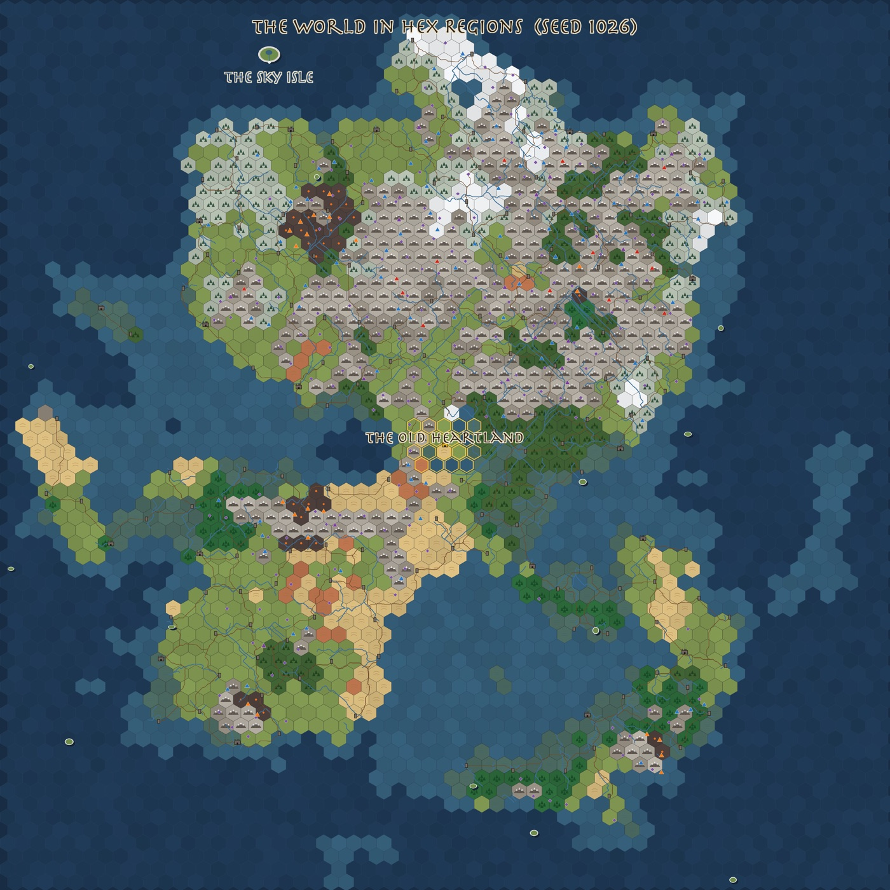
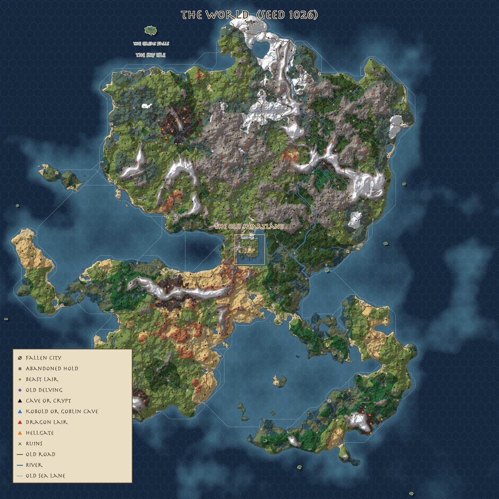
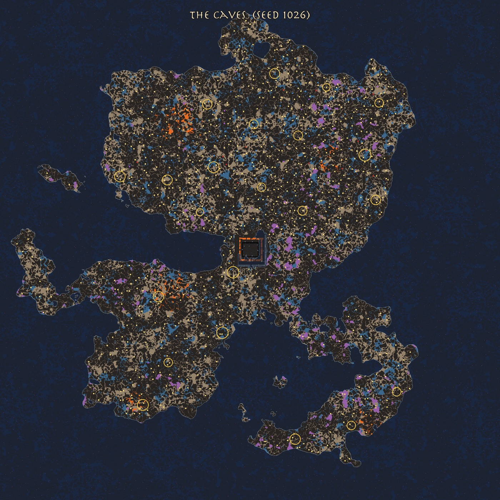
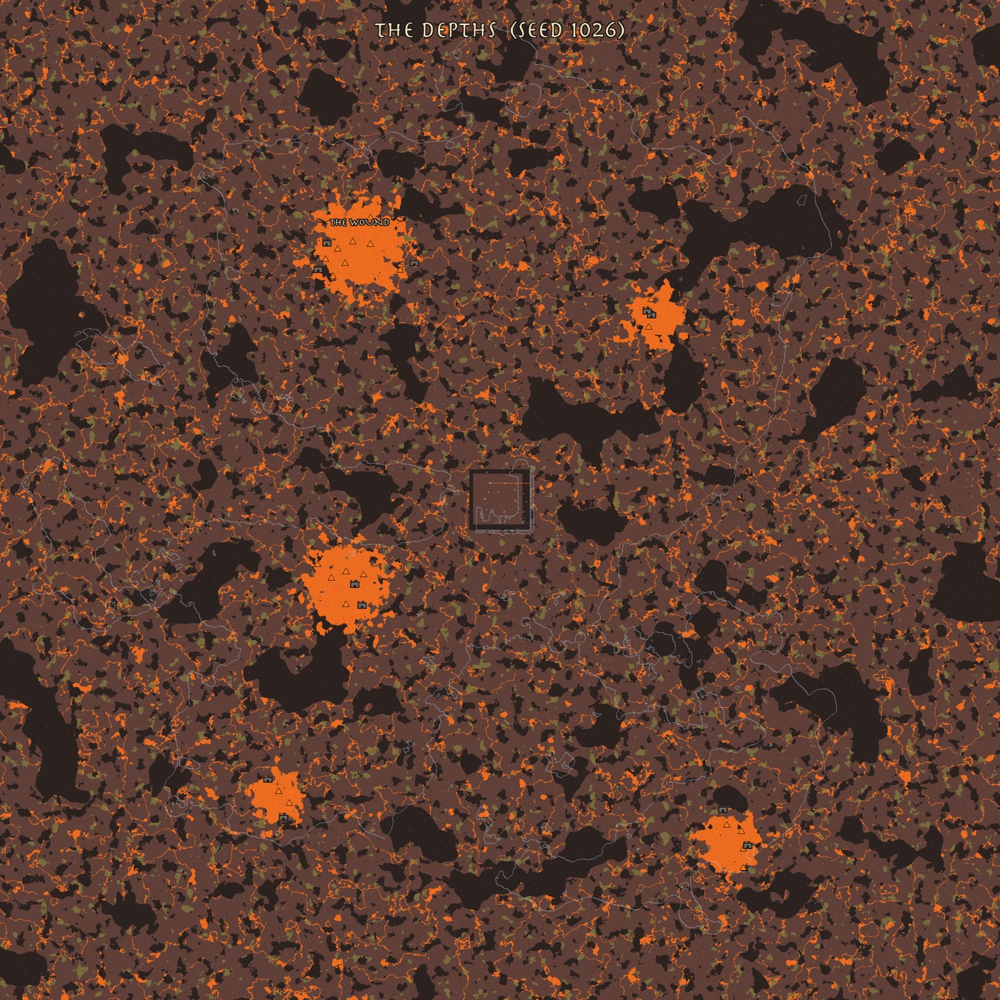
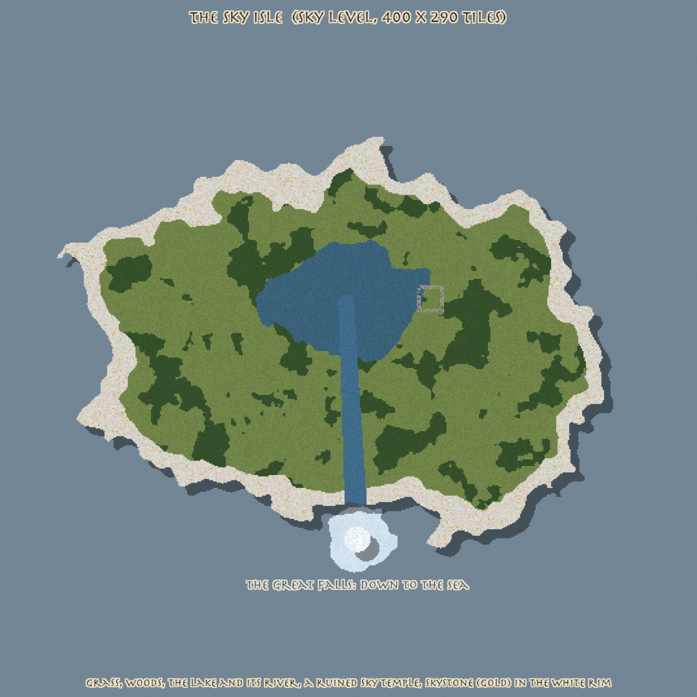
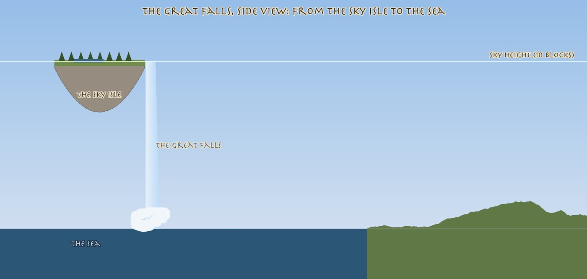
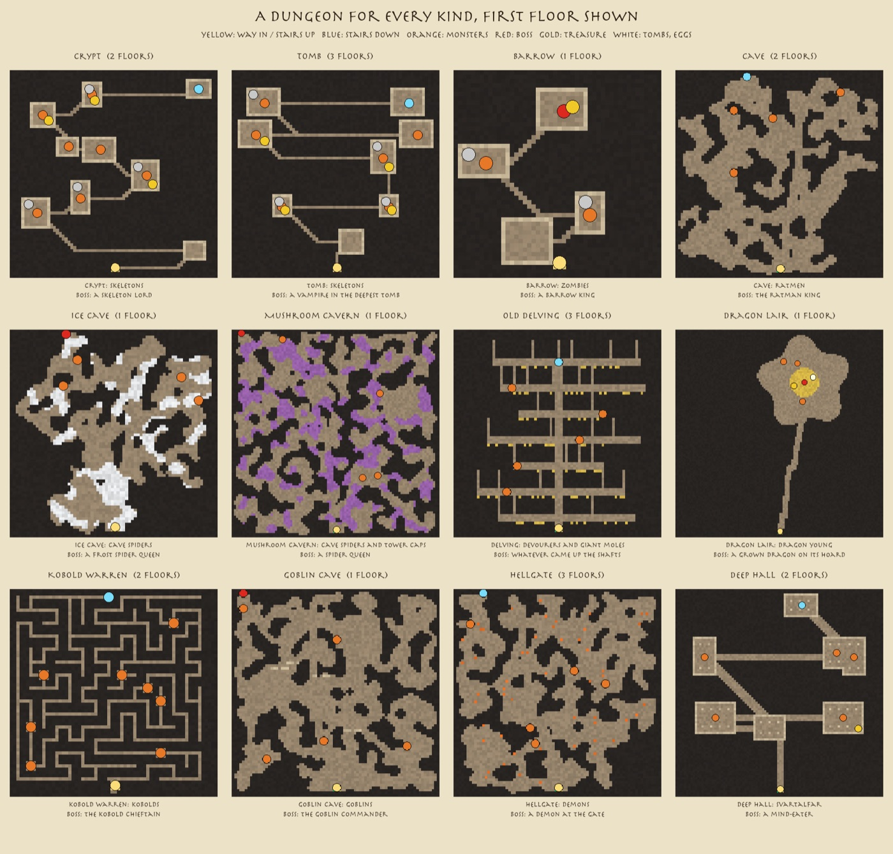
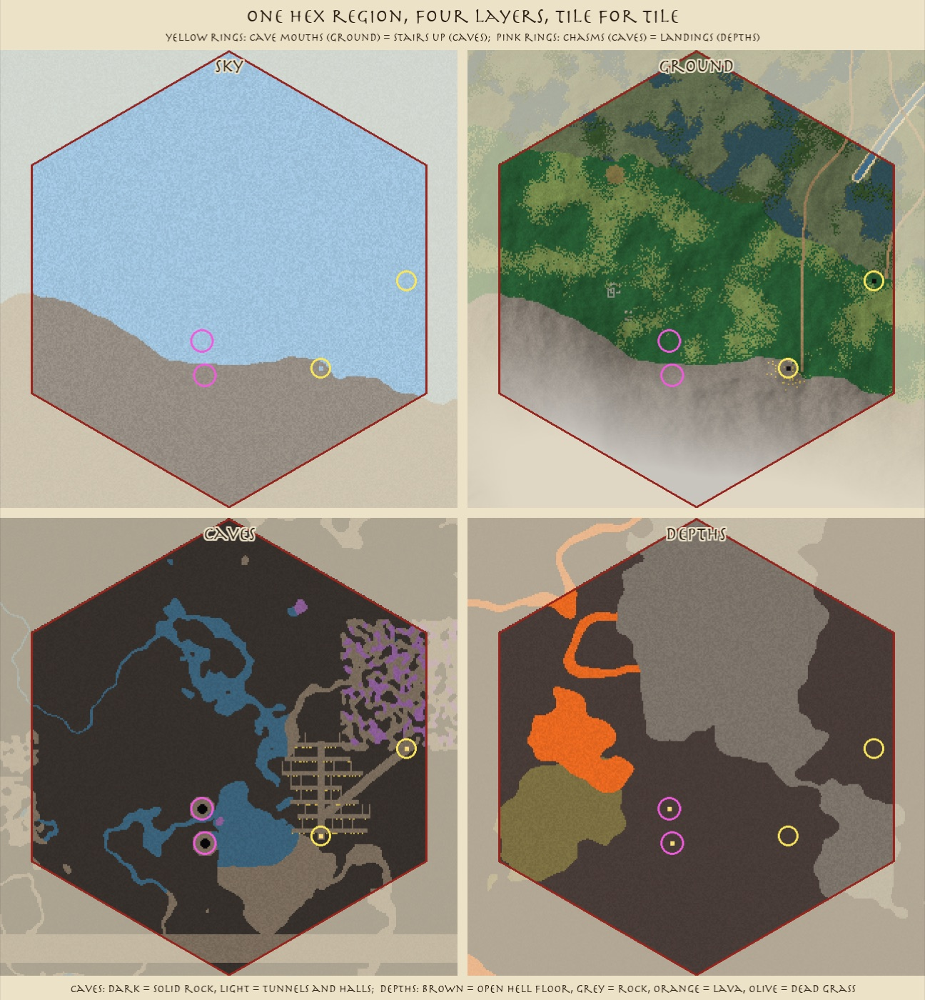

# The big world: hex map, caves and depths, dungeons, the Sky Isle, and the first hex in the game (worldgen, 10-27)

A program makes a Daggerfall-sized world from one seed number: about 268 of today's maps, cut into about 4,000
**hex regions**. The owner picked **seed 1026**. Every spot has its caves below, its depths below those and its sky
above, lined up tile for tile. The world is empty of people and has **no names**: players conquer and claim the land
and make kingdoms. Every dungeon has its own layout. The **Sky Isle** floats far out at the edge of the world, its
**Great Falls** pouring into the sea. And the first step toward the real game passed: **one hex region loaded into
the game's test arena**, windowless, in about 3 seconds.

Seed 1026 as a hex map: each hex is one region, drawn as its main land with a sign for the most important place in it.
The gold hexes are today's map. The Sky Isle is top left, out over the open sea. The small ovals are skyrocks.

The same world drawn from its tiles.

## Done
- **The generator** (`art/worldgen/`, one seed, the same world every run):
  - 4,012 hex regions of about 66,500 tiles, about 1,660 of them land. Tiles stay square inside a hex.
  - Mountains, seas, islands, 288 rivers, woods, grassland, desert, red mesa, ash lands round 5 volcanoes.
  - A great swamp east of today's map, and winter only in the far north and on high peaks.
- **Today's map in the middle** as the Old Heartland, all four of its layers kept exactly.
  - A mixed band round its edge: its snow, grass and sand spill outward in patches, so there are no hard lines.
  - It follows hud-rework's new sea on the south and east.
- **No names** (owner): no world name, no realms or borders, no names for cities, holds or caves. A place is called
  what it is: "a fallen city the lizardmen raised", "an old delving dug for iron". Only four landmarks keep a plain
  title: the Old Heartland, the Sky Isle, the Great Falls and the Wound. Kingdoms are the hexes players claim.
- **No NPC towns** (owner): only player units, beasts and monsters, plus 57 kobold warrens and 40 goblin holes.
  18 fallen cities and 150 abandoned holds are ruins to retake.
- **Caves and depths for the whole world** (owner: "we need to build the caves and the depths levels"):
  - **Caves**: tunnels and halls, underground lakes, flooded passages under the sea and rivers, lava near volcanoes,
    mushroom caverns. Also 22 **Underhalls**, the peoples' old homes, great round caverns of ruined halls under the
    mountains.
  - **Depths**: hell-floor halls, rock walls and lava rivers, a lava sea under each volcano, 11 **demon keeps** (walls
    and towers in a ring of lava) by the hellgates, and **the Wound**, the pit at the heart of the Deep.
  - **Links**: 2,721 chasms drop from the caves to the depths at the same spot; hellgates go straight down.
- **Dungeons** (owner: "dungeons we can put around the map or dungeon instances"): both ways at once.
  - Every one of 680 dungeons and 314 delvings has its own layout with 1 to 3 floors, in 12 kinds: crypt, tomb,
    barrow, cave, ice cave, mushroom hollow, old delving, dragon lair, kobold warren, goblin hole, hellgate, deep hall.
  - Each layout has its way in, stairs, monster spots, a boss, treasure, tombs and eggs. Monsters come from today's
    cave themes.
  - **The first floor is carved into the caves right under its cave mouth**, so it is part of the world.
  - **The deeper floors are instances**, made fresh for one party as `Instances.dm` does today.
- **The Sky Isle and the Great Falls** (owner: "one big waterfall ... reaches a sky island", "put it in the ocean",
  "more on the edge of the map to be discovered"):
  - A 400 x 290 island at the sky height, far out over the open sea at the world's edge, out of sight of any coast.
  - On it: grass and woods, a lake, a river, a ruined sky temple, and skystone in its white rim.
  - The river pours off the edge as the Great Falls, straight down into the sea.
  - 12 small skyrocks float over sea and land.
- **Another world, seed 2027**, for comparison (one big continent). The owner chose 1026.
- **Make it real, step 1: passed** (owner: "make it real"). `art/worldgen/arena_test.sh` exports one hex region as game
  tiles and loads it into the test arena, windowless, as four new map layers (table below). It uses only turfs the game
  already has, including hud-rework's sea, shallows, river and ford. The one exception is the sky isle's ground, which
  stands in until the planned "Cloudstone" tile exists.
- Lore (`planning/WORLD_LORE_2026-10-27.md`) and plan (`planning/WORLDGEN_PLAN_2026-10-27.md`) are updated: no names,
  kingdoms by hex, the underground, the Sky Isle, dungeons.

The whole caves layer. Gold rings are Underhalls; dots are dungeon stairs (yellow), kobold and goblin holes (blue),
deep halls (purple). Today's caves are in the middle.

The whole depths layer: lava seas under the volcanoes, demon keeps beside them, the Wound, hellgate shafts (orange).

The Sky Isle's own map at the sky height, the sea far below.

The Great Falls from the side: from the isle at the sky height down to the sea.

A dungeon of every kind, first floor. More: [a tomb's three floors](img/worldgen-dungeon-tomb-floors.jpg),
[a delving's three floors](img/worldgen-dungeon-delving-floors.jpg).

One hex region, four layers, tile for tile; its cave mouths open onto their dungeons carved below.

More: [round the heartland, hex by hex](img/worldgen-hexes-heartland.jpg),
[the land round today's map](img/worldgen-heartland-surroundings.jpg), [the great swamp](img/worldgen-hex-swamp.jpg),
[rivers across hex edges](img/worldgen-hexes-seams.jpg), [a coast](img/worldgen-hex-coast.jpg),
[mountains](img/worldgen-hex-mountain.jpg), [where today's map meets the new land](img/worldgen-heartland-edge.jpg),
[with or without today's map](img/worldgen-world-both-ways.jpg), and seed 2027:
[map](img/worldgen-seed2027-world-map.jpg), [hexes](img/worldgen-seed2027-world-hexes.jpg).

## Numbers
**One hex region loaded into the arena, windowless** (`art/worldgen/arena_test.sh 1026 40 28`, run kind, speed 1;
results in `tests/worldgen-region-checks.json`):

| What | Result |
|---|---:|
| tiles in the hex, per layer | 66,488 |
| making room: 4 new layers, world grown to 320 x 320 | 1.7 s |
| laying ground / caves / sky / depths | 0.5 / 0.3 / 0.2 / 0.2 s |
| every tile where the generator put it | yes, all 4 layers |
| cave mouths with stairs up right below | 2 of 2 |
| a peak above every mountain tile (samples) | 20 of 20 |
| a unit walks on the new ground | 5 of 5 steps |
| deep water solid; old map untouched | yes; yes |

**Seed 1026, today's map in the middle:**

| What | Count |
|---|---:|
| hex regions / land hexes | 4,012 / ~1,660 |
| fallen cities / abandoned holds | 18 / 150 |
| old delvings | 314 |
| beast lairs (wolves 186, giant spiders 52, ratmen 46, giant moles 45, death beetles 41, sand kings 38, demons 12) | 420 |
| caves, crypts, barrows, tombs, ice caves, mushroom hollows, deep halls | 580 |
| dragon peaks / hellgates | 14 / 21 |
| kobold warrens / goblin holes (the only folk) | 57 / 40 |
| ruins | 460 |
| Underhalls / demon keeps / the Wound | 22 / 11 / 1 |
| the Sky Isle / skyrocks | 1 / 12 |
| rivers / old roads / old tracks / old sea lanes | 288 / 225 / 488 / 69 |
| chasms from the caves to the depths | 2,721 |
| time to make the world map / one hex's four layers | ~35 s / ~1.5 s |

## In progress
- Nothing running. The next steps of making it real are in the plan: load and unload hexes near players, save only what
  players change, fill the places with their beasts and monsters, claims by hex for kingdoms, ships, the travel map.

## Needs the owner
- Go-ahead for step 2: hexes loading and unloading near players inside the real game (it touches the map memory work
  and needs landings through the polish lander).
