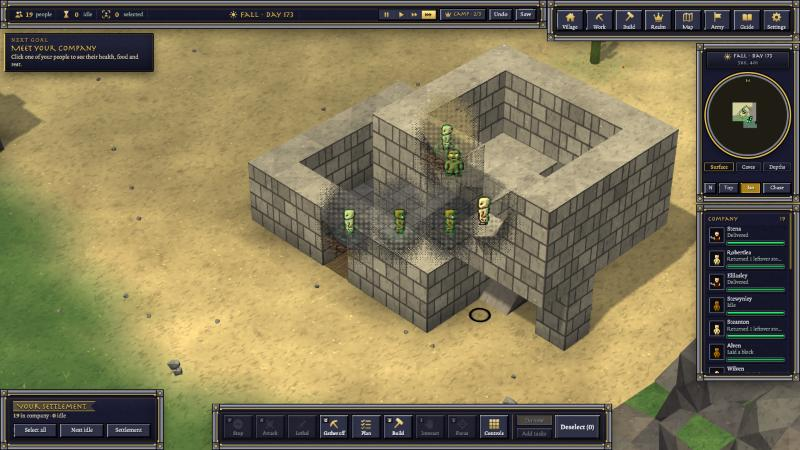

# 10-30 morning: construction sites, doors and floors

The owner, 10-30: "we need to polish the construction to 3d polish"; "has to work with the plan and building we have
currently, or we have a thing in standalone call syx we could emulate"; then "so these buildings are like a set it and
forget right ... pick door location and etc? what about the floor tiles".

## App 141 checked
The 3D launch check that the locked screen blocked last night passed this morning: apps 139-141 (block building L2-L9,
ships) are BUILD_OK.

## What a house going up looked like (real app, app 141)
Every block still to lay was its own bright wire cage, blocks popped into place with a rockfall, half-built walls wore
battlements, a glass roof hung over one course of wall, and two houses side by side were read as a wall with a gateway
(a lintel drawn across the gap). Stills: reports/construction-3d/realapp/before-8.png, before-30.png.

## Construction sites, the Songs of Syx way (app 142)
A build plan is now a site: its stone or logs are carried to a pile beside it first, then the walls go up from the pile.
In 3D: the pile (cut stone on a pallet, or a log stack) filling then emptying, stakes and string round the plan, outer
scaffolding rising with the wall, each block rising blow by blow while the builder swings a hammer, dust as it settles.
Battlements and the roof wait for the last block; timber corners cross like a log house's.
Pictures: reports/construction-3d/tests/shots/site-wide.png, site-stone.png, site-finished.png.

## Doors and floors in Plan mode (app 143)
Door (5) and Floor (6) join Dig, Build, Clear and Erase. A door marked in a wall line keeps its gap and is hung once the
walls beside it are up; floor tiles in stone or wood go to the builders. Picture:
reports/construction-3d/tests/shots/doors-marked.png.

Notes: reports/construction-3d/README.md.

## Later the same morning: getting it to finish, idle hands, an easier HUD (all in app 146)
The owner: "it continues to get stuck", "we have idle people and they do not help to fill out the slots", "we need to
work on build even more... more polish easier to use hud", "dont build on ap147 build it on 146".
- The last blocks of a house hung several ways: a trip to an empty pile set the last block aside; builders waited for
  stone another one was carrying; an idle villager stood where a block went. Fixed one by one (each seen in the real
  app, then shown in the arena): builders never wait on others' stone, and whoever stands on a block's spot steps aside.
  In the real app both houses (93 blocks) now finish in about 20 seconds, the floors 15 seconds later.
- Rows nobody set by hand now ask for hands by the work: a plan a villager per 6 blocks, the Builders row one per 4
  floor or door tiles; only free villagers come.
- Short of stone or logs with none in the stores, a plan posts a Chop wood / Mine stone order on the board itself.
- A label over each site: its name, how far it is, what lies on its pile, what it waits for. Plan mode's card shows the
  stone and logs needed against what you have, red when short.
- No spikes, battlements or gateways on walls that are still going up; they come with the last block.
Pictures: reports/construction-3d/realapp/f146-12.png, f146-35.png, g146-10.png.

## Afternoon: houses with storeys, rooms on houses (app 146)
The owner: "if someone does a 2 story or 3 story house in one drag plan does it also include the beams and etc? i want
buildings to be kind of hands free", then "we want it like mine craft where they can build anything ... off set some
buildings and rooms".
- Storeys on the Building card: one drag lays out a house of two or three storeys. You get walls through every storey,
  each upper floor held by the walls (with pillars where a span is long), a flight of three steps up each storey, and
  the roof on top.
- Pick storey 2 on the card and drag: a room is laid out on top of what is there, half on a house and half out past it
  if you like. It brings its own floor and its own stairs up from the ground under it.
- The villagers really build them. A unit walks in the door, up the stairs, stands upstairs, and comes back down.
  Getting there took six fixes to how builders climb tall buildings: they kept stalling a few blocks short of the top.
Pictures: reports/construction-3d/tests/shots/multistorey/2-two-storeys.png, 4-inside-level2.png,
reports/construction-3d/tests/shots/offset/3-rooms.png, reports/construction-3d/tests/shots/upper/upper-two-storeys.png.

## Evening: building a town by hand, in the real game
Played the way a player does: open Build, pick Building, press Storeys +, drag the house on the ground, Queue it,
then watch. The test worlds always passed, but the real game kept stalling a few blocks from the top, so each stall
was looked at in the game itself and fixed. Builders were taking no stone from the site's pile once upstairs. They
stood on wall tops where the last blocks go, and queued on the stairs both ways at once. One villager stood on the
second step holding stone. Now a two-storey stone house goes up by itself in about two minutes at full speed, and
the villagers walk up the stairs onto its upper floor.
One more fix that evening: a room built on a house no longer leaves a builder stuck on the house's wall top under it.
Builders upstairs stay up there, and the room's corner next to its stairs is now built first, from the spot beside it,
before that spot is walled in.

Then played it for real in the browser: a house, and a room dragged on top of it, half hanging out past its side. The
first try stopped two blocks short. Three builders on the one-wide stairs were each waiting for the other to move, and
the room's corner next to the bottom step had nowhere to be built from. Both are fixed. The second try finished in
about a minute and a half at full speed, with the stairs tucked under the overhang and a pillar holding up the far
corner.

What would you build on top of your house first: a watchtower, a bedroom, or a workshop?
