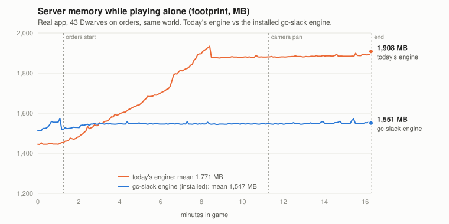
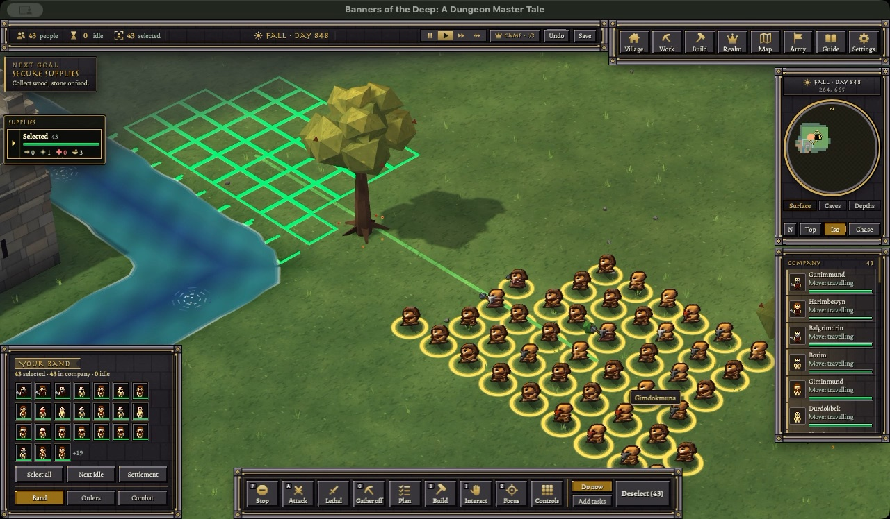
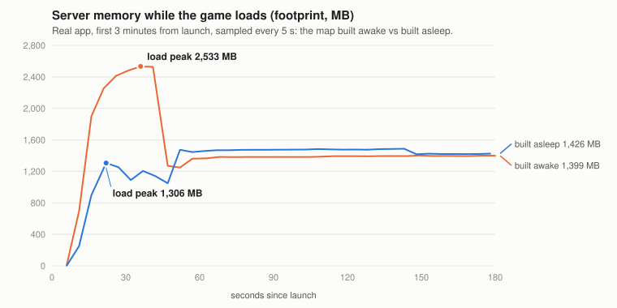
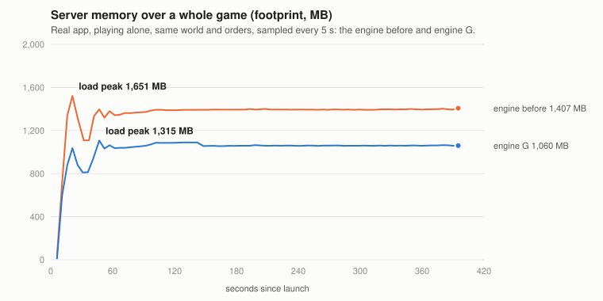
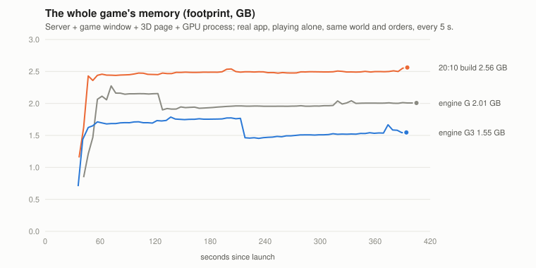

# gc-slack-1030: the server's collector slack (memory step 1)

The owner picked "server first" for the ~1 GB goal. Step 1 was the garbage the .NET collector holds. It turned out to be
two engine problems in the GC between ticks, and both are fixed in one engine file. Playing alone, the server now sits
at ~1.5 GB instead of climbing from 1.45 to 1.9 GB. It also no longer freezes for most of a second at every background
collection.

## Done
- **Measured the real app** (a pinned clone of build 146, a fresh Dwarf company under its own profile, 43 units on
  orders, a camera pan, no mouse or keys).
  - Footprint of all four processes every 5 s.
  - The server's collector from its own metrics page, every 5 s.
  - Every tick's gap from the engine's millisecond clock (`ZZStall.dm`).
- **Found why the server climbs.** After load, nothing collected the old generation for 8-9 minutes. Dead objects piled
  up (+50 MB a minute) until the runtime's own background collection, which frees room but never shrinks the heap.
- **Found a hitch.** Every background collection in play froze the server for 0.76-0.95 s, 5 of 5 times. The GC between
  ticks opened its no-GC region at the tick's end, and the runtime made that wait for the background collection to end.
  A small standalone probe proved it (`reports/gc-slack-1030/probe/`).
- **Fixed both in `engine/gc/RemasterTickGC.cs`.**
  - No region opens while a background collection runs.
  - A background collection starts early, once the old generation grows 64 MB (at most every 20 s).
  - Off switches: `RM_GC_GROW_MB=0`, `RM_GC_BGC_WAIT=1`.
- **Installed** the engine (sha f34836f7) at 18:13. Restore point:
  `restore-points/before-engine-gc-slack-20261030-181351`. App 146 as rebuilt at 18:33 has it.
- **The confirmation run found an old flaw.** One slow collection at load (110 ms) had stopped the GC between ticks for
  the whole session; it can happen on today's engine too.
  - Fixed: a collection that began a gen2 no longer sets the time estimate, 5 s of no time forgets it, and no early
    collection starts during the load.
  - Installed 18:55 (sha 3a02098b). Restore point: `restore-points/before-engine-gc-slack-fix-20261030-185543`.
  - The next app build carries it.
- Obey 32/32, clip 11/11 and combat (0 failures) pass on both versions.
- Another run's window got a real Space key press when the run fronted it for a screenshot (18:27), and the game paused.
  The scripts send no keys.

## Numbers (real app, playing alone, same world and orders)
| | today's engine | gc-slack, run 2 | gc-slack installed, run 4 |
|---|---:|---:|---:|
| server, mean in play | 1,771 MB | **1,477 MB** | **1,547 MB** |
| server after 16 min | 1,908 MB | **1,525 MB** | **1,551 MB** |
| whole game, mean in play | 2.95 GB | **2.55 GB** | **2.68 GB** |
| freezes over 500 ms in play | 4 (0.76-0.95 s) | **1** (the autosave) | **1** (the autosave) |
| background collections in play | 3 | 14 | 33 (~2% of one core) |

- Compacting at saves or pauses no longer pays. After the change a full compaction frees only ~50 MB of footprint, for a
  0.5-0.9 s freeze. A stronger `GCConserveMemory` would trade freezes for that same little, so it stays at 5.
- What is left in the server: live data ~0.92-0.99 GB, plus ~0.25-0.3 GB outside the collector. Report:
  `reports/gc-slack-1030/README.md`.

## Step 2: the map built asleep at load (landed 19:59)

The owner asked for step 2 here. The engine used to make all ~4 million tiles awake at load, and the server went to
~2.5 GB for half a minute before the load pass put them to sleep. Now the map is made a level at a time and put to
sleep before the next is made; each tile's `New()` runs a level at a time, in the same order, and goes back to sleep.

- **Found on the way:**
  - The engine's own pass over the map's objects looked up every tile, even the ~99.9% with none, and woke them all.
  - The reach map's build skipped any level with sleeping tiles, so it would have had no map at all. Now it reads
    sleeping tiles from their records.
  - An area's look change and `area.x/y` also woke whole areas; they now read the records.
  - A full collection between levels keeps the dead turfs from piling up: 1.3 s of load, with no player in yet.
- **The join's leftovers:** with the load now over before the player joins, the join's big short-lived strings and
  arrays left ~0.4 GB of free room in the large-object heap, and the server sat ~170 MB higher in play. Raising the
  server's large-object line to 4 MB (`DOTNET_GCLOHThreshold`, in `launch.zsh` and `web_host.py`) lets them die young.
- **Proof the game can't tell:** headless loads fingerprinted every tile (type, look, density, area, ref and more).
  Levels 2-4 and the reach map are identical. Level 1 differs only in rows that also differ between two old-style loads.
  Obey, clip and combat pass; the map-memory arena fails 4 checks identically on the old engine (it's out of date).
- Installed: engine v26 (sha 88d0dfeb). Restore points `restore-points/before-engine-load-asleep-20261030-195902` and
  `before-polish-load-asleep-engine-20261030-195918`. Off switch `RM_LOAD_ASLEEP=0`. Report:
  `reports/load-asleep-1030/README.md`.

| real app, playing alone | built awake | built asleep (landed) |
|---|---:|---:|
| server load peak (the process's own peak) | 2,545 MB | **1,639 MB** |
| whole game, highest | 2.93 GB | **2.72 GB** |
| server, mean in play | 1,413 MB | 1,435 MB |
| gaps between ticks ≥ 250 ms in play | 2 | **0** |
| in game, after launch | 73 s | 72 s |

## Step 3a: what the server's heap was holding (landed 21:15)

The owner caught my first census runs on an app copy pinned at 16:57: the window still showed the death loop and
standing dead sprites. I re-ran everything on a fresh clone of the 20:10 build.

The census (`dotnet-gcdump`, the owner's OK) counted 834 MB of live objects in the server. Three engine leftovers held
about 240 MB of it:
- **128 MB: the load's tile queue.** The engine queues 2 million tile changes a level while the map loads, then clears
  the list but keeps it at that size for the rest of the game.
- **~80 MB: a definition per tile.** A map object with its own values (a named turf, say) got a fresh copy of its
  type's whole variable table for *every tile* it sits on: 15,629 copies for 1,326 types. Now each map object has one,
  shared by its tiles, the way instances share their type's.
- **~33 MB: spare proc states.** The engine pools finished proc states for reuse. The pool grew to the most procs ever
  alive at once (14,897, at the load) and kept them all. Now it keeps at most 2,048.

Engine G is today's engine (the plan-engine session's stall clamp included; the 177 source files match exactly) plus
those three edits. Obey 32/32, clip 11/11, combat 0 failures. Installed as sha256 d48578fc; restore point
`restore-points/before-engine-map-defs-20261030-211450`.

| real app (20:10 build), playing alone | before | engine G (landed) |
|---|---:|---:|
| live heap after the load | 817 MB | **538 MB** |
| server load peak | 1,651 MB | **1,315 MB** |
| server, mean in play | 1,395 MB | **1,062 MB** |
| whole game, mean in play | 2.49 GB | **2.27 GB** |
| gaps between ticks ≥ 250 ms in play | 0 | 0 |

Measured and dropped: syncing the window's hidden 2D map over 2 tiles instead of 25 saved nothing (window 684 vs
685 MB). So the window's 680 MB isn't the entities it is sent, and no click audit is needed for it.

Dropped: the compaction right after the first player's join. On engine G the live heap was the same with or without
it, and with it on the collector kept more memory afterwards. It isn't worth a 0.5-0.8 s stop as the player comes in.

## Engine GG, then G3: the duplicate map (landed 22:17)

The owner: "engine g we can do better we can get engine GG", then "the map is what's killing us because we have two
sets of tiles". That was right. The world was kept three times over: as the game's own turfs, as a Robust tile grid in
the server, and as a copy of that grid in the game window. The grid only feeds a 2D map hidden under the 3D view.

- **The game's own turfs, packed tighter.** A turf's ref is now worked out from its place instead of kept in a table.
  It is exactly the ref it always had, because the map makes turfs in that order. A sleeping tile is now one 2-byte
  "kind" instead of 15 bytes. Every tile and ref came out identical in headless loads.
- **Pools capped.** The game's spare big lists and Robust's spare network buffers kept everything they ever held
  (~80 MB).
- **The 2D grid only near players.** Tiles are kept only in the 16×16-tile chunks around each player's camera.
  Dropping them all would have broken every key macro: the window finds your mob through the tile under it. A test
  pressed Space through the window at the end of a run, and the game paused and unpaused.
- **The collector's room.** After a join, my tick GC asked for 192 MB of room for a burst of sends, and the runtime
  kept it all game. It now asks for at most 64 MB.

| real app (20:10 build), playing alone, last 4 min | engine G | **engine G3** |
|---|---:|---:|
| server | 908 MB | **661 MB** |
| game window | 675 MB | **462 MB** |
| whole game | 2.02 GB | **1.61 GB** |
| whole game, highest | 2.27 GB | **1.79 GB** |
| gaps between ticks ≥ 250 ms in play | 0 | 0 |
| in game, after launch | 67 s | 57 s |

Obey 32/32, clip 11/11, combat 0 failures. Installed: sha256 48d048ee; restore point
`restore-points/before-engine-g3-20261030-221658`. Off switches: `RM_NEAR_TILES=0`, `RM_POS_REFS=0`, `RM_POOL_CAPS=0`,
`RM_GC_MAX_MB`.

## Overnight (the owner, going to sleep: "keep working ... no input from me")

- **Landed: engine G5 (23:55).** The server kept an empty cell slot for every tile of every level: 30.5 MB, almost all
  unused once the map sleeps. Cells now live in small blocks only where tiles are awake. The server's live data at the
  end of play went from 227 to 195 MB. Every tile is the same in test loads, and obey, clip and combat pass. It is built
  on the plan-engine session's latest engine (sha256 29a21842), without their unfinished work.
- **Landed: no profile-guided re-compiling (23:28).** Under Rosetta every compiled version of a method is translated
  again; with it off there is less compiled code in both processes and no CPU cost measured.
- **Key audit passed (before the screen locked):** the arrow keys panned the camera across chunk edges, and the pause
  key still worked after. The tiles near players follow the camera.
- **Measured and dropped:**
  - the 3D page's own caches are only ~44 MB of JavaScript; the rest is WebKit and the antialiased canvas, which is
    picture quality;
  - one-off "hand the room back" collections (370 ms, and the server ended *higher*);
  - Server GC with DATAS (the load peaked at 2.2 GB);
  - a smaller GC region cap;
  - dropping generated icon images (the game reads them back on hot paths).
- **A full game on the engine as installed** (16 minutes of play, the same routine as the morning): the server
  averages **781 MB** and is 795 MB after 16 minutes, flat, and peaks at 903 MB while loading. The morning started at
  1,771 MB on average and 1,908 MB at 16 minutes, with a 2.5 GB load peak.
- **Landed: engine G6 (02:30).** Most of the server's memory above its live data was the old generation full of holes. A
  join's big data dies a minute later, and the collections my tick GC starts sweep but never squeeze. Now, once the old
  generation is at least 128 MB and a third empty, the next one squeezes it, in about 0.1 s at a tick's end. The server's
  last minutes went from ~800 MB to **~580 MB**, with no pauses over 250 ms. Obey, clip and combat pass.
- **Morning (10-31): the server natively on Apple silicon.** The owner OK'd two small library downloads. With them
  (and engine G7, which lets the server start without an x86-only plug-in library the game never uses) the server runs
  as real Apple-silicon code instead of through Rosetta: **439 MB instead of 570**, a third less CPU, in game 9 s
  sooner. The app build now packs it, and Intel Macs get exactly today's app. It arrives with the next build.
- **Later that morning: precompiled code back on, and the game window on Apple silicon.** The game had switched off
  .NET's precompiled code since its very first day, and nobody had written down why. Nothing anywhere explains it, and
  the tests say it's safe: the world is ready about 5 s sooner, and comes out the same. It's on again. For the window,
  the owner OK'd six more small downloads (the window's sound, fonts and graphics libraries, built for Apple silicon).
  A test client joining a real world ran at **~125 MB instead of 223**, and joined in 2 s instead of 7. The app build
  now packs it too; the last check is a real game window, run while nobody's at the Mac.
- **The screen locked around 23:25.** From then on the window got no keys and drew nothing, so window and page numbers
  after that aren't comparable. The server numbers and the checks are fine.

## Next
- **Rosetta:** the server is native since the morning, and the window's move is packed. What's left is the real-window
  check and the next build.
- The key test covered one macro (Space, pause). Worth a playtest of the other keys, skin buttons and a reconnect on
  the next build.
- The turf ref slots (32 MB).
- Step 3, regions on disk, is the big cut in live data; plan it with the owner.
