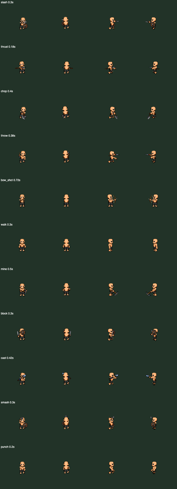

# GOA animation rig: Human male profile (2026-10-30 evening)

The owner found `Dungeon Master Sample/GOA Reusable Animation Rig v1`: the game's 97 clip keys (skills, work,
deaths, ragdoll) played on the approved GOA Elf male cut into 15 parts per facing with two-bone IK. Only the Elf was
calibrated. The owner asked for the Human next, in a folder of its own to show the rig's creator.

Result: `Dungeon Master Sample/GOA Reusable Animation Rig v1 - Human Male/` (2 MB, stands alone; open
`preview/index.html`). The Human was cut automatically from the approved Human sheet with the staged fine zones
(`reports/goa-sprite-test/staged/rig/finezones/Human`) and their joints, by `tools/cut_from_finezones.py`. The
original rig folder is unchanged (manifest hashes match).

Approximate: Elf bow/throw targets not retuned; flat joint fillers; far side-view arm is a shifted copy. Next race:
same tool, any sheet with fine zones.
