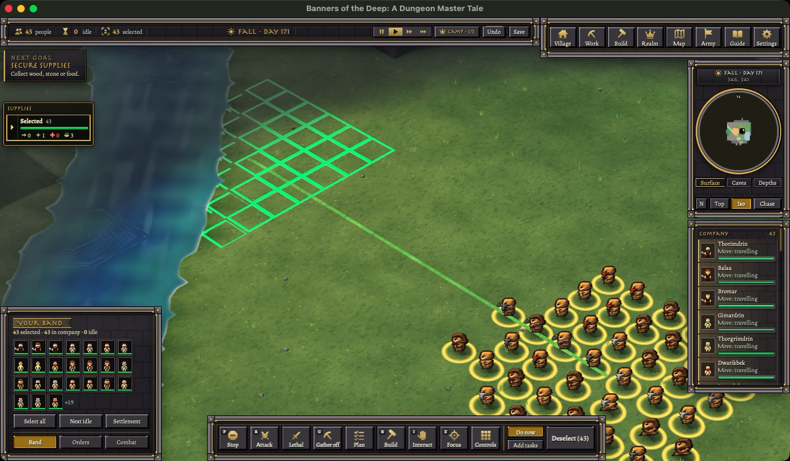
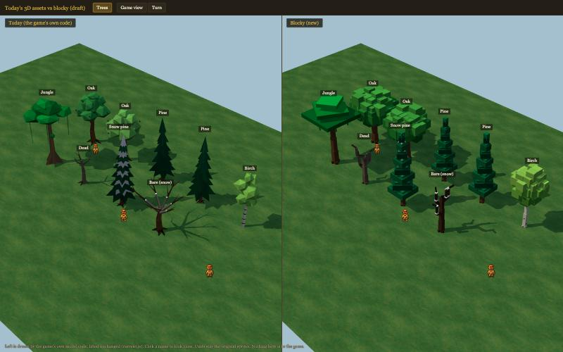
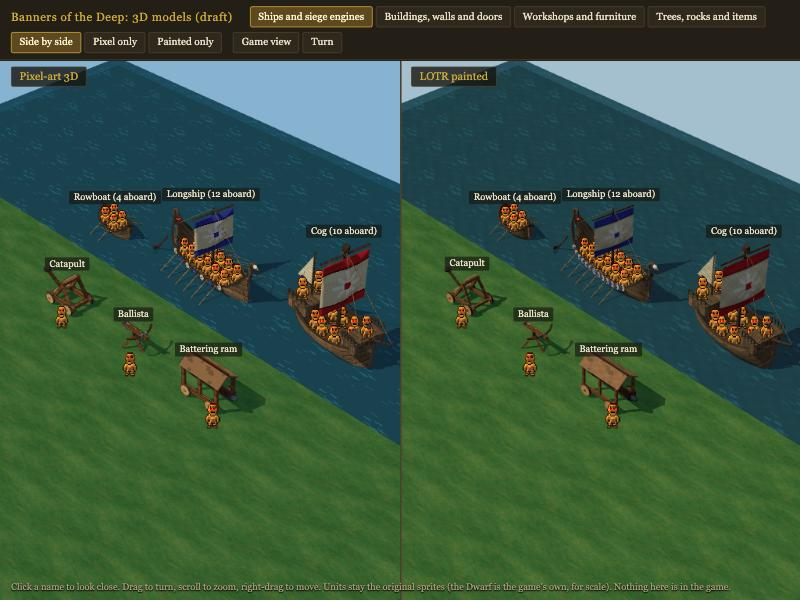
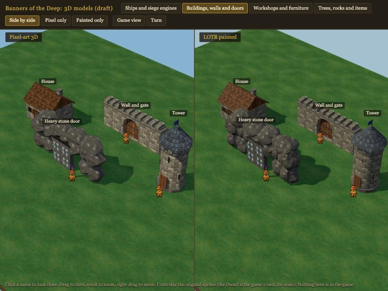

# memory-1030: memory while playing, then 3D models

Measured app 146's memory while playing alone: 2.6 GB at load, 2.9-3.1 GB after 10-15 minutes, with the server the
biggest part. The server's creep levels off. The owner picked the server side to cut first. Then, on the owner's asks,
a three.js model gallery (two looks) and a blocky remake of the game's trees beside today's.

## Done
- **Memory report**: `reports/memory-1030/README.md`. Today's numbers per process, the creep check, levers ranked by
  savings.
- **Real-app runs**: a fresh Dwarf company plus 40, orders every 60 s through a command overlay (`ZZMemPlay.dm`), no
  mouse or keys. Footprint of the server, window, 3D page and GPU process every 5 s (`memsample.py`).
- **Creep check**: 30 min with nobody playing, and 12 min of play with live-heap readings.
- **Correction**: the 10-27 "200 units" creep run never had units. `tick_profile --client none` adds none.
- **three.js gallery** `reports/models-3d/index.html`: 25 models in 4 groups (ships and siege, buildings, workshops,
  trees/rocks/items), pixel-art 3D next to LOTR painted. The ships now seat the real sprites (rowboat 4, longship 12,
  cog 10) with an original high-fantasy look.
- **Today vs blocky** `reports/models-3d/compare.html`: the game's own tree code (lifted unchanged by
  `make_current.py`) beside blocky remakes (`blocky.js`, the page's vertex format, ready to port once approved).

## Numbers (app 146, playing alone, footprint)
| | server | window | 3D page | GPU | all |
|---|---:|---:|---:|---:|---:|
| in game | 1,413 MB | 652 | 424 | 111 | 2.6 GB |
| 10 min of orders | 1,763 | 649 | 381 | 121 | 2.9 GB |
| +4 min pan into new land | 1,919 | 651 | 427 | 106 | 3.1 GB |

- Live data in play: 651 MB after load → 841 at 5 min → 868 at 10 min.

## Dropped
- The blocky remake. The owner on seeing the trees: "what the heck that was a downgrade nevermind what we have now
  is fine". Today's 3D models stay as they are. Nothing from the gallery or the blocky trees went into the game; the
  files in `reports/models-3d/` are kept as reference.

## Next
- Server-side memory cuts (the owner's pick), now in their own session: first the garbage the collector holds, then
  tiles asleep at load.
