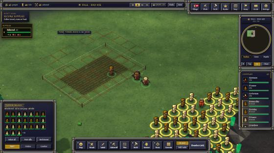
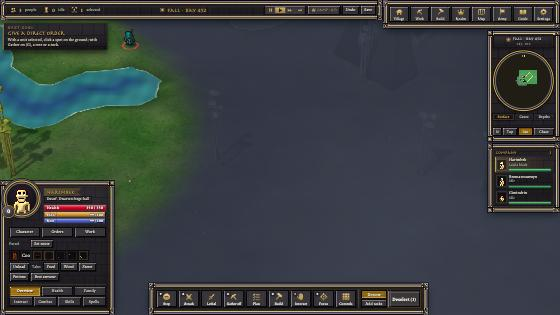
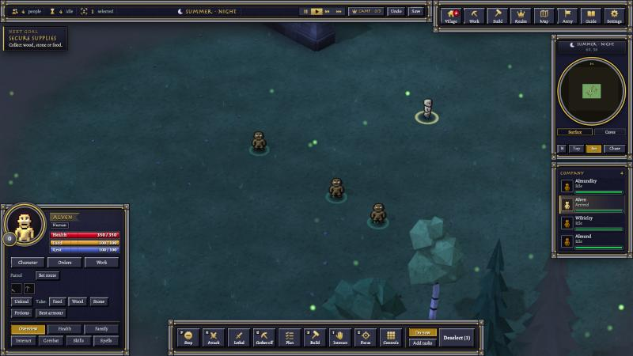
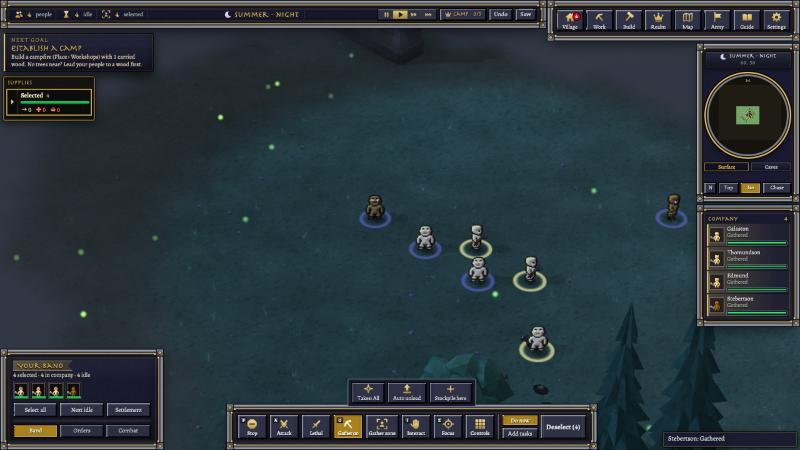
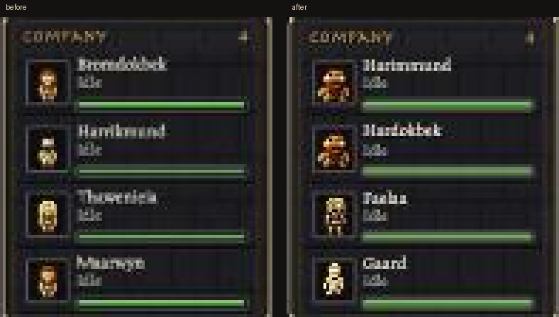

# 10-30 evening: what a Quake-style engine could teach our server

The owner asked whether OpenRealm, an engine in the style of Quake 2 for Warcraft III data, could upgrade our server.
The aims: host the game on a website server, and make more games on our engine with Banners of the Deep as the
framework. We read its server, network, game-boundary and entity-pool notes, then held each idea up against how our
server works today. The plan is `planning/SERVER_UPGRADES_PLAN_2026-10-30.md`. Nothing in the game or engine changed.

## What we found

- Our 3D and HUD sends already send only what changed for terrain, things and units. What still costs is that every
  send is built in full just to see whether anything changed, for each player separately.
- One player's sends take roughly a tenth of the server's game thread. Ten players would fill it with sends alone.
  That is the real limit for a shared world, more than bandwidth or memory.
- A browser player today needs a whole hidden game client on the host: 110-300 MB and about half a core each. What the
  browser actually uses is a handful of messages. The server could speak to it directly.
- After a stall, the server catches up with up to 5 ticks in a row that nobody can react to. Quake never allows more
  than one.
- About half of our engine add-ons have the game's own rules inside (races, holy ground, morale, doors). They need to
  move to their own folder before a second game can use the engine.

## Next

The plan ranks seven upgrades. The cheapest one only touches the game's own 3D sends (days). The one that makes web
hosting real is the direct browser connection (weeks).

## Later that evening: the first upgrade is in

The owner said go on the cheapest one, and it landed at 19:49.

- **Unit positions.** The server used to look over every tile in a big square around the camera ten times a second,
  then send every unit whenever one of them took a step. Now it asks the unit grid who is nearby and sends only the
  units that moved: about a tenth of the bytes, and a quarter of the memory churn.
- **Terrain for two players.** When two players look at the same land, it is built once instead of once each.
- **Unchanged scene parts.** Fog of war and building plans are no longer sent again when nothing about them changed.

The checks ran the old way and the new way side by side for 400 ticks, with units walking, dying, being born and
walking in and out of fog. What the page holds came out identical every tick.

Then we played it in the browser with two players: a Human village of 63 and a small Dwarf company. When the 60
villagers walked off together, the server sent a few changed units at a time instead of all 63 every tick. Every unit
ended up on the page exactly where the server had it. When both players looked at the same land, the second one's
ground came straight from the first one's work. Not one unit was pulled back a step when a new scene arrived.

## Then two engine tidy-ups

- **Hiccups no longer fast-forward the battle.** When the server freezes for a moment, for instance while it saves, it
  used to run five game ticks in a row to catch up, faster than anyone could react. Now it runs at most two. The
  world simply lets the rest of that moment go: a short pause instead of a hurry.
- **The engine's own parts and the game's parts now live apart.** About half of our additions to the engine carry
  this game's own rules (races, holy ground, morale, doors). They now sit in their own folder, and a checker keeps the
  shared part clean. It's the first step toward building other games on the same engine. The engine built from the
  new layout came out byte for byte the same as before, so nothing in play changed.

Question for you: what's the biggest crowd you'd want on one screen at once?

Question for you: if you played on a big shared server, would you rather the world paused for half a second when it
hiccups, or rushed to catch up?

## Late evening: the browser talks to the server itself

Playing in a browser has worked since the 22nd, but each web player needed a hidden copy of the game client running on
the host just to pass messages along: up to 300 MB and half a processor core each. Tonight the server learned to speak
to the browser directly. One address, and the server hands over the lobby, the game's own page, every picture and sound,
and the game's updates as they happen.

In a small test world we joined from the browser pane, clicked a Human, and sent them across the field. The second order
was a real job: everyone selected, gather on, a click on a tree, and four Humans felled it. A second player joined on the
same address with their own company, a reload picked up exactly where it left off, and a player who stayed away too long
was logged out and got their own people back on returning. No hidden client was running at any point.

It isn't in the game yet. Keyboard shortcuts don't work this way yet, and anyone can type any name. Both come next,
before friends use it.

Question for you: would you rather jump in from a link in your browser, or download the game?

## Later still: keyboard and sign-in for the browser

The browser version now answers to the same keyboard as the game window. G turns gathering on, Ctrl+A picks everyone,
Ctrl+1 saves a group and 1 brings it back, Q turns the camera, and a held key keeps going until you let it go.
The server reads the game's own key list and runs each key's command itself, so nothing about the keys had to be written
twice.

And nobody can walk in under someone else's name anymore. A server can now ask for a sign-in link instead of a typed
name. The plan is that you sign in with Discord, and the link brings you straight into your own village. A link works
once and runs out after a few minutes. Forged, stale and reused links were all turned away in testing. The Discord side
is built and tested against a stand-in; it goes live once the sign-in service has a home on the internet.

Question for you: signing in with Discord to play in the browser, yes or no?

## Last thing tonight: it's in

The browser connection is now part of the game's engine, so it ships with the next build. It stays switched off until
a host turns it on, so playing from the app works just as it did. Inviting friends still uses the old way for now;
switching that over to the new connection comes next.

## Night: your people, as they really look

The faces in the Company list were drawn from the original 2006 sprites, where a Dwarf and a Human were the very same
little figure. Now every portrait is drawn from the same body you see walking around in the world: stocky Dwarves,
slender Elves, each with their own gear, cut close so they fill their frame. The game engine couldn't trim a picture
before (that tool was an empty stub), so the engine learned how first.

Hosting moved over too: when you host for friends, your world now serves their browsers itself.

## Late night: the server stops redoing work

With 200 people on screen, the server was working out every one's health from twenty-odd body parts several times a
second, even while they stood still, and rebuilding each one's picture for the 3D view twice a second because its own
notes-to-self counted as "something changed". Now it remembers until something really changes. Same game, same
screen: about a third less work a second for one player, which is room for more players and bigger armies.

Two more before morning: the once-a-second check of every person's weapon skills had a typo that stopped it from ever
taking its shortcut, so it redid all the work for everyone, every second; and the 3D view now remembers where each
standing person was instead of rewriting it ten times a second. All told, the server's work for one player with 200
people fell by more than half tonight.

Question for you: what would you do with twice the people on one server?
