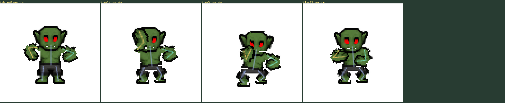
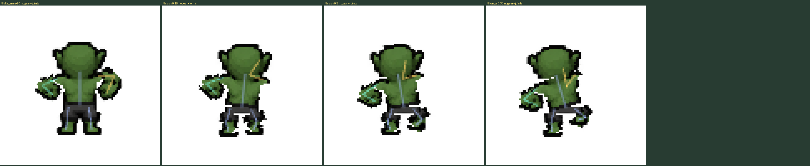
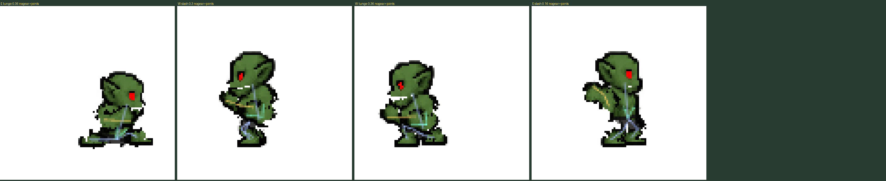
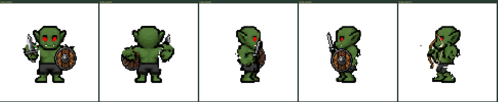
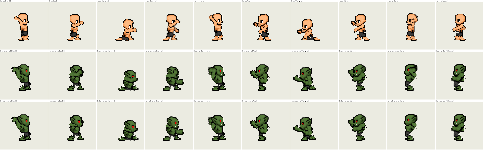
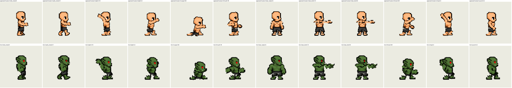
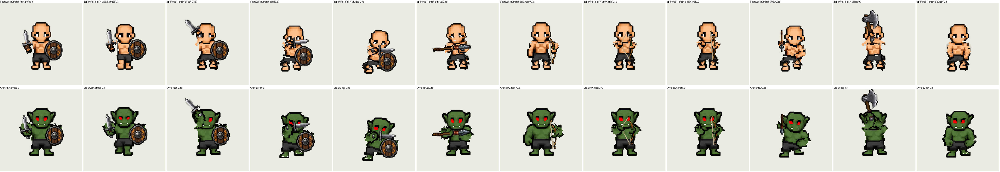
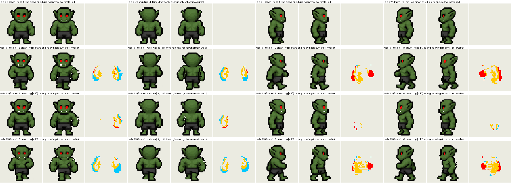

# GOA rig: the Orc, cut by its own skeleton (2026-10-31)

Third body on the animation rig after the Elf (baseline) and the Human (approved this morning). Folder:
`Dungeon Master Sample/GOA Retarget Review - Orc Male/`, preview on port 8885 (`goaorc`).

## What went wrong first

Six rounds of "still off". With equipment off and joints on, the owner could see it at once:

- the arm joints were guessed from zone edges, with the shoulder sitting on the arm's outline, so every bend
  swung the whole arm off the body (North guard: an L-shaped arm with a gap to the torso);
- the side legs had no thighs at all (the whole shorts sat on the pelvis), so a stepping leg was a skin sliver
  and a foot: the "spiky foot" in East and West;
- the tusks stayed on the torso when the head moved;
- the East/West bow was the Elf's construction, the South body with a side head set on it: "some frankenstein
  turn", not the actual East/West turn.

## What fixed it

- **Joints from the staged skeleton.** Every race already has one
  (`reports/goa-sprite-test/staged/rig/<Race>.json`): shoulder, elbow, wrist, hip, knee, ankle per cell. With
  those joints the renderer's two-bone IK lands exactly on ChatGPT's draft hold pose, so the draft's grips are
  used unchanged. One rule on top: the renderer bends front/back knees outward and the Orc's drawn knees point a
  pixel inward, so the chain knee is moved onto the hip–ankle line (the pieces are still cut at the drawn knee).
- **Side thighs.** The side shorts are one drawing over both thighs; they are split between the two shins (near
  shin at the back, far at the front), the waistband stays on the pelvis, and the far shin and foot reuse the
  near leg's pieces. The idle composite is unchanged and a lunge now shows two legs.
- **Head piece** = head zones + neck rows + the tusks.
- **Side bow on the side body.** A profile flag (`bowSideBody`) added to the approved Human renderer by a
  four-line literal patch: the bow clips use the body's own East/West drawing; the far arm holds the bow behind
  the torso, the near arm draws the string in front; East is still the exact reflection of West.

## Checks

- Unarmed parts-only rest (slash at 0, no weapon) against the drawn idle cell: South/North differ only at the
  closed piece ends; East/West only at the far leg (the near leg's foot on the far chain).
- Idle (drawn body + arm pieces at rest): South 0 pixels off, North 2, East 8, West 2.
- All 97 clips rendered at their key times, with gear and without, joints on.

Not approved yet; nothing baked, nothing in the live game. Next bodies get the same recipe: their own skeleton,
their own zones, the draft grips if a draft exists.

## Second pass the same evening: "still off"

Looking at the Orc with equipment off, next to the approved Human at the same clip and time, showed what the first
pass missed:

- **The jaw was never part of the head.** The zones end the head four or five rows above the jaw, so the chin and
  the jaw outline stayed on the torso. Every head tilt split the face, and the side bow looked like a frankenstein
  turn because the side head had no jaw while the front torso kept its own. Heads are now cut along the jaw line
  the artist drew, and the torso has skin backing under them.
- **The side shoulder sat at mid-arm.** The staged skeleton's side shoulder came from mislabelled zones; the top
  third of the arm stayed glued to the torso and a second arm swung out of the chest. The shoulder now sits where
  the Orc's own walk frames swing the arm from. The side torso behind the arm comes from the walk frames, with a
  closed back edge.
- **Wide legs tore apart.** Front/back knees buckled sideways; the 14-px shorts legs split at the crotch. A gated
  renderer flag shortens the legs along the hip-ankle line instead.
- **A forward arm covered the face.** This orc's shoulders are level with its jaw. A second gated flag draws the
  side head over a forward-reaching arm, so it passes under the jaw like the Human's passes under its chin.
- **White slivers** on every lean and swing are closed by 2-px backing strips hidden at rest.
- The side bow went back to the approved construction (front body, real side head): with whole heads it's clean.

Check: the idle rebuilt from the pieces matches the drawn idle cell exactly in all four views.
