# Quest maker, 10-31

Players can now post jobs for each other. Build a notice board, put up a notice ("bring me 5 iron bars: 20 coins and
a dagger"), and another player's people can take it, bring the goods, and get paid. The reward is set aside the moment
you post, so nobody can promise what they don't have.

## Near midnight: the world now saves by region

You said yes to R3, the third step of keeping regions on disk. The world save now also goes out as one file per
region, plus a small world file:
- **Region files:** a region is a 256 x 256 block of one layer for now; the generated world's hexes take that role
  later. Each file holds the region's changed tiles, what lies on them (items, workshops, siege engines, banners,
  runes), the quests posted on its boards, and when it was saved.
- **The world file:** the calendar, realms, wars and the rest.
- **Only changed regions are written.** A region whose contents didn't change keeps its file from an earlier save.
  That is what lets a much bigger world save quickly later on, and lets a start read only the regions near players
  once far regions can unload (R2).
- **The old single file is still written beside them, with the same stamp.** A start reads the region files only
  when they are a complete set from the last save. Anything else (a set from before a single-file save, a missing
  region file, or region files switched off with RM_REGION_FILES=0) loads the single file as before. An old save
  loads as before and becomes region files at its next save. So far nothing can be lost to the new format.

**The check:** one world started six times on the same folder, each start loading what the one before saved:
- saved;
- loaded from the region files;
- loaded from the single file only;
- loaded with a stale set;
- an old save without region files, loaded and saved again;
- loaded from the region files again.

Every start came back as the same world: tiles, items, workshops, siege engines, banners, runes, quests and the
calendar. A save with nothing changed writes no region file, one changed tile writes one, and an emptied region drops
out. All 19 checks passed. The same six starts on the real 1000 x 1000 map also gave the same world each time. The
quest tests pass too.

Not done yet: reading only the regions near players needs R2 (far regions unloading), and generated regions are R4.

## Near midnight: the world save kept only its first save

Building the region files turned up an old bug. **Every world save after the first one in a session wrote the first
save's world again.** Anything built, dug, dropped or posted after a session's first autosave was gone after a
restart.

- **Proved:** three saves a few seconds apart, then a fresh start. Only the first save's changes came back.
- **Cause:** the engine keeps a file's contents by its name, and the save reused the same temporary file name each
  time.
- **Fix:** the world save now goes out the way the unit saves already did, through the engine's own safe write.
  After the fix, all three saves' changes come back, and the newest backup is the save before the last.
- **Not affected:** your people's own saves.

Landed at 22:19, before the region work, so it reaches the game with the next build on its own.

## Late night: slow ticks

You said the slow ticks weren't good, so I looked closer.

**What they really were.** One "creature looking for a target" took 189 ms. That search can't take that long. A
memory clean-up had landed in the middle of it. The fort guards' searching costs about 1 % of the server. With ten
players the server was making and throwing away about 40-48 MB of memory every second, and the clean-ups show up
wherever they land. The worst single freeze (0.36-0.5 s) is a planned clean-up that squeezes the server's memory
back down. It happens once the joins have left a lot of empty room, at most every 5 minutes.

**The biggest waste was the HUD.** Twice a second, for every player, it rebuilt and re-encoded the ~15 KB list of
the old border buttons just to find it unchanged. Now:
- the border list is kept until something it shows changes;
- the command bar, the icon names and the quest card are not encoded again when they haven't changed;
- the explored map's text is reused when it's the same.

A send's leftover memory fell from 795 KB to 575 KB. A test proves every send is exactly what it was before (landed
21:54 as "hud-kept-keys").

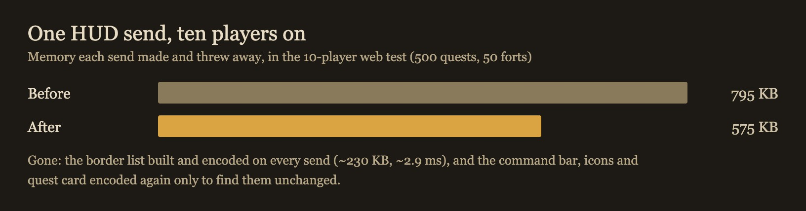

**The memory squeeze now waits for an empty world** (you: "Yes, hold it"; engine 9104dcb8, landed 23:11).
- **The test:** the same 10-player web test on the new engine. No squeeze ran while they played; the engine logged
  it waiting about twice a second. The worst tick fell from 432-470 % to 397 %, and the ticks over budget from 11-14
  to 3.
- **When the last player is gone:** browsers count as connected for 90 s after closing, in case they come back. The
  squeeze then ran once, in 254 ms with nobody to notice, and memory went from 794 MB back to 372 MB.
- **The cost:** with ten players on, the server holds about 400 MB more than right after a squeeze, a bit more than
  the 300 MB I guessed.
- **To switch it back:** RM_GC_DEFRAG_PLAYERS=1 restores the old behaviour.

## Late night: ten players, five hundred quests

The last step of the plan was to make sure quests stay fast with many players. Part of it waits for other work:
- saving each region's quests in its own file needs the world saved by region first, which hasn't started;
- turning a fort's sleeping guards into light records needs far records, which are switched off.

You chose to do the part that's ready now.

**What changed in the game:**
- Every quest now carries its region. There's one region today, and it becomes the hex once hexes arrive, so a
  region-by-region save can split the quests without touching them again.
- Three things were rebuilt on every send to every player:
  - the Quests page: 1.7 ms each time;
  - a board's list of notices: 1 ms each time;
  - every notice board's marker in view: 0.6 ms each, every screen update.

  Now they're kept until a quest actually changes somewhere, or the player's settlement or the realms do. A send's
  quest data dropped from about 2.9 ms to 0.11 ms.

**The arena test:** 10 realms, 500 quests (450 Bring notices and 50 forts with 4 guards each), and players holding each
other's quests.

| What | Time |
|---|---|
| A send's quest data, Quests page and a board open | 0.11 ms |
| Rebuilt after a change (only then) | 1.8 ms |
| The 30-second pass over every quest | 5 ms |
| The world's notice pass, 25 notices at once | 7 ms |
| A fort's card | 0.1 ms |
| Saving all 500 quests | about 255 KB, 30-70 ms |

**The web test:** a real world with 10 players in browsers, 500 quests and 50 garrisoned forts, run three times for 3
minutes each.
- **Quest data for all ten players together:** about 2 to 2.7 ms per game second, out of the 1,000 ms a server second
  has.
- **Sent to each player:** about 0.7 KB a second, 0.1 KB on the wire.
- **The server's tick:** 13 to 18 % busy on average. It had a few slow ticks, the worst at 470 % in the busiest run.
  None came from quests. A closer look later the same night found they were memory clean-up landing inside whatever
  happened to be running (see "Slow ticks" above), not the fort guards' target search.

Making sleeping garrisons into records is the part that waits for far records.

- **Checks:** a new arena test, 12 of 12; the earlier quest and admin tests; combat 32 of 32.
- **Not done (waiting):** quests saved by region (needs the world saved by region first) and sleeping garrisons as
  records (needs far records turned on).

## Night: quests that come and go with the stores and the world

Quests now react to what's happening.

**Standing notices.** On a Bring notice, open "Keep it stocked" and set, say, "keep at least 5 iron bars, pay 3 coins each".
- When your stores have fewer, the notice goes up by itself for what's missing, and its coins come out of your treasury
  then.
- When the stores are full again and nobody has taken it, it comes down and the coins come back.
- If someone has taken it, it stays up for them.

You set the price; the game never does. Quests › Ours lists your standing notices, with Stop.

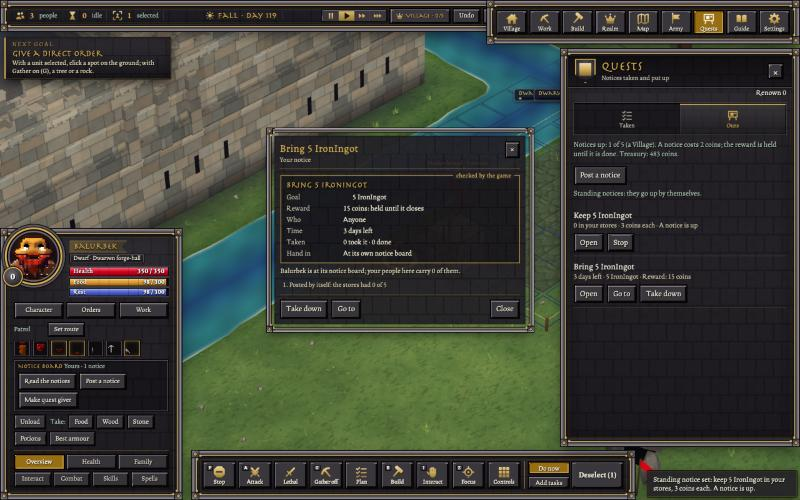

**The going rate.** When you pick what to ask for, the form now says what that good sold for lately at market stalls,
for example "about 13 coins each (2 sales)". It's only a hint.

**What we can manage.** A board now rates each notice for your people standing there:
- a fort's garrison, a creature to slay, or a cave, each **Easy**, **Even**, **Hard** or **Deadly**, worked out from both
  sides' real strength;
- **What we can manage** sorts the easiest first;
- notices with nothing to fight (Bring, Reach, Work) aren't rated.

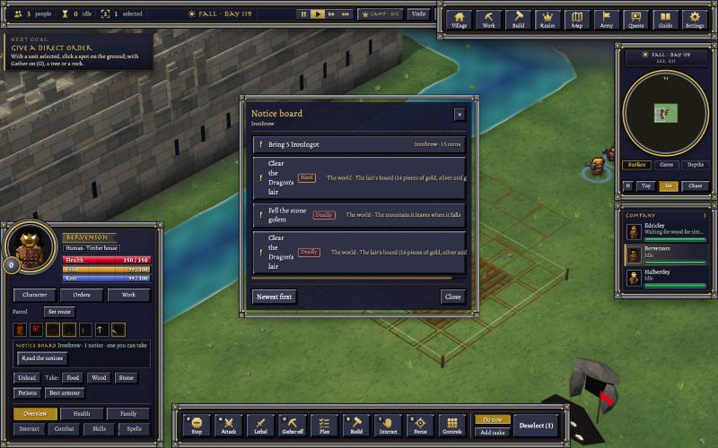

**World notices.** The world now posts notices of its own, with no giver:
- "Fell the stone golem": the prize is the mountain it leaves when it falls;
- "Clear the Dragon's lair": the prize is the lair's hoard.

The prize is the place itself, never coins from nothing. Nearby boards list them, anyone can take them, and they come
down when the golem falls or the lair is cleared. That gives a new realm something to aim at in an empty world.

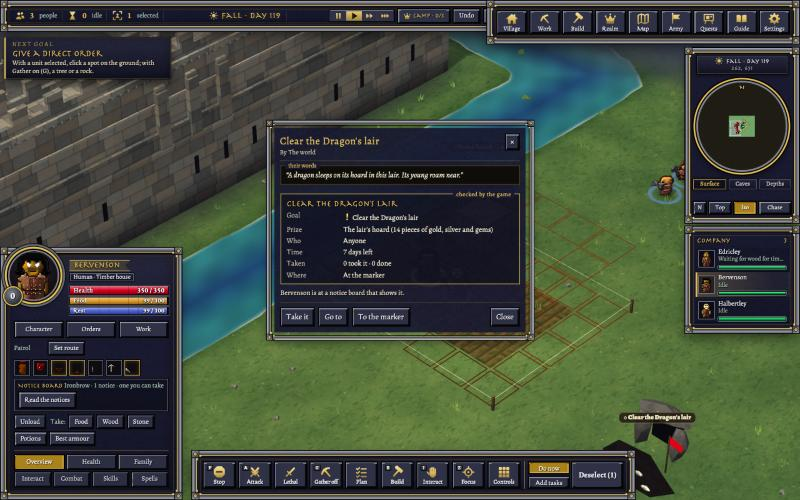

**Fort reports.** Each try at a fort now keeps its numbers: the party's size, who fell or was knocked out, and which of
the garrison's posts lost someone. The maker's card adds them up, for example "The way in lost someone in 2 of 2
tries", so you know where to build stronger.

- **Found by playing, and fixed:**
  - The post form's "Comes after" list filled with 24 golem notices; the world's notices are left out of it now.
  - A dragon's lair was rated Hard because its cave entrance had a low danger number. A great beast's lair now counts
    as one.
  - A long prize squeezed a notice's title into three lines on the board; the small text ends in "…" now.
- **Checks:**
  - A new arena test, 26 of 26.
  - A new page check, 12 of 12.
  - The earlier quest and admin tests, and combat 32 of 32.
- **Not shown in the browser:** the notice coming down once the stores fill. The new realm had no stockpile, so its
  stores always counted 0; the arena test covers it. Fort reports were only tested in the arena and the page check.
- **Not built:** "a ruin was found". The game doesn't know the map's ruins as places yet.

## Late evening: keepers, your own people who give your quests

You can now give one of your people a standing job as a **keeper**:
- a **quest giver** stands by your notice board, and other realms talk to them to take your quests;
- a **stall keeper** minds your market stall and sells what they carry.

Stand them by your own board or stall and press **Make quest giver** (or **Make stall keeper**) on their card. A realm
has at most three keepers. They stay your people: they eat, they sleep, they can be killed or captured, and a capture
ends the job.

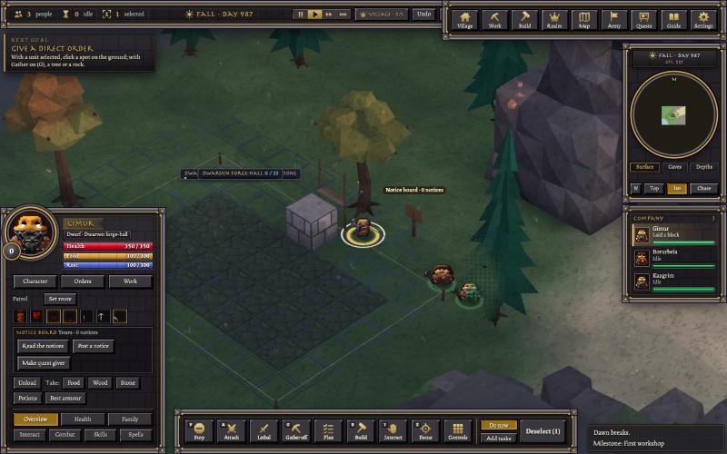

A keeper gets a **Keeper** tab on their card. It holds:
- their job and where they stand;
- which of your notices they offer;
- their words: a greeting, a line while you work, thanks, and one for turning people away;
- up to three "Ask about" topics.

Any line you leave empty is said in their race's own words, shown faded, so a dwarf sounds like a dwarf. The words go
through the same word list as chat and can be reported. What a quest asks and pays is always the game's own card.

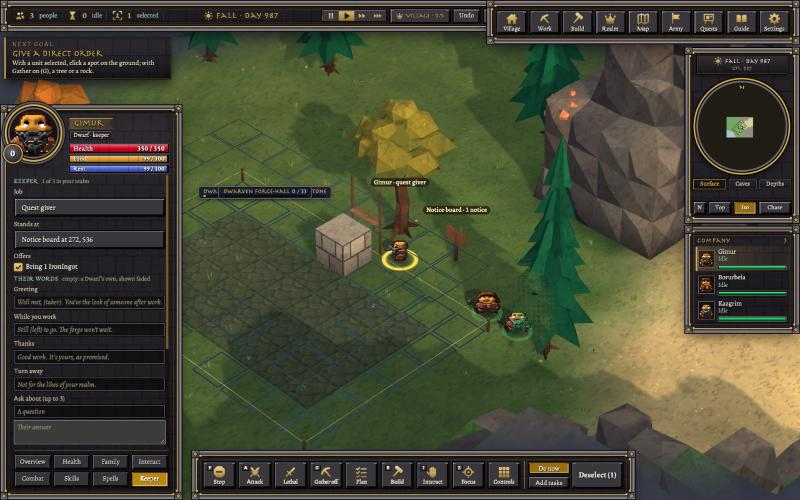

**Preview** shows the talk as other realms will see it:

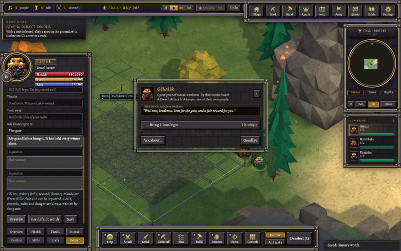

Played by two players in the browser. Ironbrow made Gimur their quest giver, posted "Bring 1 IronIngot" for 30 coins,
gave Gimur a greeting and one topic, and left the other lines to the Dwarf's defaults. For Thorgrim, a marker floats
over Gimur:

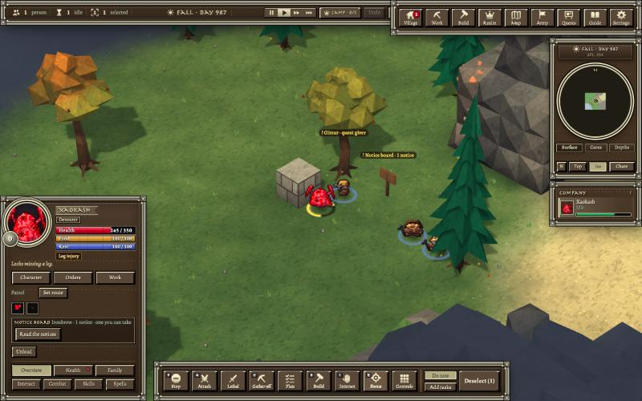

A click on Gimur (or Talk on the Interact card) opens the talk:

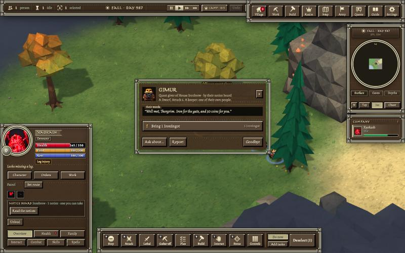

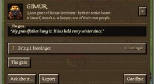

Picking the notice opens its card with Gimur's words on top and a Back button. Thorgrim took it and handed in the iron
from beside Gimur, not the board. Gimur's line changed with each step: "Still 1 IronIngot to go. The forge won't
wait." (the Dwarf's own), then "Good work. It's yours, as promised."

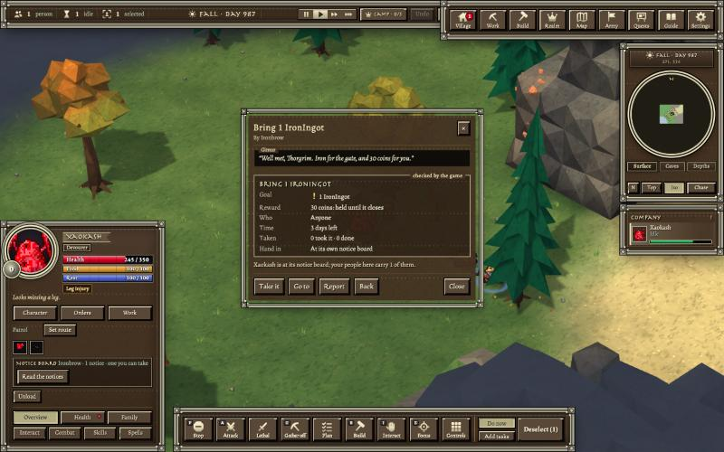

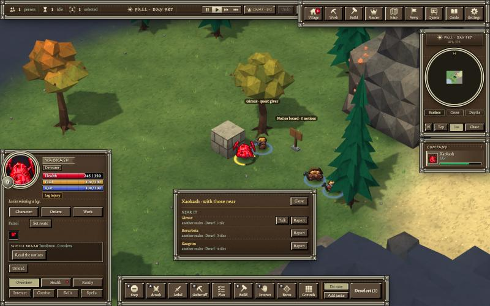

- **Found by playing, and fixed:** the maker's Preview filled in the reward as "a fair reward". It now shows the
  reward of the keeper's first quest, as takers see it.
- **Checks:**
  - A new arena test, 31 of 31: making one, the limit of three, walking back to the board, taking and handing in
    from beside a keeper, every line, the word filter, a report's copy, a stall keeper selling, a capture ending it.
  - A new page check, 17 of 17.
  - The earlier quest and admin tests, and combat 32 of 32.
- **Not built:**
  - A gate warden: there are no tolls yet.
  - A keeper's marker on the world map: the 3D view shows it.
  - A click on a keeper with nobody selected does nothing; use the Interact card or select someone first.
- **Not played in the browser:** the stall keeper (arena only).

## Tonight: building labels stay under the cards

The floating label over a building site ("Timber house 0 / 20") was drawn on top of every card and panel, and it took
their clicks. In the chain play-test it lay across a notice ("TIMBER HOUSE 0 / 20 WOOD" over the Time row, in the
"Step two for Thorgrim" picture above). A click meant for the notice opened the Build page instead. Now the labels sit
under cards and panels, like the food-pot tags and quest pins. A card that opens over a label gets the click, and a label
nothing covers still opens its site in Build.

While fixing that, a second fault turned up. In a browser the labels sat off their sites, drifting toward the top-left
as the HUD shrinks to fit the window. They now place themselves the same way the quest pins do. Nothing changes in the
app's own window, where they were already right.

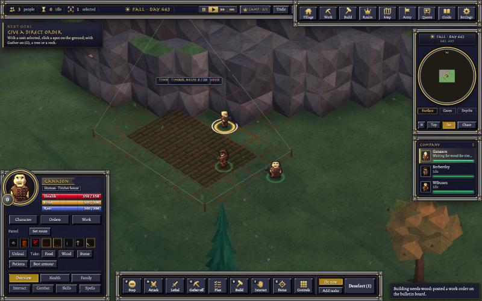

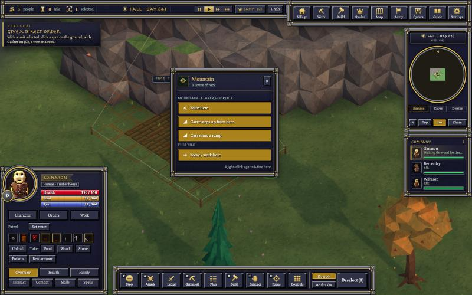

- **Checks:** a new page check, 6 of 6: placement, a quest card over a label, the open side panel over a label, a
  click on an uncovered label. The old page fails 4 of them. Combat 32 of 32.
- **Seen, not fixed:** a house that is both blocks and a building shows two labels on the same spot ("Timber house
  0 / 32 · needs wood" and "Timber house 0 / 20"), so their words run into each other.

## Later this evening: quests that lead into each other

A notice can now say what has to come first. In the post form, open "Chain" and pick up to three notices it comes
after, each "once done" or "once failed", with both or either. Failed means you gave it up, it came down while you
held it, or someone else did it first. A notice can also give a token when it's done: a real item with a name you
choose, like "the hold's seal". It goes into the pack of whoever did it, so it can be traded, stolen or lost. Any
notice, yours or another player's, can ask for that token in a Bring goal, so chains can cross between players with no
other link. And a step's place can stay secret until the step before is done: the seal tells you where the hold is.

Played in the browser. Ironbrow put up two notices: "Iron for the gate" (bring 1 iron bar, gives the hold's seal), and
"Find the old hold", which comes after it and keeps its place secret. Ironbrow sees the marker; nobody else does:

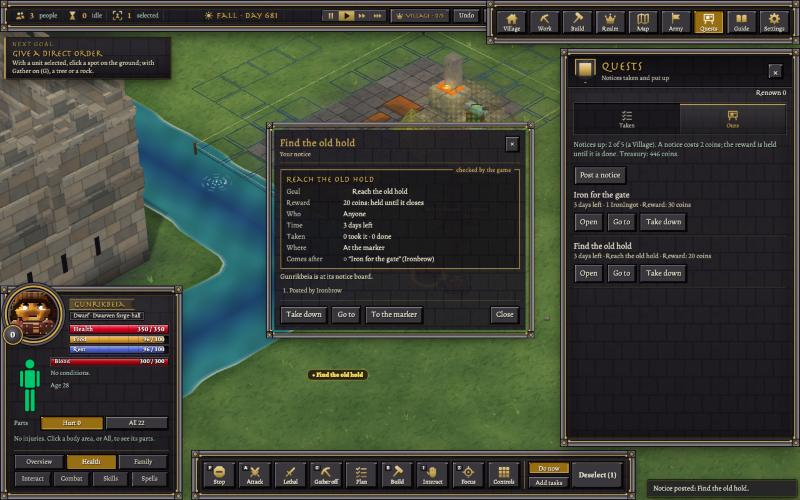

Thorgrim read the board. Step two has no Take button yet, and its place is hidden:

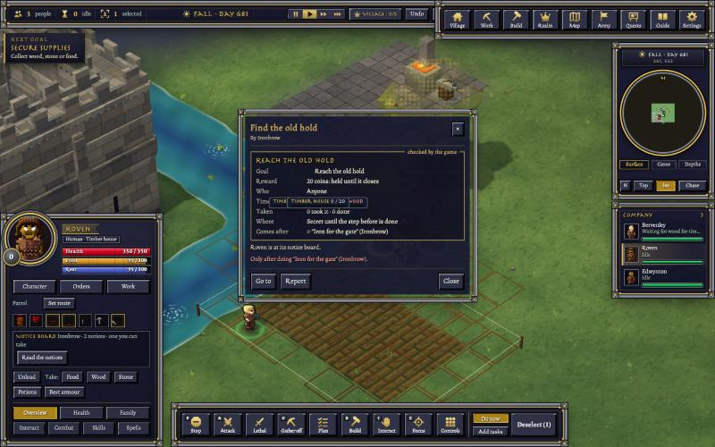

Step one shows what it gives and what it leads to:

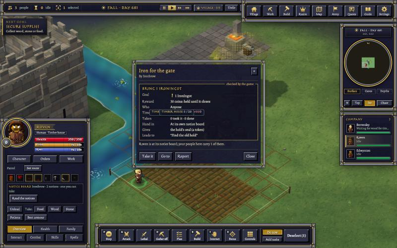

Thorgrim handed in the iron. The seal went into Roven's pack, and the marker for the old hold appeared at once:

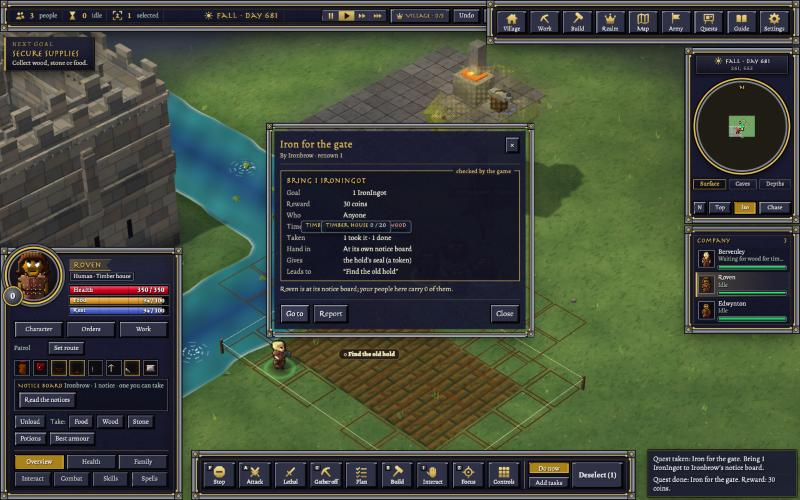

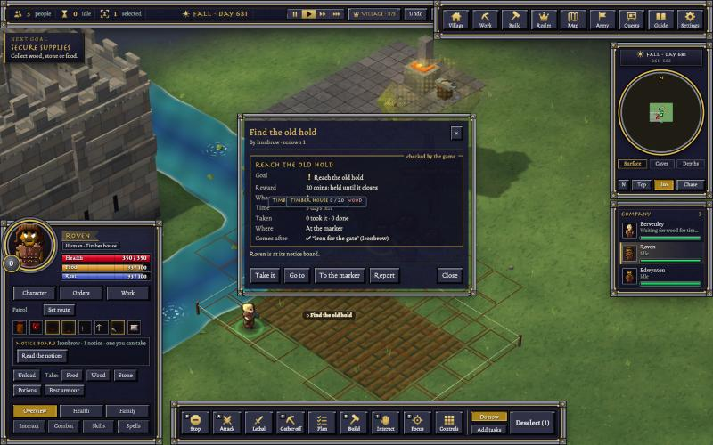

Thorgrim took it, and a villager already standing by the spot finished it: 20 coins.

- **Found by playing, and fixed:**
  - Ticked boxes in the quest form showed no tick, so "keep it secret" and the reward goods looked unticked. They show
    now:

    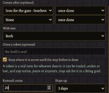

  - The chain fields stayed filled after posting, so the next notice would have given the same token. They clear now.
  - The bare token appeared in the Bring list as "RemasterToken". Gone; a token is asked for by its own name.
- **Checks:** 23 of 23 in a new arena test (links, failure, either of two, a forged token with the same name refused,
  the 10-step limit, the save). The page check passes 10 of 10, and combat 32 of 32.
- **Not yet:** a chain that crosses to another player's Bring goal was only arena-tested. A fort's two tiers (the inner
  after the outer) work as two fort notices, but weren't played.

## Evening: storm my fort

You can now publish your fort as a challenge. In the post form pick "Storm my fort", then click your fort's two
corners, its way in, and the goal: a chest's spot, or one of your people as the champion. You also choose:
- whether it's lethal;
- whether captives may be taken;
- an entry fee, which you keep whether they win or lose.

Then select the people who will hold it and press Garrison on the notice. They take posts inside by themselves, at the
way in first, then by the goal, and they guard them while you're away too.

A taker who took the notice brings up to 8 people to the way in and starts a try from the card. For 20 minutes their
party and your garrison may fight with no war, but only inside your fort. Someone reaching the chest, or your champion
falling, wins the reward. If the whole party is down, has fallen or has left, or the time runs out, the try is lost.
Every try is written up on the notice, and you get a short report. The card rates the danger from the real people on
both sides, which nobody can type in.

Played in the browser. Ironbrow marked the forge-hall plot as a fort and garrisoned it with three dwarves:

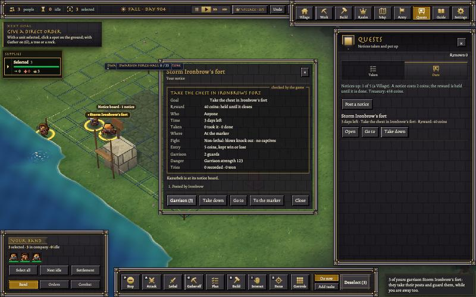

Thorgrim took the notice at Ironbrow's board, and the card rated it "Even (your 3 at the way in: 182 against 185)".
Thorgrim started a try, and the dwarves were on them at once. Non-lethal, so blows knocked people out:

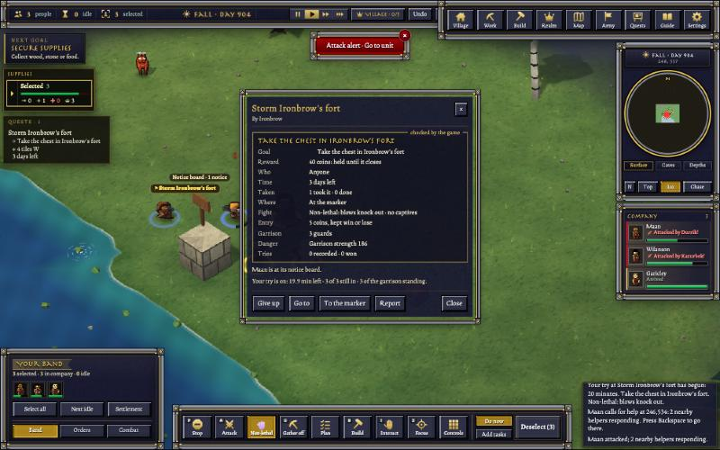

The try was lost in seconds: two knocked out, one shoved out of the fort, which was only four tiles deep.

- **Found by playing, and fixed:** after the try ended, a dwarf fought on, and the game called that an attack at peace.
  Now the end of a try stops every chase, defence and attack between the two sides, with a short truce for blows
  already under way. Also fixed: an attack ordered from the doorway was refused as "at peace". The party may now fight
  from the way in as it goes in.
- **Checks:** 44 of 44 in a new arena test, including a real fight called off halfway with nobody struck after it. The
  page check passes 12 of 12, the other quest and admin tests still pass, and combat 32 of 32.
- **Not yet:** a won try wasn't played in the browser, only in the arena (the chest and the champion both). The site
  is marked from the post form, not from a Plan mode tool as the plan said.

## Late afternoon: mute means mute, and a word list

The last admin step. A muted player could still talk in clan chat. Now they can't: every way of talking checks the
mute, and the mute is saved with the world.

You and your Admins now keep a list of words that come out as stars wherever players write: world chat, clan chat,
what a unit says, emotes, messages, notices, house names and unit names. A word counts on its own, in any case, so
listing "darn" doesn't touch "darned". End a word with * to catch every word that starts with it. The list is on the
Admin page under Words. Moderators can see it, only Admins change it, and every change goes in the log.

Played by two players in the browser. The owner listed "darn". Ironbrow shouted "What a darn fine day for digging" to
the world, and Thorgrim read it with stars:

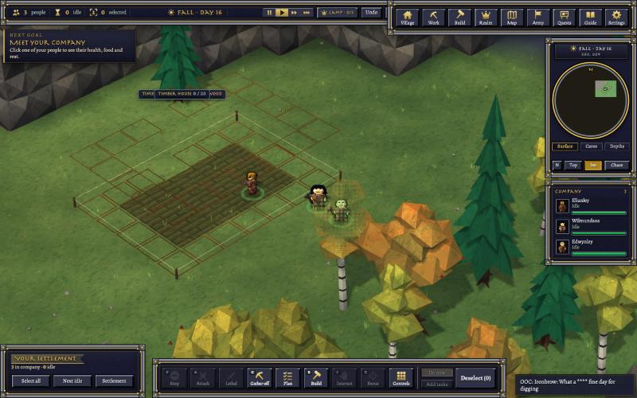

Then the owner muted Ironbrow for an hour, and Ironbrow tried clan chat:

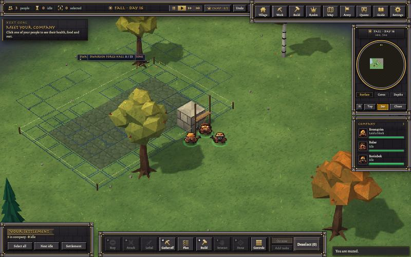

- **Found on the way, and fixed:** clan chat lines showed only "Ironbrow Clanchats:", with the words cut off, for
  everyone. That was an old fault in how the line was written, not something new.
- **Checks:** 26 of 26 in a new arena test, the Admin page check 20 of 20, the admin test 54 of 54, the quest tests
  58 of 58 and 55 of 55, combat 32 of 32.
- **Cost:** with 300 words listed, a line of chat takes about half a millisecond to check.
- **Good to know:** names and notices written before a word was listed keep it.

## Later this afternoon: quests about real things and places

A notice can now be about something out in the world, not just goods to bring. When you post one, you pick its goal:

- **Slay a creature.** You click the beast itself in the world. A wild one only: another realm's people are for war.
- **Hunt a kind.** "Kill 5 deer", anywhere. You can mark roughly where they roam, as a hint.
- **Clear a cave or lair.** You click the cave mouth. A lair is cleared when its beast dies. A cave is cleared when
  everything in it dies while the taker's people are down there.
- **Reach a place.** You click a spot, in the world or on the world map, and say how wide it is.
- **Work on my build.** You pick one of your build plans. The taker's own builders lay it with their own stone, and
  the blocks are yours. Your builders leave that plan alone while the notice is up.

Nobody gets a line to follow. A marker shows only what you or the takers have seen. Once the beast walks out of
everyone's sight, the marker stays where it was last seen and says how long ago. If someone else kills it first, the
notice comes down and your reward comes back to you. You choose how exact your marker is: the spot itself, a circle
somewhere about it, or no marker at all, only your words.

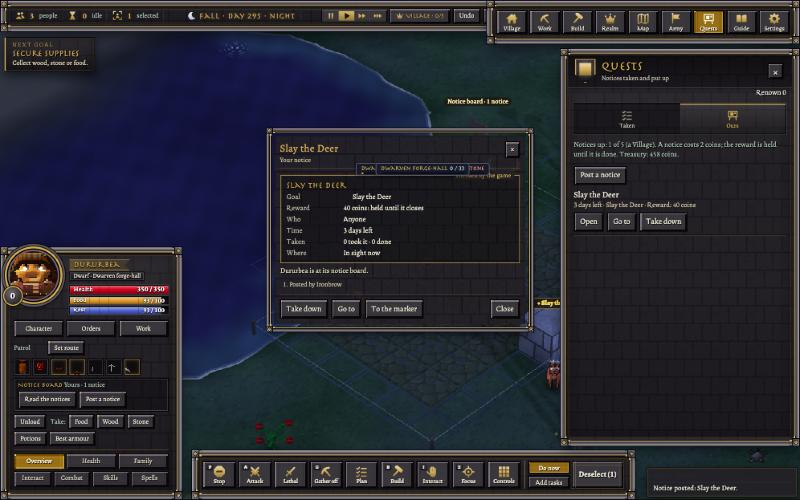

Played by two players in the browser. Ironbrow, a Dwarf company, clicked a deer and put up 40 coins. Thorgrim, a Human
company, read it at Ironbrow's board and took it. Their tracker said which way to go and how far, and "To the marker"
brought the camera to the deer, with a pin over it.

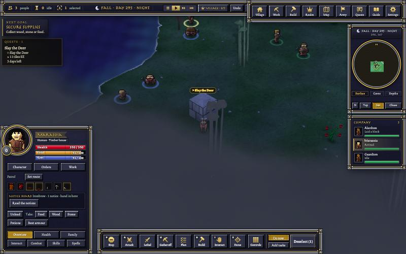

One of Thorgrim's people killed the deer, and the 40 coins went straight to Thorgrim. Then Ironbrow marked the red
flowers by the shore: "Reach the red flowers". Thorgrim's tracker counted down the tiles as their person walked over,
and the fog lifted off the flowers under the pin. The notice was done the moment they stepped inside.

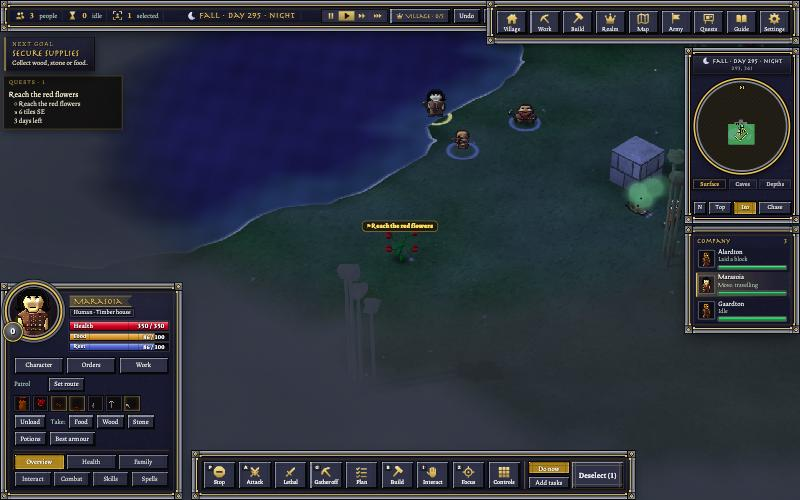

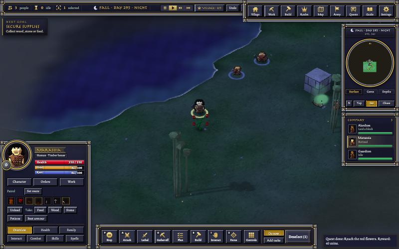

- **Checks:** 55 of 55 in a new arena test: every goal, the fog rule (last seen, not live), how exact the marker is,
  picking, the work plans, the save and a restart. The page checks pass 17 of 17 (new), 16 of 16 and 17 of 17, the
  quest test 58 of 58, combat 32 of 32.
- **Fixed after playing:** clicks on the world map landed a few tiles off in a browser, for picking and for moving the
  camera. The board no longer shows "?" (hand in here) for a goal with nothing to hand in.
- **Cost:** a death checks its quests in about 10 µs, a blow in about 4 µs, and only while someone holds such a quest.
- **Not yet:** clear and work were checked in the arena only, not played in the browser. Chains that reveal the next
  target step by step come with chains (Q6).
- **Good to know:** wild creatures aren't saved with the world. After a restart a slay notice looks for its quarry
  near where it was last seen. If none is there, the notice comes down and the reward goes back.

## Afternoon: admin is yours, and bans

You said admin is for you, the overlord, not for players. Now nobody gets it for hosting or playing alone. The game
ships with a small list naming you as the owner. Only you can add helpers. Someone typing your name in a browser
doesn't count: a name only counts on the server's own Mac.

Bans: a day, a week, or for good. A banned player's people don't vanish. They stay on the map as wanderers who
belong to no one, roaming like the wild. The player can't come back until the ban ends, and when they try they see
why:

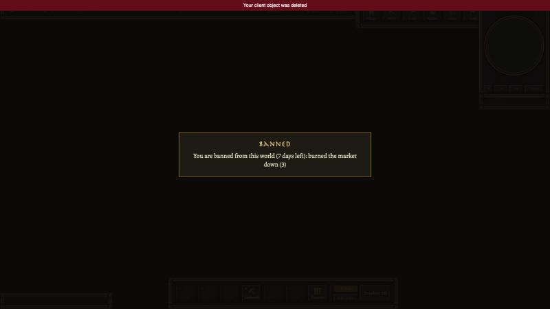

- **Checks:** 54 of 54 in the arena test, 17 of 17 on the page, combat 32 of 32.

## Earlier this afternoon: admin controls

There is one server, and now it has staff. You (the host) are the Owner. Names in a small `admins.txt` file are
Admins or Moderators, and an Admin can add more from the game. Staff get an Admin button with a red count of open
reports.

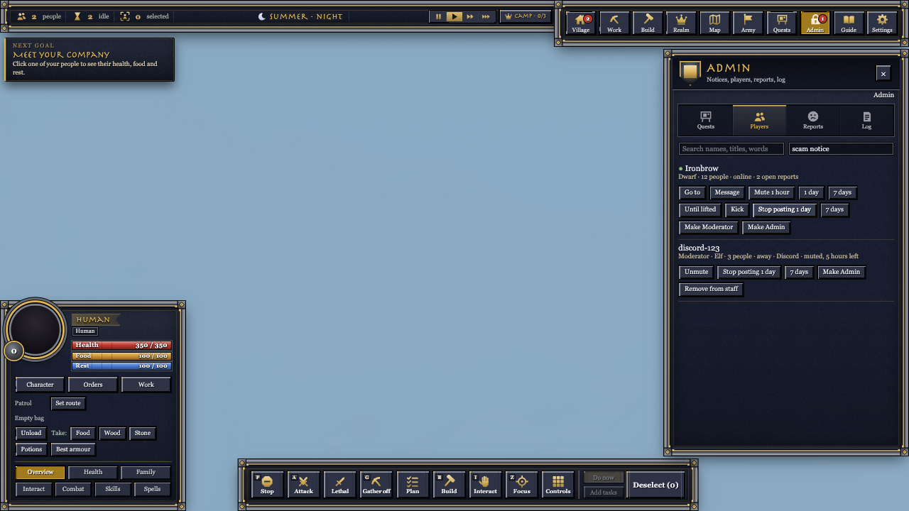

- **Quests:** every notice in the world. Take one down (its reward goes back to its maker), hide its words, or stop
  someone posting for a day, a week or for good.
- **Players:** everyone online and everyone the world knows. Message, mute (no chat and no notices), kick, stop
  posting, make Moderator or Admin. Nobody can act on someone of their own level or higher.
- **Reports:** players can now report a notice from its card, or another realm's people from the near card, with a
  reason (rude words, scam, griefing, cheating, other). The report keeps a copy of what they saw.
- **Log:** every staff action is a line in `admin-log.txt`, which nothing in the game can change.
- **Played in the browser:** one player reported another realm's player from the near card. The staff player saw it
  in Reports, muted them for an hour (they were told), then kicked them. Both actions are in the Log.

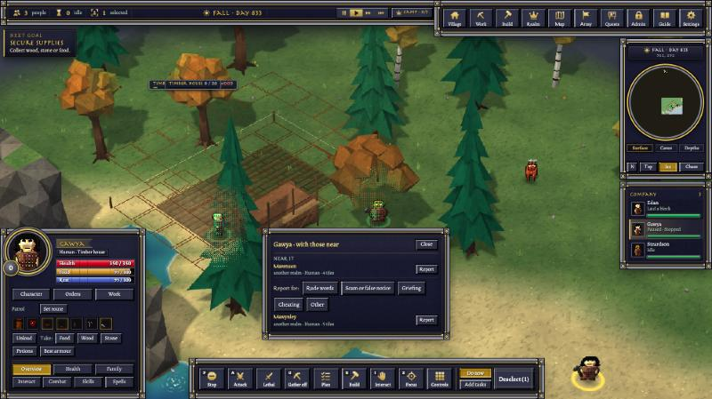

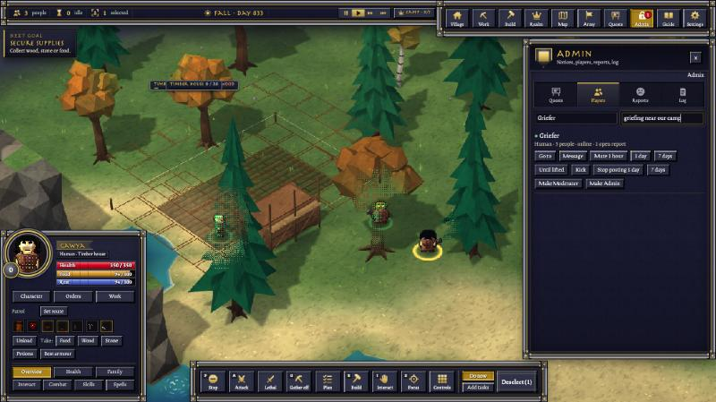

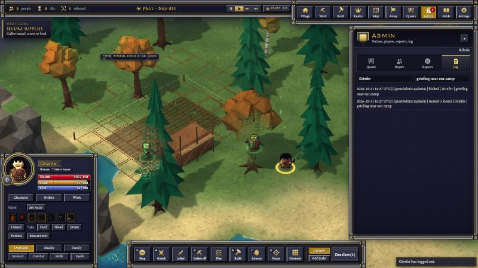

- **Checks:** 40 of 40 in the arena test, 15 of 15 on the page, combat 32 of 32; the quest checks still pass.
- **Next:** bans (step A3), then mute covering clan chat and a word list (A4).

## Noon: the first quests, played by two players in the browser

You build a notice board like any workshop (Build › Workshops, 1 wood). It stands in the world as a wooden sign.

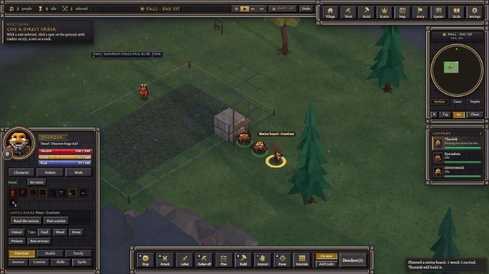

One of your people standing at it can post a notice: what to bring, how many, the reward (coins, and goods that person
carries), who may take it, and how long it stays up. A notice costs 2 coins. The coins and goods are taken off you
right away and held.

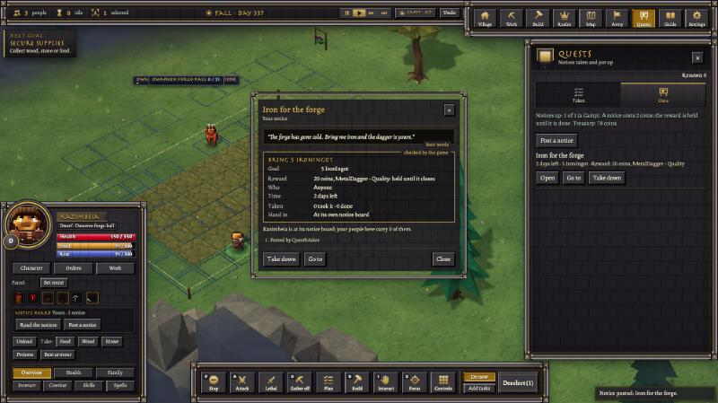

Another player walking by sees a gold "!" over the board. Their person at the board reads the notices, takes one,
and a tracker on the left shows what's left. The board's mark turns to "?": hand in here.

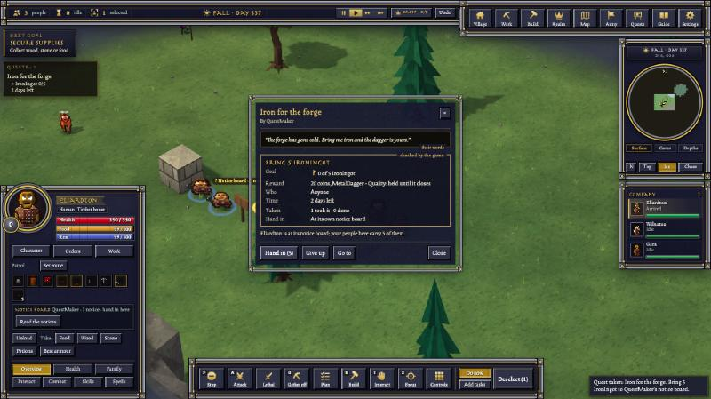

Handing in the whole amount pays at once: the coins into their treasury and the dagger into their person's pack. The
iron bars lie by the maker's board, the maker's, for their workers to carry home. The maker gets a message and a point
of renown.

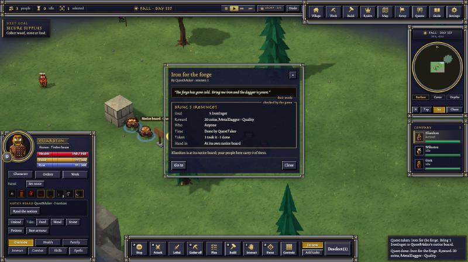

If a notice runs out of time, is taken down, or its board is destroyed, everyone gets their things back. The maker gets
the reward, and each taker gets what they handed in, by the board.

- **Also landed:** guards keep guarding while their owner is away (its own session, `offline-guards.md`).
- **Checks:** 58 of 58 in the arena test, 16 of 16 on the HUD page, combat 32 of 32. Played end to end by two browser
  players on one world.
- **Numbers:** 1,000 notices save in about 0.1-0.2 s as one JSON text, about 0.7 MB. A world with a few dozen notices
  saves them in a few ms.
- **Needs the user:** the admin panel plan (`planning/ADMIN_PANEL_PLAN_2026-10-31.md`): seven questions.

## Morning: the plan

## Later: what talking to a quest giver looks like

You asked whether players write their quest givers' words themselves, or whether the words are the same for
everyone. The answer is both. Everyone gets the same window. The giver's words are the maker's own: a greeting, a
thanks, a few things you can ask about. Anything they leave empty, the giver says in their race's own way. The quest
itself (the goal, what's in the chest, how dangerous it is, how many have tried) is always written by the game, so
nobody can lie about a reward.

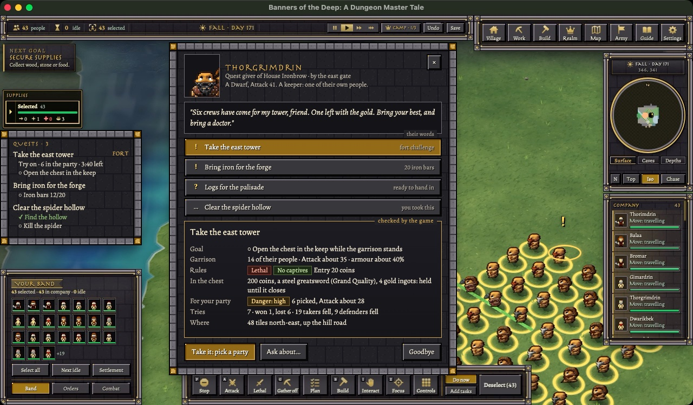

Look at the box marked "checked by the game": that part the maker can't touch. The "!" over the Dwarf on the right
shows you have something to take from them.

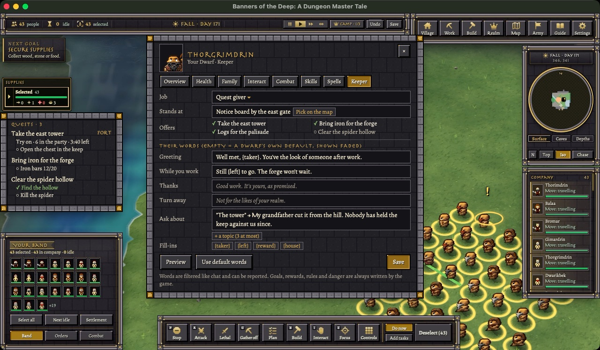

Faded lines are the default words. Fill-ins like {taker} put in the name of whoever is talking to them.

## Done

- Read how OpenRealm keeps quests. Its World of Warcraft side keeps 2,737 quests as plain rows of data, read by a
  little code. Its Warcraft III side lets map makers build quests out of events. We take both ideas, turned into menus
  that players fill in while they play.
- Read the parts of our game it builds on: forts, guards, coins, stores, the notice board, lairs, saves, the HUD.
- Wrote the plan: `planning/QUEST_MAKER_PLAN_2026-10-31.md`. It covers three things to publish (quests, fort
  challenges, keepers), rewards that are real goods held aside, quests that lead into each other across players,
  what "adaptive" means, abuse, server cost, and nine small steps.

## Found on the way

- Guards stop guarding the moment their owner logs off, and a defence started while the owner is away never ends.
  Quest forts need this fixed. It would help every player's town too (question 5 in the plan).
- There is no way yet for one player to pay another for goods, except a market stall. The first step of the plan,
  "bring me 20 iron bars", fixes that.

## Needs the user

- Seven questions in section 13 of the plan, each with a recommendation. Nothing gets built until they're answered.

Question for you: back in the BYOND days, did anyone on your server build a fort just to dare others to take it?
